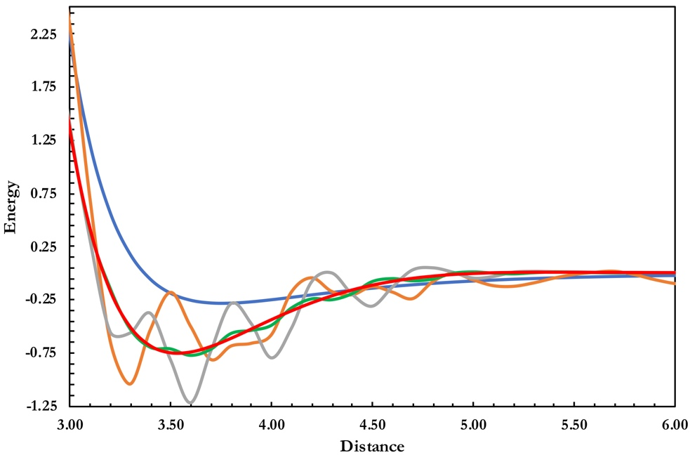

<div data-lab-exp="ex07" hidden></div>

::: {.callout-tip appearance="simple" icon=false}
**At a glance.** 31 Ar₂ distances plus the Ar atom, five functionals, three grids, all with def2-QZVP. Each job is small, but there are many of them: plan your submissions. **You will learn** what the integration grid is, why meta-GGAs are sensitive to it, and how to choose a grid you can trust.
:::

## Background

This experiment looks at a subtle issue that can affect the results of any exchange–correlation functional. Kohn–Sham (KS) DFT [@hohenberg1964; @kohn1965] needs a real-space grid to evaluate the exchange–correlation integrals. Most programs build it with an algorithm Becke introduced in 1988 [@becke1988a]: the integrals become weighted sums over a finite number of points arranged on spheres around each atom. A grid's "density" is described by its number of **radial** shells and **angular** points per shell; (75,302), for example, means 75 radial shells with 302 points each. The choice of grid can change the results significantly, as Wheeler and Houk showed for the M06 family [@wheeler2010; @zhao2008] and Mardirossian and Head-Gordon for two generations of Minnesota functionals [@mardirossian2016; @mardirossian2013]. They also point out that meta-GGA functionals usually need finer grids than GGAs.

Choosing the grid is often overlooked, and many practitioners are unaware of the issue. Relying on a program's defaults is not a good idea, even though some programs pick the grid according to the functional [@qchemmanual]. In this experiment you will study the dissociation curve of the argon dimer. The geometries come from the RG10 subset [@tang2003] of the MGCDB84 database [@mardirossian2017], with the Ar–Ar distance between 3.0 and 6.0 Å. The interaction energy at each distance is

$$
\Delta E(r) = E\big(\mathrm{Ar}_2(r)\big) - 2\,E(\mathrm{Ar}).
$$

: Reference interaction energies (kcal/mol) of the argon dimer as a function of the Ar–Ar distance (Å). {#tbl-ar2-ref .ref-table}

| *r* | Δ*E* | *r* | Δ*E* | *r* | Δ*E* |
|---:|---:|---:|---:|---:|---:|
| 3.0 | 2.24 | 4.1 | –0.23 | 5.1 | –0.07 |
| 3.1 | 1.21 | 4.2 | –0.21 | 5.2 | –0.06 |
| 3.2 | 0.57 | 4.3 | –0.18 | 5.3 | –0.05 |
| 3.3 | 0.18 | 4.4 | –0.16 | 5.4 | –0.05 |
| 3.4 | –0.06 | 4.5 | –0.14 | 5.5 | –0.04 |
| 3.5 | –0.19 | 4.6 | –0.13 | 5.6 | –0.04 |
| 3.6 | –0.26 | 4.7 | –0.11 | 5.7 | –0.03 |
| 3.7 | –0.28 | 4.8 | –0.10 | 5.8 | –0.03 |
| 3.8 | –0.28 | 4.9 | –0.09 | 5.9 | –0.03 |
| 3.9 | –0.27 | 5.0 | –0.08 | 6.0 | –0.02 |
| 4.0 | –0.25 | | | | |

Use the functionals B3LYP [@vosko1980; @becke1988; @lee1988; @becke1993; @stephens1994], M06-L [@zhao2006a], M11 [@peverati2011], M11-L [@peverati2012a] and ωB97M-V [@vydrov2010; @mardirossian2016a], and feel free to add others. Use the **def2-QZVP** basis set [@weigend2005] for all calculations, and try the grids **SG-1**, **SG-2** and **SG-3** (Q-Chem keyword `XC_GRID` = 1, 2 or 3). You can also specify a grid explicitly: `XC_GRID 000099000590` means (99,590).

Present your results as a dissociation curve like the one in @fig-vsxc, which shows the VSXC functional [@voorhis1998; @voorhis2008]. Before plotting, collect the data in a table like @tbl-vsxc.

{#fig-vsxc fig-alt="Dissociation curves of Ar2 with VSXC: coarse grids give oscillating, unphysical curves" width="600"}

: Data for the SG-1 curve in @fig-vsxc (VSXC functional; energy in kcal/mol, distance in Å). {#tbl-vsxc .ref-table}

| *r* | Δ*E* | *r* | Δ*E* | *r* | Δ*E* |
|---:|---:|---:|---:|---:|---:|
| 3.0 | 2.33 | 4.1 | –0.18 | 5.2 | –0.12 |
| 3.1 | 0.71 | 4.2 | –0.04 | 5.3 | –0.09 |
| 3.2 | –0.63 | 4.3 | –0.17 | 5.4 | –0.05 |
| 3.3 | –1.04 | 4.4 | –0.20 | 5.5 | –0.01 |
| 3.4 | –0.53 | 4.5 | –0.13 | 5.6 | 0.01 |
| 3.5 | –0.18 | 4.6 | –0.18 | 5.7 | 0.02 |
| 3.6 | –0.50 | 4.7 | –0.24 | 5.8 | –0.01 |
| 3.7 | –0.81 | 4.8 | –0.08 | 5.9 | –0.06 |
| 3.8 | –0.69 | 4.9 | 0.00 | 6.0 | –0.10 |
| 3.9 | –0.66 | 5.0 | –0.06 | | |
| 4.0 | –0.58 | 5.1 | –0.12 | | |

## The molecules

::: {data-lab="molecules"}
*Loading the structures…*
:::

::: {.callout-warning appearance="simple"}
**Pilot version.** The grid explorer, the input generator with grid options and the interactive curve plot for this experiment come after the pilot.
:::

## Questions

1. Can you find any problematic functionals?
2. Why do you see several minima and maxima in some curves? Do you think they are physical?
3. Compare the results with the smallest and the largest grid. Which functionals are well converged with respect to the grid?
4. What are the minimum grid requirements for each functional you tested?
5. Did the calculation time change with the grid? Tabulate and plot time against grid size. How noticeable is the increase?
6. Based on your results, which grid(s) would you recommend?
7. Does the HF method suffer from this problem? Why or why not?

```{=html}
<script type="module" src="../components/lab.js"></script>
```
