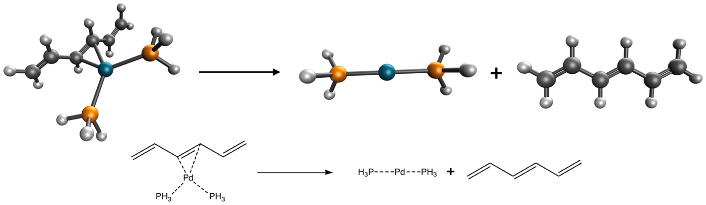

<div data-lab-exp="ex10" hidden></div>

::: {.callout-tip appearance="simple" icon=false}
**At a glance.** Three species, and every choice is yours. **You will show** that you can choose and justify a method, set up the calculations properly, and report the results the way a computational paper would.
:::

## The request

{fig-alt="Pd(PH3)2(hexatriene) dissociating into Pd(PH3)2 and hexatriene" width="560"}

Imagine that a colleague in your department is studying this palladium complex (the structures come from the PdBE2 subset [@averkiev2010] of the Minnesota 2015B database [@yu2016a]) and asks you to calculate the bond dissociation energy of the reaction above. You are in charge of setting up the calculations.

Choose the functional and basis set based on:

- the published literature, for instance these recent benchmarks [@goerigk2017; @mardirossian2017; @yu2015; @yu2016; @yu2016a; @mehta2018; @peverati2014; @chan2019; @chan2019a; @dohm2018];
- the functionals available in Q-Chem;
- what you learned in Experiments 1–9: basis-set convergence, dispersion, grids, stability analysis.

Remember that every calculation is a compromise between accuracy and computational cost, and the free server stops jobs after **10 minutes**. Pd needs an effective core potential (`ECP = def2-ECP` with the def2 basis sets).

## The molecules

::: {data-lab="molecules"}
*Loading…*
:::

## Your report

When you have finished all calculations, write a short report (**about 300 words**) that:

1. has a title;
2. states the method you chose and **why**, citing the literature;
3. describes the computational setup completely (program, functional, basis set, ECP, grid, stability analysis, convergence criteria), enough for someone else to reproduce your numbers;
4. presents your results and compares them with the reference value of **16.20 kcal/mol**;
5. ends with an appropriate reference section.

::: {.callout-warning appearance="simple"}
**Pilot version.** The "method card" builder and the report editor for this experiment come after the pilot. For now, write your report in Word and submit it as instructed in class.
:::

```{=html}
<script type="module" src="../components/lab.js"></script>
```
