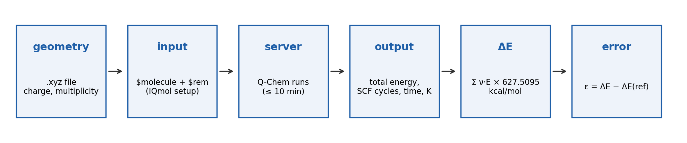

::: {.callout-note appearance="simple" icon=false}
## Learning goals

After studying this chapter you should be able to:

- decode a model chemistry and translate it into the `$rem` section of a Q-Chem input;
- write a complete Q-Chem single-point input by hand, including charge and multiplicity;
- set up, submit and retrieve a job with IQmol on the free Q-Chem server, and use the experiment pages to generate inputs and track jobs;
- find the total energy, the number of SCF cycles, the wall time and the number of basis functions in an output, and check that the job finished correctly;
- compute a reaction energy as $\Delta E = \sum_i \nu_i E_i$ with signed coefficients, convert it to kcal/mol, and compute signed and absolute errors;
- explain what Experiment 1 measures, why, and what you have to do and submit.
:::

::: {.callout-tip appearance="simple" icon=false}
## Before this class

This chapter is a companion to the lab guides, not a replacement. Have them open:

- [Guide 1 · Install IQmol and connect to Q-Chem](../guides/iqmol-setup.qmd): do this **before** class.
- [Guide 2 · Your first Q-Chem job](../guides/first-job.qmd)
- [Guide 3 · Reading a Q-Chem output](../guides/reading-output.qmd)
- [Guide 4 · Working on a shared machine](../guides/shared-machines.qmd)
- [Guide 5 · Units, reaction energies and errors](../guides/units-and-errors.qmd)
:::

## Recap: what a model chemistry is

[Class 1](l01-molecular-schrodinger.qmd) showed that every calculation makes two approximations: the **method** approximates the Hamiltonian (how electrons interact), and the **basis set** approximates the wave function (which shapes the orbitals may take). [Class 2](l02-basis-sets.qmd) opened the second one. A pair of choices, written *method/basis*, is a **model chemistry**:

| Model chemistry | Method | Rung (Classes 4–6) | Basis set | ζ | Family |
|---|---|---|---|---|---|
| HF/cc-pVTZ | Hartree–Fock | no correlation at all | cc-pVTZ | triple | Dunning, correlation-consistent |
| B3LYP/def2-SVP | B3LYP | hybrid GGA | def2-SVP | double | Karlsruhe def2 |
| ωB97M-V/def2-QZVP | ωB97M-V | range-separated hybrid meta-GGA with VV10 dispersion | def2-QZVP | quadruple | Karlsruhe def2 |

: Three model chemistries you will run in Experiment 1. The method column will make full sense after Classes 4–6; for now, treat the names as labels. {#tbl-decoder}

Two more choices complete the definition of a calculation, and you must also report them: the **geometry** (here always given to you, as an `.xyz` file) and the **electronic state**, set by the total **charge** and the **spin multiplicity**. Every number you compute in this lab is a total energy for one model chemistry, one geometry and one electronic state.

## The tools

The workflow of every experiment is the same (@fig-workflow).

{#fig-workflow fig-alt="Six boxes connected by arrows: geometry (.xyz file, charge and multiplicity), input ($molecule and $rem, IQmol setup), server (Q-Chem runs, at most 10 minutes), output (total energy, SCF cycles, time, number of basis functions), Delta E (sum of nu times E, times 627.5095 kcal/mol), error (epsilon = Delta E minus the reference)."}

### Q-Chem and IQmol

**Q-Chem** [@epifanovsky2021] is the quantum-chemistry program that actually solves the equations. It reads a plain-text **input file** and writes a plain-text **output file**. You will not install it: it runs on a remote server.

**IQmol** [@iqmol] is the free graphical program you install on your laptop ([Guide 1](../guides/iqmol-setup.qmd)). It does four jobs for you:

1. **Builder and viewer.** It opens `.xyz` files (**File → Open**) and shows the molecule in 3D. You can also build molecules, though in this lab all geometries are provided.
2. **Q-Chem setup window.** **Calculation → Q-Chem Setup** opens a window where you choose the job type, method, basis, charge and multiplicity, and which shows the text of the input file it will send. You can also paste a ready-made input there.
3. **Submission to a server.** In the **Server** menu of the setup window you select the free Q-Chem server and click **Submit**.
4. **Job Monitor.** It shows each job as *queued → running → finished* and lets you open or save the output when the job is done.

::: {.callout-important}
## The free server and its 10-minute limit
The free Q-Chem server is shared by many users ([Guide 4](../guides/shared-machines.qmd)). Each job is stopped after **10 minutes** of run time, and a killed job gives no energy. All jobs in Experiment 1 are small and well within the limit. If a job is killed, suspect a typo in the input first, for example a much larger basis than intended. Start early: queues are longest right before deadlines.
:::

### Anatomy of a Q-Chem input

A Q-Chem input is a set of sections, each starting with `$name` and ending with `$end`. For a single-point energy you need two. Here is the test job of [Guide 2](../guides/first-job.qmd), with the geometry of the HCl molecule from Experiment 1:

```text
$molecule
0 1
Cl     0.00000000     0.00000000     0.00000000
H      0.00000000     0.00000000     1.27907000
$end

$rem
   JOBTYPE              SP
   METHOD               HF
   BASIS                def2-SVP
   SCF_CONVERGENCE      8
$end
```

**`$molecule`** describes the system:

- the first line holds the **total charge** and the **spin multiplicity** $2S+1$, here `0 1` (neutral singlet);
- each following line holds an element symbol and its $x$, $y$, $z$ coordinates **in ångström** (Q-Chem converts to bohr internally).

**`$rem`** holds the instructions, one keyword and one value per line:

| Keyword | Value here | Meaning |
|---|---|---|
| `JOBTYPE` | `SP` | single-point energy at the given geometry (no optimization, no frequencies) |
| `METHOD` | `HF` | the method: `HF`, or a functional name such as `B3LYP`, `PBE`, `wB97M-V` |
| `BASIS` | `def2-SVP` | the basis set |
| `SCF_CONVERGENCE` | `8` | a tight convergence threshold for the SCF iterations, $10^{-8}$ (Class 4 explains what is converged) |

: The four `$rem` keywords used in Experiment 1. {#tbl-rem}

A model chemistry maps directly onto two lines: *method/basis* becomes `METHOD` and `BASIS`. To run the same molecule with B3LYP/def2-TZVP, you change only those two values. Everything else stays.

::: {.callout-note}
## Charge and multiplicity: line 2 of every .xyz file
Standard `.xyz` files use their second line as a free comment. In this lab, line 2 always holds `charge multiplicity`, so you never have to guess. Copy it into the first line of `$molecule`. Recall from [Class 1](l01-molecular-schrodinger.qmd): 1 = singlet (all electrons paired, like HCl), 2 = doublet (one unpaired electron, like an H atom or a radical), 3 = triplet (two parallel unpaired electrons, like ground-state O₂). All the species of Experiment 1 are closed-shell singlets. A wrong multiplicity gives a perfectly converged energy for the wrong electronic state.
:::

### The experiment pages do the typing for you

You will run hundreds of jobs this semester. Typing inputs by hand is slow and error-prone, so each experiment page has a **Run the calculations** section that generates them from the experiment's data:

- a **job checklist** with one entry per job, named systematically (for example `ex01_hf_def2-svp_hcl`), with a rough cost flag (*quick*, *a few minutes*, *may hit the 10-min limit*);
- a **Copy input** button for each job, to paste into IQmol's input editor, replacing what is there;
- an **All inputs (.zip)** button to download every input at once;
- the molecule gallery, with the 3D structures and a button to download all geometries.

The checklist ticks itself off as you enter results, so you can see at a glance what is missing. Use the generated inputs: they are already consistent with the reference calculations, and they avoid typos.

## A first job, step by step

In class we run the test job of [Guide 2](../guides/first-job.qmd) live: HCl with HF/def2-SVP. Repeat it on your own before starting Experiment 1. The steps are:

1. Download the HCl geometry from the molecule gallery of [Experiment 1](../experiments/ex01-basis-sets.qmd) and open it in IQmol (**File → Open**).
2. Open **Calculation → Q-Chem Setup**. Either fill in the fields (Energy, HF, def2-SVP, charge 0, multiplicity 1), or paste the input from the experiment page.
3. Choose the free server in the **Server** menu, give the job a systematic name, and click **Submit**.
4. Follow the job in the **Job Monitor**. When it has finished, open the output file and save it in a folder for Experiment 1.
5. Find the total energy (next section). It should be close to −460 $E_\text{h}$. If it is, everything works.

Then try the most important experiment of the semester in miniature: **change only `BASIS`** (for example to def2-TZVP), submit again, and compare. The total energy changes, and so do the number of basis functions and the time. Everything in Experiment 1 is a systematic version of this one change. Do not draw conclusions from a single molecule, though: what matters is how the *reaction* energy changes, and that needs both species of the reaction computed at the same level.

::: {.callout-tip}
## Good habits from day one
- Run **one** job first, check its output, then submit the rest in batches.
- Keep every output file, one folder per experiment, with systematic names.
- Never resubmit a failed job blindly: read the end of its output first.
:::

## Reading the output

An output file is long, but you need only a few lines. Search for the phrases below with your editor's find function ([Guide 3](../guides/reading-output.qmd) has a fully annotated example):

| You need | Search for | Example | Record |
|---|---|---|---|
| Number of basis functions $K$ | `basis functions` | `There are 26 shells and 74 basis functions` | 74 |
| SCF cycles | `Convergence criterion met` | the cycle number at the start of that line | 12 |
| Total energy ($E_\text{h}$) | `Total energy in the final basis set` | `Total energy in the final basis set = -920.6431907520` | all digits |
| Wall time (s) | `Total job time` | `Total job time:  14.52s(wall), 52.10s(cpu)` | 14.52 |
| Did it finish? | `Thank you very much for using Q-Chem` | last lines of the file | yes/no |

: Where to find the numbers in a Q-Chem output (example values from Guide 3, not from Experiment 1). {#tbl-output}

What each number means:

- **Number of basis functions.** $K$ of [Class 2](l02-basis-sets.qmd). Check it against what you expect from the shell compositions; it confirms that the right basis was used. It is also the $N$ in the cost scaling you will measure.
- **SCF cycles.** Hartree–Fock and Kohn–Sham DFT are solved iteratively (Class 4). The table of cycles shows the energy settling down; the line ending in *Convergence criterion met* is the last one. If instead you see a message that the SCF failed to converge, the energy is meaningless.
- **Total energy.** Electronic energy plus nuclear repulsion at the fixed input geometry, in hartree ([Class 1](l01-molecular-schrodinger.qmd)): no zero-point energy, no thermal corrections. If the output also prints an "SCF energy", always use the **total** energy: with extra terms such as a dispersion correction (-D4), the two can differ.
- **Wall time vs CPU time.** *Wall* time is what a stopwatch on the wall would measure. *CPU* time adds up the time of every processor core, so on a multi-core server it is larger. We always compare **wall** times, and only between jobs run on the same server. Timings are noisy: a busy server or a slow disk adds seconds that have nothing to do with the chemistry.
- **"Thank you very much for using Q-Chem. Have a nice day."** The last line of a finished job. If it is missing, the job crashed or was killed, and nothing in the file should be trusted.

::: {.callout-important}
## Five checks before you trust a number
1. The job **finished** (the "Thank you" line is there).
2. The SCF **converged** (*Convergence criterion met*).
3. The **charge and multiplicity** echoed near the top are right.
4. The **method and basis** echoed in `$rem` are the ones you intended.
5. The **number of basis functions** is what you expect for that basis.
:::

## From total energies to a reaction energy

### Signed stoichiometric coefficients

For any reaction, the reaction energy is a single sum over **all** the species $i$ that take part:

$$
\Delta E = \sum_i \nu_i E_i ,
$$ {#eq-deltae}

where $E_i$ is the total energy of species $i$ and $\nu_i$ is its **signed** stoichiometric coefficient: $\nu_i > 0$ for products and $\nu_i < 0$ for reactants. The minus sign of "products minus reactants" is already inside the coefficients, so you never subtract separately. This is the convention of the whole course, and the results forms check your $\Delta E$ with exactly this sum ([Guide 5](../guides/units-and-errors.qmd)).

For Experiment 1, the reaction is the dissociation of the HCl dimer:

$$
(\mathrm{HCl})_2 \longrightarrow 2\,\mathrm{HCl}, \qquad \nu_\text{dimer} = -1,\quad \nu_\text{HCl} = +2,
$$

$$
\Delta E = (+2)\,E(\mathrm{HCl}) + (-1)\,E\big((\mathrm{HCl})_2\big) .
$$ {#eq-ex01}

A positive $\Delta E$ means the dimer is lower in energy than the separated molecules: energy must be supplied to pull them apart.

Total energies come in hartree. Convert the reaction energy to kcal/mol at the end, with

$$
1\ E_\text{h} = 627.5095\ \text{kcal/mol}.
$$

### Keep all the digits

A reaction energy is a small difference between large numbers. In Experiment 1 the total energies are hundreds of hartree and the reference reaction energy is 2.01 kcal/mol, which is only 0.0032 $E_\text{h}$. Rounding each total energy to 4 decimals can introduce errors of almost 0.1 kcal/mol (Class 1). Copy **every digit** Q-Chem prints, and round only the final reaction energy, to two decimals in kcal/mol.

### Signed and absolute errors

To judge a method, compare the computed reaction energy with a reliable **reference** value (for the reactions in this lab, high-level wave-function results from benchmark databases):

$$
\varepsilon = \Delta E_\text{comp} - \Delta E_\text{ref} .
$$ {#eq-error}

The **signed error** $\varepsilon$ tells you the direction: positive means the method *overestimates* the reaction energy. The **absolute error** $|\varepsilon|$ tells you how far off it is, regardless of direction. Over several reactions, the mean signed error (MSE) reveals systematic bias and the mean absolute error (MAE) measures overall accuracy; Class 7 returns to these statistics. An error of about 1 kcal/mol is traditionally called **chemical accuracy**.

::: {.callout-tip}
## Worked example: a reaction energy and its error
Consider the water dimer, $(\mathrm{H_2O})_2 \to 2\,\mathrm{H_2O}$, with **hypothetical** total energies $E(\mathrm{H_2O}) = -76.4203184\ E_\text{h}$ and $E\big((\mathrm{H_2O})_2\big) = -152.8487052\ E_\text{h}$, and a reference of 5.00 kcal/mol.

1. Coefficients: $\nu(\mathrm{H_2O}) = +2$, $\nu(\text{dimer}) = -1$.
2. Sum: $\Delta E = 2(-76.4203184) + (-1)(-152.8487052) = -152.8406368 + 152.8487052 = 0.0080684\ E_\text{h}$.
3. Convert: $0.0080684 \times 627.5095 = 5.06$ kcal/mol.
4. Error: $\varepsilon = 5.06 - 5.00 = +0.06$ kcal/mol (slight overestimate); $|\varepsilon| = 0.06$ kcal/mol.

Now repeat step 2 with the total energies rounded to 3 decimals, $-76.420$ and $-152.849$: $\Delta E = -152.840 + 152.849 = 0.009\ E_\text{h} = 5.65$ kcal/mol. The rounding alone created an error ten times larger than the method's.
:::

::: {.callout-important}
## Common mistakes with reaction energies
- **Forgetting a coefficient.** The dimer dissociates into *two* monomers: $E(\mathrm{HCl})$ must be multiplied by 2.
- **Sign flip.** Writing reactants minus products gives the right magnitude and the wrong sign. With signed $\nu$ this cannot happen.
- **Mixing levels of theory.** Every species in one reaction energy must be computed with the *same* method and basis. Combining a def2-SVP dimer with a def2-TZVP monomer gives a meaningless number.
- **Forgetting the conversion**, or dividing instead of multiplying by 627.5095.
:::

## Experiment 1 briefing

Everything above comes together in [Experiment 1: Basis Set Incompleteness Error](../experiments/ex01-basis-sets.qmd). Read the experiment page in full before you start; this section explains what you will do and why it matters.

{#fig-ex01 fig-alt="(HCl)2 dissociates into two HCl molecules." width="420"}

### The question

Class 2 claimed that larger basis sets give results that converge toward the CBS limit, at a steeply growing cost. Experiment 1 tests that claim on a real reaction energy, for four different methods, with two families of basis sets. The reaction is the dissociation of the HCl dimer, a weakly bound complex held together by noncovalent interactions, from the NCCE30 subset [@peverati2014] of the Minnesota 2015B database [@yu2016a]. Its reference energy is **2.01 kcal/mol**. Weakly bound complexes are a demanding test for basis sets: the interaction energy is small, so even small basis-set errors are large in relative terms.

### What you will run

| | Choices | Count |
|---|---|---|
| Species | (HCl)₂ and HCl, both neutral singlets (`0 1`) | 2 |
| Methods | HF, PBE (GGA), B3LYP (hybrid GGA), ωB97M-V (range-separated hybrid meta-GGA) | 4 |
| Basis sets | def2-SVP, def2-TZVP, def2-QZVP (Karlsruhe); cc-pVDZ, cc-pVTZ, cc-pVQZ (Dunning) | 6 |
| **Jobs** | 2 species × 4 methods × 6 basis sets | **48** |

: The Experiment 1 design. Each method/basis pair gives one reaction energy, so you obtain 24 reaction energies. {#tbl-ex01}

All jobs are single points (`JOBTYPE SP`) with `SCF_CONVERGENCE 8`, and all are short. The two basis-set families are matched by ζ: double (SVP, DZ), triple (TZVP, TZ) and quadruple (QZVP, QZ). The methods span the range from no electron correlation at all (HF) to a modern, heavily parametrized functional (ωB97M-V); Classes 4–6 explain what each one is.

For each job, record from the output the **total energy**, the **number of SCF cycles**, the **wall time** and the **number of basis functions**. Then compute each reaction energy yourself with @eq-ex01, convert it to kcal/mol, and enter it. The results form recomputes $\Delta E$ from the total energies **you** entered and flags inconsistencies (a sign, a missing factor of 2, a unit slip). It never shows you the correct value.

### What you will look at

Once your table is complete, the page draws two charts from your own data:

- **Error vs ζ.** The signed error of each method as the basis grows from double- to quadruple-ζ, for each family. This is BSIE made visible: does the error shrink steadily, for every method? Do the two families behave the same way at the same ζ?
- **Cost scaling.** Wall time against the number of basis functions on log–log axes, with a straight-line fit for each method. The slope is the exponent $n$ in time $\propto K^n$. Class 2 said the formal scaling of HF and hybrid DFT is $K^4$, and that practice is usually kinder. You will measure your own $n$, and decide which points to trust (very short jobs are dominated by fixed overhead).

The questions at the end of the page ask you to describe the trend with ζ for each method, compare the two families, classify each method's behavior, report and interpret your measured exponent, and choose the best combination of method and basis for this reaction, considering both accuracy and cost.

::: {.callout-important}
## Lock your predictions first
Before running anything, answer the warm-up quiz and **lock your predictions** in the *Predict first* section of the experiment page. You will predict, among other things, how the error of ωB97M-V and of Hartree–Fock changes from double- to quadruple-ζ, which family gives smaller errors at the same ζ, and which method comes closest to the reference with def2-QZVP. Predictions are not graded on being right: they are part of your submission so you (and we) can see how your intuition changes. Think about them using Classes 1 and 2, commit, and then let your data answer. Once locked, they cannot be changed.
:::

### How to submit

1. Work through the page in order: warm-up quiz, predictions, calculations, results, charts, questions. Your entries are saved only in your own browser, so download your file often.
2. In the *Submit* section, enter your name and your **Florida Tech email** (ending in `@my.fit.edu` or `@fit.edu`), and confirm that you ran the calculations yourself.
3. Download your submission file (a `.json` file).
4. Open the Microsoft Form linked on the page, sign in with your Florida Tech email, and upload the file. You can resubmit until the deadline; the latest upload counts.

The optional Colab notebook at the bottom of the page extrapolates the HCl dimer to the CBS limit with PySCF, using the ideas of [Class 2](l02-basis-sets.qmd).

## Before next class

- Install IQmol and run the test job ([Guides 1–2](../guides/first-job.qmd)) if you have not yet.
- Lock your Experiment 1 predictions, then run the first batch of jobs: for example, all 12 jobs of one method, or all 8 jobs of one basis set. Check one output thoroughly with the five checks above before submitting the rest.
- Class 4 opens the second approximation, the Hamiltonian: Hartree–Fock and the self-consistent field. You will find out what the SCF cycles you just counted are actually doing, and why the "HF" row of your Experiment 1 table matters so much.

## Key points

- A calculation is defined by a model chemistry (method/basis), a geometry and an electronic state (charge and multiplicity). Report all of them.
- A Q-Chem single-point input has `$molecule` (charge, multiplicity, coordinates in Å) and `$rem` (`JOBTYPE`, `METHOD`, `BASIS`, `SCF_CONVERGENCE`). Method/basis maps onto `METHOD` and `BASIS`.
- Line 2 of every `.xyz` file in this lab is "charge multiplicity".
- IQmol opens the geometry, writes and submits the input to the free server (10-minute limit), and monitors the job. The experiment pages generate every input and keep a job checklist.
- From each output take the total energy (all digits), the SCF cycle count, the wall time and the number of basis functions; check that the job finished and the SCF converged.
- $\Delta E = \sum_i \nu_i E_i$ with $\nu > 0$ for products and $\nu < 0$ for reactants; multiply by 627.5095 to get kcal/mol. Never round total energies.
- Signed error $\varepsilon = \Delta E_\text{comp} - \Delta E_\text{ref}$; absolute error $|\varepsilon|$.
- Experiment 1: (HCl)₂ → 2 HCl, reference 2.01 kcal/mol; 4 methods × 6 basis sets × 2 species = 48 jobs; lock predictions first; submit the JSON file through the Microsoft Form with your Florida Tech email.

## Study questions

1. Write the complete Q-Chem input for a single-point B3LYP/def2-TZVP energy of the HCl molecule of Experiment 1. Which lines change if you switch to ωB97M-V/cc-pVQZ?
2. The second line of an `.xyz` file reads `0 2`. What does it tell you about the species? Give an example of a molecule or atom that could have it.
3. An output ends with SCF cycles and no "Thank you very much for using Q-Chem" line. List two possible causes and what you would check.
4. Explain the difference between wall time and CPU time. A job reports 10.0 s (wall) and 38.6 s (cpu). Roughly how many cores did it use effectively?
5. Write $\Delta E = \sum_i \nu_i E_i$ explicitly, with signed coefficients, for: (a) 2 O₃ → 3 O₂; (b) the atomization of water, H₂O → 2 H + O; (c) the Experiment 1 reaction.
6. With hypothetical energies $E(\mathrm{HCl}) = -460.1000000\ E_\text{h}$ and $E\big((\mathrm{HCl})_2\big) = -920.2040000\ E_\text{h}$, compute $\Delta E$ in kcal/mol and its signed and absolute errors with respect to 2.01 kcal/mol. Is the dimer bound in this hypothetical calculation?
7. A classmate computes the Experiment 1 reaction energy as $E\big((\mathrm{HCl})_2\big) - E(\mathrm{HCl})$ and gets about −460 $E_\text{h}$. What went wrong?
8. Why must both species of a reaction be computed with the same method *and* the same basis set?
9. If the wall time grew as $K^4$, and a job with $K = 50$ took 4 s, how long would a job with $K = 200$ take? Why might a log–log fit of your Experiment 1 timings give a smaller exponent?
10. Without running anything: how do you expect the *total* energy of HCl with HF to change from def2-SVP to def2-QZVP, and why? Does that tell you how the *reaction* energy will change?

## Further reading

- The lab guides: [Guide 2](../guides/first-job.qmd) (first job), [Guide 3](../guides/reading-output.qmd) (reading output) and [Guide 5](../guides/units-and-errors.qmd) (units and errors).
- [Experiment 1](../experiments/ex01-basis-sets.qmd) and its references, in particular the comparison of basis-set families for DFT by Witte, Neaton and Head-Gordon [@witte2016].
- E. Epifanovsky et al., the Q-Chem 5 overview [@epifanovsky2021], for what the program can do beyond this lab.
- P. Morgante and R. Peverati, "The devil in the details" [@morgante2020]: a tutorial review of often-overlooked practical aspects of DFT calculations, several of which this lab explores one by one.
