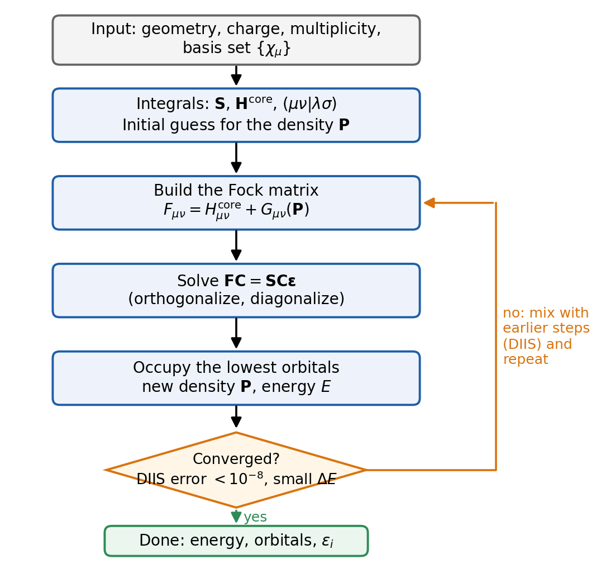

::: {.callout-tip icon=false}
## Learning goals

After studying this chapter you should be able to:

- explain the **mean-field** idea and why it makes the many-electron problem solvable;
- write the energy of a Slater determinant and say what the one-electron, Coulomb and exchange terms mean;
- write the **Fock operator** and explain why exchange has no classical analogue and why Hartree–Fock is free of self-interaction;
- write the **Roothaan–Hall equations** $\mathbf{FC} = \mathbf{SC}\boldsymbol{\varepsilon}$ and describe every step of the **SCF loop**, including what the DIIS error in a Q-Chem output means;
- tell restricted (RHF) from unrestricted (UHF) calculations and know when each is used;
- use **Koopmans' theorem** to estimate an ionization energy, and know its limits;
- define the **correlation energy**, tell dynamic from static correlation, and explain why it matters for reaction energies even though it is only about 1% of the total energy.
:::

::: {.callout-note icon=false}
## Review from P-Chem 2

This chapter builds on the instructor's P-Chem 2 textbook. Review these sections first if they feel rusty:

- [Many-electron atoms, §10.1–10.2](https://peverati.github.io/pchem2/Atoms.html): many-electron wave functions, the variational method, the helium atom.
- [Postulate 6: the Pauli exclusion principle](https://peverati.github.io/pchem2/Postulates.html#postulate-6-pauli-exclusion-principle) and [Spin](https://peverati.github.io/pchem2/Spin.html).
- [Solving the electronic eigenvalue problem, §11.3](https://peverati.github.io/pchem2/Molecules.html#solving-the-electronic-eigenvalue-problem) and [the Hartree–Fock method, §11.3.1](https://peverati.github.io/pchem2/Molecules.html#the-hartree-fock-method): LCAO, the secular determinant, the idea of a self-consistent field.
- [Hartree–Fock calculation for water, §13.2](https://peverati.github.io/pchem2/Poly.html#hartree-fock-calculation-for-water): a complete minimal-basis calculation, with the energy printed at every SCF cycle.

In P-Chem 2 you saw the *recipe*. Here we open the box and look at the equations behind it.
:::

## Where we are

Every calculation in this course makes two approximations. In [Lecture 1](l01-molecular-schrodinger.qmd) you wrote the electronic Hamiltonian (atomic units, nuclei clamped):

$$
\hat H_{\mathrm{el}} = -\frac{1}{2}\sum_{i=1}^{N}\nabla_i^2 \;-\; \sum_{i=1}^{N}\sum_{A}\frac{Z_A}{|\mathbf{r}_i-\mathbf{R}_A|} \;+\; \sum_{i=1}^{N}\sum_{j>i}^{N}\frac{1}{|\mathbf{r}_i-\mathbf{r}_j|}.
$$ {#eq-hel}

The three terms are the kinetic energy of the electrons, their attraction to the nuclei, and the electron–electron repulsion. The last term couples every electron to every other, and that is why no analytic solution exists for $N \geq 2$.

In [Lecture 2](l02-basis-sets.qmd) you approximated the **wave function's flexibility** with a basis set: orbitals are written as a finite sum of basis functions $\chi_\mu$. That is the first approximation. This lecture and the next two are about the second one: how we approximate the **Hamiltonian**, or more precisely, how we treat the electron–electron repulsion. Together, the two choices make a *model chemistry*, written method/basis, such as HF/def2-TZVP or B3LYP/def2-SVP.

Hartree–Fock (HF) is the starting point for everything else. It is a method in its own right (you are running it in [Experiment 1](../experiments/ex01-basis-sets.qmd)), it is the reference for the correlated wave-function methods that produce the benchmark numbers of this lab, and its machinery (orbitals, the Fock matrix, the SCF loop) is reused almost unchanged by density functional theory in [Lecture 5](l05-density-functional-theory.qmd).

::: {.callout-note}
## Experiment 1 check-in

By now you should have submitted your first jobs for [Experiment 1](../experiments/ex01-basis-sets.qmd). If anything did not work (the server, IQmol, a job that never finished), check the guides on [setting up IQmol](../guides/iqmol-setup.qmd), [your first job](../guides/first-job.qmd) and [reading the output](../guides/reading-output.qmd), and ask in class. We will discuss the results of Experiment 1 in [Lecture 7](l07-benchmarking.qmd), after everyone has submitted.
:::

## The mean-field idea

### Hartree's average field

In 1928 Douglas Hartree proposed a simple way out of the many-electron problem [@hartree1928]. Instead of following every electron as it dodges every other electron, let each electron move in the **average** electrostatic field created by the nuclei and by the *charge cloud* of all the other electrons. Each electron then obeys its own one-electron Schrödinger equation, with an effective potential that depends on where the other electrons are on average.

This is a **mean-field** approximation. It replaces the instantaneous repulsion $1/|\mathbf{r}_i - \mathbf{r}_j|$ by an interaction with a smeared-out charge density. The catch is that the average field depends on the orbitals of the other electrons, which are themselves the solutions we are looking for. Hartree solved the problem iteratively: guess the orbitals, compute the field, solve for new orbitals, compute a new field, and repeat until the orbitals that come out produce the same field that went in. He called the result a **self-consistent field** (SCF). The name survives in every quantum chemistry program, including the "SCF" lines of your Q-Chem outputs.

Hartree wrote the many-electron wave function as a simple product of orbitals, $\Psi = \varphi_1(\mathbf{r}_1)\varphi_2(\mathbf{r}_2)\cdots\varphi_N(\mathbf{r}_N)$. A product like this is not antisymmetric. It violates the Pauli principle, and it misses an important energy term, as we will see.

### The Slater determinant

In 1930 Fock [@fock1930] and Slater [@slater1930] fixed this by using a determinant of **spin orbitals** instead of a product. A spin orbital $\phi_i(\mathbf{x})$ is a spatial orbital times a spin function, $\phi_i(\mathbf{x}) = \varphi_i(\mathbf{r})\,\sigma(\omega)$ with $\sigma = \alpha$ or $\beta$, and $\mathbf{x} = (\mathbf{r},\omega)$ collects the space and spin coordinates of one electron. The **Slater determinant** is

$$
\Psi(\mathbf{x}_1,\ldots,\mathbf{x}_N) = \frac{1}{\sqrt{N!}}
\left|\begin{matrix}
\phi_1(\mathbf{x}_1) & \phi_2(\mathbf{x}_1) & \cdots & \phi_N(\mathbf{x}_1)\\
\phi_1(\mathbf{x}_2) & \phi_2(\mathbf{x}_2) & \cdots & \phi_N(\mathbf{x}_2)\\
\vdots & \vdots & \ddots & \vdots\\
\phi_1(\mathbf{x}_N) & \phi_2(\mathbf{x}_N) & \cdots & \phi_N(\mathbf{x}_N)
\end{matrix}\right|.
$$ {#eq-slater}

Swapping two electrons swaps two rows, which changes the sign of the determinant: the wave function is antisymmetric, as the Pauli principle requires. Putting two electrons in the same spin orbital makes two columns equal, and the determinant vanishes: no two electrons can share all their quantum numbers. You met this determinant in Lecture 1 and in [P-Chem 2](https://peverati.github.io/pchem2/Atoms.html). We will write it compactly as $\Psi = |\phi_1\phi_2\cdots\phi_N|$.

**The Hartree–Fock approximation** is a single statement: *the wave function is one Slater determinant, and the best determinant is the one with the lowest energy.* "Best" comes from the variational principle, $E[\Psi_{\mathrm{trial}}] \ge E_0$, which you used for basis sets in Lecture 2. Everything else in this chapter follows from that statement.

### The energy of a Slater determinant

Take the expectation value of the Hamiltonian (@eq-hel) with a normalized determinant of orthonormal spin orbitals. The algebra is long but standard (see @szabo1996, chapter 2). The result is short:

$$
E_{\mathrm{HF}} = \sum_{i=1}^{N} h_{i} \;+\; \frac{1}{2}\sum_{i=1}^{N}\sum_{j=1}^{N}\left(J_{ij} - K_{ij}\right) \;+\; V_{nn}.
$$ {#eq-ehf}

Here $V_{nn}$ is the constant nuclear repulsion, and the three kinds of integrals are:

- the **one-electron (core) energy** of spin orbital $i$, its kinetic energy plus its attraction to all nuclei:
  $$
  h_{i} = \int \phi_i^*(\mathbf{x}) \left[-\frac{1}{2}\nabla^2 - \sum_A \frac{Z_A}{|\mathbf{r}-\mathbf{R}_A|}\right]\phi_i(\mathbf{x})\,d\mathbf{x};
  $$
- the **Coulomb integral**, the classical repulsion between the charge clouds $|\phi_i|^2$ and $|\phi_j|^2$:
  $$
  J_{ij} = \iint \frac{|\phi_i(\mathbf{x}_1)|^2\,|\phi_j(\mathbf{x}_2)|^2}{r_{12}}\,d\mathbf{x}_1\,d\mathbf{x}_2;
  $$
- the **exchange integral**, which has the two orbitals swapped between the electrons on one side:
  $$
  K_{ij} = \iint \frac{\phi_i^*(\mathbf{x}_1)\phi_j(\mathbf{x}_1)\,\phi_j^*(\mathbf{x}_2)\phi_i(\mathbf{x}_2)}{r_{12}}\,d\mathbf{x}_1\,d\mathbf{x}_2.
  $$

The first two terms are what you would write for classical charge clouds. The third is new. It comes entirely from the antisymmetry of the determinant: a simple Hartree product gives only $h$ and $J$. Because the spin parts must match on both sides of $K_{ij}$, the exchange integral is zero unless electrons $i$ and $j$ have the **same spin**. Exchange is always positive ($K_{ij} \ge 0$), so it always lowers the energy.

::: {.callout-note}
## Exchange has no classical analogue

Exchange is not a new force. It is a correction to the Coulomb repulsion that appears because two electrons with the same spin cannot be at the same place (the determinant vanishes when $\mathbf{x}_1 = \mathbf{x}_2$). Around each electron there is a region, the **Fermi hole** or exchange hole, where same-spin electrons are unlikely to be found. Less overlap means less repulsion, and $-K_{ij}$ is that energy saving. Nothing in classical electrostatics gives this term. It is a pure consequence of the Pauli principle.
:::

::: {.callout-important}
## Remember this: no self-interaction in Hartree–Fock

Look at the double sum in @eq-ehf. It includes the terms with $i = j$. The term $J_{ii}$ is the repulsion of electron $i$ with *its own* charge cloud, which is unphysical: an electron does not repel itself. But from the definitions, $K_{ii} = J_{ii}$, so the two cancel exactly: $J_{ii} - K_{ii} = 0$. Hartree–Fock is **free of self-interaction**. Hartree's original product method was not, and, as you will see in [Lecture 5](l05-density-functional-theory.qmd), approximate density functionals are not either. This single fact explains why mixing some Hartree–Fock exchange into a functional helps ([Lecture 6](l06-jacobs-ladder.qmd)).
:::

### The Hartree–Fock equations and the Fock operator

We want the spin orbitals that minimize @eq-ehf while staying orthonormal. This is a constrained minimization, done with Lagrange multipliers. After a unitary rotation that makes the multiplier matrix diagonal (the *canonical* orbitals), the condition for a minimum becomes a set of one-electron eigenvalue equations, the **Hartree–Fock equations**:

$$
\hat f\,\phi_i = \varepsilon_i\,\phi_i, \qquad i = 1,\ldots,N.
$$ {#eq-hf}

The **Fock operator** $\hat f$ is an effective one-electron Hamiltonian:

$$
\hat f(\mathbf{x}_1) = \hat h(\mathbf{x}_1) + \sum_{j=1}^{N}\left[\hat J_j(\mathbf{x}_1) - \hat K_j(\mathbf{x}_1)\right].
$$ {#eq-fock}

- $\hat h = -\tfrac12\nabla^2 - \sum_A Z_A/|\mathbf{r}-\mathbf{R}_A|$ is the **core Hamiltonian**: kinetic energy plus nuclear attraction of one electron.
- $\hat J_j$ is the **Coulomb operator**: it multiplies the orbital by the electrostatic potential of the charge cloud of electron $j$,
  $$
  \hat J_j(\mathbf{x}_1)\,\phi_i(\mathbf{x}_1) = \left[\int \frac{|\phi_j(\mathbf{x}_2)|^2}{r_{12}}\,d\mathbf{x}_2\right]\phi_i(\mathbf{x}_1).
  $$
- $\hat K_j$ is the **exchange operator**: it swaps the orbitals inside the integral,
  $$
  \hat K_j(\mathbf{x}_1)\,\phi_i(\mathbf{x}_1) = \left[\int \frac{\phi_j^*(\mathbf{x}_2)\,\phi_i(\mathbf{x}_2)}{r_{12}}\,d\mathbf{x}_2\right]\phi_j(\mathbf{x}_1).
  $$
  $\hat K_j$ is a **nonlocal** operator: the result at point $\mathbf{x}_1$ depends on the value of $\phi_i$ everywhere in space, not only at $\mathbf{x}_1$. Keep this in mind. Density functional approximations replace this nonlocal operator by a *local* potential, and that is the root of several of their errors.

The sum $\sum_j(\hat J_j - \hat K_j)$ is the **Hartree–Fock potential**: the average field that each electron feels from all the others. This is the mean-field idea in equation form. The term $j = i$ is included in the sum, but, as above, its Coulomb and exchange parts cancel when acting on $\phi_i$.

Each eigenvalue $\varepsilon_i$ is an **orbital energy**. It equals $h_i + \sum_j (J_{ij} - K_{ij})$: the kinetic and nuclear-attraction energy of electron $i$ plus its average repulsion with all other electrons. Note that the total energy is **not** the sum of the orbital energies. Summing $\varepsilon_i$ over all occupied orbitals counts every electron pair twice, so

$$
E_{\mathrm{HF}} = \sum_i \varepsilon_i - \frac{1}{2}\sum_{i,j}\left(J_{ij} - K_{ij}\right) + V_{nn}.
$$

This is exactly the bookkeeping check in [§13.2 of P-Chem 2](https://peverati.github.io/pchem2/Poly.html#hartree-fock-calculation-for-water): twice the sum of the occupied orbital energies of water, plus the electron–electron repulsion counted once with the opposite sign, plus the nuclear repulsion, gives back the total energy.

### Closed shells: restricted Hartree–Fock

Most of the molecules in this course have an even number of electrons, all paired. For these **closed-shell** molecules we let each spatial orbital $\varphi_a$ hold two electrons, one $\alpha$ and one $\beta$. This is **restricted Hartree–Fock** (RHF). Doing the spin integration once and for all, the Fock operator for the $N/2$ doubly occupied spatial orbitals becomes

$$
\hat f(\mathbf{r}) = \hat h(\mathbf{r}) + \sum_{a=1}^{N/2}\left[2\hat J_a(\mathbf{r}) - \hat K_a(\mathbf{r})\right],
$$ {#eq-fock-rhf}

where the factor 2 counts the two electrons in each orbital, and the exchange term has no factor 2 because exchange acts only between electrons of the same spin. We come back to open shells in @sec-rhf-uhf.

## The Roothaan–Hall equations and the SCF loop

### From integro-differential equations to matrices

Equations (@eq-hf) are coupled integro-differential equations. For atoms they can be solved numerically on a radial grid, as Hartree did. For molecules this is impractical. In 1951 Roothaan [@roothaan1951] and, independently, Hall [@hall1951] used the LCAO idea from [Lecture 2](l02-basis-sets.qmd): expand each spatial orbital in a finite basis of $K$ functions,

$$
\varphi_i(\mathbf{r}) = \sum_{\mu=1}^{K} c_{\mu i}\,\chi_\mu(\mathbf{r}).
$$ {#eq-lcao}

Insert this into $\hat f\varphi_i = \varepsilon_i\varphi_i$, multiply from the left by $\chi_\nu^*$ and integrate. The unknown functions become unknown coefficients, and the equations become a matrix problem, the **Roothaan–Hall equations**:

$$
\mathbf{F}\mathbf{C} = \mathbf{S}\mathbf{C}\boldsymbol{\varepsilon}.
$$ {#eq-roothaan}

All matrices are $K \times K$:

- $\mathbf{C}$ holds the MO coefficients: column $i$ is orbital $\varphi_i$.
- $\boldsymbol{\varepsilon}$ is diagonal, with the orbital energies $\varepsilon_i$.
- $\mathbf{S}$ is the **overlap matrix**, $S_{\mu\nu} = \int \chi_\mu^*\chi_\nu\,d\mathbf{r}$. It is not the identity matrix because basis functions on different atoms overlap (the same point is made in [P-Chem 2 §11.3.1](https://peverati.github.io/pchem2/Molecules.html#the-hartree-fock-method)). This is why @eq-roothaan is a *generalized* eigenvalue problem.
- $\mathbf{F}$ is the **Fock matrix**, $F_{\mu\nu} = \int\chi_\mu^*\hat f\chi_\nu\,d\mathbf{r}$. For RHF it is

$$
F_{\mu\nu} = H^{\mathrm{core}}_{\mu\nu} + \sum_{\lambda=1}^{K}\sum_{\sigma=1}^{K} P_{\lambda\sigma}\left[(\mu\nu|\lambda\sigma) - \frac{1}{2}(\mu\lambda|\nu\sigma)\right],
$$ {#eq-fockmatrix}

with the core-Hamiltonian matrix $H^{\mathrm{core}}_{\mu\nu} = \int\chi_\mu^*\hat h\chi_\nu\,d\mathbf{r}$, the **two-electron integrals**

$$
(\mu\nu|\lambda\sigma) = \iint \frac{\chi_\mu^*(\mathbf{r}_1)\chi_\nu(\mathbf{r}_1)\,\chi_\lambda^*(\mathbf{r}_2)\chi_\sigma(\mathbf{r}_2)}{r_{12}}\,d\mathbf{r}_1\,d\mathbf{r}_2,
$$

and the **density matrix**

$$
P_{\lambda\sigma} = 2\sum_{a=1}^{N/2} c_{\lambda a}\,c_{\sigma a}^*.
$$ {#eq-density}

The density matrix is the bridge between orbitals and electron density: $\rho(\mathbf{r}) = \sum_{\lambda\sigma}P_{\lambda\sigma}\chi_\lambda(\mathbf{r})\chi^*_\sigma(\mathbf{r})$. In @eq-fockmatrix the first bracket term is the Coulomb part and the second, with the swapped indices, is the exchange part. The notation in P-Chem 2 is slightly different ($h = K + V$, $G$ for the two-electron part, $V_{ijkl}$ for the integrals), but the equation is the same.

Once the equations are solved, the energy is

$$
E_{\mathrm{RHF}} = \frac{1}{2}\sum_{\mu\nu}P_{\nu\mu}\left(H^{\mathrm{core}}_{\mu\nu} + F_{\mu\nu}\right) + V_{nn}.
$$ {#eq-erhf}

::: {.callout-note}
## Where the cost comes from

There are about $K^4/8$ unique two-electron integrals $(\mu\nu|\lambda\sigma)$. With 7 basis functions (water in a minimal basis, as in [P-Chem 2 §13.2](https://peverati.github.io/pchem2/Poly.html#hartree-fock-calculation-for-water)) this is a few hundred. With the 200 or so functions of a medium-sized molecule in def2-TZVP it is about $2\times 10^8$. Computing and contracting these integrals with $\mathbf{P}$ is the formal $K^4$ (often written $N^4$) cost of Hartree–Fock that you met in [Lecture 2](l02-basis-sets.qmd) and are measuring in [Experiment 1](../experiments/ex01-basis-sets.qmd). In practice programs skip integrals that are negligibly small (screening) or approximate them (density fitting), so the observed scaling is lower.
:::

### Why it must be solved iteratively

@eq-roothaan looks like an ordinary eigenvalue problem, but it is not linear: the Fock matrix depends on the density matrix (@eq-fockmatrix), which depends on the coefficients (@eq-density), which are the solution of the equation. We need $\mathbf{C}$ to build $\mathbf{F}$, and $\mathbf{F}$ to find $\mathbf{C}$. The way out is Hartree's: iterate until the input and output agree. This is the **SCF procedure** (@fig-scf).

{#fig-scf fig-alt="Flowchart: input geometry and basis; compute integrals and an initial density guess; build the Fock matrix; solve FC = SCε; occupy the lowest orbitals to get a new density and energy; check convergence; if not converged, go back to building the Fock matrix with DIIS extrapolation; if converged, done." width="80%"}

Step by step:

1. **Input.** Geometry, charge, multiplicity and basis set: exactly the `$molecule` and `$rem` sections of a Q-Chem input.
2. **One-time work.** Compute $\mathbf{S}$ and $\mathbf{H}^{\mathrm{core}}$ (cheap), and decide how to handle the two-electron integrals (store them, or recompute them each cycle, which modern programs usually do).
3. **Initial guess.** Make a first density matrix $\mathbf{P}$. A crude choice is to diagonalize $\mathbf{H}^{\mathrm{core}}$ alone (no electron repulsion at all). A much better one, and the default in Q-Chem, is a superposition of precomputed atomic densities (SAD). A good guess saves cycles and makes it more likely that the SCF lands on the right solution.
4. **Build the Fock matrix** from the current $\mathbf{P}$ with @eq-fockmatrix. This is the expensive step.
5. **Solve $\mathbf{FC} = \mathbf{SC}\boldsymbol{\varepsilon}$.** First transform to an orthonormal basis (for example with $\mathbf{S}^{-1/2}$), so the problem becomes an ordinary eigenvalue problem $\mathbf{F}'\mathbf{C}' = \mathbf{C}'\boldsymbol{\varepsilon}$. Diagonalize, then transform the coefficients back.
6. **Occupy** the $N/2$ orbitals with the lowest $\varepsilon_i$ (the *aufbau* principle), build the new $\mathbf{P}$ with @eq-density, and compute the energy with @eq-erhf.
7. **Check convergence.** If the new density is (almost) the same as the old one, stop. If not, go back to step 4 with the new density.

### Convergence, DIIS and the SCF table in your output

What does "the same" mean in step 7? At self-consistency the Fock matrix and the density matrix commute in the metric of the overlap matrix:

$$
\mathbf{F}\mathbf{P}\mathbf{S} - \mathbf{S}\mathbf{P}\mathbf{F} = \mathbf{0}.
$$ {#eq-diis}

Away from convergence this commutator is not zero, and its size is a natural error measure. Pulay's **DIIS** method (direct inversion in the iterative subspace) [@pulay1980] uses it twice. First, the largest element of the commutator is the **DIIS error** that Q-Chem prints in the third column of the SCF table. Second, instead of using only the newest Fock matrix, DIIS builds the next one as a linear combination of the Fock matrices from the last several cycles, with coefficients chosen to make the combined error as small as possible. This extrapolation is what makes modern SCF calculations converge in 10–20 cycles instead of hundreds.

Here is what this looks like in a Q-Chem output (see the [guide on reading the output](../guides/reading-output.qmd)):

```
 ---------------------------------------
  Cycle       Energy         DIIS error
 ---------------------------------------
    1    -920.4153225231      4.31e-02
    2    -920.6017766913      7.45e-03
    ...
   11    -920.6431907518      1.12e-07
   12    -920.6431907520      4.05e-09  Convergence criterion met
 ---------------------------------------
```

Each line is one pass through @fig-scf. The energy goes down and settles. The DIIS error shrinks by orders of magnitude. The job stops when the DIIS error falls below $10^{-n}$, where $n$ is the value of `SCF_CONVERGENCE` in the `$rem` section. All experiments in this course use `SCF_CONVERGENCE 8`, a tight threshold: the energy is then converged far beyond the digits you need for a reaction energy, because the energy error is roughly the *square* of the density error. That is a consequence of the variational principle: at the minimum, first-order errors in the orbitals give only second-order errors in the energy.

::: {.callout-warning}
## When the SCF goes wrong

The SCF is a numerical procedure, and it can fail in three ways. Learn to recognize them now. You will meet all three later in the course.

- **Oscillation.** The energy jumps up and down from cycle to cycle and never settles. This happens when two or more orbitals are close in energy near the HOMO–LUMO gap and swap occupation back and forth. Typical for transition-metal compounds and stretched bonds.
- **Slow convergence.** The DIIS error decreases, but very slowly, and the job hits the maximum number of cycles (Q-Chem prints a warning that the SCF failed to converge). The energy of a job that did not converge is meaningless. Never use it.
- **Convergence to the wrong solution.** The SCF converges perfectly, but to a stationary point that is not the lowest-energy solution: an excited configuration, or a saddle point that is a minimum only within the constraints you imposed (for example, RHF for a molecule that wants unpaired electrons). The output looks normal. Only a **stability analysis** can tell. This is the subject of [Lecture 12](l12-scf-stability.qmd) and [Experiment 8](../experiments/ex08-stability.qmd).

Programs have many tools against the first two: better initial guesses, damping, level shifting, and second-order algorithms such as geometric direct minimization. You will not need them for the organic molecules of Experiments 1–7.
:::

### Restricted and unrestricted Hartree–Fock {#sec-rhf-uhf}

Molecules with unpaired electrons (radicals, the O and S atoms, triplet states, many transition-metal complexes) cannot use @eq-fock-rhf, because their $\alpha$ and $\beta$ electrons are not paired up in the same spatial orbitals. There are two common ways to handle them:

- **Unrestricted Hartree–Fock (UHF)** [@pople1954] gives the $\alpha$ and $\beta$ electrons their own sets of spatial orbitals, $\{\varphi_i^\alpha\}$ and $\{\varphi_i^\beta\}$. There are two Fock matrices and two density matrices, coupled through the Coulomb term (the $\alpha$ electrons repel the $\beta$ electrons and vice versa). In a basis these are the Pople–Nesbet equations, $\mathbf{F}^\alpha\mathbf{C}^\alpha = \mathbf{S}\mathbf{C}^\alpha\boldsymbol{\varepsilon}^\alpha$ and the same for $\beta$. UHF has more freedom than RHF, so its energy is lower or equal. The price is that the UHF determinant is not, in general, an eigenfunction of $\hat S^2$: it is contaminated by higher spin states. Q-Chem prints $\langle \hat S^2\rangle$ for unrestricted jobs so you can check (a pure doublet has $0.75$, a pure triplet $2.0$).
- **Restricted open-shell Hartree–Fock (ROHF)** keeps doubly occupied orbitals for the paired electrons and singly occupied orbitals for the unpaired ones. It gives a pure spin state, at a slightly higher energy than UHF.

In this course, open-shell species are run **unrestricted** (Q-Chem does this automatically when the multiplicity is larger than 1). The same choice exists in DFT, where we speak of restricted and unrestricted Kohn–Sham. You will use unrestricted calculations for atoms and radicals in [Experiment 5](../experiments/ex05-difficult-cases.qmd) and later.

::: {.callout-tip}
## Multiplicity reminder

The multiplicity is $2S+1$, where $S$ is the total spin: 1 for a closed shell (singlet), 2 for one unpaired electron (doublet), 3 for two parallel unpaired electrons (triplet). It is the second number on line 2 of every `.xyz` file of this lab ("charge multiplicity"). A triplet O atom run as a singlet gives a perfectly converged, perfectly wrong energy.
:::

## Orbital energies and Koopmans' theorem

Diagonalizing the Fock matrix gives $K$ orbitals, but only the lowest $N/2$ (for RHF) are **occupied**. The remaining $K - N/2$ are **virtual** (unoccupied) orbitals. The highest occupied one is the **HOMO** and the lowest unoccupied one the **LUMO**. The number of virtual orbitals grows with the basis set, while the number of occupied orbitals is fixed by the number of electrons.

Q-Chem prints the orbital energies after the SCF table, under a heading "Orbital Energies (a.u.)", split into "Occupied" and "Virtual" lists (for unrestricted jobs, separately for $\alpha$ and $\beta$). Occupied orbital energies are negative: these electrons are bound. Their pattern follows chemical intuition: very low core levels (about $-20.5$ Eh for the O 1s orbital in water), then valence levels between about $-1.5$ and $-0.3$ Eh. Compare the minimal-basis water numbers in [P-Chem 2 §13.2](https://peverati.github.io/pchem2/Poly.html#hartree-fock-calculation-for-water).

**Koopmans' theorem** [@koopmans1934] gives the occupied orbital energies a physical meaning. If we remove an electron from orbital $i$ and keep all the other orbitals frozen, the energy of the resulting cation, minus the energy of the neutral molecule, is exactly $-\varepsilon_i$. So the first ionization energy is approximately

$$
\mathrm{IE} \approx -\varepsilon_{\mathrm{HOMO}}.
$$ {#eq-koopmans}

Two errors are hidden in this approximation. **Orbital relaxation**: in the real cation the remaining electrons rearrange to the new field, which lowers the cation energy, so Koopmans' value is too large. **Correlation**: the neutral molecule has one more electron pair to correlate than the cation, so including correlation increases the true ionization energy, and Koopmans' value is too small. The two errors have opposite signs and partly cancel, so Koopmans IEs of closed-shell molecules are often within about 1 eV of experiment. The cancellation is fortunate, not guaranteed. The analogous estimate of the electron affinity from the LUMO, $\mathrm{EA} \approx -\varepsilon_{\mathrm{LUMO}}$, is much worse, because the two errors now add up.

::: {.callout-note}
## Worked example: water

An HF calculation on water with a large basis gives $\varepsilon_{\mathrm{HOMO}} \approx -0.507$ Eh. Then $\mathrm{IE} \approx 0.507 \times 27.211 \approx 13.8$ eV. The experimental vertical ionization energy of water is 12.6 eV. Koopmans' estimate is about 1.2 eV too high, as expected when relaxation wins over correlation. Try it yourself: run water with HF and a triple-ζ basis and look for the last "Occupied" number in the output. Your value will depend slightly on the geometry and basis.
:::

::: {.callout-tip}
## What the orbital pictures in IQmol show

IQmol can plot any orbital from a Q-Chem job as an isosurface (a surface of constant $|\varphi_i|$, with two colors for the two signs). These pictures are useful for chemical intuition: the HOMO of ethene is the C=C π orbital, the LUMO is the π\*. Keep two things in mind. First, the canonical orbitals of @eq-hf are delocalized over the whole molecule and do not look like Lewis bonds and lone pairs (water's two "lone pairs" are two quite different orbitals). Any unitary rotation of the occupied orbitals gives the *same* determinant and the same energy, so localized orbitals are equally valid. Second, the virtual orbitals depend strongly on the basis set, and adding diffuse functions changes them a lot.
:::

## What Hartree–Fock misses: electron correlation

### The correlation energy

The Hartree–Fock wave function is the best single determinant, but it is still only one determinant. In the mean-field picture, each electron sees the *average* position of the others. Real electrons react to each other's *instantaneous* positions: they avoid each other more than the average field suggests. Their motions are **correlated**. Exchange already keeps same-spin electrons apart (the Fermi hole), but nothing in HF keeps opposite-spin electrons apart.

Löwdin defined the **correlation energy** as the difference between the exact energy and the Hartree–Fock energy [@lowdin1955]:

$$
E_{\mathrm{corr}} = E_{\mathrm{exact}} - E_{\mathrm{HF}}.
$$ {#eq-ecorr}

Because of the variational principle, $E_{\mathrm{corr}}$ is always negative. Two details matter. "Exact" means the exact nonrelativistic Born–Oppenheimer energy. And both energies should be in the same basis set, or, ideally, both at the complete-basis-set (CBS) limit. Otherwise the basis-set error gets mixed into the correlation energy.

How big is it? For the helium atom, $E_{\mathrm{HF}} = -2.8617$ Eh at the basis-set limit, while the exact energy is $-2.9037$ Eh. The correlation energy is $-0.042$ Eh, or $-26$ kcal/mol: about 1.4% of the total energy. For the water molecule it is roughly $-0.37$ Eh (about $-230$ kcal/mol), about 0.5% of the total. As a rule of thumb, the correlation energy is around 1% of the total energy, or very roughly 25 kcal/mol per electron pair.

One percent sounds small. It is not. **Chemistry happens in energy differences.** A typical reaction energy is 1–100 kcal/mol, and the conformational energies of [Experiment 3](../experiments/ex03-organic-a.qmd) are 1–3 kcal/mol. The total energy of a small organic molecule is about 100,000–500,000 kcal/mol. If the correlation energy changed by just 1% between reactants and products, it would shift a reaction energy by a few kcal/mol. When bonds are broken or formed, or when the number of electron pairs changes, the change in correlation energy is much larger than that.

::: {.callout-note}
## Hartree–Fock has no dispersion at all

London dispersion, the attraction between two neutral, nonpolar molecules (two argon atoms, two methane molecules, the stacked layers of graphite), comes from correlated, instantaneous fluctuations of the electron clouds. A mean-field method cannot describe it: in HF each molecule sees only the *static* average charge of the other. At long range, HF gives no dispersion attraction at all. Weakly bound complexes held together mainly by dispersion are unbound, or far too weakly bound, at the HF level, no matter how large the basis set. Keep this in mind when you look at your Experiment 1 results. Dispersion returns in [Lecture 8](l08-dispersion.qmd).
:::

### Dynamic and static correlation

It is useful to split correlation into two kinds, although there is no sharp boundary between them.

**Dynamic correlation** is the short-range dodging of electrons: each electron creates a small "Coulomb hole" around itself where other electrons, of either spin, are less likely to be. It is present in every molecule with more than one electron. Describing it requires mixing in many determinants, each with a small weight. It converges slowly with the basis set, because the wave function has a cusp where two electrons meet.

**Static (nondynamic) correlation** appears when one determinant is not even qualitatively right: when two or more electron configurations have nearly the same energy and must be mixed with comparable weights. Typical examples are stretched or breaking bonds, diradicals, ozone, and many transition-metal compounds.

The textbook example is the dissociation of H₂ (@fig-h2). Near the equilibrium distance, one doubly occupied bonding orbital $\sigma_g$ is a good description, and RHF is qualitatively right. The minimum is a little too shallow, and the difference from the exact curve is the dynamic correlation energy. But as the bond is stretched, the RHF determinant $|\sigma_g\alpha\,\sigma_g\beta|$ still forces both electrons into the same spatial orbital. Expanded in atomic orbitals, it is 50% covalent (H· + ·H) and 50% ionic (H⁺ + H⁻), at any distance. At infinite separation it should be 100% covalent. The ionic half costs a lot of energy, so the RHF curve rises far above the energy of two H atoms. The exact wave function fixes this by mixing in a second determinant, $|\sigma_u\alpha\,\sigma_u\beta|$, with a weight that grows until both have equal weight at dissociation. That second determinant is the static correlation.

![Dissociation of H₂ computed with a minimal basis set (STO-3G), where the full configuration interaction (full CI) curve is the exact answer within this basis. RHF is good near equilibrium but goes to an energy far above two H atoms. UHF breaks the spin symmetry beyond about 1.2 Å and dissociates correctly, at the cost of a spin-contaminated wave function. The gap between RHF and full CI at the minimum is the dynamic correlation energy; the growing gap at long distance is static correlation. Computed with `images/src/l04_l06_figures.py`.](images/l04-h2-dissociation.png){#fig-h2 fig-alt="Three potential energy curves for H2 versus H–H distance from 0.4 to 4.2 angstrom, energies relative to two H atoms in kcal/mol. Full CI has a minimum of about −128 kcal/mol near 0.74 angstrom and goes to zero at long distance. RHF has a minimum about 12 kcal/mol higher and rises to about +200 kcal/mol at 4 angstrom. UHF follows RHF up to about 1.2 angstrom and then bends away and goes to zero." width="85%"}

UHF also "fixes" the dissociation: past a certain distance (the Coulson–Fischer point) the $\alpha$ electron localizes on one atom and the $\beta$ electron on the other, and the energy goes correctly to two H atoms. But the UHF wave function is then a 50/50 mixture of a singlet and a triplet, and the curve has a kink. UHF solutions that are lower than RHF are an example of an **instability** of the RHF solution: the topic of [Lecture 12](l12-scf-stability.qmd).

::: {.callout-warning}
## Common mistake: "a converged SCF means the method is right"

A converged SCF tells you that the equations were solved, not that the approximation behind them is good. RHF for H₂ at 3 Å converges without trouble to a number that is 200 kcal/mol too high. Convergence is about numerics. Accuracy is about the method.
:::

## Ways forward

There are two broad families of methods that go beyond Hartree–Fock.

**Correlated wave-function methods** keep the HF determinant as a starting point (the *reference*) and add excited determinants to it.

- **Møller–Plesset perturbation theory** treats the difference between the real Hamiltonian and the sum of Fock operators as a perturbation [@moller1934]. Its second-order version, **MP2**, recovers a large part of the dynamic correlation and describes dispersion, at a cost that scales as $N^5$.
- **Coupled-cluster theory** includes excitations to all orders in an exponential form. **CCSD(T)** (singles, doubles and a perturbative estimate of triples) [@raghavachari1989] is called the "gold standard" of quantum chemistry: for molecules without strong static correlation, CCSD(T) near the CBS limit is typically within about 1 kcal/mol of experiment for reaction energies. Its cost scales as $N^7$: doubling the size of the molecule makes the calculation about 128 times slower. The reference values of most reactions in this lab come from CCSD(T)/CBS or similar high-level calculations collected in benchmark databases [@goerigk2017], as you will see in [Lecture 7](l07-benchmarking.qmd).
- **Multireference methods** (CASSCF, MRCI, CASPT2) start from several determinants and are needed when static correlation is strong. They are outside the scope of this course.

**Density functional theory** takes a different path. It keeps a one-determinant, mean-field machinery, with the same SCF loop and the same $N^3$–$N^4$ cost as HF, but it changes the *Hamiltonian* of that machinery so that it includes, approximately, both exchange and correlation. How that is possible, and why the hard part is a single term called the exchange–correlation energy, is the subject of [Lecture 5](l05-density-functional-theory.qmd).

| Method | Correlation | Formal cost | Dispersion | Typical use |
|---|---|---|---|---|
| HF | none | $N^4$ | none | reference, starting point |
| DFT (GGA, hybrid) | approximate, through $E_{xc}$ | $N^3$–$N^4$ | only if added (-D4, VV10) or fitted | everyday chemistry |
| MP2 | dynamic, second order | $N^5$ | yes (often overestimated) | medium molecules |
| CCSD(T) | dynamic, nearly complete | $N^7$ | yes | benchmarks, small molecules |

: Hartree–Fock and the methods that go beyond it. "Formal cost" is how the time grows with system size $N$ for a fixed basis-set quality. {#tbl-methods}

## Key points {.unnumbered}

- Hartree–Fock approximates the wave function by **one Slater determinant** and finds the best one with the variational principle. Each electron moves in the **average field** of the others.
- The HF energy contains one-electron terms, classical **Coulomb** terms $J_{ij}$, and **exchange** terms $K_{ij}$ between same-spin electrons. Exchange comes from antisymmetry and has no classical analogue.
- Because $J_{ii} = K_{ii}$, HF is **free of self-interaction**. Approximate density functionals are not.
- The **Fock operator** is $\hat f = \hat h + \sum_j(\hat J_j - \hat K_j)$. In a basis, the HF equations become the **Roothaan–Hall equations** $\mathbf{FC} = \mathbf{SC}\boldsymbol{\varepsilon}$.
- $\mathbf{F}$ depends on its own solution through the density matrix, so the equations are solved **iteratively** (the SCF loop). DIIS accelerates the loop, and the **DIIS error** in the output measures how far from self-consistency you are. `SCF_CONVERGENCE 8` means a DIIS error below $10^{-8}$.
- The SCF can oscillate, converge slowly, or converge to the **wrong solution**. A converged SCF is not proof of a correct answer.
- RHF pairs electrons in the same spatial orbitals; **UHF** gives $\alpha$ and $\beta$ electrons their own orbitals and is used for open shells.
- **Koopmans' theorem**: $\mathrm{IE} \approx -\varepsilon_{\mathrm{HOMO}}$, thanks to a partial cancellation of relaxation and correlation errors.
- The **correlation energy** $E_{\mathrm{exact}} - E_{\mathrm{HF}}$ is about 1% of the total energy but as large as or larger than most reaction energies. It has **dynamic** and **static** parts. HF has **no dispersion**.
- Correlated wave-function methods (MP2, CCSD(T)) are accurate but scale as $N^5$ to $N^7$. DFT is the cheaper alternative.

## Study questions {.unnumbered}

1. Write the Hartree product and the Slater determinant for a two-electron system. Show that only the determinant changes sign when the two electrons are exchanged, and that it vanishes if both electrons occupy the same spin orbital.
2. In @eq-ehf, the double sum runs over all $i$ and $j$, including $i = j$. Why is this harmless in Hartree–Fock? What would go wrong if the exchange term were approximated by something that does not exactly cancel $J_{ii}$?
3. Explain in words why $K_{ij} = 0$ when electrons $i$ and $j$ have opposite spins. What does this imply about how HF treats opposite-spin electrons?
4. The Roothaan–Hall equations look like an eigenvalue problem, but they must be solved iteratively. Explain why, in two or three sentences, using the words "Fock matrix" and "density matrix".
5. In the SCF table of a Q-Chem output, what is printed in the "DIIS error" column, and what does the job need to see there to stop with `SCF_CONVERGENCE 8`? Why can the energy be converged to more digits than the density?
6. A colleague's job printed a final energy, but no "Convergence criterion met" line. Can the energy be used in a reaction energy? Why or why not?
7. Use Koopmans' theorem to estimate the ionization energy (in eV) of a molecule with $\varepsilon_{\mathrm{HOMO}} = -0.40$ Eh. Name the two approximations hidden in this estimate and the direction of each error.
8. Using @fig-h2, explain why RHF fails to dissociate H₂ into two H atoms. What does the exact wave function contain that the RHF wave function lacks? Is this dynamic or static correlation?
9. The correlation energy of a molecule is "only" about 1% of its total energy. Explain why it is still essential for computing reaction energies, using an order-of-magnitude argument.
10. Argon dimer is bound by about 0.3 kcal/mol. What would an HF calculation with a very large basis set predict for it, and why?

## Further reading {.unnumbered}

- P-Chem 2 textbook: [Introduction to Molecules, §11.3](https://peverati.github.io/pchem2/Molecules.html#solving-the-electronic-eigenvalue-problem) and [Hartree–Fock calculation for water, §13.2](https://peverati.github.io/pchem2/Poly.html#hartree-fock-calculation-for-water).
- @szabo1996, chapters 2–3: the classic, step-by-step derivation of everything in this chapter, including a complete minimal-basis H₂ calculation like the one in @fig-h2.
- @helgaker2000: the advanced reference on wave-function methods, for those who want the full theory.
- @pulay1980: the original DIIS paper, short and readable.
- @koch2001, chapter 1: a compact review of Hartree–Fock and correlation written as a lead-in to DFT.
