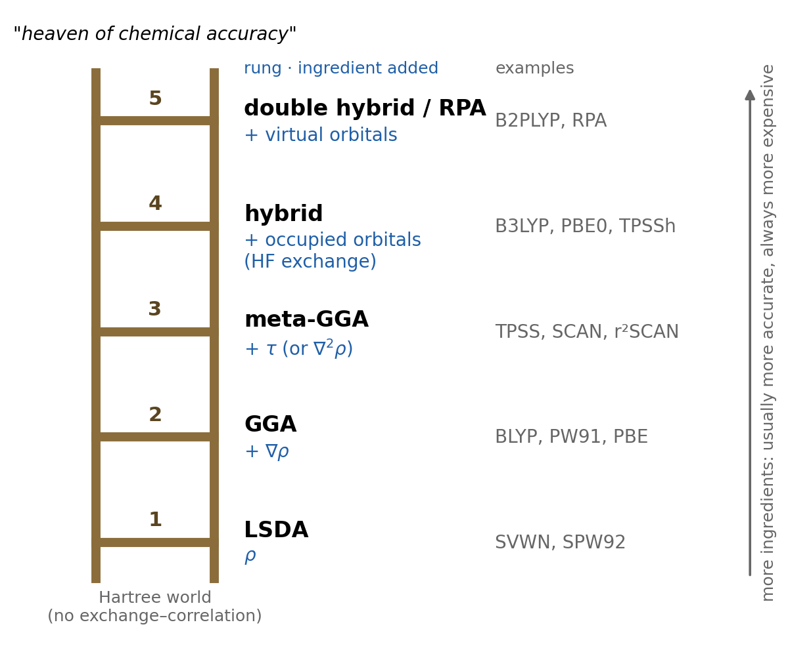

::: {.callout-tip icon=false}
## Learning goals

After studying this chapter you should be able to:

- describe Perdew's **Jacob's ladder** and name the ingredient that each rung adds;
- define the **reduced density gradient** $s$ and the **exchange enhancement factor** $F_x(s)$, and explain what B88 and PBE do;
- define the **kinetic-energy density** $\tau$ and explain what a meta-GGA can do that a GGA cannot;
- write the formula of a **global hybrid** (B3LYP, PBE0) and explain, with the adiabatic connection, why mixing in Hartree–Fock exchange helps;
- explain **range separation** with $\mathrm{erf}(\omega r)/r$ and read the percentages of a range-separated hybrid;
- say what a **double hybrid** adds;
- tell how **dispersion** is included in a functional (-D4, VV10, fitted, or not at all) and whether a functional is **non-empirical** or **empirical**;
- place any functional on the ladder from its ingredients, using the original paper or a review: the task of [Experiment 2](../experiments/ex02-jacobs-ladder.qmd).
:::

::: {.callout-note icon=false}
## Review from Classes 4 and 5

This chapter builds directly on the previous two. Before reading it, make sure you can:

- write the Hartree–Fock exchange energy and explain why it is free of self-interaction ([Class 4](l04-hartree-fock.qmd));
- write the Kohn–Sham energy $E = T_s + E_{ne} + J + E_{xc}$ ([Class 5](l05-density-functional-theory.qmd));
- write the LSDA exchange energy, $E_x^{\mathrm{LDA}} = -C_x\int\rho^{4/3}\,d\mathbf{r}$, and list what LSDA gets right and wrong ([Class 5](l05-density-functional-theory.qmd)).
:::

## Jacob's ladder

In [Class 5](l05-density-functional-theory.qmd) we saw that Kohn–Sham DFT is exact except for one term, the exchange–correlation energy $E_{xc}[\rho]$, and that the simplest approximation to it, LSDA, overbinds molecules badly. Since the late 1980s, hundreds of better approximations have been proposed. Their names can look like a random collection of letters and numbers: BLYP, PBE0, M06-2X, ωB97M-V, MN15-L. There is order behind them, and the most useful way to see it is a metaphor introduced by John Perdew and Karla Schmidt in 2001 [@perdew2001; @perdew2005].

In the Book of Genesis, Jacob dreams of a ladder that connects earth to heaven. In Perdew's version, the ladder rises from the "Hartree world" (no exchange or correlation at all, as in Hartree's 1928 method) to the "heaven of chemical accuracy", meaning errors below about 1 kcal/mol for energy differences. Each rung adds a new **ingredient**: a new kind of local information that the functional can use (@fig-ladder).

{#fig-ladder fig-alt="A ladder with five rungs. Rung 1, LSDA, uses the density rho (examples SVWN, SPW92). Rung 2, GGA, adds the gradient of the density (BLYP, PW91, PBE). Rung 3, meta-GGA, adds the kinetic-energy density tau or the Laplacian (TPSS, SCAN, r2SCAN). Rung 4, hybrid, adds the occupied orbitals through Hartree–Fock exchange (B3LYP, PBE0, TPSSh). Rung 5, double hybrid or RPA, adds the virtual orbitals (B2PLYP, RPA). The bottom is labeled Hartree world and the top heaven of chemical accuracy." width="80%"}

| Rung | Name | New ingredient | Typical examples |
|---:|---|---|---|
| 1 | LSDA | spin densities $\rho_\alpha$, $\rho_\beta$ | SVWN, SPW92 |
| 2 | GGA | density gradient $\nabla\rho_\sigma$ | BLYP, PW91, PBE |
| 3 | meta-GGA | kinetic-energy density $\tau_\sigma$ (or the Laplacian $\nabla^2\rho_\sigma$) | TPSS, SCAN, r²SCAN |
| 4 | hybrid | occupied orbitals, through Hartree–Fock exchange | B3LYP, PBE0, TPSSh, ωB97X-V |
| 5 | double hybrid, RPA | virtual (unoccupied) orbitals | B2PLYP, RPA |

: The five rungs of Jacob's ladder. {#tbl-rungs}

Three facts about the ladder are worth stating clearly.

- **Each rung includes the lower ones.** A GGA still uses the density, a meta-GGA still uses the gradient, a hybrid is built on top of a GGA or a meta-GGA.
- **Higher is usually better, but not always.** A well-designed GGA can beat a poorly designed hybrid for some properties. The ladder ranks *ingredients*, not individual functionals.
- **Higher is always more expensive.** Rungs 1–3 are **semilocal**: the energy density at a point depends only on information at that point, and the cost is small. Rung 4 needs the exchange matrix of Hartree–Fock, which is more expensive, and rung 5 needs a correlated wave-function step like MP2.

The rest of this chapter climbs the ladder one rung at a time. Rung 1 (LSDA) was the subject of [Class 5](l05-density-functional-theory.qmd).

## Rung 2: the generalized gradient approximation (GGA)

### The reduced gradient and the enhancement factor

LSDA uses only the value of the density at each point. In a molecule, the density changes rapidly: near the nuclei, in bonds, and in the tails. The natural next ingredient is the **gradient** of the density, $\nabla\rho$, which tells the functional how fast the density is changing. The early attempts to add a simple gradient correction (the gradient expansion) made things worse, because the expansion behaves badly where the gradient is large. The solution, developed in the 1980s, was the **generalized gradient approximation** (GGA): a more flexible function of $\rho$ and $\nabla\rho$ that is built to behave well everywhere.

To compare gradients in regions of very different density, GGAs use a dimensionless **reduced density gradient**:

$$
s(\mathbf{r}) = \frac{|\nabla\rho(\mathbf{r})|}{2\left(3\pi^2\right)^{1/3}\rho(\mathbf{r})^{4/3}}.
$$ {#eq-s}

$s = 0$ in the uniform gas. In molecules, $s$ is small (below about 1) in the valence and bonding regions, and it grows without limit in the exponential tails of the density, far from the nuclei.

Any GGA exchange functional can then be written as the LDA exchange energy density multiplied by an **enhancement factor** $F_x(s)$:

$$
E_x^{\mathrm{GGA}}[\rho] = -C_x\int\rho(\mathbf{r})^{4/3}\,F_x\big(s(\mathbf{r})\big)\,d\mathbf{r}, \qquad C_x = \frac{3}{4}\left(\frac{3}{\pi}\right)^{1/3}.
$$ {#eq-fx}

(For spin-polarized systems the same formula is applied to each spin density separately.) $F_x = 1$ gives back LSDA. Different GGA exchange functionals are simply different choices of $F_x(s)$. Because $F_x > 1$, GGAs make the exchange energy more negative than LSDA, which, as we saw for the hydrogen atom in [Class 5](l05-density-functional-theory.qmd), is what is needed.

### B88 exchange

In 1988 Axel Becke proposed the exchange functional that made DFT popular in chemistry [@becke1988]. In its original form, written for each spin density,

$$
E_x^{\mathrm{B88}} = E_x^{\mathrm{LSDA}} - \beta\sum_\sigma\int\rho_\sigma^{4/3}\,\frac{x_\sigma^2}{1 + 6\beta\,x_\sigma\sinh^{-1}x_\sigma}\,d\mathbf{r}, \qquad x_\sigma = \frac{|\nabla\rho_\sigma|}{\rho_\sigma^{4/3}},
$$ {#eq-b88}

with a single parameter $\beta = 0.0042$ a.u. Becke chose the form so that the exchange energy density has the correct $-1/(2r)$ behavior far from an atom, and fitted $\beta$ to the exact (Hartree–Fock) exchange energies of the noble-gas atoms. B88 is therefore a slightly **empirical** functional: one parameter, fitted to data. It is the "B" in BLYP, BP86 and B3LYP.

### PBE exchange and the idea of exact constraints

In 1996 Perdew, Burke and Ernzerhof proposed a GGA with a different philosophy [@perdew1996]. Instead of fitting to data, they chose the simplest form that satisfies known **exact constraints**, properties that the exact functional is proven to have. The PBE enhancement factor is

$$
F_x^{\mathrm{PBE}}(s) = 1 + \kappa - \frac{\kappa}{1 + \mu s^2/\kappa}, \qquad \kappa = 0.804, \quad \mu \approx 0.2195.
$$ {#eq-pbe}

Each number has a physical origin. $\mu$ is chosen so that, for small gradients, the gradient correction to exchange cancels that of PBE correlation, to recover the accurate linear response of the uniform gas. $\kappa$ is chosen so that $F_x$ never exceeds 1.804, a local version of the **Lieb–Oxford bound**, a proven lower limit on how negative the exchange–correlation energy can be. PBE is **non-empirical**: no parameter was fitted to molecular data. This makes it a safe, general-purpose functional for chemistry and especially for solids, where it is the default in many codes.

@fig-fx compares the two enhancement factors. They are almost identical for $s < 1$, where most of the chemistry happens. They differ in the tails: B88 keeps growing, while PBE levels off toward its bound.

{#fig-fx fig-alt="Plot of F_x versus s from 0 to 3. LSDA is a flat line at 1. B88 and PBE start at 1, rise together to about 1.18 at s = 1, then separate: B88 continues almost linearly to about 1.75 at s = 3, PBE bends over to about 1.57. A dotted line at 1.804 marks the local Lieb–Oxford bound used by PBE." width="80%"}

::: {.callout-note}
## Worked example: GGA exchange for the hydrogen atom

In [Class 5](l05-density-functional-theory.qmd) we evaluated LSDA exchange for the exact density of the hydrogen atom and found $-0.268$ Eh, against the exact $-0.3125$ Eh. With the same density, the two GGAs give (computed with the course script):

| | LSDA | PBE | B88 | Exact |
|---|---:|---:|---:|---:|
| $E_x$ (Eh) | $-0.268$ | $-0.306$ | $-0.310$ | $-0.3125$ |
| error (kcal/mol) | $+28$ | $+4$ | $+2$ | 0 |

The gradient correction removes most of the exchange error. The rest is a remaining self-interaction error, which a semilocal functional cannot remove completely.
:::

### GGA correlation and the names of GGA functionals

A GGA functional needs a correlation part too. The common ones are:

- **LYP** (Lee, Yang and Parr, 1988) [@lee1988], derived from a correlation formula fitted to the helium atom. It is not built on the uniform gas at all, and it gives zero correlation for any one-electron system, as it should.
- **P86** (Perdew, 1986) [@perdew1986; @perdew1986a], an early gradient correction to LSDA correlation.
- **PW91** (Perdew, Wang and co-workers, 1991–1992) [@perdew1992a], a non-empirical GGA for both exchange and correlation, the predecessor of PBE.
- **PBE** correlation [@perdew1996], the non-empirical partner of PBE exchange.

GGA names usually combine the exchange part and the correlation part: **BLYP** is B88 exchange + LYP correlation, **BP86** is B88 + P86, **PBE** is PBE exchange + PBE correlation. GGAs reduced the errors of LSDA in atomization energies by a large factor, from tens of kcal/mol to typically 5–10 kcal/mol for small molecules, and gave much better hydrogen bonds and barriers. This is why the 1990s were the decade in which chemists adopted DFT.

A third family of GGAs is built with Becke's 1997 power-series form [@becke1997], in which $F_x$ and the correlation enhancement factors are written as short power series with coefficients fitted to data. Many modern **empirical** functionals use this form, including the B97 series and the ωB97 family that we will meet below.

## Rung 3: meta-GGAs

### The kinetic-energy density

The third rung adds an ingredient that depends on the Kohn–Sham orbitals, but only in a semilocal way: the **kinetic-energy density** of each spin,

$$
\tau_\sigma(\mathbf{r}) = \frac{1}{2}\sum_{i}^{\mathrm{occ}}\left|\nabla\varphi_{i\sigma}(\mathbf{r})\right|^2.
$$ {#eq-tau}

Integrated over space, $\tau$ gives the Kohn–Sham kinetic energy $T_s$ of [Class 5](l05-density-functional-theory.qmd). Some meta-GGAs use the **Laplacian** of the density, $\nabla^2\rho$, instead of or in addition to $\tau$. Both carry information about how the density is curved, which the gradient alone does not.

Why is $\tau$ useful? Compare it with the **von Weizsäcker** kinetic-energy density, $\tau_W = |\nabla\rho|^2/(8\rho)$, which is the exact kinetic-energy density whenever only one orbital is occupied. The ratio $\tau_W/\tau$ equals 1 in regions dominated by a single orbital (for example, any one-electron system, or a region dominated by a single electron pair, like a covalent single bond) and is smaller elsewhere. Modern meta-GGAs use a closely related variable, $\alpha = (\tau - \tau_W)/\tau^{\mathrm{unif}}$, which is

- $\alpha = 0$ in one-orbital regions,
- $\alpha = 1$ in the uniform electron gas,
- $\alpha \gg 1$ in the region between two closed shells that do not bond (for example, between two weakly interacting molecules).

So a meta-GGA can **recognize** the kind of chemical region it is in, which a GGA cannot. This lets it, for instance, make the correlation energy vanish for any one-electron density (removing the one-electron self-correlation error of LSDA and most GGAs), and treat single bonds, metallic-like regions and weak interactions differently.

### Examples

- **TPSS** (Tao, Perdew, Staroverov and Scuseria, 2003) [@tao2003], a non-empirical meta-GGA.
- **SCAN** ("strongly constrained and appropriately normed", 2015) [@sun2015], a non-empirical meta-GGA that satisfies all 17 exact constraints known to be appropriate for a meta-GGA, and is "normed" to reproduce exactly a few systems (such as the hydrogen atom and the uniform gas). SCAN is accurate but numerically delicate, and needs fine integration grids. Its revision **r²SCAN** (2020) [@furness2020] keeps most of its accuracy with much better numerical behavior.
- **Empirical meta-GGAs**, fitted to large databases of reference energies. An example is **B97M-rV** [@mardirossian2015; @mardirossian2017rv].

Meta-GGAs cost only a little more than GGAs, because $\tau$ is computed from the same orbitals that the program already has. They need finer integration grids, though, because $\tau$ and $\alpha$ vary rapidly in space and many fitted meta-GGAs have oscillating enhancement factors. You will see this directly in [Experiment 7](../experiments/ex07-grids.qmd) and in [Class 11](l11-integration-grids.qmd).

::: {.callout-warning}
## "Local" means "no Hartree–Fock exchange", not "LSDA"

Rungs 1–3 together are called **semilocal** or simply **local** functionals: they use only information at each point (density, gradient, $\tau$), and no Hartree–Fock exchange. In the Minnesota family, the suffix **-L** marks such a local functional. The suffix does not tell you whether the functional is a GGA or a meta-GGA: for that, you need to know which ingredients it uses.
:::

## Rung 4: hybrid functionals

### Why mix in Hartree–Fock exchange? The adiabatic connection

So far, every functional has been a function of local quantities. The fourth rung adds a completely different ingredient: the occupied orbitals themselves, used to compute **exact exchange**, the Hartree–Fock exchange energy of [Class 4](l04-hartree-fock.qmd) evaluated with the Kohn–Sham orbitals:

$$
E_x^{\mathrm{HF}} = -\frac{1}{2}\sum_{i,j}^{\mathrm{occ}}K_{ij}.
$$ {#eq-exx}

Why would that help? A rigorous argument comes from the **adiabatic connection**. Imagine scaling the electron–electron repulsion by a factor $\lambda$ that goes from 0 to 1, while adjusting the external potential to keep the density fixed. At $\lambda = 0$ the electrons do not interact: this is the Kohn–Sham system, and its exchange–correlation energy is pure exchange, exactly $E_x^{\mathrm{HF}}$ with KS orbitals. At $\lambda = 1$ we have the real molecule. The exact $E_{xc}$ is the average of the exchange–correlation energy over this path:

$$
E_{xc} = \int_0^1 W_\lambda\,d\lambda,
$$ {#eq-adiabatic}

where $W_\lambda$ is the potential-energy part of exchange–correlation at coupling strength $\lambda$. We know the $\lambda = 0$ end exactly ($W_0 = E_x^{\mathrm{HF}}$). Semilocal functionals are best near the $\lambda = 1$ end. A simple approximation to the integral therefore mixes the two. Becke tried exactly this in 1993, with a "half-and-half" mixture of HF exchange and LSDA [@becke1993a]. A few months later he proposed a more flexible, fitted version [@becke1993], the ancestor of B3LYP.

The chemical argument is simpler. Hartree–Fock is free of self-interaction ([Class 4](l04-hartree-fock.qmd)), while semilocal functionals are not ([Class 5](l05-density-functional-theory.qmd)). Their errors often have opposite signs: HF underbinds and gives barriers that are too high, semilocal DFT overbinds and gives barriers that are too low. Mixing the two cancels part of both errors.

### Global hybrids: B3LYP and PBE0

A **global hybrid** uses the same fraction $a_0$ of HF exchange everywhere in space:

$$
E_{xc}^{\mathrm{hybrid}} = a_0\,E_x^{\mathrm{HF}} + (1 - a_0)\,E_x^{\mathrm{DFA}} + E_c^{\mathrm{DFA}},
$$ {#eq-hybrid}

where DFA stands for the underlying semilocal density functional approximation (a GGA or a meta-GGA).

**B3LYP** is the most cited functional in the history of chemistry. Becke's 1993 three-parameter form [@becke1993], with LYP correlation substituted by Stephens and co-workers in 1994 [@stephens1994], is

$$
E_{xc}^{\mathrm{B3LYP}} = (1 - a_0)\,E_x^{\mathrm{LSDA}} + a_0\,E_x^{\mathrm{HF}} + a_x\,\Delta E_x^{\mathrm{B88}} + (1 - a_c)\,E_c^{\mathrm{VWN}} + a_c\,E_c^{\mathrm{LYP}},
$$ {#eq-b3lyp}

with $a_0 = 0.20$, $a_x = 0.72$ and $a_c = 0.81$. Here $\Delta E_x^{\mathrm{B88}}$ is the gradient correction part of B88 (@eq-b88, minus its LSDA part). So B3LYP contains **20% HF exchange**. The three parameters were fitted by Becke to a small set of thermochemical data (with PW91 correlation in his original functional, today called **B3PW91**), and the same values were kept when LYP replaced PW91. B3LYP is an empirical hybrid GGA. Because different programs use different forms of VWN correlation ([Class 5](l05-density-functional-theory.qmd)), "B3LYP" energies can differ slightly from code to code.

**PBE0** [@adamo1999; @ernzerhof1999] is the non-empirical counterpart:

$$
E_{xc}^{\mathrm{PBE0}} = \frac{1}{4}E_x^{\mathrm{HF}} + \frac{3}{4}E_x^{\mathrm{PBE}} + E_c^{\mathrm{PBE}}.
$$ {#eq-pbe0}

The **25% HF exchange** is not fitted. Perdew, Ernzerhof and Burke argued from perturbation theory that 1/4 is a good general choice for molecules [@perdew1996a].

Hybrids built on meta-GGAs are **hybrid meta-GGAs**. Examples are TPSSh (TPSS with 10% HF exchange) [@staroverov2003] and several Minnesota functionals: **M06-2X** [@zhao2008] has **54%** HF exchange (the "2X" stands for doubled HF exchange relative to its parent functional), and **MN15** [@yu2016a] has **44%**. Notice how much the HF fraction varies between functionals. Fitted functionals designed for main-group thermochemistry and barrier heights tend to use more HF exchange (40–60%), while functionals meant also for transition metals use less, because HF exchange makes the static-correlation problems of [Class 5](l05-density-functional-theory.qmd) worse.

::: {.callout-note}
## The cost of exact exchange

Exact exchange is computed exactly as in Hartree–Fock: the program must build the exchange matrix from the two-electron integrals, which costs more than the Coulomb part and much more than evaluating a semilocal functional on a grid. In practice, a hybrid calculation takes noticeably longer per SCF cycle than a GGA in the same basis. You will measure this in [Experiment 3](../experiments/ex03-organic-a.qmd).
:::

### Range-separated hybrids

A global hybrid uses the same fraction of HF exchange for electrons that are close together and for electrons that are far apart. That is a compromise. At **short range**, semilocal exchange works reasonably well, and its errors partly cancel those of semilocal correlation. At **long range**, semilocal exchange is qualitatively wrong: the exchange–correlation potential of a semilocal functional decays exponentially far from a molecule, instead of as $-1/r$. This makes orbital energies, charge-transfer excitations, Rydberg states and stretched bonds poorly described, and leaves residual self-interaction where it hurts most.

**Range-separated hybrids** use different amounts of HF exchange at different electron–electron distances. They split the Coulomb operator with the error function:

$$
\frac{1}{r_{12}} = \underbrace{\frac{\mathrm{erfc}(\omega r_{12})}{r_{12}}}_{\text{short range}} + \underbrace{\frac{\mathrm{erf}(\omega r_{12})}{r_{12}}}_{\text{long range}},
$$ {#eq-rs}

where $\mathrm{erf}$ is the error function, $\mathrm{erfc} = 1 - \mathrm{erf}$, and the **range-separation parameter** $\omega$ (in bohr$^{-1}$) sets where the switch happens: $1/\omega$ is roughly the distance at which long range takes over (@fig-rs, left). The exchange energy is then written as

$$
E_x = c_{\mathrm{SR}}\,E_x^{\mathrm{HF,SR}} + (1 - c_{\mathrm{SR}})\,E_x^{\mathrm{DFA,SR}} + c_{\mathrm{LR}}\,E_x^{\mathrm{HF,LR}} + (1 - c_{\mathrm{LR}})\,E_x^{\mathrm{DFA,LR}},
$$ {#eq-rsh}

where $c_{\mathrm{SR}}$ and $c_{\mathrm{LR}}$ are the fractions of HF exchange at short and long range. The effective fraction of HF exchange grows smoothly from $c_{\mathrm{SR}}$ at $r_{12} = 0$ to $c_{\mathrm{LR}}$ at large $r_{12}$ (@fig-rs, right).

{#fig-rs fig-alt="Two panels. Left: 1/r decreases steeply; erfc(ωr)/r follows it at short distance and drops to zero by about 5 bohr; erf(ωr)/r starts at about 0.34 at r = 0 and merges with 1/r beyond about 6 bohr. Right: fraction of HF exchange versus distance. ωB97M-V rises from 0.15 at r = 0 to 1.0 by about 6 bohr; M11 rises from 0.428 to 1.0; flat lines at 0.54 (M06-2X), 0.25 (PBE0) and 0.20 (B3LYP)." width="100%"}

The most common choice in chemistry is a **long-range corrected** hybrid, with $c_{\mathrm{LR}} = 1$ (100% HF exchange at long range, which restores the correct $-1/r$ potential). The idea goes back to Iikura, Tsuneda, Yanai and Hirao [@iikura2001]. Examples:

| Functional | $c_{\mathrm{SR}}$ | $c_{\mathrm{LR}}$ | $\omega$ (bohr$^{-1}$) | Base rung |
|---|---:|---:|---:|---|
| CAM-B3LYP [@yanai2004] | 19% | 65% | 0.33 | GGA |
| ωB97X-V [@mardirossian2014] | 16.7% | 100% | 0.30 | GGA |
| M11 [@peverati2011] | 42.8% | 100% | 0.25 | meta-GGA |
| ωB97M-V [@mardirossian2016a] | 15% | 100% | 0.30 | meta-GGA |
| HSE (screened, for solids) [@heyd2003] | 25% | 0% | about 0.1 | GGA |

: Some range-separated hybrids. CAM-B3LYP uses a slightly more general partition than @eq-rsh. HSE does the opposite of a long-range correction: it keeps HF exchange only at short range, which makes calculations on metals and solids cheaper. {#tbl-rsh}

The "ω" at the beginning of a name (ωB97X-V, ωB97M-V, ωPBE) means range separation. Not every range-separated functional has it in its name, though: M11 and CAM-B3LYP are both range-separated. Range separation is also used in some local functionals, with two *different semilocal* exchange forms at short and long range and no HF exchange at all. So "range-separated" does not automatically mean "hybrid".

## Rung 5: double hybrids and RPA

The fifth rung uses the **virtual** (unoccupied) Kohn–Sham orbitals as well. **Double hybrids** add a fraction of second-order perturbation (MP2-like) correlation, computed from the virtual orbitals, on top of a hybrid. The first widely used one, **B2PLYP** (Grimme, 2006) [@grimme2006], has 53% HF exchange and 27% MP2-like correlation, with B88 and LYP for the rest. The **random-phase approximation** (RPA) is a different fifth-rung method, which treats correlation through all virtual orbitals and naturally includes dispersion.

Fifth-rung methods are among the most accurate DFT approaches for main-group thermochemistry [@goerigk2017]. The price is MP2-like cost ($N^5$) and slow basis-set convergence (like any correlated wave-function method, Class 4). We will not use them in the experiments, and there are no double hybrids in [Experiment 2](../experiments/ex02-jacobs-ladder.qmd).

## Two design questions that cut across the ladder

The rung tells you *which ingredients* a functional uses. Two other questions are independent of the rung, and you need both to understand a functional's name and behavior.

### How is dispersion included?

As we saw in [Class 5](l05-density-functional-theory.qmd), no semilocal functional describes long-range dispersion, and adding HF exchange does not help (HF has no dispersion at all, Class 4). There are four possibilities:

1. **Not at all.** Many classic functionals, including plain B3LYP, PBE and PBE0, have no long-range dispersion. They underbind dispersion-dominated complexes and get conformational energies of large flexible molecules wrong.
2. **An empirical pairwise correction, -D.** Grimme's corrections add an atom–atom term $-\sum_{AB} C_6^{AB}/R_{AB}^6$ (plus higher terms), switched off at short range by a damping function, on top of the DFT energy. The history: D2 (2006) [@grimme2006b], D3 (2010) [@grimme2010], and the current **D4** (2017–2019) [@caldeweyher2017; @caldeweyher2019], whose $C_6$ coefficients depend on the atomic partial charges and so on the chemical environment. In this course we always use **-D4**: B3LYP-D4 is B3LYP plus the D4 correction. The correction costs almost nothing.
3. **A nonlocal correlation functional, -V.** Vydrov and Van Voorhis's **VV10** [@vydrov2010] adds a correlation term that depends on the density at *two* points at once, $\iint \rho(\mathbf{r})\,\Phi(\mathbf{r},\mathbf{r}')\,\rho(\mathbf{r}')\,d\mathbf{r}\,d\mathbf{r}'$, so it can see two separate molecules. A "-V" at the end of a name (ωB97X-V, ωB97M-V, B97M-V) means VV10; "-rV" means the revised, faster rVV10 [@sabatini2013], as in B97M-rV. Note that VV10 is a correlation ingredient; it does not change the rung of the functional.
4. **Built into a fitted functional.** Highly parametrized functionals such as the Minnesota family were fitted to data that include noncovalent complexes, so they capture **medium-range** dispersion (at van der Waals contact distances) through their parameters, without any explicit term. At long range they behave like any semilocal functional. In the course data files this is labeled "fitted".

Dispersion is the topic of [Class 8](l08-dispersion.qmd), and [Experiment 4](../experiments/ex04-organic-b.qmd) compares these options directly.

### Non-empirical or empirical?

The second question is how the parameters were chosen.

- **Non-empirical** (constraint-satisfying) functionals, like PBE, PBE0, TPSS and SCAN, are built to obey exact constraints of the true functional, with no fitting to molecular data [@perdew2005]. Their strength is that they are expected to be reasonable for *any* system, including systems unlike anything their designers tested.
- **Empirical** (fitted) functionals, like B3LYP (3 parameters), the B97 family, the Minnesota functionals and ωB97M-V, have parameters fitted to databases of reference energies. ωB97M-V was designed by a "combinatorial" search: its authors fitted thousands of candidate forms and kept the one with the best balance between training and test sets [@mardirossian2016a]. Highly parametrized functionals can be very accurate for the kinds of systems they were trained on.

The danger of fitting is **overfitting**: a functional with many parameters can reproduce its **training set** very well and still fail for systems unlike those in the training set. A fair test of a functional uses data it was not fitted to. This is not a reason to avoid empirical functionals (several of the best functionals available are empirical), but it is a reason to check what a functional was trained on before trusting a good result. You will meet a concrete case in [Experiment 5](../experiments/ex05-difficult-cases.qmd) and in [Class 9](l09-difficult-cases.qmd). In reality the line between the two groups is blurred: many "non-empirical" functionals use exact data for a few simple systems (norms), and most empirical functionals also impose some exact constraints.

### Decoding functional names

There is no universal naming rule, but the following conventions cover most cases:

| Piece of the name | Meaning | Example |
|---|---|---|
| Exchange + correlation authors | B = Becke 88, LYP = Lee–Yang–Parr, P86 = Perdew 86, PW91 = Perdew–Wang | BLYP, BP86 |
| A number before the correlation part | number of fitted mixing parameters of a hybrid | B3LYP, B3PW91 |
| "0" at the end | a parameter-free hybrid | PBE0 |
| "M" in B97M, ωB97M | meta-GGA | ωB97M-V |
| ω or "LC-" at the start | range-separated | ωB97M-V, LC-ωPBE |
| "-V", "-rV" | VV10 or rVV10 nonlocal correlation | ωB97M-V, B97M-rV |
| "-D4" (or -D3, -D2) | empirical dispersion correction added | B3LYP-D4, PBE-D4 |
| Minnesota: M + year (+ suffix) | M = Minnesota, MN = Minnesota nonseparable; 06, 11, 15 = year | M06-2X, M11, MN15 |
| "-2X" (Minnesota) | doubled HF exchange relative to the parent functional | M06-2X |
| "-L" (Minnesota) | local: no HF exchange | MN15-L |

: How to read functional names. Always confirm with the original paper: names are conventions, not definitions. {#tbl-names}

Four worked examples:

- **B3LYP-D4**: Becke's 3-parameter hybrid with LYP correlation (a hybrid GGA, 20% HF exchange), plus the D4 dispersion correction.
- **ωB97M-V**: range-separated (ω) hybrid built on Becke's 1997 power-series form (B97), meta-GGA (M), with VV10 nonlocal correlation (V). 15% HF exchange at short range, 100% at long range.
- **M06-2X**: Minnesota 2006, with "double" HF exchange (54%). Which rung? The name alone does not say; the paper does (it uses $\tau$).
- **MN15-L**: Minnesota 2015, "N" for *nonseparable* (exchange and correlation are not fitted as separate pieces), "L" for local, so no HF exchange. Whether it is a GGA-type or a meta-GGA-type functional, the name does not say. You need the paper.

The last two examples carry the main message for Experiment 2: **the name is a hint, the paper is the answer.**

## Experiment 2: climbing the ladder yourself

[Experiment 2](../experiments/ex02-jacobs-ladder.qmd) has no calculations. You will classify 20 functionals into five categories: **LSDA**, **GGA**, **meta-GGA**, **hybrid GGA** and **hybrid meta-GGA** (there are no double hybrids). The point is to learn how to find this information for *any* functional, which is something you will need every time you read a computational paper or choose a method.

A reliable procedure, for each functional:

1. **Does it contain any Hartree–Fock exchange?** If yes, it is a hybrid (global or range-separated). Look for a percentage of "exact" or "HF" exchange in the paper or the Q-Chem manual. If no, it is local (rungs 1–3).
2. **Does it use the kinetic-energy density $\tau$ or the Laplacian $\nabla^2\rho$?** If yes, it is a meta-GGA (or a hybrid meta-GGA). Look for $\tau$ in the equations, or for "meta" in the abstract.
3. **Does it use the density gradient?** If yes (and not $\tau$), it is a GGA. If it uses only the density, it is LSDA.

Note separately, for yourself, whether the functional is range-separated and how it handles dispersion. The form does not ask for these, but you will need them in Experiments 3–5.

**Where to look.** The best source is the original paper (the references for every functional appear on the pages of [Experiments 3–5](../experiments/ex03-organic-a.qmd)). Reviews are faster: @mardirossian2017 and @goerigk2017 classify hundreds of functionals with consistent notation, and @peverati2014 and @yu2016b explain the Minnesota family and the general landscape. The Q-Chem manual lists the functionals available in the program, with their references [@epifanovsky2021]. Avoid unsourced web pages.

**Common traps.**

- A functional named after its *parameters* or its *year* tells you nothing about its rung.
- "Range-separated" does not imply "hybrid" (see above).
- "-V" adds nonlocal correlation, not HF exchange, and does not move a functional up the ladder.
- "-L" means no HF exchange, but it does not tell you GGA or meta-GGA.
- MN-type ("nonseparable") functionals are classified, on this simplified ladder, with the GGAs or meta-GGAs of the same ingredients.

::: {.callout-important}
## Before next week: lock your Experiment 3 predictions

[Experiment 3](../experiments/ex03-organic-a.qmd) asks you to predict, before running anything, how methods on different rungs will perform on four "easy" organic reactions. Make those predictions with what you learned in Classes 4–6, and lock them in before you start the calculations. Predictions are graded for being made, not for being right.
:::

## The 16 methods of Experiments 3–5 on the ladder

In Experiments 3, 4 and 5 you will run the same 16 methods: fifteen density functionals and Hartree–Fock, all with the def2-TZVP basis. Every chart in those experiments colors the methods by rung. Several of them are also in the Experiment 2 exercise, so place them on the ladder yourself first, using the procedure above. The complete table is in [Class 7](l07-benchmarking.qmd), which you should read after you submit Experiment 2.

## Key points {.unnumbered}

- **Jacob's ladder** (Perdew, 2001) orders functionals by their ingredients: LSDA ($\rho$), GGA ($+\nabla\rho$), meta-GGA ($+\tau$ or $\nabla^2\rho$), hybrid ($+$ occupied orbitals via HF exchange), double hybrid/RPA ($+$ virtual orbitals). Higher rungs are usually more accurate and always more expensive.
- GGA exchange is LSDA exchange times an **enhancement factor** $F_x(s)$ of the reduced gradient $s$. **B88** (1988) has one fitted parameter; **PBE** (1996) is non-empirical, with parameters fixed by exact constraints.
- **Meta-GGAs** use the kinetic-energy density $\tau$, which lets them recognize one-orbital regions, uniform-gas-like regions and weak-interaction regions. Examples: TPSS, SCAN, r²SCAN. They need finer grids.
- **Global hybrids** mix a fixed fraction of HF exchange: B3LYP 20%, PBE0 25%, M06-2X 54%, MN15 44%. The adiabatic connection justifies mixing; HF exchange reduces self-interaction error.
- **Range-separated hybrids** split $1/r_{12}$ with $\mathrm{erf}(\omega r_{12})$. Long-range corrected hybrids reach 100% HF exchange at long range: ωB97M-V 15% → 100% ($\omega = 0.3$), M11 42.8% → 100% ($\omega = 0.25$).
- **Double hybrids** (B2PLYP) add MP2-like correlation from virtual orbitals, at MP2-like cost.
- **Dispersion** is independent of the rung: none, **-D4**, nonlocal VV10 ("-V", "-rV"), or fitted (medium range only).
- Functionals are **non-empirical** (constraints) or **empirical** (fitted). Fitted functionals can be excellent, but beware of overfitting and of judging a functional on its own training set.
- **The name is a hint, the paper is the answer.**

## Study questions {.unnumbered}

1. List the five rungs of Jacob's ladder and the ingredient each one adds. Why is each rung more expensive than the one below it?
2. Calculate the reduced gradient $s$ for the hydrogen-atom density $\rho = e^{-2r}/\pi$ as a function of $r$. (Hint: $|\nabla\rho| = 2\rho$.) Where is $s$ small and where is it large? Which part of @fig-fx matters most for the hydrogen atom's valence region?
3. B88 and PBE exchange agree closely for $s < 1$. Why do they still give somewhat different energies for atoms and molecules?
4. What does the variable $\alpha = (\tau - \tau_W)/\tau^{\mathrm{unif}}$ tell a meta-GGA? Give its value in a one-electron system and in the uniform gas.
5. Write the B3LYP and PBE0 formulas. Which parameters were fitted and which were derived? What fraction of HF exchange does each contain?
6. Using the adiabatic connection, explain in a few sentences why a hybrid functional should contain *some* but not 100% HF exchange.
7. Sketch the fraction of HF exchange as a function of electron–electron distance for B3LYP, for ωB97M-V and for a screened hybrid like HSE. Explain why long-range correction restores the correct asymptotic potential.
8. Decode the names B3PW91, ωB97X-V, PBE-D4 and B97M-rV: what does each part of the name mean? Which of them are hybrids, and which include dispersion, and how?
9. A colleague says: "M11 is range-separated, so it must be a hybrid; and B97M-V has a V, so it must be better at dispersion than B97M-rV." Comment on both statements.
10. Why is overfitting a concern for functionals with many parameters? How would you test whether a fitted functional really is better than a non-empirical one?

## Further reading {.unnumbered}

- @perdew2001 and @perdew2005: the original Jacob's ladder papers, and a clear statement of the constraint-satisfaction philosophy.
- @mardirossian2017: a long, careful review of 200 functionals tested on a large database, with a classification of each. The best single reference for Experiment 2.
- @goerigk2017: the GMTKN55 database paper, which also ranks functionals on each rung of the ladder.
- @peverati2014: a review of the quest for a universal density functional, with the history of the Minnesota functionals.
- @koch2001, chapters 6–7: GGAs and hybrids explained for chemists.
- @becke2014: Becke's personal perspective on fifty years of DFT, from the man behind B88 and B3LYP.
