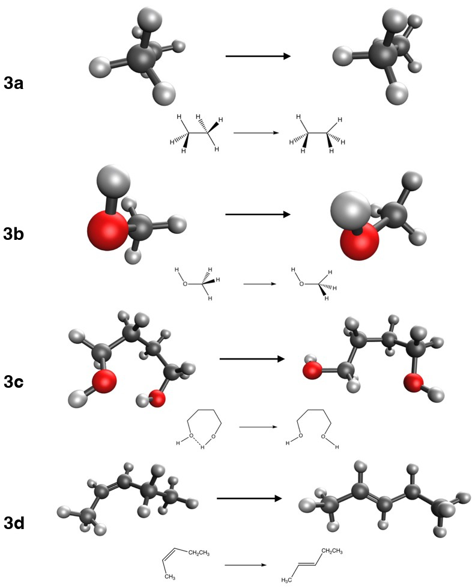

::: {.callout-note}
## Learning goals

After this class you should be able to:

- explain why the error of a DFT calculation on (HCl)₂ shrinks as the basis grows, and why the Hartree–Fock error does not;
- explain why the measured cost exponent of a calculation is smaller than the formal N⁴;
- place any of the 16 methods of Experiments 3–5 on Jacob's ladder;
- describe how a benchmark database is built, where its reference values come from, and what "CCSD(T)/CBS" means;
- compute and interpret the signed error, mean signed error (MSE), mean absolute error (MAE), maximum error and relative error;
- say what "chemical accuracy" means and why a single statistic never tells the whole story;
- start Experiment 3 knowing what to run, what to record and what to look for.
:::

This class has two parts. Part 1 looks back at the first two experiments. Part 2 introduces the tools we use from now on to judge a method: benchmark databases and error statistics. It ends with the briefing for [Experiment 3](../experiments/ex03-organic-a.qmd).

# Part 1 · Looking back at Experiments 1 and 2

::: {.callout-important}
## Read this after you submit Experiment 2
This part discusses the trends you probably saw in [Experiment 1](../experiments/ex01-basis-sets.qmd) and the classification of [Experiment 2](../experiments/ex02-jacobs-ladder.qmd). If you have not submitted them yet, stop here and come back later.
:::

## Experiment 1: the basis-set error

In Experiment 1 you computed the dissociation energy of the HCl dimer,

$$
\Delta E = 2\,E(\mathrm{HCl}) - E\big((\mathrm{HCl})_2\big),
$$ {#eq-hcl-diss}

with four methods (HF, PBE, B3LYP, ωB97M-V) and six basis sets from two families (def2-SVP/TZVP/QZVP and cc-pVDZ/TZ/QZ). The reference value is 2.01 kcal/mol. Because the reaction is a *dissociation*, ΔE is positive, and a **positive signed error** ε = ΔE~comp~ − ΔE~ref~ means the dimer is **bound too strongly**.

### What you probably saw for the density functionals

The chart *How the error changes as the basis grows* puts ζ (DZ, TZ, QZ) on the horizontal axis and |ε| on the vertical axis, one panel per family. For the three functionals the typical picture is:

- the error is largest with the double-ζ basis sets, and the dimer is usually **too strongly bound**;
- the error drops sharply from double-ζ to triple-ζ;
- the change from triple-ζ to quadruple-ζ is small. The curve flattens out.

Two effects make the double-ζ number too large. The first is the **basis-set incompleteness error** (BSIE): a small basis cannot describe the orbitals well, and the error does not cancel between the dimer and the monomers. The second, and the dominant one for a weakly bound dimer, is the **basis-set superposition error** (BSSE). In the dimer, each HCl molecule can "borrow" the basis functions centered on its partner to improve its own description. The isolated monomers have no partner to borrow from. So the dimer is artificially stabilized, and the binding energy comes out too large. BSSE shrinks quickly as the basis grows, because a molecule that already has a nearly complete basis gains little from its neighbor's functions. We return to BSSE and the counterpoise correction in [Class 10](l10-error-cancellation.qmd).

When the curve flattens, you are close to the **complete-basis-set (CBS) limit** for that functional. What is left is the error of the functional itself. This is the most important lesson of Experiment 1: **the basis-set error goes to zero as the basis grows, the functional error does not.** With a quadruple-ζ basis, the remaining error tells you how good the *method* is. For (HCl)₂ the functional with built-in nonlocal dispersion (ωB97M-V) usually ends up closest to the reference. Functionals with no dispersion term can converge to a value that is slightly too small (underbinding), so their |ε| can go down and then up again as BSSE disappears and their real underbinding is revealed. That is why "no specific pattern" is a legitimate answer for some methods.

### What you probably saw for Hartree–Fock

Hartree–Fock behaves very differently, and this is the first big surprise of the course. The HF error often does *not* decrease with the basis. It may even grow. The reason is physical. (HCl)₂ is held together by a mixture of dipole–dipole electrostatics and **London dispersion**. Hartree–Fock has no electron correlation at all, and dispersion is a correlation effect (Class 8 explains why). So at the CBS limit, HF underbinds the dimer. With a small basis, BSSE adds a spurious attraction that partly hides this missing physics. As the basis grows, the spurious attraction disappears and the true HF answer (too little binding) emerges.

In other words, HF/def2-SVP can look better than HF/def2-QZVP *for the wrong reason*. Keep this example in mind: a small basis can make a bad method look good. It is the theme of Experiment 6 and [Class 10](l10-error-cancellation.qmd).

::: {.callout-warning}
## Common mistake: "the error got smaller, so the method got better"
A smaller error is not proof of a better description. Ask *why* it got smaller. If the improvement comes from an artifact (BSSE) that happens to compensate for missing physics (dispersion), it will not transfer to another molecule.
:::

### def2 or cc-pVnZ?

The two families were built for different purposes. The Dunning correlation-consistent sets, cc-pV*n*Z [@dunning1989], were designed so that the **correlation energy** of wave-function methods (MP2, CCSD(T)) converges smoothly with *n*. Each step adds a full shell of polarization functions chosen for correlation. The Karlsruhe def2 sets [@weigend2005] were optimized mostly at the Hartree–Fock and DFT level, with the goal of a balanced error across the whole periodic table. Head-Gordon and co-workers found the def2 family to be the most cost-effective for DFT [@witte2016].

What you probably saw is that, at the same ζ, the two families give errors of similar size, with def2 often a bit better for the functionals at double- and triple-ζ. The differences shrink at quadruple-ζ, where both are close to the CBS limit. Note also that "triple-ζ" does not mean "the same number of functions": look at the number of basis functions you recorded for each set. Comparing basis sets by name alone is risky, and we will see this again in Experiment 6.

### The cost: measured exponents

The second chart plots wall time against the number of basis functions N on a log–log scale. If the cost follows t = a N^n^, then

$$
\log t = \log a + n \log N,
$$ {#eq-loglog}

and the slope of the straight line is the exponent *n*. In [Class 2](l02-basis-sets.qmd) you learned that the formal cost of HF and hybrid DFT grows as N⁴, because the number of two-electron integrals (μν|λσ) grows as N⁴. Most of you measured a smaller exponent, often between 2 and 3. Why?

1. **Integral screening.** Most of the N⁴ integrals are tiny because the Gaussians are far apart. Programs estimate integrals cheaply (Schwarz inequality) and skip the negligible ones. For large enough molecules the number of significant integrals grows closer to N².
2. **Fixed overhead.** Small jobs spend a large share of their time on start-up, reading the basis, building the grid and writing output. This cost does not depend much on N, and it flattens the curve at small N.
3. **Other steps with different scaling.** For functionals, the exchange–correlation integration on the grid scales roughly linearly with the size of the molecule. Linear algebra (diagonalization) scales as N³ but has a small prefactor.
4. **A narrow range.** Your N values span less than one decade. A fit over a short range is sensitive to noise and to the choice of points.

@fig-cost-scaling shows the effect of a fixed overhead on an ideal N⁴ law: at small N the curve is almost flat, and only at large N does it approach the true slope. Which of your points would you trust most? The largest ones.

{#fig-cost-scaling fig-alt="Log-log plot of wall time against number of basis functions, with straight lines for N squared, N cubed and N to the fourth, and a dashed N to the fourth curve with a constant offset that flattens at small N." width="85%"}

### The best compromise

Putting accuracy and cost together, the usual conclusion is that **triple-ζ** is the sweet spot for DFT. Double-ζ is cheap but not converged (BSIE and BSSE are still large). Quadruple-ζ is close to the CBS limit but costs several times more than triple-ζ for a small gain. This is why Experiments 3–5 use def2-TZVP. If you checked the [class results](../class-results.qmd) (when released), the heatmap shows the same picture for the whole class.

## Experiment 2: climbing the ladder

Experiment 2 asked you to classify 20 functionals into LSDA, GGA, meta-GGA, hybrid GGA and hybrid meta-GGA. The rung depends only on the **ingredients** of the functional (see [Class 6](l06-jacobs-ladder.qmd)):

| Rung | Ingredients |
|---|---|
| LSDA | ρ(**r**) only |
| GGA | ρ and ∇ρ |
| meta-GGA | ρ, ∇ρ and the kinetic-energy density τ (or ∇²ρ) |
| hybrid GGA | GGA + a fraction of HF exchange |
| hybrid meta-GGA | meta-GGA + a fraction of HF exchange |

: The rungs used in this course. {.striped}

The most common mistakes were these:

- **Range separation is not the same as "hybrid".** M11-L is range separated, but both ranges use *local* (semilocal) exchange. It contains no HF exchange, so it is a meta-GGA. M11 and ωB97M-V, by contrast, use HF exchange at long range (and some at short range), so they are hybrid meta-GGAs.
- **"-V" is not a rung.** The V in B97M-V and ωB97M-V stands for the VV10 nonlocal correlation term, which adds dispersion. It does not add HF exchange. B97M-V is a meta-GGA; ωB97M-V is a hybrid meta-GGA because of the ω (range-separated exchange), not because of the V.
- **"-L" means local.** M06-L, M11-L and MN15-L have no HF exchange. MN15-L is formally a meta-NGA, which sits on the meta-GGA rung in our simplified ladder.
- **Names that count parameters or exchange.** The "3" in B3LYP and B3PW91 refers to three mixing parameters. The "2X" in M06-2X means twice the HF exchange of M06 (54% vs 27%). M06-HF has 100% HF exchange and is still a hybrid meta-GGA, because it also contains a meta-GGA part.

The 16 methods you use in Experiments 3–5 sit on the ladder like this:

| Rung | Methods | Dispersion treatment |
|---|---|---|
| LSDA | SPW92 | none |
| GGA | BP86, BLYP, PBE, PBE-D4 | none; -D4 for PBE-D4 |
| meta-GGA | SCAN, B97M-V | none; VV10 for B97M-V |
| hybrid GGA | B3LYP, B3LYP-D4, B3PW91, PBE0 | none; -D4 for B3LYP-D4 |
| hybrid meta-GGA | M06-2X, M11, MN15, ωB97M-V | fitted (Minnesota); VV10 for ωB97M-V |
| (no DFT) | HF | none |

: The methods of Experiments 3–5. "Fitted" means the functional was parametrized on data that include noncovalent complexes. {#tbl-16 .striped}

Every chart in Experiments 3–5 colors the methods by rung, so you can see whether climbing the ladder really pays off.

# Part 2 · How we test a functional

## Why functionals must be tested

The exact exchange–correlation functional exists, but nobody knows its form. Every functional you use is an approximation, and unlike wave-function methods (HF → MP2 → CCSD → CCSD(T) → …), there is no systematic path that guarantees improvement. Climbing Jacob's ladder *usually* helps, but a meta-GGA is not guaranteed to beat every GGA on every problem.

So we test. A functional is judged by how well it reproduces trusted reference values for many chemical problems. This is called **benchmarking**, and it is how the whole field decides which functionals to recommend [@goerigk2017; @mardirossian2017; @goerigk2019]. In Experiments 3–5 you will do a small benchmark yourself.

## Reference values

A benchmark is only as good as its reference values. There are two sources.

### Experiment

Experimental thermochemistry (enthalpies of formation, bond energies, ionization potentials) has the advantage of being "real". But experimental numbers cannot be compared directly with a single-point electronic energy:

- experiments measure enthalpies or free energies at a finite temperature, which include zero-point vibrational energy and thermal corrections (see [Class 13](l13-theory-vs-experiment.qmd));
- some experimental values have uncertainties of 1 kcal/mol or more;
- many interesting quantities (a barrier height, the energy of an unstable conformer, a dimer at a fixed geometry) cannot be measured cleanly at all.

To compare with experiment you must back-correct the experimental value to an electronic energy difference, or add the corrections to the computed one. Both introduce extra uncertainty.

### High-level theory: CCSD(T)/CBS

The alternative is to compute the reference with a method far more accurate than DFT, at the same geometries. The workhorse is **CCSD(T)**, coupled cluster with single and double excitations and a perturbative estimate of triple excitations [@raghavachari1989]. It is called the "gold standard" of quantum chemistry because, for molecules dominated by a single electron configuration, it reproduces experiment to a few tenths of a kcal/mol. Its cost scales as N⁷, so it is affordable only for small molecules.

CCSD(T) also needs a very large basis set, because the correlation energy converges slowly with the basis. The trick is to compute the energy with two or three basis sets of increasing cardinal number *n* (e.g., cc-pVTZ and cc-pVQZ) and **extrapolate** to the complete-basis-set (CBS) limit. A common form for the correlation energy is

$$
E_\text{corr}(n) = E_\text{corr}^\text{CBS} + \frac{A}{n^3},
$$ {#eq-cbs}

where A is fitted from two values of *n* [@helgaker1997]. With two points, @eq-cbs can be solved for the limit:

$$
E_\text{corr}^\text{CBS} = \frac{n^3 E_\text{corr}(n) - (n-1)^3 E_\text{corr}(n-1)}{n^3 - (n-1)^3}.
$$ {#eq-cbs2}

The HF part converges much faster and is usually taken from the largest basis or extrapolated exponentially. The combination is written **CCSD(T)/CBS**. For the most demanding thermochemistry, composite protocols such as W4 add even higher excitations and small corrections, reaching uncertainties around 0.1–0.2 kcal/mol; the W4-17 database used for reaction 5d was built this way [@karton2017].

::: {.callout-tip}
## Worked example: a two-point CBS extrapolation
Suppose the CCSD(T) correlation energy of a small molecule is −0.27500 E~h~ with cc-pVTZ (*n* = 3) and −0.28500 E~h~ with cc-pVQZ (*n* = 4). These are made-up numbers for practice. Using @eq-cbs2:

$$
E_\text{corr}^\text{CBS} = \frac{64(-0.28500) - 27(-0.27500)}{64 - 27} = \frac{-18.24000 + 7.42500}{37} = \frac{-10.81500}{37} = -0.29230\ E_\text{h}.
$$

The extrapolation adds −0.00730 E~h~ beyond the cc-pVQZ value, which is −0.00730 × 627.5095 = −4.58 kcal/mol. The basis-set error of the correlation energy is far from negligible even with a quadruple-ζ basis. For reaction energies much of it cancels, but not all.
:::

The important point for you: the reference values in Experiments 3–5 come from CCSD(T)/CBS or better, computed at the *same* geometries you use. So the difference between your number and the reference is the error of your method (functional + basis set), with no thermal corrections or experimental uncertainty mixed in.

## Benchmark databases

A single reaction says little about a functional. A **benchmark database** collects hundreds or thousands of reference values, grouped in **subsets** by chemical type. Three families of databases matter for this course.

### GMTKN55

GMTKN55 (General Main-group Thermochemistry, Kinetics and Noncovalent interactions, 55 subsets) was published by Goerigk, Grimme and co-workers in 2017 [@goerigk2017]. It contains about 1500 relative energies, organized in five categories:

1. basic properties and reaction energies of small systems (atomization energies, ionization potentials, proton affinities, …);
2. reaction energies of larger systems and isomerizations;
3. reaction barrier heights;
4. intermolecular noncovalent interactions;
5. intramolecular noncovalent interactions (conformers).

Reactions 3a and 3b come from its BHROT27 subset (rotational barriers), 3c from BUT14DIOL (butane-1,4-diol conformers), 3d from FH51 (reaction energies), and in Experiment 4 you will use DARC (Diels–Alder reactions) and ADIM6 (alkane dimers). The paper tested more than 200 functional/dispersion combinations, and it is one of the best places to look up how a functional performs.

Because the energies in GMTKN55 range from tenths of a kcal/mol (conformers) to hundreds (atomizations), a plain average would be dominated by the large ones. GMTKN55 therefore uses a **weighted** mean absolute deviation, WTMAD-2, in which the MAD of each subset *i* is scaled by the ratio between 56.84 kcal/mol (the average absolute reference energy over the whole database) and the average absolute reference energy of that subset, $\overline{|\Delta E|}_i$:

$$
\text{WTMAD-2} = \frac{1}{\sum_i N_i}\sum_i N_i \,\frac{56.84\ \text{kcal/mol}}{\overline{|\Delta E|}_i}\,\text{MAD}_i .
$$ {#eq-wtmad}

Take two subsets whose average reference energies are 1 kcal/mol (conformers) and 50 kcal/mol (reaction energies). An MAD of 0.5 kcal/mol in the first then weighs as much as an MAD of 25 kcal/mol in the second, because 0.5 × 56.84/1 = 25 × 56.84/50 = 28.4. A half-kcal/mol error on a 1 kcal/mol conformer energy really is as bad, chemically, as a 50% error on a larger reaction energy.

### MGCDB84

MGCDB84 (Main-Group Chemistry DataBase, 84 subsets), assembled by Mardirossian and Head-Gordon [@mardirossian2017], contains close to 5000 data points. It grew out of the data used to develop the ωB97X-V, B97M-V and ωB97M-V functionals, and the same paper uses it to evaluate 200 functionals. Its categories distinguish "easy" from "difficult" problems: noncovalent dimers and clusters, isomerization energies, thermochemistry and barrier heights, each split into easy and difficult groups. The AlkIsomer11 and S66 subsets of Experiment 4 come from it.

### The Minnesota databases

Truhlar's group has built a long series of databases to develop and test the Minnesota functionals (M06, M11, MN15 and others). The latest, Minnesota Database 2015B, was used to parametrize MN15 [@yu2016a; @peverati2014]. It includes many inorganic and transition-metal systems, and multireference cases. Reactions 5b (CaO) and 5c (H₂SO₄) come from it, and Experiment 1 came from its NCCE30 subset.

### Training sets and test sets

Many modern functionals contain parameters fitted to a database. The data used for fitting form the **training set**. Data never used for fitting form the **test set**. A functional's performance on its own training set is not an independent test: it is guaranteed to be good there, by construction. A fair benchmark looks at the test set, or at a database built by someone else. Keep this in mind for [Class 9](l09-difficult-cases.qmd): one reaction in Experiment 5 belongs to the training set of one of your functionals.

## Error statistics

You will compute these quantities in every experiment from now on. They are also defined in the [units and errors guide](../guides/units-and-errors.qmd).

### The signed error

For one reaction *k*,

$$
\varepsilon_k = \Delta E_k^\text{comp} - \Delta E_k^\text{ref}.
$$ {#eq-signed}

The sign carries meaning. If ε > 0, the computed reaction energy is *more positive* (less negative) than the reference. For an exothermic reaction (ΔE < 0), a positive ε means the method underestimates how favorable the reaction is. For a dissociation (ΔE > 0), a positive ε means the method overbinds. **Always write down the direction of the reaction before interpreting the sign.**

### Statistics over a set of N reactions

$$
\text{MSE} = \frac{1}{N}\sum_{k=1}^{N}\varepsilon_k, \qquad
\text{MAE} = \frac{1}{N}\sum_{k=1}^{N}|\varepsilon_k|,
$$ {#eq-mse-mae}

$$
\text{RMSD} = \sqrt{\frac{1}{N}\sum_{k=1}^{N}\varepsilon_k^2}, \qquad
\text{MaxE} = \max_k |\varepsilon_k|.
$$ {#eq-rmsd}

- The **mean signed error** (MSE) measures *systematic bias*. A method with MSE ≈ 0 is not necessarily good: large positive and negative errors can cancel.
- The **mean absolute error** (MAE, sometimes MAD or MUE) measures *typical accuracy*. It is the number most benchmark papers report.
- The **root-mean-square deviation** (RMSD) weights large errors more heavily. RMSD ≥ MAE always; a RMSD much larger than the MAE warns you of outliers.
- The **maximum error** tells you the worst case. If you design a drug or a catalyst, the worst case may matter more than the average.

### The relative error

$$
\varepsilon_k^\text{rel} = \frac{\varepsilon_k}{|\Delta E_k^\text{ref}|}\times 100\%.
$$ {#eq-rel}

The relative error puts reactions of very different size on the same footing. But chemistry is decided by *absolute* energies: an equilibrium constant depends on ΔG in kcal/mol, not on a percentage. A 1% error on an atomization energy of 600 kcal/mol is 6 kcal/mol, which changes a rate or an equilibrium by orders of magnitude. And a relative error is meaningless when the reference is close to zero. Experiment 5 has a chart for exactly this comparison.

::: {.callout-tip}
## Worked example: statistics for a hypothetical method
A hypothetical method gives these reaction energies (kcal/mol) for four reactions. The numbers are invented for practice; they are not results for any real functional.

| Reaction | ΔE~ref~ | ΔE~comp~ | ε | \|ε\| |
|---|---:|---:|---:|---:|
| A | 2.50 | 2.10 | −0.40 | 0.40 |
| B | 1.00 | 1.30 | +0.30 | 0.30 |
| C | −10.00 | −8.80 | +1.20 | 1.20 |
| D | 50.00 | 47.60 | −2.40 | 2.40 |

- MSE = (−0.40 + 0.30 + 1.20 − 2.40)/4 = −1.30/4 = −0.33 kcal/mol (−0.325 before rounding).
- MAE = (0.40 + 0.30 + 1.20 + 2.40)/4 = 4.30/4 = 1.08 kcal/mol (1.075).
- RMSD = √[(0.16 + 0.09 + 1.44 + 5.76)/4] = √(7.45/4) = √1.8625 = 1.36 kcal/mol.
- MaxE = 2.40 kcal/mol (reaction D).
- Relative errors: A 16%, B 30%, C 12%, D 4.8%.

Reaction D has the largest absolute error but the smallest relative error. Reaction B has the smallest absolute error but the largest relative error. Which one is "worst" depends on the question you are asking.
:::

::: {.callout-warning}
## Common mistakes with error statistics
- Averaging signed errors and calling the result "the accuracy". That is the MSE, a measure of bias.
- Rounding the total energies before taking differences. Keep all the digits of the total energies (in E~h~), convert the *difference* to kcal/mol with 1 E~h~ = 627.5095 kcal/mol, and round only at the end.
- Forgetting the stoichiometric coefficients. In ΔE = Σ ν~i~E~i~ the coefficients are signed: ν > 0 for products, ν < 0 for reactants. "2 ethane → dimer" has ν = −2 for ethane.
- Comparing MAEs computed over different sets of reactions.
:::

## Chemical accuracy

The traditional target for a computational method is **chemical accuracy**, an error of about **1 kcal/mol** (4.2 kJ/mol). The number is not arbitrary. At 298 K, RT = 0.5925 kcal/mol, and an error δ in a free-energy difference changes an equilibrium constant (or a rate constant, through the barrier) by a factor exp(δ/RT):

$$
\frac{K_\text{comp}}{K_\text{true}} = e^{\delta/RT} = e^{1.000/0.5925} = e^{1.688} \approx 5.4 .
$$ {#eq-chemacc}

So a 1 kcal/mol error means a factor of about 5 in K or in a rate. That is often good enough to tell which product dominates. A 3 kcal/mol error means a factor of e^5.06^ ≈ 160, which is often not.

For reference: on GMTKN55, the best hybrid and double-hybrid functionals reach a WTMAD-2 of a few kcal/mol, and the best functionals have MAEs well below 1 kcal/mol for easy noncovalent and conformational data, but several kcal/mol for difficult thermochemistry [@goerigk2017; @mardirossian2017]. Chemical accuracy is not reached uniformly by any functional.

## Why a single number never tells the whole story

Benchmark rankings are useful, but they must be read with care:

1. **The composition of the database matters.** A ranking depends on which reactions are included and how they are weighted. A functional that is excellent for organic chemistry may be mediocre for transition metals, and an overall average hides this.
2. **Training sets.** A functional fitted to a database will look good on that database (see above).
3. **Error cancellation.** A good number can come from a lucky cancellation between two errors (Experiment 1 already showed one). Lucky cancellations don't transfer.
4. **Outliers.** A small MAE can coexist with a catastrophic failure on one system. Always look at the maximum error and at the distribution.
5. **The reference itself.** CCSD(T)/CBS is excellent for single-reference molecules, but less reliable for systems with strong static correlation (Class 9).

The practical advice: before using a functional for a new problem, look up its performance on the *subsets* most similar to your problem, not just its overall rank.

# Experiment 3 briefing

## The goal

[Experiment 3](../experiments/ex03-organic-a.qmd) is your first benchmark. You will test 16 methods on four reactions that appear in every organic chemistry textbook:

| Reaction | Description | ΔE~ref~ (kcal/mol) |
|---|---|---:|
| 3a | ethane, staggered → eclipsed (rotational barrier) | 2.73 |
| 3b | methanol, staggered → eclipsed (rotational barrier) | 1.01 |
| 3c | butane-1,4-diol, conformer B1 → B43 (breaks an intramolecular H-bond) | 3.29 |
| 3d | *cis*-pent-2-ene → *trans*-pent-2-ene | −1.15 |

: Reactions of Experiment 3. Data from the BHROT27, BUT14DIOL and FH51 subsets of GMTKN55 [@goerigk2017]. {.striped}

{fig-alt="Ball-and-stick and line drawings of the four reactions 3a to 3d." width="70%"}

## Methods and jobs

You will use the 16 methods of @tbl-16 with the def2-TZVP basis set. Eight molecules × 16 methods = **128 jobs**. Each one is small and fast, but there are many, so submit them in batches (see [working on a shared machine](../guides/shared-machines.qmd)). For every job record the total energy, the number of SCF cycles and the wall time.

## Why these reactions are "easy"

All four reactions compare two forms of the same molecule (two conformers, or a cis and a trans isomer). The atoms, the bonds and the number of electron pairs are the same on both sides. Only the arrangement in space changes. Most errors of an approximate functional are tied to specific features of the electron density: the core, the lone pairs, each type of bond. When the same features appear on both sides of the reaction, their errors largely **cancel** when you take products minus reactants.

This idea has a name in thermochemistry. An **isodesmic reaction** conserves the number and type of each bond, and a **homodesmotic** reaction also conserves the hybridization of the atoms. Chemists design such reactions on purpose, because they make the computed reaction energy much less sensitive to the method. Conformational changes are the extreme case: nothing changes but the geometry.

Error cancellation is not guaranteed, though. Ask yourself, for each reaction, what *does* change. In 3c an intramolecular hydrogen bond is broken. In 3a and 3b the barrier comes from a subtle balance of steric and hyperconjugative effects. How well does each rung describe a hydrogen bond? How does a method with no electron correlation at all (HF) do?

## Cost per SCF cycle

In Experiment 3 you also measure cost. Different functionals need different numbers of SCF cycles to converge, so the total time mixes "how expensive is one iteration" with "how hard was it to converge". Dividing the wall time by the number of SCF cycles isolates the cost of one iteration. Think about what each rung adds to that cost:

- a GGA or meta-GGA needs the density (and its gradient, and τ) on a numerical grid;
- a hybrid also needs the HF exchange matrix K, built from the two-electron integrals, which is usually the most expensive step;
- a range-separated hybrid needs extra integrals for the long-range part;
- a nonlocal VV10 term needs a double integral over the grid.

The site computes the time per cycle for you and plots it against the MAE in the *cost vs accuracy* chart. The ideal method sits in the bottom-left corner: cheap and accurate.

## What to watch out for

- Read the reaction direction in the table: ΔE = E(product) − E(reactant). 3d is negative.
- These reaction energies are small (1–3 kcal/mol). Keep every digit of the total energies.
- Check that each job finished ("Thank you very much for using Q-Chem") and that the SCF converged. Re-run any job that failed.
- Lock in your predictions on the experiment page *before* you run anything, including the "functional draft": the method you bet will win over Experiments 3, 4 and 5.

## Key points

- In Experiment 1 the basis-set error (BSIE + BSSE) of DFT shrinks quickly with ζ; what remains at quadruple-ζ is the error of the functional.
- Hartree–Fock has no dispersion. Its apparent accuracy with small basis sets for (HCl)₂ comes from BSSE, an artifact that disappears as the basis grows.
- Measured cost exponents are below the formal N⁴ because of integral screening, fixed overhead and the short range of N. Triple-ζ is the usual sweet spot for DFT.
- The rung of a functional depends only on its ingredients. Range separation, "-V" and "-D4" are not rungs.
- Functionals are judged by benchmarking against reference data, usually CCSD(T)/CBS, collected in databases such as GMTKN55, MGCDB84 and the Minnesota databases.
- Signed error, MSE, MAE, RMSD, maximum error and relative error each answer a different question. Use more than one.
- Chemical accuracy (1 kcal/mol) corresponds to a factor of about 5 in an equilibrium or rate constant at room temperature.
- Performance on a functional's own training set is not an independent test.

## Study questions

1. In Experiment 1, the reaction is a dissociation. Explain in one sentence what a positive signed error means for the binding of (HCl)₂.
2. Why does BSSE make dimers too stable and not too unstable? Why does it shrink as the basis grows?
3. Explain why the HF error for (HCl)₂ can grow when going from def2-SVP to def2-QZVP. What does this tell you about judging a method by a single small-basis calculation?
4. A student measures time ∝ N^2.3^ for a hybrid functional. Give three reasons why the exponent is smaller than 4.
5. Classify M11-L, B97M-V, ωB97M-V and M06-HF on Jacob's ladder, and explain the trap in each name.
6. Why are CCSD(T)/CBS values preferred over experimental values as references for benchmarking functionals? Give two reasons.
7. Using @eq-cbs2, extrapolate correlation energies of −0.2000 E~h~ (*n* = 2) and −0.2300 E~h~ (*n* = 3). How large is the extrapolation correction, in kcal/mol?
8. A method has MSE = 0.0 kcal/mol and MAE = 3.0 kcal/mol on a set of reactions. Describe what its errors look like.
9. Show that an error of 2 kcal/mol in ΔG changes an equilibrium constant at 298 K by a factor of about 29.
10. Why might a functional rank first on one database and tenth on another?

## Further reading

- L. Goerigk et al., "A look at the density functional theory zoo with the advanced GMTKN55 database" [@goerigk2017]. The database, its categories and WTMAD-2, with a ranking of more than 200 methods.
- N. Mardirossian and M. Head-Gordon, "Thirty years of density functional theory in computational chemistry" [@mardirossian2017]. MGCDB84, and a review of 200 functionals.
- L. Goerigk and N. Mehta, "A trip to the density functional theory zoo" [@goerigk2019]. A readable guide to choosing functionals.
- P. Morgante and R. Peverati, "The devil in the details" [@morgante2020]. The tutorial review on which this lab is based.
- The course guide on [units and errors](../guides/units-and-errors.qmd).
