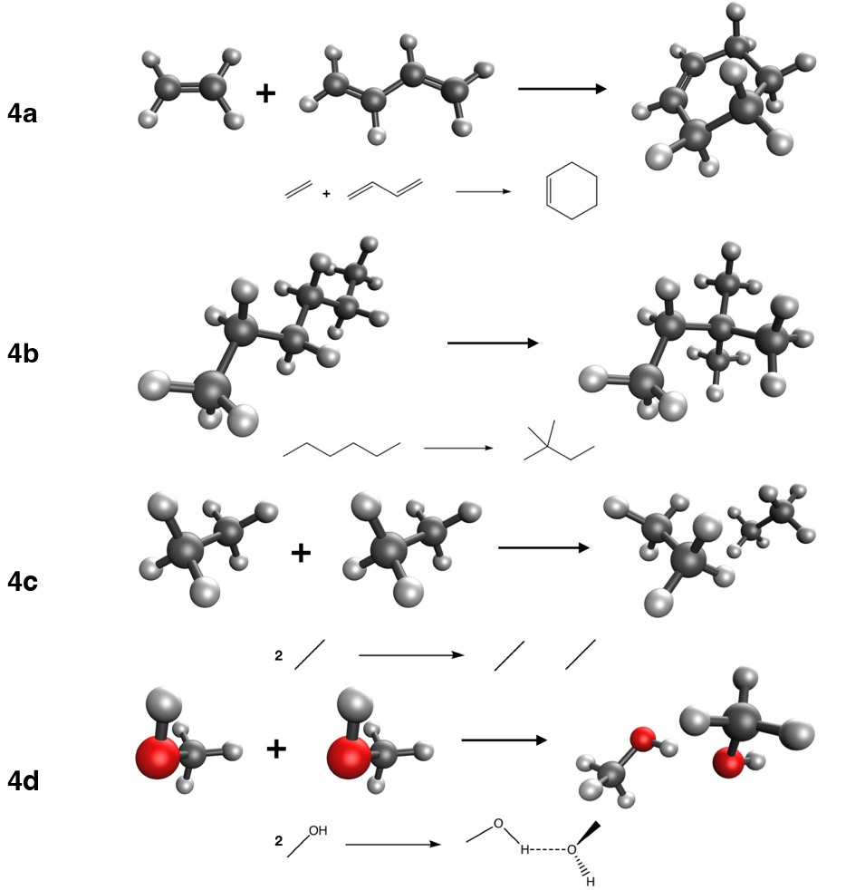

::: {.callout-note}
## Learning goals

After this class you should be able to:

- explain why most methods give small errors for the reactions of Experiment 3, and why LSDA and Hartree–Fock are the usual exceptions;
- read the cost-vs-accuracy chart and explain why hybrids cost more per SCF cycle than (meta-)GGAs;
- derive the −C₆/R⁶ form of the London dispersion energy from a model of two coupled oscillators;
- explain why semilocal functionals and Hartree–Fock cannot describe dispersion;
- describe how the -D4 correction works (pairwise C₆ terms, damping, charge dependence, three-body term) and how nonlocal VV10/rVV10 correlation differs from it;
- explain why intramolecular dispersion matters for branched alkanes;
- start Experiment 4 knowing what each reaction tests.
:::

# Part 1 · Looking back at Experiment 3

::: {.callout-important}
## Read this after you submit Experiment 3
This part discusses the trends you probably saw in [Experiment 3](../experiments/ex03-organic-a.qmd). If you have not submitted it yet, stop here and come back later.
:::

## The "easy" reactions really were easy

In Experiment 3 you computed four small energy differences: two rotational barriers (3a ethane, 2.73 kcal/mol; 3b methanol, 1.01 kcal/mol), a conformational change of butane-1,4-diol that breaks an intramolecular hydrogen bond (3c, 3.29 kcal/mol), and the *cis*→*trans* isomerization of pent-2-ene (3d, −1.15 kcal/mol). The 16 methods range from LSDA to hybrid meta-GGAs, plus Hartree–Fock.

What you probably saw on the *signed error* chart is a sea of very short bars. For 3a, 3b and 3d, nearly every method lands within a few tenths of a kcal/mol of the reference, whatever its rung. The ranking among the best methods changes from reaction to reaction, and the differences between them are often smaller than 0.1–0.2 kcal/mol. Differences that small are close to the uncertainty of the reference values and of your own numerical settings, so they should not be over-interpreted.

### Why: error cancellation

The explanation is the one we anticipated in [Class 7](l07-benchmarking.qmd). Each reaction compares two forms of the *same* molecule. The number of electrons, the bonds, the lone pairs and the core orbitals are identical on both sides. An approximate functional makes errors in describing each of these features, but it makes nearly the same errors in the reactant and in the product. When you compute ΔE = E(product) − E(reactant), those errors cancel. What remains is the error in describing the small *change* in the density, and that change is small and local.

This is the most powerful idea in practical quantum chemistry. It is also fragile, because it depends on the reaction, not on the method. Nobody can tell in advance, from the reaction type alone, whether a conformational change will be easy. That is why we benchmark.

### The usual outliers: butane-1,4-diol, LSDA and HF

Reaction 3c is the one where the sea of short bars breaks up. In conformer B1 the two OH groups form an intramolecular hydrogen bond; in B43 they do not. So 3c measures, roughly, the energy of one hydrogen bond plus some conformational strain. A change in a noncovalent interaction does not cancel.

The two methods that most often stand out are at the two ends of the ladder:

- **LSDA (SPW92)** is known to **overbind** hydrogen bonds and, more generally, to give too much attraction wherever two densities overlap weakly. The uniform-electron-gas model has no way to tell a weak, stretched interaction from a real bond. For 3c this makes the hydrogen-bonded conformer too stable, so the energy to break the H-bond comes out too large.
- **Hartree–Fock** has no correlation. A hydrogen bond is mostly electrostatics, which HF describes reasonably, but the correlation and dispersion parts are missing, so HF tends to **underbind**. Its error on 3c has the opposite sign to LSDA's.

The modern hybrid and meta-GGA functionals usually describe the hydrogen bond well. You may also have noticed that -D4 changed the numbers in Experiment 3 very little. The dispersion energy depends on interatomic distances, and the distances barely change in a rotation or in a cis–trans isomerization, so the -D4 contribution nearly cancels too. In 3c, where the molecule changes shape more, -D4 makes a slightly larger difference.

## Cost vs accuracy

The *cost vs accuracy* chart plots the MAE against the time per SCF cycle on a log axis. You probably saw something like this:

- **SPW92 and the GGAs** are the cheapest per cycle. They need only the density and its gradient on the integration grid.
- **Meta-GGAs** cost slightly more: they need τ on the grid too, and are often run on finer grids (Class 11).
- **Hybrids** are clearly more expensive per cycle. They need the HF exchange matrix K, built from the four-index two-electron integrals, and that step dominates.
- **Range-separated hybrids** (ωB97M-V, M11) need extra integrals for the long-range exchange, and **VV10** (B97M-V, ωB97M-V) adds a double integral over grid points. These are usually the most expensive per cycle.
- **HF** needs K but no grid at all, so it costs about the same as a hybrid.
- **B3LYP is not special.** It costs about the same as B3PW91 and PBE0, because cost is set by the rung (and by the HF exchange), not by the name.

The ideal method sits bottom-left. For Experiment 3, cheap methods are almost as accurate as expensive ones, because error cancellation does most of the work. The ranking will look very different in Experiments 4 and 5. Keep your chart: comparing it with the next two is the real lesson.

::: {.callout-warning}
## Common mistake: generalizing from easy reactions
"SPW92 was fine for the ethane barrier, so LSDA is good enough" is wrong. Experiment 3 tells you that *conformational energies with similar bonding* are easy. It says almost nothing about reactions where bonds or noncovalent contacts change.
:::

# Part 2 · Dispersion and noncovalent interactions

## Noncovalent interactions

Noncovalent interactions are the forces between molecules (and between distant parts of the same molecule) that do not involve sharing electrons in a bond. They are weak, typically 0.1–10 kcal/mol per contact, but they decide the structure of DNA, the folding of proteins, the packing of crystals, and the binding of a drug to its target. The total interaction energy is often split into four physical contributions:

1. **electrostatics**: the classical interaction between the charge distributions of the two monomers (charges, dipoles, quadrupoles);
2. **exchange (Pauli) repulsion**: electrons with the same spin cannot occupy the same region; it grows roughly exponentially as the densities overlap;
3. **induction (polarization)**: each monomer's density is distorted by the field of the other;
4. **dispersion**: the attraction between correlated, instantaneous fluctuations of the electron clouds.

A hydrogen bond, like the one in the methanol dimer, is dominated by electrostatics, with important induction and dispersion parts. The interaction between two alkanes, like the ethane dimer, is almost purely dispersion balanced by Pauli repulsion: ethane has no dipole moment and no hydrogen-bond donors or acceptors.

## The physics of London dispersion

### Fluctuating dipoles

Even a perfectly spherical atom, like argon, has an instantaneous dipole moment at every moment, because its electrons move. On average the dipole is zero. But an instantaneous dipole on atom A creates an electric field at atom B, which induces a dipole on B. The two dipoles are aligned so that they attract. The motions of the electrons on A and B become **correlated**, and the correlation lowers the energy. This is the picture Fritz London gave in 1930 [@london1930]: dispersion is an electron correlation effect between two distant regions of space.

### A model: two coupled oscillators

The simplest model that captures the physics is the **Drude model**. Represent each atom by a charge −q bound to a nucleus by a spring of force constant k = mω₀², so that it oscillates with frequency ω₀. The static polarizability of such an oscillator is α = q²/k. Put two of these oscillators a distance R apart, and let the charges move only along the line that joins them (a one-dimensional model). The dipole–dipole interaction between the displacements x₁ and x₂ is

$$
V = -\frac{2q^2 x_1 x_2}{R^3}.
$$ {#eq-dd}

The Hamiltonian of the two coupled oscillators can be separated into two normal modes, x₁ ± x₂, with frequencies

$$
\omega_\pm = \omega_0\sqrt{1 \mp \frac{2\alpha}{R^3}} .
$$ {#eq-modes}

Quantum mechanics says each oscillator keeps a zero-point energy ħω/2 even in its ground state. The total zero-point energy of the pair is (ħ/2)(ω₊ + ω₋). Expanding the square roots for large R with √(1 + x) ≈ 1 + x/2 − x²/8, the first-order terms cancel and the second-order terms do not:

$$
\frac{\hbar}{2}(\omega_+ + \omega_-) \approx \hbar\omega_0 - \frac{\hbar\omega_0}{2}\,\frac{\alpha^2}{R^6}.
$$ {#eq-zpe}

The first term is just the energy of two separate oscillators. The second is the interaction:

$$
E_\text{disp} = -\frac{\hbar\omega_0\,\alpha^2}{2R^6} \quad\text{(1D model)}, \qquad
E_\text{disp} = -\frac{3\hbar\omega_0\,\alpha^2}{4R^6} \quad\text{(3D model)}.
$$ {#eq-london}

Three lessons come out of this simple calculation.

1. Dispersion is **always attractive**.
2. It decays as **R⁻⁶**. We write E~disp~ = −C₆/R⁶, with a **dispersion coefficient** C₆.
3. It is a **quantum** effect: it comes from the change in zero-point energy. Classical static charge distributions with no dipole would not interact at all.

The model also tells us what C₆ depends on: the **polarizability** α (how easily the electron cloud is distorted) and a characteristic excitation energy ħω₀. London approximated ħω₀ by the ionization energy I, which gives the famous **London formula** for two different atoms:

$$
C_6^{AB} \approx \frac{3}{2}\,\frac{I_A I_B}{I_A + I_B}\,\alpha_A\alpha_B .
$$ {#eq-london-formula}

The exact expression, due to Casimir and Polder [@casimir1948], integrates the frequency-dependent polarizabilities at imaginary frequency:

$$
C_6^{AB} = \frac{3}{\pi}\int_0^\infty \alpha_A(i\omega)\,\alpha_B(i\omega)\,d\omega .
$$ {#eq-casimir-polder}

Large, soft, polarizable atoms (Xe, I, S) have large C₆; small, hard ones (He, Ne, H) have small C₆. That is why boiling points rise down a group, and why long alkanes are liquids or solids while methane is a gas.

::: {.callout-tip}
## Worked example: the size of dispersion between two argon atoms
The C₆ coefficient of the argon dimer is about 64.3 E~h~ a₀⁶. Convert it to kcal/mol Å⁶ using 1 E~h~ = 627.5095 kcal/mol and 1 a₀ = 0.529177 Å, so 1 a₀⁶ = 0.529177⁶ Å⁶ = 0.021958 Å⁶:

$$
C_6 = 64.3 \times 627.5095 \times 0.021958\ \text{kcal mol}^{-1}\,\text{Å}^6 = 886\ \text{kcal mol}^{-1}\,\text{Å}^6 .
$$

At the equilibrium distance of Ar₂, R ≈ 3.76 Å, R⁶ = 3.76⁶ = 2.83 × 10³ Å⁶, and

$$
-\frac{C_6}{R^6} = -\frac{886}{2.83\times 10^{3}} = -0.31\ \text{kcal/mol}.
$$

The full well depth of Ar₂ is about 0.28 kcal/mol (Experiment 7 studies this curve). The dispersion attraction is slightly larger than the well depth, because Pauli repulsion already cancels part of it at that distance.
:::

@fig-disp-models (a) shows a Lennard-Jones model of a rare-gas dimer. The minimum arises from the balance of a steep repulsion and the R⁻⁶ attraction. Without the attraction there is no minimum at all: the curve is purely repulsive.

{#fig-disp-models fig-alt="Two panels. Left: a Lennard-Jones potential with a minimum near 3.8 angstrom, and its repulsive and attractive parts as dashed curves. Right: the undamped minus C6 over R to the sixth diverges at short distance; the rational-damped curve levels off at a finite value; the zero-damped curve goes back to zero at short distance." width="100%"}

## Why semilocal DFT and Hartree–Fock miss dispersion

### Semilocal functionals

A GGA writes the exchange–correlation energy as a single integral over space:

$$
E_\text{xc}^\text{GGA}[\rho] = \int f\big(\rho(\mathbf r), \nabla\rho(\mathbf r)\big)\,d\mathbf r .
$$ {#eq-gga}

The energy density at each point depends only on the density and its gradient *at that point*. A meta-GGA adds τ(**r**), still at the same point. Now consider two argon atoms far apart, so that their densities do not overlap. At every point in space, the density is either that of atom A or that of atom B (or zero). The integral splits into a sum of two atomic integrals, and the interaction energy is exactly zero. As the atoms approach and the densities start to overlap, the semilocal functional "sees" the overlap, but this effect decays **exponentially** with distance, like the density tails, not as R⁻⁶.

Dispersion is a correlation between fluctuations at **r** in atom A and at **r′** in atom B, which may be far apart. A functional that looks only at one point at a time cannot know about it. This is a limitation of the *form* of the functional, not of its parameters.

Different semilocal functionals fail in different ways in the overlap region, where they can produce *spurious* binding or *spurious* repulsion. LSDA tends to overbind weakly interacting systems. PBE gives a little binding for some dispersion-bound complexes. B88 exchange (in BLYP, B3LYP) is quite repulsive, so BLYP and B3LYP often predict little or no binding for rare-gas and alkane dimers. None of these behaviors comes from real dispersion: they are side effects of how the exchange functional behaves where the density is small and varies quickly. Getting binding from LSDA is "right for the wrong reason".

### Hybrids

Hybrid functionals add a fraction of HF exchange, which is nonlocal. But dispersion is a *correlation* effect, and the correlation part of a hybrid is still semilocal. Hybrids miss dispersion just as GGAs do.

### Hartree–Fock

Hartree–Fock describes each electron in the average field of the others. Instantaneous, correlated fluctuations are exactly what the mean field leaves out, so HF has **no dispersion at all**. HF describes electrostatics, induction and Pauli repulsion, so it binds hydrogen-bonded or ionic complexes partially, but rare-gas and alkane dimers come out unbound. Experiment 1 already showed this for (HCl)₂.

### Wave-function methods

Correlated wave-function methods include dispersion naturally, because they include excitations on both monomers at once. MP2 includes it at second order (and tends to overestimate it for π stacks). CCSD(T) describes it accurately, which is why it provides the reference values for noncovalent databases such as S66 [@rezac2011; @rezac2016].

## How to put dispersion back into DFT

Three strategies are in use [@grimme2016; @grimme2011]. Experiment 4 compares all three.

### Strategy 1: pairwise corrections (-D)

The simplest idea is to add the London formula, atom pair by atom pair, to the DFT energy:

$$
E_\text{tot} = E_\text{DFT} + E_\text{disp}, \qquad
E_\text{disp} = -\sum_{A<B}\sum_{n=6,8} s_n\,\frac{C_n^{AB}}{R_{AB}^n}\,f_{\text{damp},n}(R_{AB}) .
$$ {#eq-dftd}

Here R~AB~ is the distance between atoms A and B, C₆^AB^ and C₈^AB^ are dispersion coefficients (the C₈/R⁸ term describes dipole–quadrupole fluctuations and matters at medium range), s~n~ are scaling factors fitted for each functional, and f~damp~ is a **damping function**. The correction depends only on the geometry, so it costs almost nothing and does not change the density or the orbitals. It adds energy (and forces, for geometry optimizations).

**Why damping?** The bare −C₆/R⁶ diverges at short distance (@fig-disp-models b). It would make molecules collapse. Moreover, at short and medium range the functional already describes some correlation; adding the full −C₆/R⁶ there would count it twice. The damping function switches the correction off where the functional is already doing the job. Two forms are common:

- **zero damping** sends the correction to zero at short range. D2 used a Fermi-type function of R/R₀, and the original D3 a similar "zero-damping" function.
- **rational (Becke–Johnson, BJ) damping** replaces R⁶ by R⁶ + R₀⁶, so the correction tends to a finite constant at short range [@grimme2011]:

$$
f_\text{damp,n}^\text{BJ}(R) = \frac{R^n}{R^n + (a_1 R_0^{AB} + a_2)^n}, \qquad R_0^{AB} = \sqrt{C_8^{AB}/C_6^{AB}} .
$$ {#eq-bj}

The parameters a₁, a₂ and s₈ are fitted for each functional, because each functional has its own amount of spurious short-range binding or repulsion. That is why the same -D4 correction gives different numbers on PBE and on B3LYP.

**A short history.** Grimme's first corrections (D, 2004, and D2, 2006 [@grimme2006b]) used fixed C₆ for each element. But the C₆ of carbon depends on its environment: an sp³ carbon in an alkane is less polarizable than an sp² carbon in benzene. D3 (2010) made C₆ depend on the **coordination number** of each atom, computed from the geometry [@grimme2010]. D3(BJ) added rational damping [@grimme2011].

**-D4, the version used in this course** [@caldeweyher2017; @caldeweyher2019], goes one step further. Its main ingredients are:

- **reference polarizabilities.** For each element, D4 stores frequency-dependent polarizabilities α(iω) of reference systems with different coordination numbers.
- **coordination and charge.** For each atom in your molecule, D4 interpolates between these references using the atom's coordination number *and its partial charge*. The charges come from a fast electronegativity-equilibration model that uses only the geometry. An anion-like atom is more polarizable (larger C₆) than a cation-like one, which D3 could not capture.
- **Casimir–Polder integration.** The atom-in-molecule α(iω) are combined with @eq-casimir-polder to give C₆^AB^ for every pair.
- **a three-body term.** The Axilrod–Teller–Muto term describes the dispersion among three atoms at once. It is usually repulsive for compact arrangements and matters for large molecules and molecular crystals.

In Q-Chem, -D4 is requested with `DFT_D = D4` on top of the functional (e.g., `METHOD = B3LYP`). The site's input generator does it for you.

### Strategy 2: nonlocal correlation functionals (VV10, rVV10)

The second strategy is to fix the functional itself, by adding a correlation term that couples two points of space:

$$
E_\text{c}^\text{nl} = \frac{1}{2}\iint \rho(\mathbf r)\,\Phi(\mathbf r, \mathbf r')\,\rho(\mathbf r')\,d\mathbf r\,d\mathbf r' + \beta N .
$$ {#eq-nl}

The **kernel** Φ depends on the distance |**r** − **r′**| and on the local density and its gradient at both points. The first functional of this kind was vdW-DF by Dion, Lundqvist and co-workers [@dion2004; @lee2010]. Vydrov and Van Voorhis built the simpler and more accurate **VV10** [@vydrov2010]. Its kernel has the form

$$
\Phi^\text{VV10} = -\frac{3}{2\,g\,g'\,(g+g')}, \qquad g = \omega_0(\mathbf r)\,R^2 + \kappa(\mathbf r), \quad R = |\mathbf r - \mathbf r'|,
$$ {#eq-vv10}

where ω₀(**r**) is a local excitation frequency built from the density and its gradient, and κ(**r**) controls the short-range behavior. For large R, g ≈ ω₀R², and Φ ≈ −3/(2ω₀ω₀′(ω₀+ω₀′)R⁶): the R⁻⁶ law is recovered, with C₆ coefficients that come from the density itself, not from a table. The kernel has two parameters, b and C; b in particular is adjusted for each host functional. The constant β is chosen so that the term vanishes for the uniform electron gas.

**rVV10** [@sabatini2013] is a revised form of the kernel that can be evaluated much faster (via a Fourier-space interpolation), with nearly the same accuracy. B97M-rV [@mardirossian2017rv] is B97M-V with rVV10 in place of VV10.

Compared with -D4, nonlocal functionals respond to the actual electron density (they "know" about charge transfer or unusual bonding), at the price of an extra double integral over the grid. This is why B97M-V and ωB97M-V cost more per SCF cycle.

### Strategy 3: fitted functionals

The third strategy is to include noncovalent complexes in the training set of a highly flexible functional, and let the fit find parameters that reproduce their binding energies. Many Minnesota functionals (M06-2X, M11, MN15) work this way [@zhao2008; @peverati2011; @yu2016a]. They describe **medium-range** dispersion (the region around the equilibrium distance of most complexes) surprisingly well. But they are still semilocal (plus HF exchange) in their correlation, so they have no true R⁻⁶ tail at long range. Dispersion corrections for some Minnesota functionals have been proposed [@goerigk2011; @goerigk2015], but they are small by design.

| Strategy | Example in this course | Long-range R⁻⁶ | Depends on density? | Extra cost |
|---|---|---|---|---|
| none | PBE, B3LYP, BLYP | no | n/a | none |
| pairwise -D4 | PBE-D4, B3LYP-D4 | yes | no (geometry and model charges) | negligible |
| nonlocal VV10/rVV10 | B97M-V, ωB97M-V, B97M-rV | yes | yes | moderate |
| fitted | M06-2X, M11, MN15 | no | n/a | none |

: Four ways a functional can treat dispersion. {.striped}

::: {.callout-warning}
## Common mistakes about dispersion corrections
- "-D4 changes the orbitals." It does not. It adds an energy computed from the geometry (it does change optimized geometries, through the forces).
- "Adding -D4 always helps." It fixes missing dispersion. It cannot fix other errors of the functional, and if the functional already has spurious binding (or the basis has BSSE), adding -D4 can overbind.
- "The V in ωB97M-V means it is a meta-GGA." V stands for VV10, a correlation term. The rung is set by the exchange and by the ingredients.
:::

## Intramolecular dispersion: branched alkanes

Dispersion does not act only *between* molecules. Any two atoms that are a few ångström apart in the same molecule also attract each other. In a long, extended chain most atom pairs are far apart. In a compact, **branched** molecule, more atoms are at medium distance (1,3- and 1,4-contacts between C and H atoms), so the total intramolecular dispersion is larger.

This is part of the reason why branched alkanes are more stable than their linear isomers: for example, neohexane (2,2-dimethylbutane) lies below *n*-hexane. Schleyer and co-workers called the stabilizing 1,3-interactions in alkanes **protobranching**. The effect is small, a few kcal/mol, but it is a classic difficulty for DFT. In 2006 Grimme [@grimme2006alkanes] and Wodrich, Corminboeuf and Schleyer [@wodrich2006] showed that popular functionals such as B3LYP make systematic errors for the relative stability of alkane isomers, and that the errors grow with the size of the molecule. Missing medium-range correlation (dispersion) is one of the causes. Karton, Gruzman and Martin computed benchmark values for all the alkane isomers up to octane [@karton2009]; reaction 4b comes from that work, via the AlkIsomer11 subset of MGCDB84.

Notice how different this is from Experiment 3. There, the molecule changed shape but kept the same set of close contacts, so dispersion nearly cancelled. Here, the *number* of medium-range contacts changes.

## A reminder about BSSE

When you compute the binding energy of a dimer, E(dimer) − E(monomer A) − E(monomer B), BSSE makes the dimer artificially too stable (Class 7). With def2-TZVP the BSSE is much smaller than with double-ζ sets, but it is not zero, and for a dimer bound by 1–2 kcal/mol even a few tenths matter. We do not correct for it in Experiment 4. Class 10 defines the counterpoise correction that removes most of it.

# Experiment 4 briefing

## The goal

[Experiment 4](../experiments/ex04-organic-b.qmd) moves from "easy" to "medium" reactions. Reactants and products are now different molecules, or a complex and its separated parts, so error cancellation can no longer be taken for granted.

| Reaction | Description | ΔE~ref~ (kcal/mol) |
|---|---|---:|
| 4a | ethene + butadiene → cyclohexene (Diels–Alder) | −45.40 |
| 4b | *n*-hexane → neohexane | −2.49 |
| 4c | 2 ethane → (ethane)₂ | −1.34 |
| 4d | MeOH(A) + MeOH(B) → (MeOH)₂ | −5.81 |

: Reactions of Experiment 4. Data from the DARC and ADIM6 subsets of GMTKN55 [@goerigk2017] and the AlkIsomer11 and S66 subsets of MGCDB84 [@mardirossian2017]. {.striped}

{fig-alt="Ball-and-stick and line drawings of reactions 4a to 4d." width="75%"}

What each reaction tests:

- **4a, Diels–Alder.** Two π bonds become two new C–C σ bonds and one π bond moves. The bonding changes substantially between reactants and product. This is a test of how well a functional describes *bond formation*, not dispersion.
- **4b, alkane isomerization.** Same atoms, same bond types (all C–C and C–H single bonds), but a different number of medium-range contacts. A test of intramolecular dispersion and of subtle electronic effects in alkanes.
- **4c, ethane dimer.** Almost pure dispersion. A direct test of how each method treats dispersion.
- **4d, methanol dimer.** A hydrogen bond. Mostly electrostatics and induction, with a smaller dispersion part.

## Methods and jobs

The same 16 methods as Experiment 3, all with def2-TZVP. Ten molecules × 16 methods = **160 jobs**.

## What to watch out for

- **Directions and signs.** 4c and 4d are written as *monomers → dimer*, so the reference values are negative: a negative ΔE means the dimer is bound. A positive signed error for a dimer means it is bound **too weakly**.
- **Coefficients.** In 4c the ethane monomer counts twice: ν = −2. In 4a and 4d three species are involved.
- **Two different methanol monomers.** In 4d the monomers are cut from the dimer and have slightly different geometries, so compute both (A and B). Do not use one monomer twice.
- **Pairs of methods.** PBE/PBE-D4 and B3LYP/B3LYP-D4 differ only by the dispersion correction. The *Does -D4 help?* chart compares each pair directly.
- **The dimer chart.** The *binding of the two dimers* chart groups the methods by how they treat dispersion (none, D4, VV10, fitted). Before you look, write down what you expect for each group on 4c and on 4d, and why the two dimers might behave differently.
- Lock in your predictions on the experiment page before you run anything.

## Key points

- Conformational and cis–trans reactions are easy because errors cancel between two forms of the same molecule; noncovalent changes (like the H-bond in 3c) cancel less.
- LSDA overbinds weak interactions, HF underbinds them; neither is reliable for noncovalent chemistry.
- Hybrids cost more per SCF cycle than (meta-)GGAs because of the exchange matrix K; range separation and VV10 add more. B3LYP is not special in cost.
- London dispersion is an attractive correlation between fluctuating dipoles. It decays as −C₆/R⁶, with C₆ set by polarizabilities.
- Semilocal functionals and Hartree–Fock cannot describe dispersion: semilocal ones see one point at a time, HF has no correlation.
- -D4 adds damped pairwise −C₆/R⁶ and −C₈/R⁸ terms with coordination- and charge-dependent C₆, plus a three-body term. VV10/rVV10 add a nonlocal correlation functional of the density. Minnesota functionals capture medium-range dispersion by fitting.
- Damping prevents the divergence of −C₆/R⁶ at short range and avoids double counting with the functional.
- Intramolecular dispersion helps make branched alkanes more stable than linear ones, and is a known difficulty for popular functionals.

## Study questions

1. Why does adding -D4 change the reaction energies of Experiment 3 so little?
2. Explain, with the signs, why LSDA and HF tend to err in opposite directions on the hydrogen-bond-breaking reaction 3c.
3. Starting from @eq-modes, carry out the expansion and verify @eq-zpe. Why do the first-order terms cancel?
4. Use @eq-london-formula to explain why C₆ for two xenon atoms is much larger than for two neon atoms.
5. Two argon atoms are 5.0 Å apart. Using C₆ = 886 kcal mol⁻¹ Å⁶, compute the undamped dispersion energy. Is damping important at this distance? (Look at @fig-disp-models.)
6. Explain in your own words why a GGA gives zero interaction energy for two atoms whose densities do not overlap.
7. What is the role of the damping function in -D4? What would happen in a geometry optimization without it?
8. What does -D4 add over D3? Give one chemical situation where the difference should matter.
9. Compare -D4 and VV10: which one depends on the electron density, which is cheaper, and which one has an R⁻⁶ tail with coefficients computed from the density?
10. Why is a branched alkane stabilized more by dispersion than its linear isomer?

## Further reading

- S. Grimme, A. Hansen, J. G. Brandenburg and C. Bannwarth, "Dispersion-corrected mean-field electronic structure methods" [@grimme2016]. A complete review of dispersion corrections.
- E. Caldeweyher et al., the two -D4 papers [@caldeweyher2017; @caldeweyher2019].
- O. A. Vydrov and T. Van Voorhis, the VV10 paper [@vydrov2010].
- J. Řezáč and P. Hobza, "Benchmark calculations of interaction energies in noncovalent complexes and their applications" [@rezac2016].
- S. Grimme, "Seemingly simple stereoelectronic effects in alkane isomers and the implications for Kohn–Sham density functional theory" [@grimme2006alkanes].
