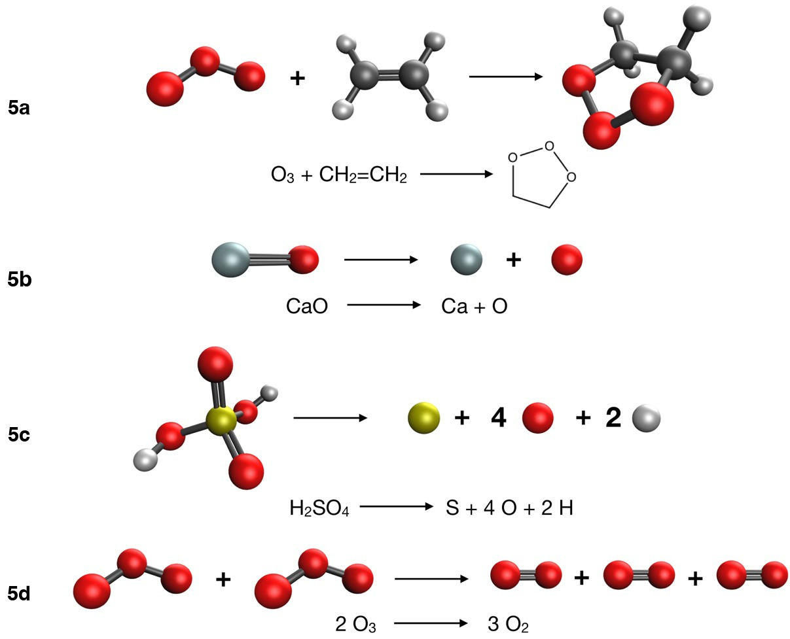

::: {.callout-note}
## Learning goals

After this class you should be able to:

- read the -D4 pair chart and the dimer chart of Experiment 4, and explain which reactions dispersion corrections help and why;
- explain why error cancellation breaks down when bonds are formed or broken;
- define the self-interaction error and the delocalization error, and list their chemical consequences;
- explain what static (nondynamic) correlation is and why a single-determinant method struggles with ozone, stretched bonds and CaO;
- explain why atomization energies are hard, especially for Hartree–Fock;
- assign the correct spin multiplicity to O, S, H, Ca and O₂ and set up unrestricted calculations;
- distinguish absolute and relative errors, and explain why a functional should not be judged on its own training set.
:::

This class may be taught over two meetings. The split point is marked in the text.

# Part 1 · Looking back at Experiment 4

::: {.callout-important}
## Read this after you submit Experiment 4
This part discusses the trends you probably saw in [Experiment 4](../experiments/ex04-organic-b.qmd). If you have not submitted it yet, stop here and come back later.
:::

## The big picture: errors got larger

Compare the *signed error* chart of Experiment 4 with the one from Experiment 3. The bars are longer, and they differ much more from method to method. The typical error has grown, sometimes by an order of magnitude. This is what happens when reactants and products are no longer two forms of the same molecule. Each reaction in Experiment 4 failed to cancel errors for a different physical reason, which is why it is worth looking at them one at a time.

## 4a: the Diels–Alder reaction

The Diels–Alder reaction (ethene + butadiene → cyclohexene, −45.40 kcal/mol) usually produces the largest absolute errors of the experiment. What you probably saw:

- Several older functionals, BLYP and B3LYP in particular, and also Hartree–Fock, make the reaction **not exothermic enough** (positive signed error), often by many kcal/mol.
- LSDA tends to err in the opposite direction (too exothermic), consistent with its general overbinding.
- The modern meta-GGAs and hybrid meta-GGAs usually do much better.
- -D4 helps B3LYP and PBE, but it does not remove the whole error.

Why is this reaction hard? Two π bonds turn into two new C–C σ bonds. The electron density changes substantially: a delocalized, conjugated π system in butadiene becomes localized single bonds in cyclohexene. Errors in describing a π bond and a σ bond are different, so they no longer cancel. In addition:

- **Delocalization error** (Part 2) makes approximate functionals overstabilize delocalized electrons, like the conjugated π system of butadiene. A reactant that is too stable makes the reaction too little exothermic.
- **Medium-range correlation** is larger in the compact, ring-shaped product than in the two separated reactants. A functional that misses it underestimates the stability of the product. This is the part -D4 can fix, and it explains why -D4 helps but is not enough.

## 4b: n-hexane → neohexane

This reaction keeps the same atoms and the same types of bonds, but neohexane is more compact. What you probably saw: functionals without any dispersion treatment (BLYP, BP86, B3LYP, B3PW91, PBE, PBE0) do not make neohexane stable enough, so their signed errors are positive and similar in size to the reaction energy itself. Adding -D4 shrinks the error substantially, and the VV10 functionals and the fitted Minnesota functionals are usually good. Hartree–Fock, with no correlation, is among the worst.

You may also have seen LSDA (SPW92) do surprisingly well here. That is the spurious overbinding of LSDA in regions of small overlap, which mimics the missing medium-range attraction. It is "right for the wrong reason", and it will not survive the next experiment.

## 4c and 4d: the two dimers

The *binding of the two dimers* chart sorts the methods by how they treat dispersion. Remember that positive ε means the dimer is bound too weakly.

For the **ethane dimer (4c)**, which is held together almost only by dispersion:

- methods with **no dispersion** treatment bind too weakly. BLYP, BP86 and B3LYP give almost no binding, or even repulsion, because B88 exchange is repulsive in the overlap region. PBE gives a little binding from its exchange behavior, but not enough. HF does not bind at all;
- **-D4** and **VV10** usually bring the binding very close to the reference;
- the **fitted** Minnesota functionals usually get most of it, because similar complexes were in their training sets;
- **LSDA** tends to overbind.

For the **methanol dimer (4d)**, held together by a hydrogen bond, the picture is different. Most methods, even those without any dispersion term, are within about 1 kcal/mol, because the hydrogen bond is dominated by electrostatics and induction, which all methods describe reasonably. Dispersion is a smaller part of the binding, so -D4 changes it less, and in some cases slightly overbinds. The lesson is that "noncovalent" is not one thing: an interaction dominated by dispersion and one dominated by electrostatics respond differently to dispersion corrections.

## The -D4 pair chart

The *Does -D4 help?* chart pairs PBE with PBE-D4 and B3LYP with B3LYP-D4. What you probably saw: -D4 helps most where the *number of close contacts* changes, that is, 4c (two molecules come together) and 4b (a more compact isomer). It helps partially for 4a. It matters little for 4d. Overall, the MAE of each functional drops when -D4 is added. This matches the theory of Class 8: -D4 adds only dispersion, so it improves only what was wrong because of missing dispersion.

## Lessons of Experiment 4

1. Error cancellation weakens as the chemical change between reactants and products grows.
2. Dispersion corrections fix dispersion. They are cheap and should be used routinely with functionals that lack dispersion.
3. A method can be right for the wrong reason (LSDA on 4b). Check a method on several reactions before trusting it.
4. Bond formation (4a) is a different problem from dispersion, and needs a better functional, not a better dispersion correction.

# Part 2 · Why DFT fails

Experiment 5 contains reactions that are hard for nearly every functional. To understand why, we need three ideas: self-interaction (and delocalization) error, static correlation, and the special difficulty of atomization energies. All are discussed in the excellent review by Cohen, Mori-Sánchez and Yang [@cohen2012].

## Self-interaction error

### One electron should not repel itself

Consider a system with just one electron, like the hydrogen atom. There is no electron–electron interaction, so the exact energy contains only the kinetic energy and the attraction to the nucleus. In Kohn–Sham DFT the energy is

$$
E[\rho] = T_s[\rho] + E_\text{ne}[\rho] + J[\rho] + E_\text{xc}[\rho],
$$ {#eq-ks}

where J[ρ] is the classical Coulomb energy of the density with itself:

$$
J[\rho] = \frac{1}{2}\iint \frac{\rho(\mathbf r)\rho(\mathbf r')}{|\mathbf r - \mathbf r'|}\,d\mathbf r\,d\mathbf r' .
$$ {#eq-J}

For one electron, J is not zero: it is the repulsion of the electron's density with itself, a spurious **self-interaction**. The exact functional cancels it exactly:

$$
J[\rho_1] + E_\text{xc}[\rho_1] = 0 \quad \text{for any one-electron density } \rho_1 .
$$ {#eq-sic}

In Hartree–Fock, the condition holds automatically, because the Coulomb and exchange integrals of an orbital with itself are equal (J~ii~ = K~ii~, Class 4). Approximate functionals (LSDA, GGAs, meta-GGAs) do not satisfy @eq-sic. Perdew and Zunger called the leftover the **self-interaction error** (SIE) and proposed an orbital-by-orbital correction for it [@perdew1981]. Hybrids reduce the SIE in proportion to their fraction of HF exchange, and range-separated hybrids, with 100% HF exchange at long range, remove it at long range.

### Many electrons: delocalization error

For many-electron systems the more useful concept is the **delocalization error** [@morisanchez2008]. Imagine allowing the number of electrons N to vary continuously, so that a system can hold a fractional number of electrons (think of a statistical mixture, or of one electron shared between two very distant fragments). The exact energy E(N) is a series of **straight lines** between integer values of N [@perdew1982]. Approximate functionals give curves instead (@fig-fractional):

- typical density functionals give curves that bow **below** the straight lines (they are convex). Fractional charges, and therefore electrons spread over too large a region, come out **too low in energy**. This is the **delocalization error**.
- Hartree–Fock gives curves that bow **above** the lines (concave). It favors electrons that are too localized: the **localization error**.

{#fig-fractional fig-alt="Plot of energy against electron number with three curves: straight line segments meeting at N0 for the exact energy, a curve sagging below them for approximate functionals, and a curve bulging above them for Hartree-Fock." width="80%"}

Hybrids mix the two behaviors, and their errors partly cancel. This is one reason why hybrids with 20–50% HF exchange perform well for thermochemistry.

### Chemical consequences

The delocalization error shows up in many places:

- **Stretched one-electron bonds.** For H₂⁺ at long distance, the exact answer is a proton plus a hydrogen atom, or equivalently half an electron on each side with the same energy. Approximate functionals favor the delocalized "half and half" state too much, and give a dissociation curve that is far too low at large distance. The same happens for other radical cations [@bally1997].
- **Barrier heights too low.** In a transition state, bonds are partly broken and electrons are more delocalized than in reactants. GGAs overstabilize the transition state and underestimate barriers, often by several kcal/mol. More HF exchange raises barriers, which is why functionals built for kinetics (M06-2X, for example) have a lot of it.
- **Charge-transfer complexes** and donor–acceptor systems are overbound, because partial charge transfer is overstabilized.
- **Conjugated and delocalized systems** are overstabilized relative to localized ones (we saw a hint of this in 4a).
- **Band gaps and orbital energies.** The HOMO energy of a GGA is much too high, and fundamental gaps are too small.
- **Odd-electron systems and radicals** with delocalized spin are overstabilized.

The delocalization error is a property of the *functional*. A larger basis does not help, and neither does -D4.

::: {.callout-note}
## Split point
If this class is taught over two meetings, the first meeting ends here, after the Experiment 4 debrief and self-interaction error. The second meeting starts with a short recap, then covers static correlation, atomization energies and the Experiment 5 briefing.
:::

## Static correlation and multireference character

### Dynamic and static correlation

In Class 4 we split the correlation energy into two kinds:

- **dynamic correlation**: electrons avoid each other at short range. Every system has it. A single determinant is a good starting point, and correlation adds small corrections from many excited determinants.
- **static (nondynamic) correlation**: the system cannot be described by a single determinant at all, because two or more electron configurations have similar energies and mix strongly. Systems like this are said to have **multireference character**.

### The textbook example: stretching H₂

At its equilibrium distance, H₂ is described well by one determinant with both electrons in the bonding orbital σ~g~. As the bond is stretched, the antibonding orbital σ~u~ comes down in energy, and the configurations σ~g~² and σ~u~² become degenerate. The exact wave function at long distance is an equal mixture of the two, which describes one electron on each atom. Restricted Hartree–Fock (RHF), stuck with σ~g~², puts both electrons on the same atom half of the time (H⁺ + H⁻) and gives a dissociation energy that is far too large. An unrestricted calculation (UHF or UKS) can break the symmetry and dissociate correctly, at the price of a wave function that is no longer a pure spin state (spin contamination, Class 12).

Approximate functionals are built for single-determinant Kohn–Sham systems. They capture dynamic correlation reasonably, and they mimic some static correlation through their exchange part, but systems with strong static correlation remain hard. They also make the reference values harder to compute: CCSD(T) itself becomes less reliable when the single-determinant starting point is poor.

### Where static correlation appears in Experiment 5

- **Ozone.** O₃ has partial **diradical character**: besides the main closed-shell configuration, a second configuration with two electrons promoted into a low-lying π* orbital has a large weight. This makes O₃ a classic multireference molecule. Reactions 5a (ozonolysis) and 5d (2 O₃ → 3 O₂) both involve it.
- **CaO.** Calcium oxide is a molecule with low-lying excited states and strongly mixed bonding (ionic Ca²⁺O²⁻ and less ionic configurations close in energy). Reaction 5b comes from MR-MGM-BE4, a subset of *multireference* main-group bond energies [@yu2015a].
- **Stretched bonds and bond breaking** in general, and **transition-metal compounds** (Class 12).

How do you know whether a molecule has multireference character? Diagnostics exist, for example the T₁ diagnostic from coupled cluster [@lee1989], or the fraction of the atomization energy that comes from the (T) triples. Large values are a warning: the reference values themselves may carry larger uncertainties, and DFT results should be treated with caution.

## Atomization energies and open-shell atoms

### Why atomization energies are hard

An **atomization energy** is the energy needed to separate a molecule into its atoms, for example

$$
\mathrm{H_2SO_4 \rightarrow S + 4\,O + 2\,H}, \qquad \Delta E = E(\mathrm S) + 4E(\mathrm O) + 2E(\mathrm H) - E(\mathrm{H_2SO_4}).
$$ {#eq-atomization}

Here all the bonds are broken at once, and the products are open-shell atoms while the reactant is a closed-shell molecule. This is the opposite of an isodesmic reaction: there is essentially **no error cancellation**. Every error in the description of each bond adds up. That is why atomization energies are the classic hard test for functionals, and the test on which Becke's first hybrid functionals were judged [@becke1993].

### Why Hartree–Fock fails dramatically

When atoms come together to form bonds, electrons pair up in the same region of space. A molecule therefore has *more* correlation energy than its separated atoms. Hartree–Fock has no correlation at all, so it misses this extra stabilization of the molecule and **severely underestimates atomization energies**. The error grows with the number of bonds, and for a molecule like H₂SO₄ it is enormous. For the same reason, HF is not a useful method for any reaction where the number of electron pairs changes.

### Open-shell atoms and their multiplicities

The atoms you will compute in Experiment 5 are open-shell, and their ground-state multiplicities follow Hund's rules:

| Species | Configuration | Ground state | Multiplicity 2S + 1 |
|---|---|---|---:|
| H | 1s¹ | ²S | 2 (doublet) |
| O | [He] 2s² 2p⁴ | ³P | 3 (triplet) |
| S | [Ne] 3s² 3p⁴ | ³P | 3 (triplet) |
| Ca | [Ar] 4s² | ¹S | 1 (singlet) |
| O₂ | (π\*)² | ³Σ~g~⁻ | 3 (triplet) |

: Ground-state multiplicities of the open-shell species (and Ca) in Experiment 5. {#tbl-mult .striped}

Two practical rules follow.

1. **Set the multiplicity correctly.** Line 2 of every .xyz file in this lab is "charge multiplicity". A triplet O atom run as a singlet gives a perfectly converged, perfectly wrong energy, too high by tens of kcal/mol, and every reaction that uses it is wrong.
2. **Use an unrestricted calculation** (`UNRESTRICTED = TRUE` in Q-Chem) for open shells, so that α and β electrons can have different orbitals. The generated inputs do this for you.

Open-shell atoms are hard for approximate functionals for additional reasons. The functional must describe **spin polarization** (different α and β densities) correctly. The p-shell of O and S is partly filled, and an approximate functional may give different energies for different ways of occupying the p orbitals, or break the spherical symmetry of the atom. The molecule, by contrast, is closed-shell. The errors in the two kinds of systems are different and do not cancel.

::: {.callout-tip}
## Worked example: an atomization energy from total energies
Suppose a calculation gives these total energies (illustrative numbers, not from any experiment in this course): E(H₂O) = −76.40000 E~h~, E(O, triplet) = −75.05000 E~h~, E(H, doublet) = −0.50000 E~h~. For H₂O → O + 2 H, with ν(H₂O) = −1, ν(O) = +1 and ν(H) = +2:

$$
\Delta E = (+1)(-75.05000) + (+2)(-0.50000) + (-1)(-76.40000) = -76.05000 + 76.40000 = 0.35000\ E_\text{h}.
$$

In kcal/mol: 0.35000 × 627.5095 = 219.63 kcal/mol. Note the sign: atomization is endothermic, so ΔE > 0. If the O atom had been run as a singlet, its energy would be too high, and the atomization energy would come out too large.
:::

## Absolute and relative errors

Reaction 5c, the atomization of sulfuric acid, has a reference value of 602.18 kcal/mol, by far the largest number in the course. A method that is "only" 1% off is wrong by about 6 kcal/mol. Is that good or bad?

- In **relative** terms (the relative error defined in [Class 7](l07-benchmarking.qmd)), 1% looks excellent, much better than a 0.3 kcal/mol error on a 1 kcal/mol rotational barrier (30%).
- In **absolute** terms, 6 kcal/mol is six times chemical accuracy. It would change an equilibrium constant by a factor of about $e^{6/0.5925} \approx 2.5\times 10^4$ at room temperature.

Chemistry is decided by absolute energies. Relative errors are useful to compare the difficulty of very different quantities, but they must never be used to excuse a large absolute error. Experiment 5 has a chart that shows the same errors in both ways.

## Training sets and fitted functionals

Many functionals contain parameters fitted to data (Class 6). B3LYP has 3; the Minnesota functionals have several dozen. The data used for the fit are the **training set**. A fitted functional reproduces its training set well *by construction*, so a good result on a training-set molecule is expected, not impressive. What matters for a user is how the functional performs on systems it was **not** fitted to.

Reaction 5b (CaO → Ca + O) belongs to the MR-MGM-BE4 subset of Minnesota Database 2015B [@yu2015a], and MN15 was parametrized on that database [@yu2016a]. Experiment 5 has a *spotlight* chart for this reaction. When you look at it, ask: is this result a test of MN15, or a check that the fit worked? The same caution applies to any benchmark: before you use a dataset to judge a functional, check whether it was part of the functional's training set.

::: {.callout-warning}
## Common mistakes in hard cases
- Running open-shell atoms as singlets, or with restricted orbitals.
- Using the wrong coefficient for the atoms: in 5c there are 4 O atoms and 2 H atoms (ν = +4 and +2).
- Expecting -D4 to fix everything. Dispersion corrections fix dispersion, not self-interaction or static correlation.
- Judging a functional by a single good result, especially on its own training data.
:::

# Experiment 5 briefing

## The goal

[Experiment 5](../experiments/ex05-difficult-cases.qmd) is the last experiment on functionals. It contains four reactions that look simple chemically (the largest molecules have only five atoms heavier than hydrogen) but are known to be hard for DFT.

| Reaction | Description | ΔE~ref~ (kcal/mol) |
|---|---|---:|
| 5a | O₃ + C₂H₄ → primary ozonide | −58.7 |
| 5b | CaO → Ca + O | 96.15 |
| 5c | H₂SO₄ → S + 4 O + 2 H | 602.18 |
| 5d | 2 O₃ → 3 O₂ | −67.60 |

: Reactions of Experiment 5. Data from the DC13 subset of GMTKN55 [@goerigk2017], the MR-MGM-BE4 and SMAE3 subsets of Minnesota 2015B [@yu2016a; @yu2015a], and W4-17 [@karton2017]. {.striped}

{fig-alt="Ball-and-stick drawings of reactions 5a to 5d." width="80%"}

For each reaction, think about which of the difficulties of Part 2 it contains: delocalization error, static correlation, open-shell atoms, no error cancellation. Some reactions contain more than one.

## Methods and jobs

The same 16 methods as Experiments 3 and 4, all with def2-TZVP. Twelve species × 16 methods = **192 jobs**. Note that 5a and 5d use two different ozone geometries (from two different databases), and that the O atom of 5b and the O atom of 5c also come from different databases: use the files listed for each reaction.

## What to watch out for

- **Multiplicities.** O, S and O₂ are triplets, H is a doublet, Ca and all the closed-shell molecules are singlets (@tbl-mult). The generated inputs already set the multiplicity and `UNRESTRICTED = TRUE`. If you build an input by hand, check line 2 of the .xyz file.
- **Coefficients.** In 5c, ν = −1 for H₂SO₄, +1 for S, +4 for O and +2 for H. In 5d, ν = −2 for O₃ and +3 for O₂.
- **SCF convergence.** Open-shell atoms and ozone can take more SCF cycles. Check that every job converged before using its energy.
- **The charts.** Besides the signed errors, you will see the *relative-error* chart, the *CaO spotlight* and the *easy → hard* chart, which combines your Experiments 3, 4 and 5 (from this browser) and shows how your functional-draft pick did.
- Lock in your predictions on the experiment page first: how much larger will the errors be, which method will win, and will -D4 help?

## Key points

- In Experiment 4 errors grew because reactants and products differ: bonds change in 4a, the number of close contacts in 4b and 4c.
- -D4 and VV10 fix missing dispersion (4b, 4c) but not errors in bond formation (4a); hydrogen bonds (4d) depend mostly on electrostatics.
- The self-interaction error is the spurious repulsion of an electron with itself; HF has none, approximate functionals do.
- The delocalization error makes approximate functionals overstabilize spread-out electrons: stretched radical cations, transition states, charge transfer, conjugated systems. HF has the opposite (localization) error.
- Static correlation arises when several configurations are nearly degenerate (stretched bonds, ozone, CaO); single-determinant methods struggle.
- Atomization energies have no error cancellation. HF underestimates them badly because molecules have more correlation energy than their atoms.
- Open-shell atoms need the right multiplicity (O, S triplet; H doublet; Ca singlet) and unrestricted orbitals.
- Absolute errors decide chemistry; relative errors can hide large absolute errors.
- A functional's result on its own training data is not an independent test.

## Study questions

1. Why did -D4 help much more for 4c than for 4d? Answer in terms of the physical components of each interaction.
2. Give two reasons why the Diels–Alder reaction 4a is harder for DFT than the ethane rotation 3a.
3. Write @eq-sic in words. Why does Hartree–Fock satisfy it automatically?
4. Sketch E(N) between N₀ − 1 and N₀ + 1 for the exact functional, a GGA and HF. Use your sketch to explain why GGAs underestimate reaction barriers.
5. Why is a GGA's dissociation curve for H₂⁺ too low at large distance?
6. Explain the difference between dynamic and static correlation, using H₂ at equilibrium and at a long bond length.
7. Why does Hartree–Fock underestimate atomization energies? Would you expect the error to grow or shrink for larger molecules?
8. Determine the ground-state multiplicity of N, C, F and Mg atoms. Which need an unrestricted calculation?
9. An atomization energy of 400 kcal/mol is computed with a 1.5% error. A conformational energy of 0.8 kcal/mol is computed with a 50% error. Which is the larger absolute error, and by how much?
10. A new functional reproduces a molecule's bond energy within 0.1 kcal/mol, and that molecule was in its training set. What can you conclude? What would you check next?

## Further reading

- A. J. Cohen, P. Mori-Sánchez and W. Yang, "Challenges for density functional theory" [@cohen2012]. The best review of delocalization error and static correlation.
- P. Mori-Sánchez, A. J. Cohen and W. Yang, "Localization and delocalization errors in density functional theory" [@morisanchez2008].
- J. P. Perdew and A. Zunger, the original self-interaction-correction paper [@perdew1981].
- E. R. Johnson, P. Mori-Sánchez, A. J. Cohen and W. Yang, "Delocalization errors in density functionals and implications for main-group thermochemistry" [@johnson2008].
- K. H. Hopmann's editorial in *Organometallics* on what makes a computational study useful [@hopmann2019]: "Do not use DFT for mechanisms it cannot handle."
