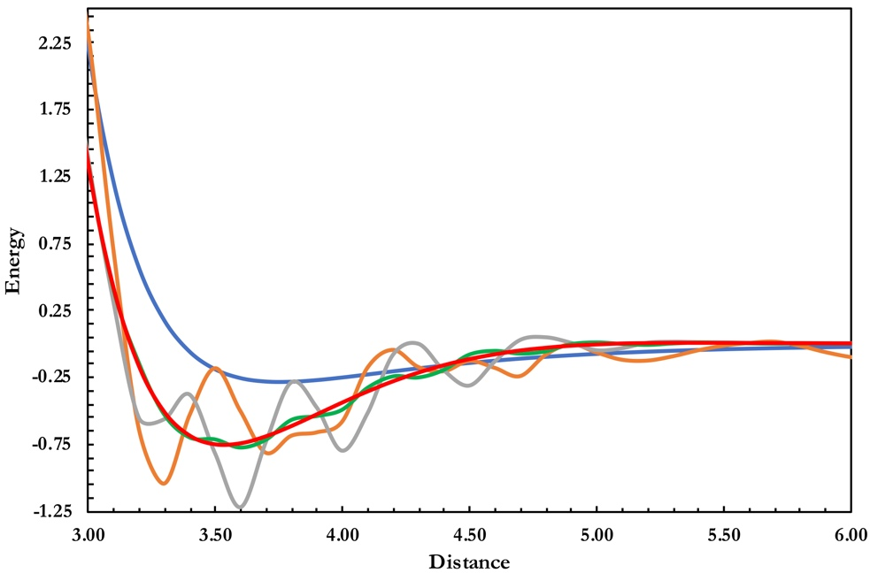

::: {.callout-note}
## Learning goals
After this lecture you should be able to:

- explain why B3LYP/6-31G\* can beat B3LYP/def2-TZVP for one reaction and fail badly for another, and why that should worry you;
- explain why the exchange–correlation energy has to be computed numerically, while the Hartree–Fock energy does not;
- describe Becke's partition of a molecule into fuzzy atomic cells, and the radial × angular grid built on each atom;
- read grid names such as (75,302), SG-1, SG-3 and `XC_GRID 000099000590`, and estimate how many points they contain;
- explain why meta-GGAs and heavily parametrized functionals need finer grids;
- plan and run Experiment 7, and collect its 480 results with the extraction script.
:::

# Part 1 · Looking back at Experiment 6

::: {.callout-important}
## Read this after you submit Experiment 6
This part discusses the trends you most likely saw in [Experiment 6](../experiments/ex06-b3lyp-631gs.qmd). Your own numbers may differ a little. What matters is the reason behind each trend.
:::

In Experiment 6 you ran B3LYP and B3LYP-D4 with four polarized double-ζ basis sets (6-31G\*, def2-SVP, cc-pVDZ and pc-1). You compared them with the def2-TZVP results from Experiments 4 and 5 on three reactions: the Diels–Alder reaction **4a** (reference −45.4 kcal/mol), the alkane isomerization **4b** (−2.49 kcal/mol) and the CaO dissociation **5b** (96.15 kcal/mol). The reactions were chosen because they react to a small basis in three different ways.

## How to read the charts

The **MAE by basis set** chart shows one bar per basis set for each functional. If the variational principle were the whole story, the bars would get shorter from double-ζ to triple-ζ for every reaction. The **Spot the anomaly** panel asked you to flag, before you saw the numbers, every cell where you expected a small basis to beat def2-TZVP. Each confirmed anomaly is a small basis "winning". The **How big is each basis?** table counts the basis functions for one molecule. It reminds you that "double-ζ" is a family name, not a size.

## Three reactions, three behaviors

**4a, the Diels–Alder reaction.** Most of you probably found that B3LYP/6-31G\* is *closer* to the reference than B3LYP/def2-TZVP, and by a wide margin. This is not because 6-31G\* is a better basis. At a nearly converged basis, B3LYP makes this reaction too little exothermic: it has no dispersion ([Lecture 8](l08-dispersion.qmd)), and it has a known tendency to underbind when π bonds turn into σ bonds. A small basis makes an error of its own, and here that error has the opposite sign. The product, cyclohexene, is one compact molecule with two new C–C σ bonds. With a small basis it can "borrow" functions from neighboring atoms more than the two separate reactants can (the intramolecular cousin of basis-set superposition error, [Lecture 10](l10-error-cancellation.qmd)). A small basis therefore favors the product and makes the reaction more exothermic. Two errors with opposite signs cancel, and the result looks good.

**4b, n-hexane → neohexane.** Here the small bases probably gave nearly the same answer as def2-TZVP. Both sides of the reaction have the same number and kind of bonds, so the basis-set errors almost cancel between reactant and product. B3LYP's error for this reaction is mostly the missing intramolecular dispersion, which no basis set can supply. -D4 fixes most of it.

**5b, CaO → Ca + O.** This is where 6-31G\* probably failed badly, by tens of kcal/mol, while the other double-ζ sets stayed in a more reasonable range. CaO is a strongly ionic molecule (close to Ca²⁺O²⁻), and the products are two neutral atoms. Nothing on one side of the reaction resembles the other side, so there is no cancellation to rely on. The 6-31G\* set for calcium is a much later addition to the Pople family [@rassolov2001] than the sets for C, H and O, and it describes the ionic molecule and the separated atoms very unevenly. The other three double-ζ families were built to be more balanced across the periodic table [@weigend2005; @jensen2001].

::: {.callout-warning}
## Common mistake: "the small basis wins, so it's better"
A small basis that beats a large one for a single reaction tells you that two errors cancelled. It tells you nothing about the next reaction. Experiment 6 showed both outcomes with the *same* functional and basis: help for 4a, a disaster for 5b. A method you can trust gets better, or at least not worse, as the basis grows.
:::

## -D4 with a small basis

With def2-TZVP, adding -D4 to B3LYP improves 4a and 4b, as you saw in Experiment 4. With the double-ζ sets the picture is muddier, and for some reactions -D4 probably made things worse. The reason is **double counting**. Basis-set superposition error acts like an artificial attraction between fragments that are close together. Dispersion is a real attraction between the same fragments. A small basis already adds a fake version of the effect, and -D4 then adds the real one on top. The sum overbinds. Dispersion corrections are fitted with large basis sets, where BSSE is small, so they are meant to be used with them.

## Not all double-ζ sets are equal

The basis-function table showed that 6-31G\* is the smallest of the four sets for cyclohexene. Its "\*" adds *d* functions on carbon only, with no polarization functions on hydrogen. def2-SVP, cc-pVDZ and pc-1 all put *p* functions on hydrogen, so they are larger even though they share the "polarized double-ζ" label. Size alone did not decide which basis gave the smallest error, which is one more sign that the errors you saw were not systematic.

## Lessons from Experiment 6

1. **Converge the basis first, then judge the functional.** A functional's error is only meaningful at (or near) the complete-basis-set limit. In this course, def2-TZVP is our practical stand-in for it.
2. **A small basis that wins is a warning, not a result.** Kruse, Goerigk and Grimme reached the same conclusion for B3LYP/6-31G\* on a much larger data set [@kruse2012].
3. **Corrections are designed for a context.** -D4 assumes a reasonable basis. Using it with 6-31G\* mixes a physical correction with an unphysical error.

The same logic returns today. The integration grid is a third numerical approximation, after the basis set and the SCF convergence threshold, and its errors can also hide or mimic chemistry.

# Part 2 · Numerical integration grids

## Why the exchange–correlation energy needs quadrature

Recall the Kohn–Sham energy (see [Lecture 5](l05-density-functional-theory.qmd)):

$$
E[\rho] = T_s[\rho] + E_{\mathrm{ne}}[\rho] + J[\rho] + E_{\mathrm{xc}}[\rho].
$$

All terms except $E_\mathrm{xc}$ reduce to integrals over Gaussian basis functions. The kinetic energy, the nuclear attraction and the Coulomb energy $J$ need one- and two-electron integrals such as $(\mu\nu|\lambda\sigma)$. The Gaussian product theorem ([Lecture 2](l02-basis-sets.qmd)) turns every one of them into a closed formula. Hartree–Fock exchange is built from the same two-electron integrals. That is why a Hartree–Fock calculation is exact for a given basis set, up to the SCF convergence threshold.

The exchange–correlation energy is different. In its simplest form, LSDA exchange,

$$
E_\mathrm{x}^\mathrm{LDA} = -\frac{3}{4}\left(\frac{3}{\pi}\right)^{1/3} \int \rho(\mathbf{r})^{4/3}\, d\mathbf{r},
$$

the integrand is the density to the power 4/3. The density is a sum of products of Gaussians, and a non-integer power of such a sum has no analytic integral. GGAs, meta-GGAs and every other rung of Jacob's ladder make the integrand even more complicated:

$$
E_\mathrm{xc} = \int f\big(\rho_\alpha, \rho_\beta, \nabla\rho_\alpha, \nabla\rho_\beta, \tau_\alpha, \tau_\beta\big)\, d\mathbf{r}.
$$

The only general way to evaluate it is **numerical quadrature**: replace the integral by a weighted sum over a finite set of points $\mathbf{r}_i$,

$$
E_\mathrm{xc} \approx \sum_{i=1}^{N_\mathrm{pts}} w_i\, f(\mathbf{r}_i).
$$ {#eq-quad}

The same points are used for the exchange–correlation potential in the Kohn–Sham matrix,

$$
V^\mathrm{xc}_{\mu\nu} = \int \chi_\mu(\mathbf{r})\, v_\mathrm{xc}(\mathbf{r})\, \chi_\nu(\mathbf{r})\, d\mathbf{r} \approx \sum_i w_i\, \chi_\mu(\mathbf{r}_i)\, v_\mathrm{xc}(\mathbf{r}_i)\, \chi_\nu(\mathbf{r}_i),
$$

at every SCF cycle. The set of points and weights is the **integration grid**. A finer grid gives a more accurate sum and costs more time. Unlike the basis set, the grid is **not variational**: a coarse grid can make the energy too high or too low, and the error does not shrink smoothly.

## The problem with molecules

A single, uniform 3D grid would be a terrible choice. The density has a sharp cusp at every nucleus and decays exponentially far away. Near a nucleus the integrand changes on a scale of hundredths of a bohr; in the bonding region, on a scale of a bohr. A grid fine enough for the core would waste millions of points in the valence region and in empty space.

Spherical grids centered on an atom work well for that atom. In spherical polar coordinates,

$$
\int F(\mathbf{r})\, d\mathbf{r} = \int_0^\infty r^2\, dr \int_{\Omega} F(r, \theta, \phi)\, d\Omega,
$$

so we need a set of **radial shells** and, on each shell, a set of **angular points**. A molecule has several nuclei, though, and each needs its own spherical grid. The question is how to combine them without counting any region twice.

## Becke's fuzzy cells

In 1988 Becke solved this problem in a way that almost every program still uses [@becke1988a]. The idea is to split the integrand into atomic pieces,

$$
F(\mathbf{r}) = \sum_A w_A(\mathbf{r})\, F(\mathbf{r}), \qquad \sum_A w_A(\mathbf{r}) = 1 \text{ at every point},
$$

and to integrate each piece $w_A F$ on the spherical grid of atom $A$. The weight $w_A(\mathbf{r})$ is close to 1 near nucleus $A$ and close to 0 near every other nucleus. The atoms are "fuzzy cells": like Voronoi cells, but with smooth boundaries.

For a pair of atoms $A$ and $B$ at distance $R_{AB}$, Becke defines the elliptical coordinate

$$
\mu_{AB}(\mathbf{r}) = \frac{|\mathbf{r} - \mathbf{R}_A| - |\mathbf{r} - \mathbf{R}_B|}{R_{AB}},
$$

which is −1 at nucleus $A$, +1 at nucleus $B$ and 0 on the plane halfway between them. He then applies the polynomial

$$
p(\mu) = \tfrac{3}{2}\mu - \tfrac{1}{2}\mu^3
$$

three times, $p_3(\mu) = p(p(p(\mu)))$, and defines the cell function

$$
s(\mu_{AB}) = \tfrac{1}{2}\big[1 - p_3(\mu_{AB})\big].
$$

Each application of $p$ makes the step sharper while keeping it smooth (@fig-becke b). The cell weight of atom $A$ is the product over all other atoms, normalized:

$$
P_A(\mathbf{r}) = \prod_{B \neq A} s\big(\mu_{AB}(\mathbf{r})\big), \qquad
w_A(\mathbf{r}) = \frac{P_A(\mathbf{r})}{\sum_C P_C(\mathbf{r})}.
$$

For atoms of different sizes, Becke shifts the boundary toward the smaller atom with an adjustment based on atomic radii. The full molecular integral becomes a double sum over atoms and their grid points:

$$
\int F(\mathbf{r})\, d\mathbf{r} \approx \sum_A \sum_{i \in A} w_A(\mathbf{r}_{Ai})\, w_i\, F(\mathbf{r}_{Ai}).
$$ {#eq-becke}

{#fig-becke fig-alt="Two plots. Left: the cell weight of atom A falls from 1 to 0 between atoms A and B, more sharply with more iterations, and the weight of B rises as a mirror image. Right: the cell function s(mu) as a sigmoid from 1 at mu = -1 to 0 at mu = +1 for k = 1, 2 and 3." width="100%"}

::: {.callout-tip}
## Worked example: weights at the midpoint
At the midpoint of a homonuclear diatomic, $\mu_{AB} = 0$. Then $p(0) = 0$, so $p_3(0) = 0$ and $s(0) = \tfrac{1}{2}$. Both atoms have $P = \tfrac{1}{2}$, and $w_A = w_B = \tfrac{1}{2}/(\tfrac{1}{2} + \tfrac{1}{2}) = \tfrac{1}{2}$. At a quarter of the way from $A$ to $B$ on the axis, $|\mathbf{r} - \mathbf{R}_A| = R/4$ and $|\mathbf{r} - \mathbf{R}_B| = 3R/4$, so $\mu = -\tfrac{1}{2}$. Then $p(-0.5) = -0.6875$, $p(-0.6875) = -0.8688$, $p(-0.8688) = -0.9753$, and $s = \tfrac{1}{2}(1 + 0.9753) = 0.988$. With $s(+\tfrac{1}{2}) = 1 - 0.988 = 0.012$ for atom $B$, $w_A = 0.988$. A point a quarter of the way along the bond belongs almost entirely to atom $A$.
:::

The key consequence for us: **the grid moves with the atoms.** Each atom carries its own spherical grid, and the cell weights change whenever the distance between two atoms changes. Keep this in mind for Experiment 7.

## The atomic grid: radial shells × angular points

**Radial shells.** The radial integral runs from 0 to ∞, so programs map it onto a finite interval and use a standard one-dimensional rule. Becke used Gauss–Chebyshev points $x_i$ in (−1, 1) mapped with $r = r_m (1 + x)/(1 - x)$, where $r_m$ is about half the atom's Bragg–Slater radius [@becke1988a]. Murray, Handy and Laming proposed an Euler–Maclaurin scheme that many programs, Q-Chem among them, still use [@murray1993]. Every good radial scheme places many shells close to the nucleus, where the density changes fastest, and only a few far away (@fig-radial).

{#fig-radial fig-alt="Four rows of tick marks, one row each for 23, 50, 75 and 99 radial shells, showing shells densely packed near r = 0 and increasingly far apart at larger r." width="100%"}

**Angular points.** On each shell the angular integral is done with a **Lebedev** grid [@lebedev1976]. Lebedev grids place points on the sphere with octahedral symmetry, and their weights are chosen so the grid integrates every spherical harmonic $Y_{lm}$ up to a certain degree $L$ exactly. They are the most efficient rules known for this job. Only certain sizes exist:

| Lebedev points | 110 | 194 | 302 | 590 | 974 |
|---|---:|---:|---:|---:|---:|
| exact up to degree $L$ | 17 | 23 | 29 | 41 | 53 |

: Common Lebedev grids. A grid of degree $L$ integrates all functions on the sphere that are combinations of $Y_{lm}$ with $l \le L$ exactly. {#tbl-lebedev}

**The notation $(n_r, n_\Omega)$.** A grid with $n_r$ radial shells and $n_\Omega$ Lebedev points on each shell is written $(n_r, n_\Omega)$. The grid (75,302) has 75 shells × 302 points = 22,650 points per atom. The grid (99,590) has 58,410 points per atom.

## Pruning

Close to a nucleus the density is almost spherical. Far from all nuclei it is small and smooth. Only in the valence region does the angular structure of bonds and lone pairs matter. A **pruned** grid uses this: it keeps the full angular grid only in the valence region and uses smaller Lebedev grids on the inner and outer shells. SG-1, for example, is built from a (50,194) grid by dividing the 50 shells into five regions with 6, 38, 86, 194 and 86 angular points [@gill1993]. Pruning removes about two thirds of the points with almost no loss of accuracy.

## Standard grids in Q-Chem

Q-Chem offers four **standard grids**, SG-0 to SG-3, selected with the `$rem` keyword `XC_GRID` [@qchemmanual]:

| Grid | `XC_GRID` | Pruned from | Points for a carbon atom | Introduced by |
|---|:-:|:-:|---:|---|
| SG-0 | 0 | (23,170) | ≈ 1,400 | @chien2006 |
| SG-1 | 1 | (50,194) | ≈ 3,800 | @gill1993 |
| SG-2 | 2 | (75,302) | ≈ 7,800 | @dasgupta2017 |
| SG-3 | 3 | (99,590) | ≈ 17,700 | @dasgupta2017 |

: The standard grids in Q-Chem. Point counts are for one carbon atom, as listed in the Q-Chem manual; they differ a little between elements. {#tbl-sg}

You can also ask for an unpruned grid directly. The value is written as two six-digit numbers glued together: the number of radial shells, then the number of Lebedev points. `XC_GRID 000099000590` means an unpruned (99,590) grid, and `XC_GRID 000075000302` an unpruned (75,302) grid. Experiment 9 uses this format.

The **default grid** depends on the program, its version and the functional. Recent Q-Chem versions use SG-1 for LSDA, most GGAs and hybrids, SG-2 for meta-GGAs and B97-based functionals, and SG-3 for Minnesota functionals [@qchemmanual]. Older versions used SG-1 for everything. Other programs have their own defaults. Because you can't be sure what a default means on a given server, **always set the grid explicitly and report it.**

::: {.callout-tip}
## Worked example: how many grid points for Ar₂?
With an unpruned (99,590) grid, each argon atom gets 99 × 590 = 58,410 points, so Ar₂ has 2 × 58,410 = 116,820. With SG-1 (pruned from 50 × 194 = 9,700 points per atom, roughly 40% kept), each atom has about 3,800–4,000 points. A calculation on a 50-atom organic molecule with SG-3 handles close to a million points at every SCF cycle. That is why programs screen out points where all basis functions are negligible.
:::

## How big is a grid error?

Grid errors in total energies are tiny on the scale of hartrees. They matter because reaction energies are small differences of large numbers, and the grid errors of the species in a reaction do not cancel reliably. Three effects make this worse:

1. **The grid moves with the atoms.** When a bond length changes, the points around each atom shift relative to the other atoms, and the cell weights change. The integration error changes erratically from one geometry to the next. A potential energy curve picks up small oscillations, or "wiggles", that have nothing to do with chemistry.
2. **Rotational variance.** A Lebedev grid has a fixed orientation in space. If you rotate a molecule while keeping the grid fixed, the energy changes slightly. Programs reduce this by putting every molecule in a standard orientation first. Two conformers or two molecules in a reaction have no common orientation, though, so the effect never vanishes completely.
3. **Derivatives are more sensitive than energies.** Forces and, especially, second derivatives amplify grid noise. Small vibrational frequencies (methyl rotations, soft torsions) can change by tens of cm⁻¹ or even become imaginary on a coarse grid. That matters when you compute thermal corrections ([Lecture 13](l13-theory-vs-experiment.qmd)).

::: {.callout-tip}
## Worked example: noise vs signal in Ar₂
The reference Ar₂ well depth in Experiment 7 is 0.28 kcal/mol. In hartree that is

$$
\frac{0.28\ \text{kcal/mol}}{627.5095\ \text{kcal/mol per } E_h} = 4.5 \times 10^{-4}\ E_h.
$$

The interaction energy is $\Delta E(r) = E(\mathrm{Ar}_2) - 2E(\mathrm{Ar})$, and each argon atom has a total energy of about −527 $E_h$. So the binding energy is less than one part in a million of the total energy. A grid error of only $10^{-4}\ E_h$ in $E(\mathrm{Ar}_2)$, about 0.06 kcal/mol, is already more than 20% of the well depth. For a reaction energy of 50 kcal/mol, the same error would be invisible.
:::

## Which functionals are grid-sensitive?

The quadrature error in @eq-quad depends on how smooth the integrand is. A smooth integrand is integrated well by few points; one with sharp features needs many. The integrand of a functional depends on its ingredients and on its functional form.

- **LSDA and GGAs** depend on $\rho$ and $\nabla\rho$. Their integrands are fairly smooth, and SG-1 is usually adequate for energies.
- **Meta-GGAs** also depend on the kinetic-energy density $\tau(\mathbf{r}) = \tfrac{1}{2}\sum_i |\nabla\phi_i(\mathbf{r})|^2$. Many use $\tau$ through a ratio such as $\alpha = (\tau - \tau_\mathrm{W})/\tau_\mathrm{unif}$, where $\tau_\mathrm{W} = |\nabla\rho|^2/8\rho$ is the von Weizsäcker kinetic-energy density. In the tails of the density and between atoms, $\alpha$ is a ratio of two small numbers. It varies rapidly and is numerically delicate.
- **Heavily parametrized functionals** expand their enhancement factors in power series with many fitted coefficients, often large and of alternating sign. The fit makes the functional accurate on its training set but can make the enhancement factor oscillate as a function of $\alpha$ or of the reduced gradient. Oscillations in the functional become structure in the integrand, which a coarse grid samples badly.

Both effects are well documented. Wheeler and Houk showed that the M06 family gives unreliable torsional profiles and reaction energies with the grids that were defaults at the time [@wheeler2010; @zhao2008]. Mardirossian and Head-Gordon examined two generations of Minnesota functionals and found that meta-GGAs, in particular the heavily parametrized ones, need much finer grids than GGAs [@mardirossian2016; @mardirossian2013]. More recently, Lehtola and Marques tested hundreds of functionals and found that many modern ones, including SCAN, converge impractically slowly with standard grids [@lehtola2022]. The design of a functional, not only its accuracy, decides how much grid it needs. Functionals designed with smoothness in mind, such as ωB97M-V, tend to be better behaved [@mardirossian2016a].

::: {.callout-note}
## Aside: functionals with nonlocal correlation
Functionals with VV10 nonlocal correlation (B97M-V, ωB97M-V, the "-V" family) need a double integral over two grid points. Programs evaluate this part on a second, usually coarser grid that you can set separately (in Q-Chem, `NL_GRID`). The `XC_GRID` keyword controls only the semilocal part.
:::

## Hartree–Fock needs no exchange–correlation grid

Hartree–Fock has no $E_\mathrm{xc}$. Its exchange energy is built from analytic two-electron integrals, so the HF energy does not depend on any grid. For a hybrid functional, the exact-exchange part is analytic and only the DFT part is on the grid. Hybrids with a large fraction of exact exchange are therefore often (not always) less grid-sensitive than their semilocal parents.

::: {.callout-note}
## Aside: grids in HF too?
Some programs speed up large Hartree–Fock and hybrid calculations by evaluating exchange *seminumerically*, on a grid (for example the COSX or "chain-of-spheres" method). Those calculations do have a grid dependence. In this course, Q-Chem's HF calculations are fully analytic.
:::

## What a finer grid costs

The time spent on the exchange–correlation part of each SCF cycle grows roughly in proportion to the number of grid points. With screening, it also grows only about linearly with the size of the molecule. The other parts of the cycle (Coulomb and exact-exchange integrals, diagonalization) don't depend on the grid. How much the *total* time grows from SG-1 to SG-3 therefore depends on the functional and the basis set. You will measure it in Experiment 7, so it's worth making a prediction first.

::: {.callout-warning}
## Common mistakes with grids
- **Mixing grids within one reaction.** Every species in a reaction energy must be computed with the same grid. Different grids, and even different radial schemes, give different absolute energies.
- **Trusting the default.** The default grid changes between programs and versions. If your methods section says "default grid", nobody can reproduce your numbers.
- **Blaming the functional for grid noise.** Wiggles in a potential curve, a spurious minimum, or a small imaginary frequency may be numerical. Check with a finer grid before you interpret them.
- **Thinking HF has grid noise.** If an HF curve wiggles, look for another cause (SCF convergence, a symmetry change, a wrong geometry).
:::

# Experiment 7 briefing

## Goal

[Experiment 7](../experiments/ex07-grids.qmd) asks a simple question: how fine a grid does each functional need before its answer stops changing? You will find out on the argon dimer, where the signal is very small and grid noise has nowhere to hide.

## The system and the reference

Ar₂ is held together only by dispersion. The geometries come from the RG10 subset [@tang2003] of MGCDB84 [@mardirossian2017]: 31 Ar–Ar distances from 3.0 to 6.0 Å in steps of 0.1 Å, plus the argon atom. The interaction energy at each distance is

$$
\Delta E(r) = E\big(\mathrm{Ar}_2(r)\big) - 2\,E(\mathrm{Ar}),
$$

with signed stoichiometric coefficients ν = +1 for the dimer and ν = −2 for the atom. The reference curve is repulsive at short range (+2.24 kcal/mol at 3.0 Å), has a single minimum of −0.28 kcal/mol at 3.7–3.8 Å, and approaches zero slowly (−0.02 kcal/mol at 6.0 Å). The full table is on the experiment page.

## Methods and jobs

| Setting | Value |
|---|---|
| Functionals | B3LYP, M06-L, M11-L, M11, ωB97M-V |
| Grids | SG-1, SG-2, SG-3 (`XC_GRID` 1, 2, 3) |
| Basis set | def2-TZVP (with def2-QZVP, the SG-3 jobs would not fit in the 10-minute limit) |
| Structures | 31 dimers + 1 atom = 32 |
| Jobs | 5 × 3 × 32 = **480**: seconds each with SG-1, a few minutes each with SG-2 and SG-3 |

Before you run anything, place the five functionals on Jacob's ladder ([Lecture 6](l06-jacobs-ladder.qmd)) and think about which ingredients each one uses. That is the basis for your predictions.

## Running 480 jobs without losing your mind

- **Work one functional and one grid at a time.** Run the 32 jobs of one curve, check that the curve looks reasonable, then go on.
- **Run the atom with every functional and every grid.** The atom's energy must come from the same functional and grid as the dimer. That's why there are 32 jobs per curve, not 31.
- **Check `XC_GRID` in the inputs.** The website's input generator writes it for you. If you build inputs by hand and forget it, you get the default grid, which is not SG-1, SG-2 or SG-3 in general.
- Your instructor may split the functionals across the class.

## Collecting the results with the script

Typing 480 total energies by hand is slow and error-prone. Experiment 7 is the only experiment where a script does it for you. Download [extract_ex07.py](../downloads/extract_ex07.py) and follow the instructions in the section [Collect your results with a script](../experiments/ex07-grids.qmd#sec-extract) of the experiment page. In short:

1. Put all your Experiment 7 output files in one folder (subfolders are fine).
2. Run `python3 extract_ex07.py <folder>` (macOS/Linux) or `py extract_ex07.py <folder>` (Windows). Google Colab works if you can't install Python.
3. The script reads every Q-Chem output, recognizes each job from the functional, `XC_GRID`, basis set and Ar–Ar distance that Q-Chem echoed, and writes `ex07_results.csv`. It never changes your outputs.
4. **Read the report it prints.** You need 32 usable jobs for every functional and grid, 480 in all. It lists missing jobs, failed or unconverged jobs (from which it takes no energy), duplicates and files it didn't recognize. Fix the problems and run it again.
5. On the results form, use **Import CSV** to load the file. The page computes every $\Delta E(r)$ and draws the curves.

::: {.callout-warning}
## Pitfalls with the script
- **Check its work** on two or three outputs, say one per grid: compare the total energy, SCF cycles and wall time with what you read in the file ([Guide 3](../guides/reading-output.qmd)). The numbers you submit are your responsibility.
- **Don't open the CSV in Excel and save it.** Excel may round the energies or change the separators. Import the file exactly as the script wrote it.
- **Keep your output files.** The CSV is a summary, not a replacement.
:::

## What to look at

The results page has three views:

- **Curves**: your $\Delta E(r)$ for each functional, one panel per grid, with the reference as a dashed black line. Use the zoom switch to look inside the well.
- **Wiggle report**: for each functional and grid, the number of minima ("smooth" means exactly one, like the reference), the RMS deviation from the reference, and the largest difference from the same functional on SG-3. The last number measures grid convergence without using the reference at all.
- **Timing**: the total wall time of each curve by grid.

@fig-vsxc, from the experiment page, shows what grid noise can look like for a functional that is *not* part of your set (VSXC). Your job is to find out which of your five functionals behave like this, and on which grids.

{#fig-vsxc fig-alt="Dissociation curves of Ar2 with the VSXC functional: coarse grids give oscillating curves with several spurious minima, while the finest grids give a smooth curve." width="560"}

Two questions to keep in mind while you work. First, a curve can be perfectly smooth and still wrong: grid convergence is not accuracy. Second, think about what the grid explorer on the experiment page shows. Why would a wiggle appear at one distance and not at the next?

## Key points

- B3LYP/6-31G\* can beat B3LYP/def2-TZVP when the basis-set error and the functional error cancel. The cancellation is luck: Experiment 6 showed it helping for 4a and failing badly for 5b.
- Dispersion corrections are designed for converged basis sets. With small basis sets, BSSE and -D4 can double count.
- The exchange–correlation energy has no analytic integral over Gaussians. It is computed by numerical quadrature on a grid of points around each atom, at every SCF cycle.
- Becke's scheme splits a molecule into fuzzy atomic cells with smooth weights. Each atom carries a radial × angular (Lebedev) grid, written $(n_r, n_\Omega)$.
- Pruned standard grids SG-0 to SG-3 are selected in Q-Chem with `XC_GRID` 0–3. `XC_GRID 000099000590` is an unpruned (99,590) grid.
- Grid errors are not variational. They change erratically with geometry because the grid moves with the atoms, and they are largest for small energy differences and for derivatives.
- Meta-GGAs (through τ) and heavily parametrized functionals need finer grids than GGAs. Hartree–Fock needs no exchange–correlation grid.
- Always set the grid explicitly, use the same grid for every species in a reaction, and report it.

## Study questions

1. For reaction 4a, B3LYP at the basis-set limit and the B3LYP/6-31G\* basis-set error have opposite signs. Explain, in terms of the reactants and the product, why a small basis tends to favor the product.
2. Why is the cancellation of basis-set errors nearly complete for 4b but absent for 5b?
3. Explain "double counting" between BSSE and -D4. Would you expect the same problem with def2-QZVP? Why or why not?
4. Show that Becke's polynomial $p(\mu) = \tfrac{3}{2}\mu - \tfrac{1}{2}\mu^3$ satisfies $p(\pm 1) = \pm 1$ and $p'(\pm 1) = 0$. Why are these properties useful for a cell function?
5. How many grid points per atom are in the unpruned grids (50,194), (75,302) and (99,590)? By what factor does the point count grow from the first to the last?
6. A colleague reports a reaction energy computed with "B3LYP/def2-TZVP, default settings". List what you would need to know about the grid to reproduce the number.
7. Explain, without equations, why the integration error changes from one Ar–Ar distance to the next.
8. Why are meta-GGAs more grid-sensitive than GGAs? Why can a heavily parametrized functional be more sensitive than a simple one on the same rung?
9. Would a Hartree–Fock Ar₂ curve show grid wiggles in Q-Chem? Would a B3LYP curve? Explain the difference.
10. Your geometry optimization with a meta-GGA ends with one small imaginary frequency of 25i cm⁻¹. What would you check before concluding that the structure is a transition state?

## Further reading

- A. D. Becke, "A multicenter numerical integration scheme for polyatomic molecules" [@becke1988a]. The original fuzzy-cell paper; short and readable.
- P. M. W. Gill, B. G. Johnson and J. A. Pople, the SG-1 paper [@gill1993], and S. Dasgupta and J. M. Herbert on SG-2 and SG-3 [@dasgupta2017]: how a standard grid is designed and tested.
- S. E. Wheeler and K. N. Houk on grid sensitivity of the M06 family [@wheeler2010], and N. Mardirossian and M. Head-Gordon on grid sensitivity of meta-GGAs [@mardirossian2016].
- S. Lehtola and M. A. L. Marques, "Many recent density functionals are numerically ill-behaved" [@lehtola2022].
- P. Morgante and R. Peverati, "The devil in the details" [@morgante2020]: the review behind several experiments of this course, including the grid experiment.
- H. Kruse, L. Goerigk and S. Grimme on why B3LYP/6-31G\* is "right for the wrong reasons" [@kruse2012].
- The Q-Chem manual, section on DFT numerical quadrature [@qchemmanual].
