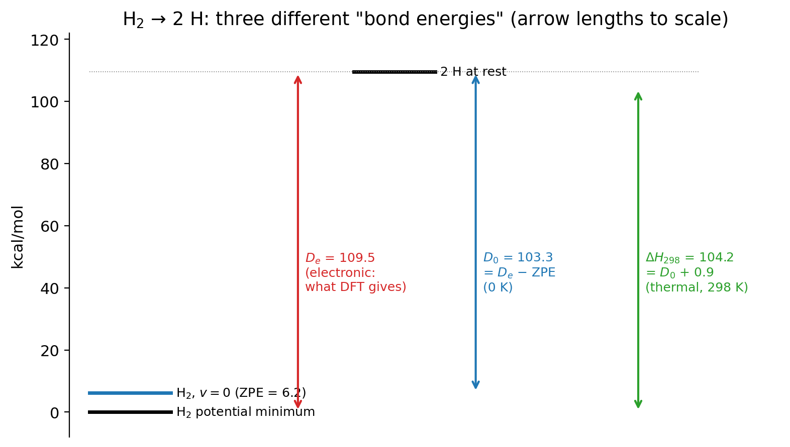

::: {.callout-note}
## Learning goals
After this lecture you should be able to:

- explain what stability analysis changed in Experiment 8, and why a stable solution can still be inaccurate;
- distinguish $\Delta E_\mathrm{el}$, $\Delta E_0$, $\Delta H_{298}$ and $\Delta G_{298}$, and say which one a Q-Chem single-point energy gives you;
- compute a zero-point energy and the thermal corrections of an ideal gas from harmonic frequencies;
- explain the difference between $D_e$ and $D_0$;
- compute a spin–orbit correction for an atom from its energy levels;
- explain why an atomization energy can't be compared directly with an enthalpy of formation, and connect the two with NIST data;
- plan Experiment 9.
:::

::: {.callout-note appearance="simple"}
**This lecture may take two meetings.** If it does, the natural split point is after @sec-thermal: the first meeting covers the Experiment 8 debrief and the thermal corrections, the second covers spin–orbit coupling, atomization energies, experimental data and the Experiment 9 briefing.
:::

# Part 1 · Looking back at Experiment 8

::: {.callout-important}
## Read this after you submit Experiment 8
This part discusses the trends you most likely saw in [Experiment 8](../experiments/ex08-stability.qmd). Your own numbers may differ. Focus on the reasons.
:::

## How much did stability analysis change?

Start with the **energy-lowering table**: E(with stability analysis) − E(without), for each functional and state. The typical picture is lopsided. For most functional/state pairs the number is 0.00: the first SCF solution was already stable. For one or two pairs it is large and negative, often tens of kcal/mol. In those cases the first SCF had landed on an unstable solution, typically a wrong occupation of the d orbitals, and the stability analysis found a much lower one. Hybrid functionals are often more prone to this: exact exchange makes the energy more sensitive to how the d electrons are arranged, which creates more competing solutions.

What happens to the excitation energy depends on *which* state was unstable. If only the ground state is lowered, the gap grows. If only the excited state is lowered, the gap shrinks. If both are lowered by different amounts, it can go either way. That is why you must check every species of a reaction, not just the one that "looks" difficult.

::: {.callout-warning}
## Common mistake: an energy that went up
If any number in your table was positive by more than a few hundredths of a kcal/mol, the two runs did not use the same settings (a different basis, a missing ECP, a different multiplicity). A stability analysis can't raise the energy.
:::

## Stable is not the same as accurate

Now look at the error chart. After stability analysis, every solution is a true minimum, but the errors that remain are probably still large, particularly for Fe, where errors of 10 kcal/mol or more are common. Stability analysis fixes a *numerical* problem: it makes sure you found the lowest solution of the equations you set up. It can't fix the *functional's* error.

For Fe, the excitation changes the configuration from 3d⁶4s² to 3d⁷4s¹: one electron moves from 4s to 3d. Approximate functionals are known to be biased in how they treat a localized d electron compared with a diffuse s electron, mostly through self-interaction error ([Lecture 9](l09-difficult-cases.qmd)). Many semilocal functionals make the 3d⁷4s¹ states too low, so they underestimate this excitation. Ru⁺ is a different case, and you probably saw smaller errors there for some functionals. One atom and one functional rarely tell the whole story.

## Why several functionals were removed

SPW92, B3LYP, SCAN, ωB97M-V and Hartree–Fock were taken out of Experiment 8 because their SCF calculations on these atoms often did not converge on the IQmol server. Near-degenerate d orbitals make the SCF oscillate between occupations. Better initial guesses, damping, level shifting or direct-minimization algorithms (Q-Chem's `SCF_ALGORITHM` options) often help, but they take experience. The lesson: for transition metals, expect convergence problems, always run a stability analysis, and get help from someone who has done it before [@cao2019].

## Spin-state energetics are a hard benchmark

The reference values you used came from atomic spectroscopy. They are among the most accurate numbers in this course, and still most functionals miss them by many kcal/mol. When a paper reports a spin-state gap or a metal–ligand bond energy computed with one functional, ask which functional, why, and whether anyone checked it against data for similar systems. That question returns in [Lecture 14](l14-choosing-a-method.qmd).

The reference values also raise a question we have avoided so far. An experiment measures an atom's energy levels, a molecule's heat of reaction, or a bond enthalpy at room temperature. Our calculations give an electronic energy at fixed nuclei. How are the two related? That is the subject of the rest of this lecture.

# Part 2 · From electronic energies to experiment

## What a single-point energy is

The "total energy" in a Q-Chem output is the electronic energy at fixed nuclei plus the nuclear repulsion ([Lecture 1](l01-molecular-schrodinger.qmd)):

$$
E_\mathrm{el}(\mathbf{R}) = \langle \Psi_\mathrm{el} | \hat H_\mathrm{el} | \Psi_\mathrm{el} \rangle + V_\mathrm{nn}(\mathbf{R}).
$$

It is the potential energy surface at one point $\mathbf{R}$: no nuclear motion, no temperature. Every reaction energy you have computed in this course is

$$
\Delta E_\mathrm{el} = \sum_i \nu_i\, E_{\mathrm{el},i},
$$

with signed stoichiometric coefficients. The benchmark references in Experiments 1–8 are values of this same quantity, derived from high-level calculations or from experiment after removing all the effects below. That is why you could compare directly.

An experiment never measures $\Delta E_\mathrm{el}$. Real molecules vibrate even at 0 K, and at room temperature they also translate, rotate and populate excited vibrational levels. Experiments report one of these:

| Quantity | What it includes | Typical source |
|---|---|---|
| $\Delta E_\mathrm{el}$ | electronic energy only, nuclei fixed at the minima | calculations; benchmark databases |
| $\Delta E_0$ (or $D_0$) | $\Delta E_\mathrm{el}$ + zero-point vibrational energy | spectroscopy (dissociation limits) |
| $\Delta H_T$ | $\Delta E_0$ + thermal energy at temperature $T$ + $\Delta(pV)$ | calorimetry, thermochemical tables |
| $\Delta G_T$ | $\Delta H_T - T\Delta S_T$ | equilibrium constants, electrochemistry |

: The energies a "reaction energy" can mean. {#tbl-energies}

## Zero-point energy and harmonic frequencies

Near a minimum, the potential energy surface is approximately quadratic in the nuclear displacements. Diagonalizing the mass-weighted matrix of second derivatives of $E_\mathrm{el}$ with respect to the nuclear coordinates (the *nuclear* Hessian, not the electronic one of [Lecture 12](l12-scf-stability.qmd)) gives $3N_\mathrm{atoms} - 6$ normal modes for a nonlinear molecule ($3N_\mathrm{atoms} - 5$ for a linear one), each with a harmonic wavenumber $\tilde\nu_k$. In Q-Chem this is `JOBTYPE FREQ`. It is only meaningful at a stationary point optimized with the same method and basis set. At a minimum all frequencies are real. An imaginary frequency marks a saddle point (or, if it is small, possibly grid noise; see [Lecture 11](l11-integration-grids.qmd)).

A quantum harmonic oscillator can't be at rest: its lowest level has energy $\tfrac{1}{2}hc\tilde\nu$. The **zero-point vibrational energy** of a molecule is the sum over modes,

$$
\mathrm{ZPE} = \frac{1}{2} \sum_k h c\,\tilde\nu_k .
$$

Atoms have no vibrations and no ZPE. A molecule always has some, so breaking bonds always *releases* zero-point energy, and

$$
\Delta E_0 = \Delta E_\mathrm{el} + \sum_i \nu_i\,\mathrm{ZPE}_i .
$$

For a diatomic, the **equilibrium dissociation energy** $D_e$ is measured from the bottom of the well, and the **spectroscopic dissociation energy** $D_0$ from the lowest vibrational level:

$$
D_0 = D_e - \mathrm{ZPE}.
$$

Harmonic frequencies from DFT are usually a few percent too high, partly because of anharmonicity and partly because of the functional, so they are often multiplied by an empirical scale factor. Anharmonicity lowers the real ZPE a little below the harmonic value.

::: {.callout-tip}
## Worked example: $D_e$ and $D_0$ of H₂
Spectroscopy gives, for H₂, the harmonic wavenumber $\omega_e = 4401.2$ cm⁻¹ and the anharmonicity constant $\omega_e x_e = 121.3$ cm⁻¹. The zero-point level of an anharmonic diatomic is $\tfrac{1}{2}\omega_e - \tfrac{1}{4}\omega_e x_e$:

$$
\mathrm{ZPE} = 2200.6 - 30.3 = 2170.3\ \text{cm}^{-1}.
$$

With 1 cm⁻¹ = 0.0028591 kcal/mol, $\mathrm{ZPE} = 6.21$ kcal/mol. The measured $D_0$ is 36118 cm⁻¹ = 103.27 kcal/mol, so

$$
D_e = D_0 + \mathrm{ZPE} = 103.27 + 6.21 = 109.48\ \text{kcal/mol},
$$

which matches the W4-11 reference you will use in Experiment 9 (109.5 kcal/mol). As a check from first principles: the exact nonrelativistic energy of H₂ at its equilibrium bond length is −1.17448 $E_h$, and each H atom has exactly −0.5 $E_h$. Then $D_e = 2(-0.5) - (-1.17448) = 0.17448\ E_h$, and $0.17448 \times 627.5095 = 109.49$ kcal/mol.
:::

## Thermal corrections from statistical mechanics {#sec-thermal}

At temperature $T$ molecules also carry thermal energy. For an ideal gas, statistical mechanics splits the molecular partition function into independent factors,

$$
q = q_\mathrm{trans}\, q_\mathrm{rot}\, q_\mathrm{vib}\, q_\mathrm{elec},
$$

and each factor gives a contribution to the internal energy $U$ and the entropy $S$. With the rigid-rotor, harmonic-oscillator model, the molar thermal energies above the zero-point level are:

$$
\begin{aligned}
E_\mathrm{trans} &= \tfrac{3}{2}RT, \\
E_\mathrm{rot} &= RT \ \text{(linear)}, \qquad \tfrac{3}{2}RT \ \text{(nonlinear)}, \\
E_\mathrm{vib} &= R \sum_k \frac{\theta_k}{e^{\theta_k/T} - 1}, \qquad \theta_k = \frac{hc\tilde\nu_k}{k_\mathrm{B}}, \\
E_\mathrm{elec} &\approx 0 \ \text{(unless low-lying excited states exist)}.
\end{aligned}
$$

For one mole of ideal gas $H = U + pV = U + RT$, so the enthalpy at temperature $T$ is

$$
H_T = E_\mathrm{el} + \mathrm{ZPE} + E_\mathrm{trans} + E_\mathrm{rot} + E_\mathrm{vib} + RT .
$$

At 298.15 K, $RT = 0.5925$ kcal/mol. An atom has only translation: $H_{298} - H_0 = \tfrac{5}{2}RT = 1.48$ kcal/mol. A diatomic adds rotation, $\tfrac{7}{2}RT = 2.07$ kcal/mol, plus a vibrational term that is negligible when $\tilde\nu$ is large. @fig-vib shows why: a stiff mode is "frozen" at room temperature, and only modes below a few hundred cm⁻¹ contribute much.

{#fig-vib fig-alt="Two plots against wavenumber from 0 to 4000 inverse centimeters. Left: zero-point energy rises linearly to about 5.7 kcal/mol. Right: thermal vibrational energy falls from about 0.55 kcal/mol at low wavenumber toward zero above 1500, below the dashed classical limit RT = 0.59." width="100%"}

::: {.callout-tip}
## Worked example: $\Delta H_{298}$ for H₂ → 2 H
Products: two H atoms, each $\tfrac{5}{2}RT$. Reactant: H₂, $\tfrac{7}{2}RT$ (its vibration, 4401 cm⁻¹, contributes nothing at 298 K). The thermal part of the reaction enthalpy is

$$
2 \times \tfrac{5}{2}RT - \tfrac{7}{2}RT = \tfrac{3}{2}RT = 1.5 \times 0.5925 = 0.89\ \text{kcal/mol}.
$$

So $\Delta H_{298} = D_0 + 0.89 = 103.27 + 0.89 = 104.16$ kcal/mol. The NIST WebBook gives $\Delta_f H^\circ_{298}(\mathrm{H}, g) = 217.998$ kJ/mol = 52.10 kcal/mol, and $\Delta_f H^\circ(\mathrm{H_2}) = 0$, so the experimental $\Delta H_{298} = 2 \times 52.10 = 104.20$ kcal/mol. The small difference comes from treating H₂'s rotation classically.
:::

@fig-levels puts the three numbers side by side. For H₂ the ZPE is the biggest correction, about 6 kcal/mol, and the thermal correction is under 1 kcal/mol. For molecules with many hydrogen atoms the ZPE becomes large: tens of kcal/mol for the atomization of methane.

{#fig-levels fig-alt="Level diagram for H2 to 2 H with three arrows: De = 109.5 kcal/mol from the bottom of the well, D0 = 103.3 from the zero-point level, and Delta H 298 = 104.2 including thermal energy." width="85%"}

## Entropy and Gibbs energy

The same partition functions give the entropy. Translation dominates, and it depends on the number of particles: breaking one molecule into two fragments gains a lot of translational entropy, about 30 cal mol⁻¹ K⁻¹ or more. At 298 K, $T\Delta S$ for a dissociation is typically 8–12 kcal/mol, so $\Delta G$ is much smaller than $\Delta H$. Vibrational entropy comes mostly from soft modes, and the harmonic model treats very soft modes (internal rotations, floppy ligands) poorly. That makes computed entropies and Gibbs energies more uncertain than enthalpies. In this course we compare energies and enthalpies only.

::: {.callout-warning}
## Common mistakes with thermochemistry
- **Frequencies at a non-optimized geometry.** The harmonic analysis assumes a stationary point of the same method. The geometries in our experiments come from benchmark databases, not from your functional, so we don't compute frequencies on them.
- **Mixing levels.** ZPE and thermal corrections are often computed with a cheaper method than the electronic energy. That's fine, but say so.
- **Comparing $\Delta E_\mathrm{el}$ with $\Delta H_{298}$.** For bond breaking the difference is several kcal/mol, larger than the chemical accuracy you are aiming for.
:::

## Spin–orbit coupling in atoms

Standard DFT, as used in this course, is nonrelativistic for the light atoms and scalar-relativistic for the heavy ones (Lecture 12). It ignores **spin–orbit coupling**, the interaction of the electron spin with its orbital motion. In an atom with orbital angular momentum $L > 0$ and spin $S > 0$, spin–orbit coupling splits the term into levels with total angular momentum $J = |L - S|, \dots, L + S$. A nonrelativistic calculation gives, approximately, the energy of the term *averaged* over all its levels. The real ground level lies below that average.

The **spin–orbit correction** is the difference between the lowest level and the degeneracy-weighted average:

$$
\Delta E_\mathrm{SO} = E_{J,\mathrm{lowest}} - \frac{\sum_J (2J+1)\,E_J}{\sum_J (2J+1)} .
$$

It is always negative (or zero). Atoms in S states (H, N) have $L = 0$ and no first-order correction. Closed-shell molecules have none either. Open-shell atoms such as C, O, Cl and Fe do.

::: {.callout-tip}
## Worked example: the spin–orbit correction of the oxygen atom
The ground term of O is ³P, with levels $J = 2$ at 0 cm⁻¹, $J = 1$ at 158.3 cm⁻¹ and $J = 0$ at 227.0 cm⁻¹. The weighted average is

$$
\bar E = \frac{5(0) + 3(158.3) + 1(227.0)}{5 + 3 + 1} = \frac{701.9}{9} = 78.0\ \text{cm}^{-1}.
$$

So $\Delta E_\mathrm{SO} = 0 - 78.0 = -78.0$ cm⁻¹ = $-78.0 \times 0.0028591 = -0.22$ kcal/mol. The same calculation for Cl (²P, $J = 3/2$ at 0 and $J = 1/2$ at 882.4 cm⁻¹) gives $-\,2(882.4)/6 = -294.1$ cm⁻¹ = −0.84 kcal/mol. For C it is −0.08 kcal/mol, and for Fe (⁵D, five levels up to 978 cm⁻¹) about −1.2 kcal/mol.
:::

Because the computed atoms are too high by $|\Delta E_\mathrm{SO}|$, a computed atomization energy without spin–orbit coupling is too *large* by the sum of the atomic corrections. For O₃ → 3 O, that is 3 × 0.22 = 0.66 kcal/mol. Benchmark references such as W4-11 report values with spin–orbit effects removed [@karton2011], so you can compare with them directly. An experimental number needs this correction first. For heavier atoms the correction grows quickly: for iodine it is several kcal/mol.

## Atomization energies and enthalpies of formation

The **total atomization energy** (TAE) of a molecule is the energy to separate it into ground-state atoms in the gas phase. For methane, CH₄ → C + 4 H. The **standard enthalpy of formation** $\Delta_f H^\circ$ is the enthalpy of forming the molecule from its *elements in their standard states* at 298.15 K and 1 bar: for methane, C(graphite) + 2 H₂(g) → CH₄(g).

The two are not the same reaction. Graphite and H₂ gas are not atoms. To connect them you need the enthalpies of formation of the gas-phase atoms, which are themselves experimental numbers:

$$
\Delta H_{298}(\text{atomization of M}) = \sum_\text{atoms} \Delta_f H^\circ(\text{atom}, g) - \Delta_f H^\circ(\mathrm{M}, g).
$$

Then, to reach the electronic TAE that a calculation gives, you must remove the thermal enthalpies, add back the ZPE, and remove the spin–orbit corrections.

::: {.callout-tip}
## Worked example: from NIST to the atomization energy of methane
From the NIST WebBook [@nistwebbook], in kJ/mol: $\Delta_f H^\circ(\mathrm{C}, g) = 716.68$, $\Delta_f H^\circ(\mathrm{H}, g) = 217.998$ and $\Delta_f H^\circ(\mathrm{CH_4}, g) = -74.87$. In kcal/mol (÷ 4.184): 171.29, 52.10 and −17.89. Then

$$
\Delta H_{298} = 171.29 + 4(52.10) - (-17.89) = 397.6\ \text{kcal/mol}.
$$

The W4-11 electronic reference used in Experiment 9 is 420.4 kcal/mol. The 22.8 kcal/mol between them is mostly the zero-point energy of methane (about 27.7 kcal/mol), partly offset by the thermal enthalpies (about +5 kcal/mol in favor of the five atoms) and carbon's small spin–orbit correction (0.08 kcal/mol). Comparing a computed $\Delta E_\mathrm{el}$ with 397.6 would make any functional look about 23 kcal/mol wrong.
:::

## Experimental uncertainty

Experimental numbers come with error bars, and they matter. The enthalpy of formation of the H atom is known to ±0.006 kJ/mol. Values for small organic molecules are typically good to a few tenths of a kJ/mol. Gas-phase data for transition-metal compounds can be uncertain by several kcal/mol, comparable to the errors of a good functional. When you combine several values, uncertainties add in quadrature for independent errors:

$$
\sigma_{\Delta H} = \sqrt{\sum_i \nu_i^2\, \sigma_i^2}.
$$

If the experimental uncertainty is ±3 kcal/mol, a functional that agrees to within 1 kcal/mol is not "better" than one that is off by 2. Both are within the error bar. Before declaring a winner, check the experiment's uncertainty.

## The NIST Chemistry WebBook

The [NIST Chemistry WebBook](https://webbook.nist.gov/chemistry/) [@nistwebbook] is the standard free source of gas-phase thermochemistry. To use it:

1. Search by **formula** (e.g. `FeCl`) or name, and choose the right species (check the structure and the phase).
2. Open **Gas phase thermochemistry data**. Read $\Delta_f H^\circ_\mathrm{gas}$, its **units** (usually kJ/mol) and its **uncertainty**.
3. Note the **reference** for the value. Several measurements may be listed; prefer a recent evaluated compilation and say which you used.
4. For atoms, search the element and take the gas-phase value (for example H, C, O, Cl, Fe).
5. Convert with 1 kcal/mol = 4.184 kJ/mol, and use signed stoichiometric coefficients.

# Experiment 9 briefing

## Goal

[Experiment 9](../experiments/ex09-experiment-vs-theory.qmd) tests five methods on two bond dissociations and five atomization energies, all reactions that break molecules into radicals or atoms, and asks you to compare one of them with experimental data from NIST.

## The reactions

| Label | Reaction | Reference $\Delta E_\mathrm{el}$ (kcal/mol) | Source |
|---|---|---:|---|
| 9a | (CH₃)₃C–OH → (CH₃)₃C· + ·OH | 115.02 | SR-MGN-BE107 |
| 9b | FeCl → Fe + Cl | 78.5 | SR-TM-BE17 |
| | H₂ → 2 H | 109.5 | W4-11 |
| | CH₄ → C + 4 H | 420.4 | W4-11 |
| | NH₃ → N + 3 H | 298.0 | W4-11 |
| | H₂O → O + 2 H | 233.0 | W4-11 |
| | O₃ → 3 O | 147.4 | W4-11 |

: Reactions and reference values of Experiment 9. The bond dissociations come from the Minnesota 2015B database [@yu2016a]; the atomization energies from W4-11 [@karton2011] in GMTKN55 [@goerigk2017]. {#tbl-ex09}

All reference values are electronic energies ($D_e$-like), so you compare your $\Delta E_\mathrm{el}$ with them directly. The exception is the NIST exercise for FeCl, where you do the opposite: start from experiment and see how far it is from the electronic reference.

**Multiplicities to get right:** H, OH, *tert*-butyl and Cl are doublets; C and O are triplets; N is a quartet; Fe is a quintet; FeCl is a sextet; all closed-shell molecules are singlets. The geometry files have them on line 2.

## Methods and settings

| Setting | Value |
|---|---|
| Methods | MN15-L, MN15, B3LYP, PBE, HF |
| Basis set | def2-TZVP (def2-QZVP would not fit the 10-minute limit for *tert*-butanol) |
| Grid | (99,590): `XC_GRID 000099000590` |
| Stability | `INTERNAL_STABILITY TRUE` on every job |
| Extra | B3LYP/6-31G\* for the three species of reaction 9a only |
| Jobs | 15 species × 5 methods + 3 = **78** |

The website's inputs already contain the grid and the stability keyword. Everything you learned in Lectures 11 and 12 is switched on.

::: {.callout-tip}
## Worked example: signs in an atomization reaction
For CH₄ → C + 4 H, the coefficients are ν(CH₄) = −1, ν(C) = +1, ν(H) = +4:

$$
\Delta E = E(\mathrm{C}) + 4\,E(\mathrm{H}) - E(\mathrm{CH_4}).
$$

With total energies in $E_h$, multiply the result by 627.5095. Forgetting the 4 in front of $E(\mathrm{H})$ is the most common error in this experiment. It gives a "reaction energy" off by three hydrogen atoms, about 3 × 0.5 $E_h$ ≈ 940 kcal/mol. A number that far from the reference should stop you immediately.
:::

## Pitfalls

- **Big numbers, small relative errors.** An error of 4 kcal/mol is 1% of methane's atomization energy but 3.6% of H₂'s. The **relative errors** chart puts them on the same footing; look at both.
- **The H atom is used many times.** An error in $E(\mathrm{H})$ is multiplied by 4 in CH₄ → C + 4 H. Check that every H-atom job used the right method.
- **Radicals and atoms.** Every product in this experiment is open-shell. Check ⟨S²⟩ in each output (Lecture 12).
- **Time.** *tert*-Butanol with def2-TZVP, (99,590) and stability analysis is the largest job. If MN15 or MN15-L is slow, start those first.

## The NIST exercise

The **Theory meets experiment** panel asks for $\Delta_f H^\circ$ of FeCl(g), Fe(g) and Cl(g) from the NIST WebBook. It computes the experimental bond enthalpy at 298 K and compares it with the electronic reference of 78.5 kcal/mol. Your job is to explain the difference with the corrections of this lecture: ZPE (small for a heavy diatomic with a low frequency), thermal enthalpy, spin–orbit coupling in the Fe and Cl atoms and in FeCl itself, and the experimental uncertainty. Estimate each one if you can.

Before you run anything, think back to Lecture 9 and make your predictions: which methods include electron correlation, which reactions have no error cancellation between reactants and products, and which basis-set behavior from Experiment 6 might return for *tert*-butanol?

## Key points

- Stability analysis changes nothing for most species and a lot for a few. Check every species; a stable solution can still have a large functional error.
- Transition-metal SCF calculations often fail to converge. Expect it, and use stability analysis.
- A single-point calculation gives $\Delta E_\mathrm{el}$. Experiments give $D_0$, $\Delta H_T$ or $\Delta G_T$.
- $\Delta E_0 = \Delta E_\mathrm{el} + \Delta\mathrm{ZPE}$, with ZPE = ½ Σ $hc\tilde\nu_k$ from harmonic frequencies at an optimized geometry. $D_0 = D_e - \mathrm{ZPE}$.
- Thermal enthalpy at 298 K: $\tfrac{3}{2}RT$ translation, $RT$ or $\tfrac{3}{2}RT$ rotation, a vibrational term from soft modes, and $RT$ for $pV$.
- Open-shell atoms with $L > 0$ need a spin–orbit correction (O: −0.22, Cl: −0.84 kcal/mol). Without it, computed atomization energies are too large.
- An atomization energy is not an enthalpy of formation. Connect them through the enthalpies of formation of the gas-phase atoms.
- Always check the experimental uncertainty before ranking methods.

## Study questions

1. In Experiment 8, the stability analysis lowered the excited state of one atom by 40 kcal/mol and its ground state by 25 kcal/mol. By how much and in which direction did the excitation energy change?
2. Give two reasons why a stable SCF solution can still give a large error for an atomic excitation energy.
3. Order $\Delta E_\mathrm{el}$, $\Delta E_0$ and $\Delta H_{298}$ for the dissociation of H₂, from largest to smallest, and explain the order.
4. The harmonic wavenumber of HCl is about 2990 cm⁻¹. Estimate its ZPE in kcal/mol, neglecting anharmonicity.
5. Show that the thermal part of $\Delta H_{298}$ for a diatomic AB → A + B is about $\tfrac{3}{2}RT$ when the vibrational frequency is high. What changes if the frequency is 300 cm⁻¹?
6. Why do atoms in S states (H, N) need no spin–orbit correction? Why does the correction make computed atomization energies too large?
7. The F atom has a ²P term with levels at 0 ($J = 3/2$) and 404.1 cm⁻¹ ($J = 1/2$). Compute its spin–orbit correction in kcal/mol.
8. Explain why you can't compare a computed atomization energy of water with $\Delta_f H^\circ(\mathrm{H_2O}, g)$. List the data you need to connect them.
9. A functional gives a bond energy within 1.5 kcal/mol of an experimental value with an uncertainty of ±3 kcal/mol. Another gives 2.5 kcal/mol. Can you say one is better?
10. Why is $\Delta G$ for a dissociation reaction much smaller than $\Delta H$ at room temperature?

## Further reading

- C. J. Cramer and D. G. Truhlar, "Density functional theory for transition metals and transition metal chemistry" [@cramer2009]: spin states, multireference character and practical advice.
- W. Zhang, D. G. Truhlar and M. Tang, and X. Xu et al., on comparing computed and experimental bond energies of transition-metal compounds [@zhang2013; @xu2015].
- A. Karton, S. Daon and J. M. L. Martin, the W4-11 dataset [@karton2011]: how electronic reference values are built from experiment and high-level theory.
- L. A. Curtiss et al. on the G2 test set [@curtiss1997]: a standard source for spin–orbit and thermal corrections in thermochemistry.
- W. Koch and M. C. Holthausen, *A Chemist's Guide to Density Functional Theory* [@koch2001], the chapters on thermochemistry and harmonic frequencies.
- The NIST Chemistry WebBook [@nistwebbook].
- For a review of statistical thermodynamics, see the [P-Chem 2 textbook](https://peverati.github.io/pchem2/).
