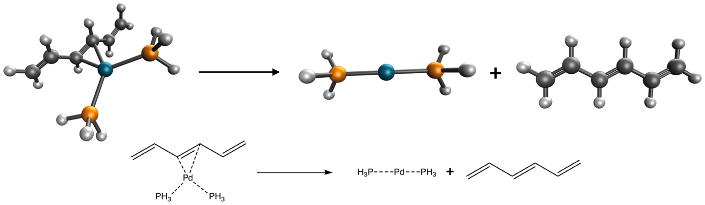

::: {.callout-note}
## Learning goals
After this class you should be able to:

- explain why reactions that produce atoms and radicals are harder than reactions between closed-shell molecules, and why Hartree–Fock fails for them;
- explain the gap between an experimental bond enthalpy and an electronic reference value;
- choose a functional, basis set, dispersion treatment, grid and SCF settings for a new problem, and justify each choice with evidence;
- check whether a calculation fits a computer-time budget;
- write a methods paragraph that lets someone else reproduce your numbers;
- plan Experiment 10.
:::

# Part 1 · Looking back at Experiment 9

::: {.callout-important}
## Read this after you submit Experiment 9
This part discusses the trends you most likely saw in [Experiment 9](../experiments/ex09-experiment-vs-theory.qmd). Your own numbers may differ. The reasons are what you should take away.
:::

## Hartree–Fock and the atomization energies

The first thing on the signed-error chart was probably Hartree–Fock. Its atomization energies are far too small: tens of kcal/mol too small for the hydrides, and for ozone the error can be so large that HF barely binds the molecule at all relative to three oxygen atoms. You saw the same failure for H₂SO₄ in Experiment 5.

The reason is the one from [Class 9](l09-difficult-cases.qmd). Correlation energy is larger in the molecule than in the separated atoms, because bonding packs more electron pairs into the same region of space. Hartree–Fock has no correlation at all, so it misses this extra stabilization of the molecule, and every bond comes out too weak. In an atomization nothing on the product side looks like the reactant, so there is no cancellation to rescue it. Even H₂, a two-electron problem, is underbound by HF: the missing energy is exactly the correlation energy of the H₂ bond, since the hydrogen atom has only one electron and no correlation.

## The density functionals

The density functionals all include correlation in some approximate way, and most of them got the hydrides within a few kcal/mol. Look at the errors in two ways:

- **Absolute errors** grow with the size of the number. Methane's atomization energy is 420 kcal/mol. An error of 4 kcal/mol there is less than 1%.
- **Relative errors** put H₂ and CH₄ on the same scale. The relative-errors chart probably showed that some functionals that look fine on the absolute scale are not as good per bond.

Ozone was probably the hardest atomization for everyone. It has strong multireference character (Class 9), and a single determinant can't describe it well. GGAs such as PBE tend to overbind ozone by a lot, inheriting LSDA's overbinding. Hybrids and the Minnesota functionals usually do better, but not uniformly.

## Radicals and the C–O bond of *tert*-butanol

Reaction 9a breaks one C–O bond and produces two radicals, *tert*-butyl and OH. The reactant is a closed-shell molecule; the products are two open-shell doublets. As with atomization, the two sides are different kinds of species, so error cancellation is weak. Self-interaction error tends to overstabilize the delocalized, partly broken bond relative to the separated radicals, and the open-shell products are where unrestricted calculations, spin contamination and stability all matter.

If you compared B3LYP/6-31G\* with B3LYP/def2-TZVP for this reaction, you may have seen the small basis do slightly *better*. You know the lesson from Experiment 6: before you call it an improvement, ask whether two errors cancelled.

## FeCl

The FeCl dissociation combines everything difficult: a transition metal, a sextet molecule, a quintet Fe atom and a doublet Cl atom. The spread between functionals is wide, and Hartree–Fock is far off. The functional that does best on FeCl is not necessarily the one that does best on the atomizations. Experiment 9 contains seven reactions, and no single method is best at all of them.

## What NIST told you

The **Theory meets experiment** panel probably gave an experimental bond enthalpy a few kcal/mol away from the electronic reference of 78.5 kcal/mol. Several corrections stand between the two numbers ([Class 13](l13-theory-vs-experiment.qmd)):

- **ZPE.** FeCl is a heavy diatomic with a low vibrational frequency, a few hundred cm⁻¹, so its ZPE is well under 1 kcal/mol.
- **Thermal enthalpy.** About $\tfrac{3}{2}RT \approx 0.9$ kcal/mol in favor of the atoms, a little less once FeCl's soft vibration is counted.
- **Spin–orbit coupling.** The Fe atom (−1.2 kcal/mol) and the Cl atom (−0.84 kcal/mol) both have it, and so does the FeCl molecule. Together these can amount to a couple of kcal/mol.
- **Experimental uncertainty.** Check the error bar NIST quotes for FeCl. Gas-phase data for transition-metal diatomics are often uncertain by several kcal/mol, comparable to all the corrections combined.

The take-home message: for a transition-metal diatomic, the experimental uncertainty alone may be larger than the difference between a good functional and a mediocre one. Comparing a computed electronic energy directly with an experimental enthalpy is not meaningful without the corrections, and sometimes not meaningful even with them.

# Part 2 · Choosing, running and reporting a method

## The question you will face after this course

So far, every experiment told you which methods to run. In research, nobody does. You will have a molecule, a property and a budget, and you will have to decide. There is no single correct answer, but there are bad answers, and there is a process that avoids most of them. The process is the same whether the system is a drug molecule, a catalyst or a battery material.

## A decision process

**1. Define the question.** What property do you need: a reaction energy, a barrier, a geometry, a spin-state gap, a noncovalent binding energy? How accurate must it be? A trend across a series of similar molecules tolerates larger errors than an absolute number to be compared with experiment.

**2. Identify the chemistry.** Ask the questions this course has trained you to ask:

- Is everything closed-shell, or are there radicals, atoms or open-shell metals? (Experiments 5, 8, 9)
- Do bonds form or break, or is it an isomerization or conformational change with good error cancellation? (Experiments 3–5)
- Are noncovalent interactions or large, polarizable groups involved? (Experiment 4)
- Are there transition metals, near-degenerate states or elements beyond krypton? (Experiments 8–10)
- Is there any sign of multireference character, such as a small HOMO–LUMO gap, ozone-like bonding or stretched bonds? (Experiment 5)

**3. Look for benchmark evidence for that kind of reaction.** Large benchmark databases rank functionals by reaction type: GMTKN55 for main-group thermochemistry, kinetics and noncovalent interactions [@goerigk2017], MGCDB84 [@mardirossian2017], and the Minnesota databases [@yu2016a], which include transition-metal bond energies. Specialized sets exist for transition-metal chemistry [@chan2019; @dohm2018]. Read the summary tables, but also the category closest to your problem: a functional that is excellent on average can be poor for your reaction type. Be wary of evidence from a functional's own training set (the CaO lesson of Experiment 5).

**4. Choose the basis set.** For DFT, a triple-ζ basis such as def2-TZVP is the practical standard for energies (Experiment 1). Double-ζ sets are for screening and geometries, and their results can be right for the wrong reasons (Experiment 6). Use a quadruple-ζ set to check convergence if you can afford it. Elements beyond krypton need an effective core potential: with def2 sets, `ECP = def2-ECP` ([Class 12](l12-scf-stability.qmd)). Anions and very weak interactions need diffuse functions.

**5. Decide on dispersion.** Unless the functional already includes it, add a dispersion correction such as -D4 [@caldeweyher2017; @caldeweyher2019]. Never add -D4 on top of a functional that has VV10 (the "-V" functionals) or that was parametrized to include dispersion. That double counts (Experiment 4). Check that -D4 parameters exist for your functional.

**6. Choose the grid.** SG-2 at least for meta-GGAs, SG-3 or (99,590) for Minnesota and other heavily parametrized functionals (Experiment 7). Always state it.

**7. Check the SCF.** Run a stability analysis for anything open-shell or containing a transition metal, check ⟨S²⟩, and make sure you are in the intended spin state (Experiment 8). For a closed-shell molecule a stability check is cheap insurance.

**8. Check the cost.** Count basis functions, remember how cost grows with them (you measured the exponent in Experiment 1), and run the smallest species first. Hybrids cost more per SCF cycle than GGAs and meta-GGAs; range-separated hybrids and VV10 add a little more (Experiment 3). On the IQmol server every job must finish within 10 minutes.

**9. Sanity-check the answer.** If you can, compare two functionals from different families, or two basis sets. If they disagree by more than your accuracy target, you have learned something important about your problem.

::: {.callout-note}
## Aside: one functional, or several?
In a research paper, a single "best" functional is rarely enough to convince a referee. Reporting a second functional from a different family, or a basis-set check, shows how robust the conclusion is. In Experiment 10 you report one main result, but a sentence on how it might change with another choice makes the report stronger.
:::

## What the course has shown you

| Experiment | What you saw | What it means for your choice |
|---|---|---|
| 1 | Errors fall from double- to quadruple-ζ; cost rises steeply | Use triple-ζ for energies; check convergence when possible |
| 2 | Functionals differ in their ingredients | Know the rung and the dispersion treatment of what you use |
| 3 | Easy reactions: most methods do well | Error cancellation makes some problems forgiving; don't generalize from them |
| 4 | Dispersion matters even within molecules | Include dispersion; avoid double counting |
| 5 | Hard reactions: large errors, HF fails, training sets mislead | Find benchmarks for *your* reaction type |
| 6 | A small basis can win by luck | Don't trust a result that gets worse with a better basis |
| 7 | Meta-GGAs need fine grids | Set and report the grid |
| 8 | SCF solutions can be unstable; metals are hard | Run stability analysis; check spin states |
| 9 | Atoms and radicals are hard; experiment needs corrections | Compare like with like |

: The evidence from Experiments 1–9. {#tbl-evidence}

## A cost budget

Budgeting computer time is part of choosing a method. A rough rule from Experiment 1: the time per SCF cycle grows roughly as $N_\mathrm{bf}^{\,p}$, with an exponent $p$ that is smaller in practice than the formal value of 4 (you measured it). The number of SCF cycles adds a factor of about 10–30, more for difficult open-shell systems, and a stability analysis adds a few more.

::: {.callout-tip}
## Worked example: will the big job fit?
Suppose a small fragment with 200 basis functions took 40 s with your method, and the full complex has 500 basis functions. With $p = 3$, the estimate for the complex is

$$
40\ \text{s} \times \left(\frac{500}{200}\right)^{3} = 40 \times 15.6 = 625\ \text{s} \approx 10.4\ \text{min}.
$$

That is right at the 10-minute limit, before counting a stability analysis or extra SCF cycles. You could move to a cheaper functional (a meta-GGA instead of a hybrid), a smaller grid where it is safe, or a smaller basis, and say in your report what the compromise costs in accuracy. With $p = 2.5$, the estimate is $40 \times 2.5^{2.5} = 40 \times 9.9 = 395$ s, about 6.6 minutes, comfortably inside. The exponent matters; measure it rather than guess.
:::

The method card in Experiment 10 makes a similar estimate for you from the number of basis functions. It is a rough guide, not a guarantee.

## Reproducible reporting

A computed number is only useful if someone else can reproduce it. That requires a methods section that lists every choice that changes the number. A reader should be able to rebuild your input file from your text.

A complete computational methods paragraph states:

1. **Program and version**, with its citation (Q-Chem [@epifanovsky2021], run through IQmol [@iqmol]).
2. **Method**: the functional with its original reference(s); for a hybrid or range-separated functional, the name is enough if it is standard.
3. **Dispersion**: none, -D4 (with reference), or built in (VV10, fitted).
4. **Basis set** with its reference, and the **ECP** for heavy elements (which atoms, which ECP).
5. **Integration grid**: by name (SG-3) or as $(n_r, n_\Omega)$.
6. **SCF settings**: convergence threshold (`SCF_CONVERGENCE 8` = $10^{-8}$), restricted or unrestricted, stability analysis.
7. **Spin states**: the charge and multiplicity of every species.
8. **Geometries**: where they come from (optimized at which level, or taken from a database, with its reference).
9. **What is reported**: electronic energies, or with ZPE or thermal corrections (and how those were obtained); units and conversion factor.
10. **Reference values** for any comparison, with their source.

::: {.callout-tip}
## Example: a methods paragraph for reaction 4a
"All calculations were performed with Q-Chem [@epifanovsky2021] through the IQmol interface [@iqmol]. We used the ωB97M-V functional [@mardirossian2016a], which includes VV10 nonlocal correlation [@vydrov2010], so no additional dispersion correction was applied. The def2-TZVP basis set [@weigend2005] was used for all atoms. The exchange–correlation energy was integrated on the SG-3 grid [@dasgupta2017]. SCF calculations used a convergence criterion of $10^{-8}$ and were followed by an internal stability analysis; all species are closed-shell singlets and were computed with restricted orbitals. Geometries were taken from the DARC subset of GMTKN55 [@goerigk2017] without further optimization. Reported values are electronic reaction energies, with no zero-point or thermal corrections, converted with 1 $E_h$ = 627.5095 kcal/mol, and compared with the GMTKN55 reference value of −45.4 kcal/mol."

About 120 words, and someone else could rebuild every input from it.
:::

::: {.callout-warning}
## Common mistakes in methods sections
- **"Default settings."** Defaults change between programs and versions. Name the grid, the convergence threshold and the ECP.
- **Citing only the program.** Each functional, basis set and dispersion correction has its own reference.
- **Mixing up the quantity.** Say whether you report $\Delta E_\mathrm{el}$, $\Delta E_0$ or $\Delta H$, and compare with a reference of the same kind.
- **Hiding the compromise.** If the 10-minute limit forced a smaller basis, say so and estimate the consequence. An honest limitation is a strength of a report, not a weakness.
- **Over-precise numbers.** Report reaction energies to 0.1 or 0.01 kcal/mol, not to eight decimals. Keep all digits in the total energies you used to compute them.
:::

# Experiment 10 briefing

## You are the consultant

In [Experiment 10](../experiments/ex10-final-review.qmd), a colleague asks you for the energy needed to remove a hexatriene ligand from a palladium(0) complex:

$$
\mathrm{Pd(PH_3)_2(C_6H_8)} \;\rightarrow\; \mathrm{Pd(PH_3)_2} + \mathrm{C_6H_8}.
$$

{#fig-pd fig-alt="Ball-and-stick drawing of Pd(PH3)2 bound to hexatriene, dissociating into Pd(PH3)2 and free hexatriene." width="520"}

The reaction energy, with signed coefficients, is

$$
\Delta E = E\big(\mathrm{Pd(PH_3)_2}\big) + E\big(\mathrm{C_6H_8}\big) - E\big(\mathrm{Pd(PH_3)_2(C_6H_8)}\big).
$$

The structures come from the PdBE2 subset [@averkiev2010] of the Minnesota 2015B database [@yu2016a], and the reference value is **16.2 kcal/mol** (an electronic bond dissociation energy, like every reference in this course). All three species are closed-shell singlets: palladium(0) is d¹⁰.

## What you have to decide

Every setting is yours: functional, dispersion, basis set, grid and stability analysis. The **method card** on the experiment page collects your choices and your reasons, warns you about common pitfalls (double-counting dispersion, grid-sensitive functionals without an explicit grid, no stability check), estimates whether each job fits in 10 minutes, and writes the three Q-Chem inputs. Only three jobs are required. You are welcome to run extra ones to check your choice, for example a second basis set or a second functional.

Use the decision process of this class. Some questions to answer before you pick:

- What kind of bond breaks here? Is it covalent, dative, noncovalent, or a mix? What does that say about dispersion (Experiment 4)?
- Which benchmarks include metal–ligand bond energies, and which functionals do well there? Start from the references on the experiment page [@goerigk2017; @mardirossian2017; @yu2016a; @peverati2014; @chan2019; @dohm2018].
- Pd is beyond krypton. Which basis sets come with a suitable ECP?
- Does your functional need a fine grid? Does it already include dispersion?
- Which of your three jobs is the largest, and will it fit?

## The report

Write a short report of **about 300 words** that:

1. has a title;
2. states the method you chose and **why**, citing the literature and your own evidence from Experiments 1–9;
3. describes the computational setup completely, as in the checklist above;
4. presents your result and compares it with the reference value of 16.20 kcal/mol, with the signed error;
5. ends with a reference list.

A good report is not the one closest to 16.2. It is the one with a well-justified choice, a reproducible setup, and an honest discussion of the result. A method that lands 2 kcal/mol away for well-stated reasons is better consulting than one that lands on 16.2 by luck and can't explain why. Your instructor may ask you to review two classmates' reports with a short rubric: is the method justified, is the setup reproducible, is the comparison honest?

::: {.callout-warning}
## Pitfalls in Experiment 10
- **Forgetting the ECP.** Without `ECP = def2-ECP`, a def2 basis on Pd fails or gives meaningless energies. The method card adds it automatically; check your inputs.
- **Double-counting dispersion.** No -D4 on top of a "-V" functional or one that already contains dispersion.
- **Choosing by the reference value.** Choose and justify the method *before* you compute. Changing the functional until the number matches 16.2 is not a method choice, and a reviewer will see it.
- **Different settings for different species.** All three jobs must use exactly the same method, basis, grid and ECP.
- **Running out of time.** Run the smallest species (hexatriene) first to check the settings, then the complex.
:::

## Key points

- Hartree–Fock badly underbinds atomization energies because it has no correlation; the missing correlation is larger in the molecule than in the atoms.
- Reactions that produce atoms or radicals have little error cancellation. Report relative as well as absolute errors.
- An experimental bond enthalpy differs from an electronic reference by ZPE, thermal enthalpy and spin–orbit corrections, and for metal compounds the experimental uncertainty can be as large as all of them together.
- Choosing a method means defining the question, identifying the chemistry, finding benchmark evidence for that reaction type, and then choosing basis set, ECP, dispersion, grid, SCF checks and cost to match.
- A methods section must let a reader rebuild your input: program, method, dispersion, basis, ECP, grid, SCF settings, spin states, geometry source, the quantity reported, and references.
- In Experiment 10 you are judged on the justification and the reproducibility of your choice, not only on how close you land to 16.2 kcal/mol.

## Study questions

1. Why does Hartree–Fock underbind H₂, even though the H atom has no correlation energy at all?
2. A functional has a mean absolute error of 3 kcal/mol on the atomizations of Experiment 9 and 8 kcal/mol on FeCl. What would you conclude about using it for a new iron compound?
3. List the corrections needed to compare the FeCl bond enthalpy from NIST with the electronic reference, and estimate the size of each.
4. Your reaction involves a Cu(I) complex with a large aromatic ligand. Go through steps 2–7 of the decision process and write one sentence for each.
5. Why is it a mistake to add -D4 to ωB97M-V? Why might it be a mistake to add it to a Minnesota functional?
6. A job with 300 basis functions took 2 minutes. Estimate the time for 600 basis functions with exponents of 2.5 and 3.5. Would either fit in 10 minutes?
7. Rewrite this methods sentence so it is reproducible: "Calculations were done with DFT using Q-Chem with default settings."
8. Why should you choose the method for Experiment 10 before you know how close it gets to the reference?
9. A classmate reports 16.3 kcal/mol for Experiment 10 with B3LYP/def2-SVP. What questions would you ask in a peer review?

## Further reading

- L. Goerigk et al., "A look at the density functional theory zoo with the advanced GMTKN55 database" [@goerigk2017]: the most widely used main-group benchmark, with explicit recommendations per rung.
- N. Mardirossian and M. Head-Gordon, "Thirty years of density functional theory in computational chemistry" [@mardirossian2017]: a review with practical recommendations.
- H. S. Yu, X. He, S. L. Li and D. G. Truhlar on MN15 and the Minnesota 2015 database [@yu2016a].
- B. Chan, P. M. W. Gill and M. Kimura on transition-metal benchmarks [@chan2019], and S. Dohm et al. on metal–organic reactions [@dohm2018].
- R. Peverati and D. G. Truhlar, "Quest for a universal density functional" [@peverati2014].
- P. Morgante and R. Peverati, "The devil in the details" [@morgante2020]: this course's experiments, and why each detail matters.
