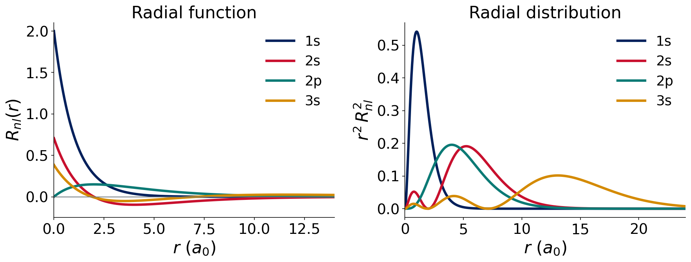
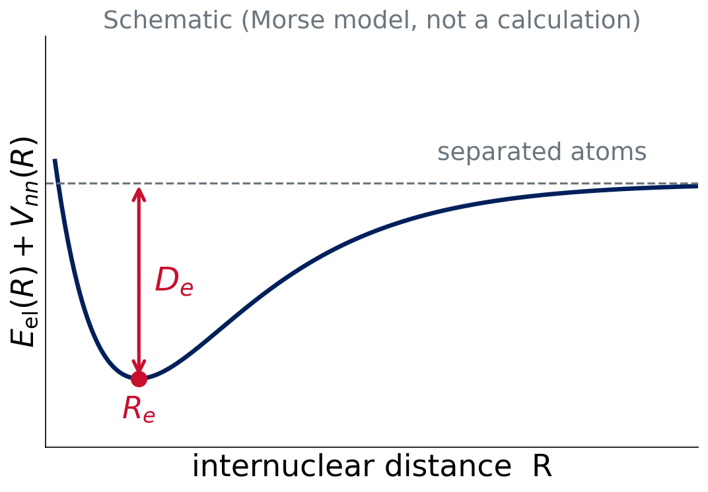

# Why compute?

## What does a computational chemist predict?

- **Reaction energies**: is the reaction downhill, and by how much?
- **Barriers**: how fast could it go?
- **Structures**: bond lengths, angles, conformers
- **Interaction energies**: why molecules stick together

. . .

::: takeaway
A calculation gives **numbers with errors**. This course teaches you where the errors come from and how to choose a method.
:::

## Course roadmap

:::: {.columns}
::: {.column width="55%"}
- **Ten experiments**, each a small benchmark with Q-Chem (through IQmol)
- Lectures 1–3: the wave function and the basis set (Experiment 1)
- Lectures 4–6: the Hamiltonian and the functionals (Experiment 2)
- Later: test, break and choose methods
:::
::: {.column width="45%"}
Two big approximations in every calculation:

1. **Approximate Ψ**: basis set
2. **Approximate Ĥ**: method (HF, DFT, ...)
:::
::::

## Today

1. Review: the Schrödinger equation and the hydrogen atom
2. The molecular Hamiltonian and atomic units
3. Born–Oppenheimer: the potential energy surface
4. Many electrons: spin, antisymmetry, the variational principle
5. The "model chemistry"

::: {.small .muted}
Review material: P-Chem 2 textbook, peverati.github.io/pchem2
:::

# Review: Ĥ Ψ = E Ψ

## The time-independent Schrödinger equation

$$
\hat H\,\Psi = E\,\Psi
$$

- Ĥ: the **Hamiltonian** operator (kinetic + potential energy)
- Ψ: an **eigenfunction**; |Ψ|² is a probability density
- E: the **eigenvalue**, the energy of that state

. . .

Solve it, and you know the energy of the molecule.

::: {.small .muted}
pchem2: Schrödinger, Operators
:::

::: notes
Quick review: eigenvalue problem. Ask who remembers the particle in a box.
:::

## Hydrogen: the one exactly solvable atom

$$
\hat H=-\tfrac12\nabla^2-\frac{1}{r}\qquad E_n=-\frac{1}{2n^2}\ E_\mathrm{h}
$$

- Orbitals: one-electron wave functions $\psi_{nlm}=R_{nl}(r)\,Y_l^m(\theta,\phi)$
- Quantum numbers $n,\,l,\,m$; radial nodes: $n-l-1$
- Ground state: $E_1=-0.5\ E_\mathrm{h}$

::: {.small .muted}
pchem2: Hydrogen
:::

## Hydrogen radial functions

{fig-alt="Hydrogen atom radial functions R(r) and radial distribution r squared R squared for the 1s, 2s, 2p and 3s orbitals; 2s has one radial node and 3s has two."}

::: {.small}
Exact analytic functions. 1s: no node. 2s: one node. 3s: two nodes.
:::

## Think–pair–share

::: {.callout-note}
## Question (2 min)
How many radial nodes do the **3p** and **4d** orbitals have?
:::

. . .

Radial nodes = $n-l-1$:

- 3p: 3 − 1 − 1 = **1**
- 4d: 4 − 2 − 1 = **1**

# The molecular Hamiltonian

## Five terms

$$
\hat H=\underbrace{-\sum_A\tfrac{1}{2M_A}\nabla_A^2}_{\hat T_n}\;\underbrace{-\sum_i\tfrac12\nabla_i^2}_{\hat T_e}\;\underbrace{-\sum_{i,A}\tfrac{Z_A}{r_{iA}}}_{\hat V_{ne}}\;\underbrace{+\sum_{i<j}\tfrac{1}{r_{ij}}}_{\hat V_{ee}}\;\underbrace{+\sum_{A<B}\tfrac{Z_AZ_B}{R_{AB}}}_{\hat V_{nn}}
$$

- A, B: nuclei. i, j: electrons. M in units of $m_e$.
- Everything is Coulomb attraction or repulsion, plus kinetic energy.

::: {.small .muted}
pchem2: Molecules §11.1
:::

## Atomic units

Set $\hbar=m_e=e=4\pi\varepsilon_0=1$.

| Quantity | Unit | Value |
|---|---|---|
| Length | bohr, $a_0$ | 0.529177 Å |
| Energy | hartree, $E_\mathrm{h}$ | 27.211 eV |

. . .

$$
1\ E_\mathrm{h}=627.5095\ \text{kcal/mol}=27.211\ \text{eV}=2625.5\ \text{kJ/mol}
$$

Q-Chem prints energies in $E_\mathrm{h}$. Chemists think in kcal/mol.

## Think–pair–share

::: {.callout-note}
## Question (2 min)
A calculation says reaction A is 0.0100 $E_\mathrm{h}$ lower in energy than reaction B. How many kcal/mol is that? Is it "chemically significant"?
:::

. . .

$0.0100\times627.5095=\mathbf{6.275}$ kcal/mol. Yes: chemical accuracy is about 1 kcal/mol, so **thousandths** of a hartree matter.

# Born–Oppenheimer

## Clamp the nuclei

Nuclei are ≥ 1836 times heavier than electrons. Electrons adjust instantly to nuclear positions.

. . .

At fixed nuclear positions **R**: $\hat T_n=0$, $\hat V_{nn}$ is a constant.

$$
\hat H_\mathrm{el}=\hat T_e+\hat V_{ne}+\hat V_{ee}\qquad \hat H_\mathrm{el}\,\Psi_\mathrm{el}(\mathbf r;\mathbf R)=E_\mathrm{el}(\mathbf R)\,\Psi_\mathrm{el}
$$

::: {.small .muted}
Born & Oppenheimer, Ann. Phys. 1927. pchem2: Molecules §11.2
:::

## The potential energy surface

:::: {.columns}
::: {.column width="55%"}
{fig-alt="Schematic Morse-type potential energy curve with equilibrium distance Re and well depth De, labeled as a schematic."}
:::
::: {.column width="45%"}
$$
E(\mathbf R)=E_\mathrm{el}(\mathbf R)+V_{nn}(\mathbf R)
$$

The nuclei move on this surface. Minima are structures; saddle points are transition states.
:::
::::

## What does Q-Chem's "total energy" mean?

::: takeaway
Total energy = $E_\mathrm{el}+V_{nn}$ at **one fixed geometry**.
:::

- No zero-point energy
- No thermal terms
- Not an enthalpy or a free energy

Those return in Lecture 13. For now, differences of total energies = reaction energies at fixed geometries.

::: notes
Common student confusion: comparing total energy to experimental heats. Flag it now.
:::

# Many electrons

## Why it's hard

$$
\hat V_{ee}=\sum_{i<j}\frac{1}{r_{ij}}
$$

Each electron's motion depends on every other. The equation does not separate.

- N = 1: exact solution (H, He⁺, H₂⁺ with BO)
- **N ≥ 2: no analytic solution**

We need approximations. Which ones? That is the rest of the course.

## Spin and antisymmetry

- Electrons are fermions with spin ½
- Pauli principle: Ψ changes sign if two electrons swap (space **and** spin)

. . .

Simplest antisymmetric Ψ: a **Slater determinant** of spin orbitals

$$
\Psi=\frac{1}{\sqrt{N!}}\begin{vmatrix}\phi_1(1)&\phi_2(1)&\cdots\\ \phi_1(2)&\phi_2(2)&\cdots\\ \vdots&\vdots&\ddots\end{vmatrix}
$$

::: {.small .muted}
pchem2: Spin, Postulate 6, Atoms §10.1–10.2
:::

## Think–pair–share

::: {.callout-note}
## Question (2 min)
What happens to a Slater determinant if two electrons occupy the **same** spin orbital?
:::

. . .

Two columns are identical, so the determinant is **zero**: the Pauli exclusion principle falls out of antisymmetry.

## The variational principle

For any trial wave function with proper boundary conditions:

$$
E[\Psi_\mathrm{trial}]=\frac{\langle\Psi_\mathrm{trial}|\hat H|\Psi_\mathrm{trial}\rangle}{\langle\Psi_\mathrm{trial}|\Psi_\mathrm{trial}\rangle}\;\ge\;E_0
$$

. . .

::: takeaway
**Lower energy = better wave function.** This is how we judge basis sets (Lecture 2) and how HF is derived (Lecture 4).
:::

# Model chemistry

## Every calculation has two choices

$$
\textbf{method}\,/\,\textbf{basis set}
$$

| Model chemistry | Method (approximates Ĥ) | Basis (approximates Ψ) |
|---|---|---|
| HF/def2-SVP | Hartree–Fock | def2-SVP |
| B3LYP/def2-TZVP | B3LYP functional | def2-TZVP |

. . .

Results are only meaningful **with** both labels.

## Summary and next class

::: takeaway
- Ĥ has five terms; Born–Oppenheimer gives $E(\mathbf R)$
- $V_{ee}$ makes N ≥ 2 unsolvable; Ψ is built from orbitals (Slater determinants)
- Variational principle: lower is better
:::

**Lecture 2:** how do we build orbitals from basis functions?

## References

::: {.small}
- Born & Oppenheimer, *Ann. Phys.* **84**, 457 (1927)
- Slater, *Phys. Rev.* **34**, 1293 (1929); **35**, 509 (1930)
- Review: P-Chem 2 textbook, peverati.github.io/pchem2 (Schrödinger, Operators, Hydrogen, Molecules, Spin, Atoms)
:::
