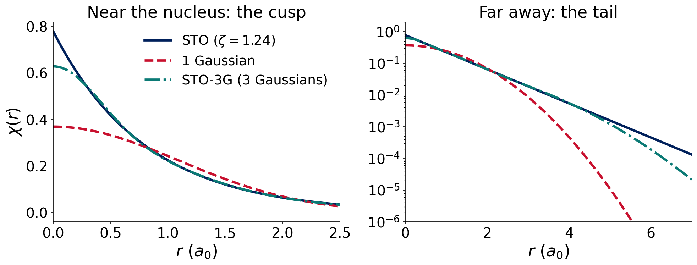
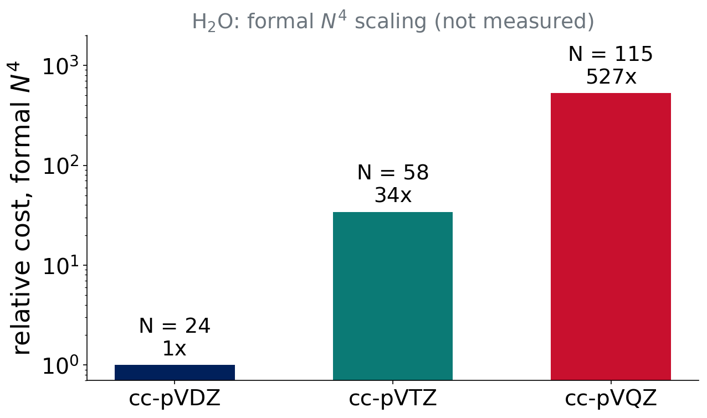

# LCAO

## Last class

- Ĥ has five terms; Born–Oppenheimer gives $E(\mathbf R)$
- Ψ is built from **orbitals** φᵢ
- Variational principle: **lower energy = better**

. . .

Question for today: **what functions do we use to write the orbitals?**

## Linear combination of atomic orbitals

$$
\phi_i(\mathbf r)=\sum_{\mu=1}^{K} c_{\mu i}\,\chi_\mu(\mathbf r)
$$

- $\chi_\mu$: **basis functions** (fixed, centered on atoms)
- $c_{\mu i}$: coefficients (the computer finds them)
- $K$: number of basis functions, printed in the Q-Chem output

. . .

A finite $K$ is an **approximation**. Bigger $K$ means a more flexible φ, so a lower energy.

::: {.small .muted}
pchem2: Bonds, Poly §13.1–13.2
:::

## Basis sets converge from above

::: takeaway
Adding functions can only lower the energy (HF and DFT): the variational principle.

Infinite basis = **complete basis set (CBS) limit**.
:::

The CBS energy is the best this method can do. Basis-set error is the distance to it.

::: notes
Strictly guaranteed for HF; for DFT it holds in practice for well-behaved sets. Say so only if asked.
:::

# Slater and Gaussian functions

## Two kinds of radial function

:::: {.columns}
::: {.column width="50%"}
**Slater-type (STO)**

$$\chi\propto e^{-\zeta r}$$

- Correct cusp at the nucleus
- Correct exponential tail
- Multicenter integrals are very hard
:::
::: {.column width="50%"}
**Gaussian-type (GTO)**

$$\chi\propto e^{-\alpha r^2}$$

- Wrong: no cusp, tail too short
- Gaussian product theorem: product of two Gaussians is one Gaussian
- Integrals are fast
:::
::::

## Hydrogen 1s: STO versus Gaussians

{fig-alt="Hydrogen 1s STO with zeta 1.24 compared with the best single Gaussian and with the STO-3G contraction. The single Gaussian has no cusp and decays too fast; STO-3G follows the STO closely except very near the nucleus and far away."}

::: {.small}
STO-3G parameters from the published basis set. One Gaussian is poor; three are good.
:::

## Contracted Gaussians

A **contracted** function is a fixed sum of **primitive** Gaussians:

$$
\chi_\mu=\sum_{k}d_{k}\,g_k(\mathbf r;\alpha_k)
$$

- Coefficients $d_k$ are fixed once, not optimized in the calculation
- Mimics one STO with cheap integrals
- **STO-3G**: 3 primitives per function (the minimal basis)

## Cartesian versus spherical d

- Cartesian d: 6 functions ($xx, yy, zz, xy, xz, yz$)
- Spherical d: **5** functions (the sixth is an s-like combination)

Each basis set is defined for one convention. Q-Chem uses the right one automatically. This is why published basis-function counts differ between programs.

# Building better basis sets

## Minimal to split-valence

- **Minimal**: one function per occupied atomic orbital (STO-3G)
- **Split valence**: two (double-ζ, "DZ"), three (TZ), four (QZ) functions per **valence** orbital

. . .

::: takeaway
More than one valence function lets the orbital **change size** in a molecule.
:::

## Polarization functions

Add functions of **higher angular momentum**: d on C, N, O; p on H.

- A p orbital mixed with a little d is **off-center and distorted**
- Needed for bonds, lone pairs and almost every molecule

. . .

::: takeaway
Polarization lets orbitals change **shape**.
:::

## Diffuse functions

Functions with **very small exponents**: slowly decaying, spread out.

- Anions and lone pairs
- Weak (noncovalent) interactions
- Excited, Rydberg-like states

Prefix **aug-** (Dunning) or **+** (Pople). They cost more and can cause SCF trouble.

## Think–pair–share

::: {.callout-note}
## Question (2 min)
You compute the dissociation of an **anion**, F⁻ + CH₃Cl. Which feature would you add first: more ζ, polarization or diffuse functions?
:::

. . .

**Diffuse** functions: the extra electron is loosely bound and far from the nucleus. Then triple-ζ with polarization.

# Pople basis sets

## Reading a Pople name

:::: {.columns}
::: {.column width="55%"}
**6-31+G\*\***

- **6-31**: core = 6 primitives; valence split into 3 + 1 primitives (double-ζ)
- **+**: diffuse s,p on heavy atoms (**++** also on H)
- **G\***: d on heavy atoms; **G\*\***: also p on H
:::
::: {.column width="45%"}
Equivalent notation:

- 6-31G\* = 6-31G(d)
- 6-31G\*\* = 6-31G(d,p)
- 6-311G\*\*: triple-ζ valence
:::
::::

## Pople sets: know them, don't love them

STO-3G, 3-21G, 6-31G, 6-31G\*, 6-31+G\*, 6-311G\*\*

- Historical and **still very common** (Experiment 6 revisits 6-31G\*)
- Unbalanced; not designed to converge systematically
- Hard to extend to the whole periodic table

::: takeaway
Pople sets are fine to recognize, but we use modern, systematic families.
:::

# Modern families

## Karlsruhe def2

**def2-SVP, def2-TZVP, def2-QZVP**

- Weigend & Ahlrichs 2005
- Almost the whole periodic table
- **Effective core potentials** for heavy elements (beyond Kr)
- Good accuracy per function for DFT

::: {.small .muted}
Weigend & Ahlrichs, Phys. Chem. Chem. Phys. 7, 3297 (2005)
:::

## Dunning correlation-consistent

**cc-pVDZ, cc-pVTZ, cc-pVQZ, cc-pV5Z**, and **aug-cc-pVnZ**

- Built so the **correlation energy converges systematically** with n
- Designed for wave-function methods (MP2, CCSD(T))
- **aug-**: diffuse functions added
- Also: Jensen's **pc-n**, polarization-consistent, optimized for DFT

::: {.small .muted}
Dunning, J. Chem. Phys. 90, 1007 (1989); Woon & Dunning, J. Chem. Phys. 98, 1358 (1993); Jensen, J. Chem. Phys. 115, 9113 (2001)
:::

## Number of basis functions: H₂O

| Basis | Functions $K$ |
|---|---|
| def2-SVP | 24 |
| def2-TZVP | 43 |
| cc-pVDZ | 24 |
| cc-pVTZ | 58 |
| cc-pVQZ | 115 |
| aug-cc-pVTZ | 92 |

::: {.small .muted}
Spherical functions. Check the number Q-Chem prints in your own output.
:::

::: notes
Hand-counted from contraction patterns; verify against a real Q-Chem run before the first class.
:::

## Think–pair–share

::: {.callout-note}
## Question (2 min)
Same ζ level, two families: def2-SVP and cc-pVDZ have the same $K$ for water. Does that mean they give the same energy?
:::

. . .

No. Same size, different **contents** (exponents, contraction, polarization). Experiment 1 compares the two families.

# The price of accuracy

## Cost grows fast with K

{fig-alt="Bar chart on a log scale of relative formal N to the fourth cost for water with cc-pVDZ, cc-pVTZ and cc-pVQZ, with N equal to 24, 58 and 115. The cost ratios are 1, 34 and 527. Labeled as formal scaling, not measured."}

- Formal scaling of HF and hybrid-DFT integrals: $N^4$
- Practical scaling is lower (screening, density fitting)
- **You will measure the exponent in Experiment 1**

## Extrapolating to the CBS limit

Outlook (the Experiment 1 Colab notebook does this):

$$
E(n)=E_\mathrm{CBS}+A\,e^{-\alpha n}\quad(\text{HF}),\qquad E(n)=E_\mathrm{CBS}+\frac{A}{n^3}\quad(\text{correlation})
$$

Two kinds of basis-set error to remember:

- **BSIE**: incompleteness error (finite K)
- **BSSE**: superposition error (fragments "borrow" each other's functions); returns in Lectures 8 and 10

## Summary

::: takeaway
More well-chosen functions: lower energy, systematic convergence to CBS, **steeply higher cost**.

Triple-ζ is the usual compromise.
:::

- Decode names: ζ (size), polarization (shape), diffuse (reach)
- Families: Pople (historical), **def2**, **cc-pVnZ**, pc-n

**Lecture 3:** from theory to a calculation (IQmol and Q-Chem).

## References

::: {.small}
- Weigend & Ahlrichs, *Phys. Chem. Chem. Phys.* **7**, 3297 (2005)
- Dunning, *J. Chem. Phys.* **90**, 1007 (1989)
- Woon & Dunning, *J. Chem. Phys.* **98**, 1358 (1993)
- Jensen, *J. Chem. Phys.* **115**, 9113 (2001)
- P-Chem 2: peverati.github.io/pchem2 (Bonds, Poly)
:::
