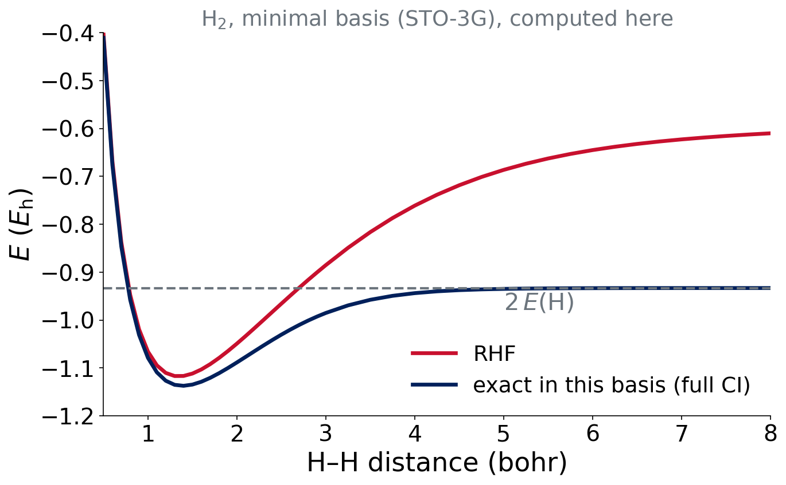

# Where we are

## Two approximations, one done

- Lecture 2: we fixed how flexible Ψ is (the **basis set**)
- Today: how to handle the **electron–electron repulsion** (the **method**)

. . .

::: {.callout-note}
## Check-in (3 min)
Any problems running Experiment 1 jobs? Full debrief in Lecture 7.
:::

# Hartree–Fock

## Hartree's idea: the mean field

Each electron moves in the **average** field of all the others.

. . .

$$
\frac{1}{r_{ij}}\ \longrightarrow\ \text{a one-electron potential from the other electrons' density}
$$

N coupled electrons become N **one-electron** problems.

::: {.small .muted}
Hartree, Proc. Camb. Phil. Soc. 1928
:::

## Hartree–Fock

Take **one Slater determinant** and minimize $E$ (variational principle). The result:

$$
\hat f\,\phi_i=\varepsilon_i\,\phi_i
$$

Orbitals φᵢ with orbital energies εᵢ. The Fock operator depends on the orbitals themselves.

::: {.small .muted}
Fock, Z. Phys. 1930; Slater, Phys. Rev. 1930. pchem2: Molecules §11.3.1, Poly §13.2
:::

## The Fock operator

$$
\hat f=\hat h_\text{core}+\sum_j\big(\hat J_j-\hat K_j\big)
$$

- $\hat h_\text{core}$: kinetic energy + attraction to nuclei
- $\hat J_j$: **Coulomb**, the classical repulsion from electron j
- $\hat K_j$: **exchange**, a consequence of antisymmetry; **no classical analogue**

## Exchange and self-interaction

$$
\hat J_{ii}=\hat K_{ii}\quad\Rightarrow\quad\text{an electron does not repel itself in HF}
$$

. . .

::: takeaway
HF is **free of self-interaction**. Remember this when we reach DFT.
:::

::: notes
Seeds class 5 and 6: self-interaction error and why HF exchange in hybrids helps.
:::

## Think–pair–share

::: {.callout-note}
## Question (2 min)
In a Slater determinant, electrons with the **same spin** avoid each other (Pauli), with no Coulomb repulsion needed. Which term of $\hat f$ describes this?
:::

. . .

The **exchange** operator $\hat K$. It lowers the energy of same-spin pairs.

# The SCF procedure

## Roothaan–Hall equations

In a basis set, HF becomes a matrix equation:

$$
\mathbf{F}\mathbf{C}=\mathbf{S}\mathbf{C}\boldsymbol{\varepsilon}
$$

- **F**: Fock matrix, depends on **C** through the density
- **S**: overlap matrix of the basis functions
- **C**: orbital coefficients; $\boldsymbol\varepsilon$: orbital energies

. . .

F depends on C, so we must **iterate**.

## The SCF loop

```{mermaid}
%%| fig-alt: "Flowchart of the self-consistent field loop: initial guess, build the Fock matrix, diagonalize to get new orbitals and density, check convergence, and repeat until converged, then report the total energy."
%%{init: {'themeVariables': {'fontSize': '28px'}}}%%
flowchart LR
  A["Initial<br/>guess"] --> B["Build<br/>F"]
  B --> C["Diagonalize<br/>FC = SCε"]
  C --> D["New<br/>density"]
  D --> E{"Converged?"}
  E -- no --> B
  E -- yes --> F["Total<br/>energy"]
```

Convergence test: energy change **and** DIIS error below the threshold.

## The table in your output

```text
  Cycle       Energy         DIIS error
    1    -920.4153225231      4.31e-02
    2    -920.6017766913      7.45e-03
   ...
   12    -920.6431907520      4.05e-09  Convergence criterion met
```

- `SCF_CONVERGENCE 8`: stop at $10^{-8}$
- **DIIS**: extrapolation that speeds up convergence
- The same table appears for DFT

::: {.small .muted}
Example from the reading-output guide.
:::

## When the SCF goes wrong

- **Oscillation**: energy bounces between two values
- **Slow convergence**: many cycles
- Converges to the **wrong solution**: an excited or unstable state (Lecture 12)

Warning signs: "failed to converge" in the output, or a surprising ⟨S²⟩. A job that does not converge gives a **meaningless** energy.

## Restricted versus unrestricted

- **RHF**: each spatial orbital holds two electrons (α and β); closed shells
- **UHF**: α and β electrons get **different** orbitals; open shells (atoms, radicals)

. . .

::: takeaway
The SCF is **iterative, variational and the same machinery** for HF and DFT. Multiplicity must be right.
:::

# Orbital energies

## Koopmans' theorem

$$
\text{IP}\approx-\varepsilon_\text{HOMO}
$$

- **Occupied** orbitals: used to build Ψ
- **Virtual** orbitals: empty, only a by-product
- Neglects orbital relaxation: a rough estimate

IQmol can draw these MOs from your output.

## Think–pair–share

::: {.callout-note}
## Question (2 min)
HF gives an orbital energy ε(HOMO) = −0.50 Eh for a molecule. Estimate its ionization potential in eV.
:::

. . .

IP ≈ 0.50 × 27.211 ≈ **13.6 eV**. A crude estimate (relaxation neglected).

# Electron correlation

## What HF misses

$$
E_\text{corr}=E_\text{exact}-E_\text{HF}\qquad(\text{same basis; ideally at the CBS limit})
$$

- Always negative (HF is variational)
- About 1% of the total energy
- But **comparable to reaction energies**, so it cannot be ignored

. . .

HF has **no dispersion** at all.

## Dynamic and static correlation

- **Dynamic**: electrons dodge each other; many small contributions
- **Static** (nondynamic): several determinants are equally important, as in a stretched bond

H₂ stretched: RHF puts both electrons in one bonding orbital, which fails at long distance.

## H₂ dissociation: RHF fails

{fig-alt="Energy curves of H2 in a minimal basis. RHF rises above twice the hydrogen atom energy at long distance, while the exact result in the same basis (full CI) goes smoothly to twice the hydrogen atom energy."}

::: {.small}
Computed for this course: STO-3G integrals, RHF and 2-configuration full CI. At 1.4 bohr: RHF −1.1167, full CI −1.1373 Eh.
:::

## What the plot says

- Near equilibrium: RHF is close (the missing part is dynamic correlation)
- Far apart: RHF dissociates to the **wrong** limit (static correlation)

::: takeaway
A single determinant cannot describe two separating electrons. Bond breaking needs more.
:::

# Ways forward

## Wave-function methods

| Method | What it adds | Cost scaling |
|---|---|---|
| MP2 | perturbation theory for correlation | $N^5$ |
| CCSD(T) | coupled cluster: the "gold standard" | $N^7$ |

CCSD(T)/CBS provides the **reference values** for many experiments in this lab.

## Summary

::: takeaway
- HF: mean field + exchange from antisymmetry, solved by the **SCF**
- Missing: **correlation** (no dispersion at all)
- Wave-function fixes work but cost $N^5$ to $N^7$
:::

**Lecture 5:** density functional theory, a cheaper way to include correlation.

## References

::: {.small}
- Hartree, *Proc. Camb. Phil. Soc.* **24**, 89 (1928)
- Fock, *Z. Phys.* **61**, 126 (1930)
- Slater, *Phys. Rev.* **35**, 210 (1930)
- Review: pchem2 Molecules §11.3.1, Poly §13.2
:::
