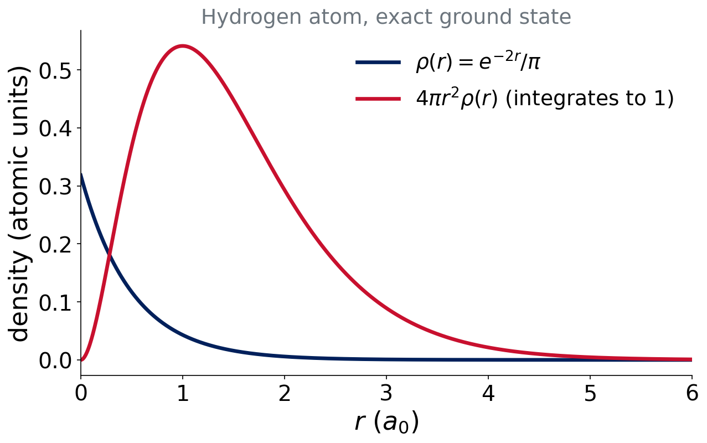
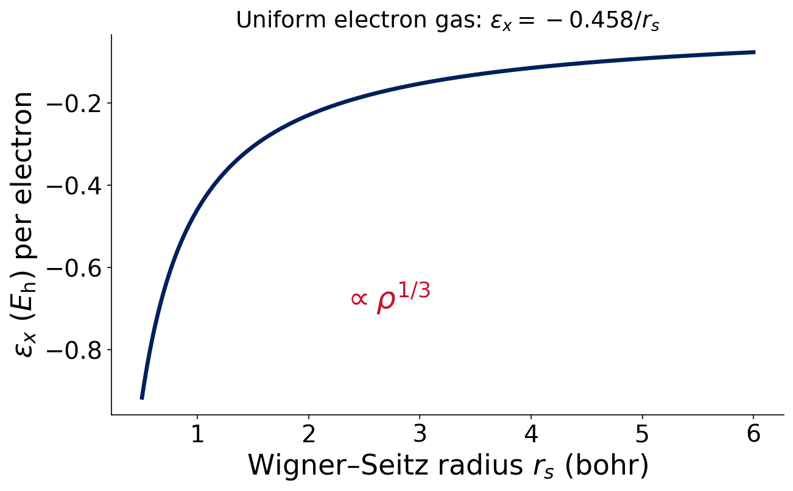

# Motivation

## Wave function or density?

- Ψ depends on **3N** spatial coordinates (plus spin)
- The density ρ(**r**) depends on **3**

. . .

Correlated wave-function methods are accurate and expensive ($N^5$ to $N^7$). Could the **density** be enough?

## Think–pair–share

::: {.callout-note}
## Question (2 min)
A molecule with 50 electrons. How many spatial variables does Ψ have? And ρ?
:::

. . .

Ψ: $3\times50=150$. ρ: **3**, whatever the size.

# The density

## The electron density

$$
\rho(\mathbf r)=N\int|\Psi(\mathbf r,\mathbf r_2,\dots,\mathbf r_N)|^2\,d\mathbf r_2\cdots d\mathbf r_N\qquad\int\rho\,d\mathbf r=N
$$

- Probability density of finding **an** electron at **r**
- An **observable**: measured by X-ray diffraction

## Hydrogen atom density

{fig-alt="Density of the hydrogen atom, e to the minus 2r over pi, and the radial density 4 pi r squared times rho, which integrates to one electron."}

::: {.small}
Exact ground-state hydrogen. The density has a cusp at the nucleus and decays exponentially.
:::

## Hohenberg–Kohn theorems (1964)

1. ρ(**r**) **determines** the external potential, and so Ĥ and **everything**
2. There is a variational principle for $E[\rho]$: $E[\rho]\ge E_0$

. . .

::: takeaway
In principle, the density contains all the information of Ψ. But the theorem does not tell us the functional $E[\rho]$.
:::

::: {.small .muted}
Hohenberg & Kohn, Phys. Rev. 136, B864 (1964)
:::

## Thomas–Fermi: a cautionary tale

Write the kinetic energy directly as a functional of ρ (**orbital-free** DFT).

- Simple, fast, no orbitals
- But the result is poor: **no chemical bonding** at all

. . .

Lesson: the kinetic energy is too important to approximate crudely.

# Kohn–Sham

## The Kohn–Sham idea (1965)

Invent a fictitious system of **non-interacting** electrons with the **same density**.

- Orbitals are back: $\rho(\mathbf r)=\sum_i|\phi_i(\mathbf r)|^2$
- Compute most of the kinetic energy **exactly** from the orbitals

::: {.small .muted}
Kohn & Sham, Phys. Rev. 140, A1133 (1965)
:::

## The energy expression

$$
E[\rho]=T_s[\rho]+E_{ne}[\rho]+J[\rho]+E_{xc}[\rho]
$$

- $T_s$: kinetic energy of the non-interacting electrons
- $E_{ne}$: attraction to nuclei; $J$: classical Coulomb repulsion
- $E_{xc}$: **exchange–correlation**

. . .

All the unknown physics is in $E_{xc}$.

## What is in E_xc?

$$
E_{xc}=\underbrace{\text{exchange}}_{\text{antisymmetry}}+\underbrace{\text{correlation}}_{\text{dodging}}+\underbrace{(T-T_s)}_{\text{kinetic correction}}
$$

::: takeaway
With the **exact** $E_{xc}$, Kohn–Sham DFT is exact. Every functional is a different **approximation to $E_{xc}$**.
:::

## The Kohn–Sham equations

$$
\Big[-\tfrac12\nabla^2+v_\text{eff}(\mathbf r)\Big]\phi_i=\varepsilon_i\,\phi_i
$$

- Same form as HF: one-electron equations
- $v_\text{eff}$ depends on ρ, so we **iterate** (the same **SCF**)
- That is why the output looks the same for HF and DFT

## HF versus KS-DFT

| | HF | Kohn–Sham DFT |
|---|---|---|
| Unknowns | orbitals φᵢ | orbitals φᵢ |
| Exchange | exact | approximate, in $E_{xc}$ |
| Correlation | none | approximate, in $E_{xc}$ |
| Solved by | SCF | SCF |
| Exact in principle? | no | **yes** (exact $E_{xc}$) |

## Think–pair–share

::: {.callout-note}
## Question (2 min)
HF and DFT have a similar cost. Why can a DFT calculation give a lower or a higher energy than HF, with **no** variational guarantee against the exact energy?
:::

. . .

The exact $E_{xc}$ is unknown. An **approximate** functional is not variational with respect to the true energy: errors can go either way.

# The first approximation: LSDA

## The uniform electron gas

:::: {.columns}
::: {.column width="55%"}
{fig-alt="Exchange energy per electron of the uniform electron gas, minus 0.458 divided by the Wigner-Seitz radius, plotted against the Wigner-Seitz radius."}
:::
::: {.column width="45%"}
Pretend the density is **locally uniform**.

$$
\varepsilon_x\propto-\rho^{1/3}
$$

$$
E_x^\text{LDA}=-C_x\int\rho^{4/3}\,d\mathbf r
$$
:::
::::

::: {.small .muted}
Dirac 1930; Slater 1951. Wigner–Seitz radius: $r_s=(3/4\pi\rho)^{1/3}$.
:::

## LSDA correlation

Correlation energy of the uniform gas, fitted to **quantum Monte Carlo** data (Ceperley & Alder):

- **VWN**: Vosko, Wilk & Nusair, Can. J. Phys. 1980
- **PW92**: Perdew & Wang, Phys. Rev. B 1992

Spin-dependent: **LSDA** (local spin-density approximation).

## What does LSDA get right and wrong?

:::: {.columns}
::: {.column width="50%"}
**Right**

- Geometries, surprisingly good
- Vibrational frequencies (reasonable)
:::
::: {.column width="50%"}
**Wrong**

- Bonds too strong (**overbinding**)
- Atomization energies much too large
- Weak interactions unreliable
:::
::::

## Think–pair–share

::: {.callout-note}
## Question (2 min)
Real molecules have regions where the density changes rapidly (near nuclei, in bonds). Why is a "locally uniform gas" a poor model there? What ingredient would you add?
:::

. . .

A uniform gas has **zero** gradient. Add information about how fast ρ changes: the **gradient ∇ρ**. That is the next rung (Lecture 6).

# Practicalities and known errors

## Numerical integration

$E_{xc}$ has **no analytic integral**. It is evaluated on a **grid** of points around each atom.

- Accuracy and cost depend on the grid
- HF needs no such grid

. . .

Full story in Lecture 11.

## Hybrid functionals: a preview

Mix a fraction of **exact HF exchange** into the functional.

- Reduces self-interaction error
- Costs more than pure functionals
- Next class

## Known errors to keep in mind

- **Self-interaction / delocalization error**: an electron partly repels itself (HF has none)
- **Missing long-range dispersion**: semilocal functionals see only local density
- **Static correlation**: stretched bonds, near-degenerate states

Each returns in Lectures 8–9.

## Summary

::: takeaway
- Hohenberg–Kohn: ρ is enough, in principle
- Kohn–Sham: orbitals back, the same SCF, **all the difficulty in $E_{xc}$**
- LSDA: the first, simplest approximation to $E_{xc}$
:::

**Lecture 6:** climbing Jacob's ladder.

## References

::: {.small}
- Hohenberg & Kohn, *Phys. Rev.* **136**, B864 (1964)
- Kohn & Sham, *Phys. Rev.* **140**, A1133 (1965)
- Slater, *Phys. Rev.* **81**, 385 (1951)
- Vosko, Wilk & Nusair, *Can. J. Phys.* **58**, 1200 (1980)
- Perdew & Wang, *Phys. Rev. B* **45**, 13244 (1992)
:::
