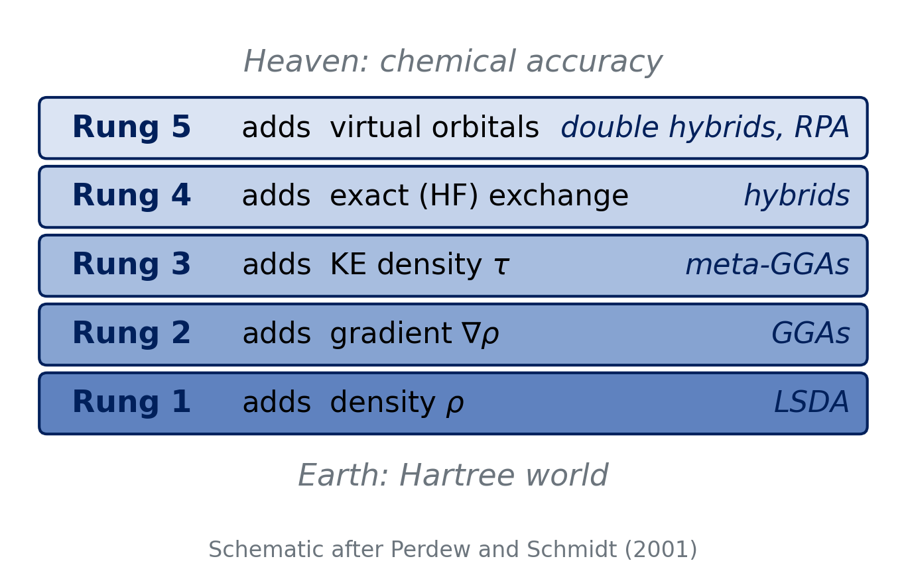
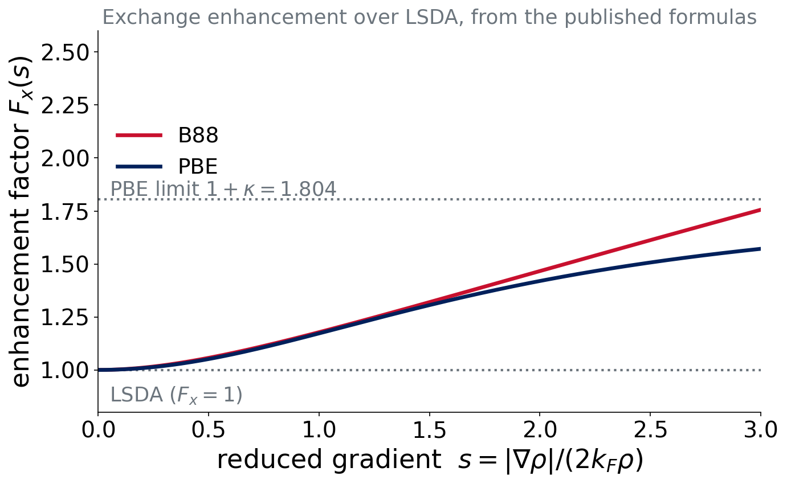
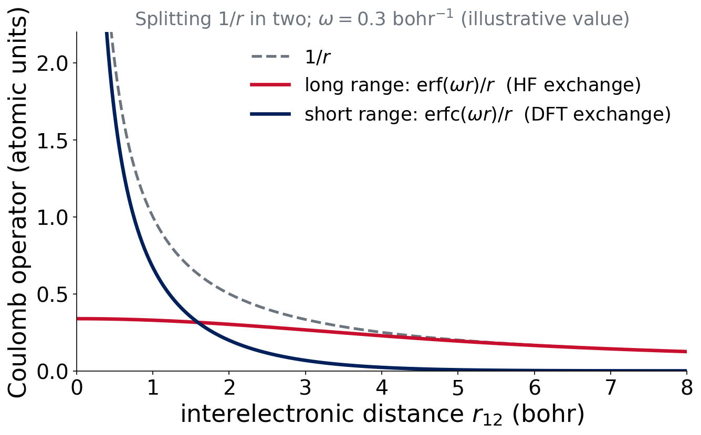

# The ladder

## Jacob's ladder

{fig-alt="Schematic of Jacob's ladder with five rungs between Hartree world at the bottom and chemical accuracy at the top: rung 1 density, rung 2 gradient, rung 3 kinetic-energy density tau, rung 4 exact exchange, rung 5 virtual orbitals."}

::: {.small .muted}
Perdew & Schmidt, AIP Conf. Proc. 577, 1 (2001)
:::

## The idea

Each rung adds a **new ingredient** to $E_{xc}$ and, hopefully, climbs towards **chemical accuracy** (about 1 kcal/mol).

. . .

- More ingredients: usually more accuracy
- Also: more cost, and more ways to go wrong
- A climb in principle, not a guarantee in practice

::: notes
Heaven/Earth image: Genesis, Jacob's dream. Perdew's metaphor, not a theorem.
:::

# Rungs 2 and 3

## Rung 2: GGA

Add the **gradient** of the density, through the reduced gradient

$$
s=\frac{|\nabla\rho|}{2k_F\rho},\qquad k_F=(3\pi^2\rho)^{1/3}
$$

$$
E_x^\text{GGA}=\int \rho^{4/3}\,F_x(s)\,d\mathbf r\cdot(\text{constants})
$$

$F_x(s)$: the **enhancement factor** over LSDA.

## Two exchange enhancement factors

{fig-alt="Enhancement factor F_x versus reduced gradient s for B88 and PBE exchange. Both start at 1 (the LSDA value) and rise; PBE saturates below the limit 1.804 while B88 keeps rising."}

::: {.small}
Plotted from the published formulas. B88: empirical, one parameter fitted to atoms. PBE: derived from constraints, bounded.
:::

## GGA names are recipes

Exchange + correlation:

| Name | Exchange | Correlation |
|---|---|---|
| BLYP | B88 | LYP |
| BP86 | B88 | P86 |
| PBE | PBE | PBE |

::: {.small .muted}
Becke, Phys. Rev. A 38, 3098 (1988); Lee, Yang & Parr, Phys. Rev. B 37, 785 (1988); Perdew, Burke & Ernzerhof, Phys. Rev. Lett. 77, 3865 (1996)
:::

## Rung 3: meta-GGA

Add the **kinetic-energy density**

$$
\tau(\mathbf r)=\tfrac12\sum_i|\nabla\phi_i(\mathbf r)|^2
$$

(and/or the Laplacian $\nabla^2\rho$). Still **no HF exchange**.

Examples: **TPSS** (2003), **SCAN** (2015; non-empirical, built to satisfy 17 exact constraints).

::: {.small .muted}
Tao, Perdew, Staroverov & Scuseria, Phys. Rev. Lett. 91, 146401 (2003); Sun, Ruzsinszky & Perdew, Phys. Rev. Lett. 115, 036402 (2015)
:::

## Think–pair–share

::: {.callout-note}
## Question (2 min)
A functional uses ρ, ∇ρ and τ, and has no HF exchange. Which rung? What could you add to climb one more rung?
:::

. . .

Rung 3 (meta-GGA). Add a fraction of **exact (HF) exchange**: rung 4.

# Rung 4: hybrids

## Global hybrids

Replace part of the DFT exchange with **exact HF exchange**:

$$
E_{xc}=E_{xc}^\text{DFT}+a_0\big(E_x^\text{HF}-E_x^\text{DFT}\big)
$$

Motivation: the adiabatic connection links the non-interacting and the real system, and the **exact** exchange belongs to the non-interacting end (Becke 1993).

## B3LYP and PBE0

- **B3LYP**: **20%** HF exchange. Three fitted parameters in total (Becke 1993; Stephens et al. 1994)
- **PBE0**: **25%** HF exchange, no fitted mixing (Adamo & Barone 1999)

. . .

Hybrid **meta**-GGAs add τ as well:

- **M06-2X**: **54%** HF exchange; the "2X" means "double the exchange" of M06

::: {.small .muted}
Becke, J. Chem. Phys. 98, 5648 (1993); Stephens et al., J. Phys. Chem. 98, 11623 (1994); Adamo & Barone, J. Chem. Phys. 110, 6158 (1999)
:::

## Why HF exchange helps

- HF has **no self-interaction**
- Pure functionals have **some**: electrons are too delocalized
- Mixing HF exchange **reduces** this error

Price: HF exchange is a **non-local** operator, so hybrids cost more than (meta-)GGAs.

## Range-separated hybrids

Split the Coulomb operator:

$$
\frac{1}{r_{12}}=\underbrace{\frac{\mathrm{erfc}(\omega r_{12})}{r_{12}}}_\text{short range}+\underbrace{\frac{\mathrm{erf}(\omega r_{12})}{r_{12}}}_\text{long range}
$$

DFT exchange at **short** range; HF exchange at **long** range (up to 100%).

## The split in a picture

{fig-alt="Coulomb operator 1 over r split into a short-range erfc part that decays quickly and a long-range erf part that stays finite at zero and carries the tail."}

## Range-separated examples

- **ωB97X-V** and **ωB97M-V** (Mardirossian & Head-Gordon, 2014 and 2016)
- **M11** (Peverati & Truhlar, 2011): 42.8% HF at short range rising to 100% at long range

. . .

::: takeaway
Rung 4 in one sentence: **mix in exact exchange**: a fixed fraction (global) or a fraction that depends on distance (range-separated).
:::

## Think–pair–share

::: {.callout-note}
## Question (2 min)
If 20% HF exchange is good, is 100% better? Why or why not?
:::

. . .

No. Pure HF exchange has no matching correlation and is not self-consistent with approximate DFT correlation. The best fraction depends on the functional's other ingredients. High fractions (such as 54%) help some properties (barriers) and hurt others.

# Rung 5 and two design questions

## Rung 5: double hybrids

Add a term that looks like **MP2 correlation**, from **virtual orbitals**.

- Example: **B2PLYP** (Grimme 2006)
- Also: random-phase approximation (RPA)
- More accurate, more expensive ($N^5$)

Not part of the course's methods.

## Design question 1: dispersion

How do we get the missing long-range dispersion?

| Strategy | Example |
|---|---|
| none | PBE |
| empirical **-D4** (pairwise, charge-dependent $C_6$) | PBE-D4, B3LYP-D4 |
| nonlocal **VV10** kernel ("-V", "-rV") | ωB97M-V, B97M-rV |
| built into a fitted functional | Minnesota functionals |

D4 is our standard. D2 and D3 are history.

::: {.small .muted}
Caldeweyher et al., J. Chem. Phys. 147, 034112 (2017); 150, 154122 (2019); Vydrov & Van Voorhis, J. Chem. Phys. 133, 244103 (2010)
:::

## Design question 2: how are functionals built?

:::: {.columns}
::: {.column width="50%"}
**Non-empirical**

Satisfy exact constraints (PBE, SCAN). Few or no fitted parameters.
:::
::: {.column width="50%"}
**Empirical**

Parameters fitted to data: B3LYP (3), Minnesota functionals, ωB97M-V (combinatorial optimization, many parameters).
:::
::::

. . .

Risk: **overfitting** to the training set (Lecture 9).

## Decoding names

| Name | Reads as |
|---|---|
| **B3LYP-D4** | Becke 3-parameter hybrid + LYP, plus D4 dispersion |
| **ωB97M-V** | ω = range-separated; B97-type; M = meta; V = VV10 nonlocal correlation |
| **M06-2X** | Minnesota 2006; 2X = twice the HF exchange of M06 |
| **B97M-rV** | B97-type meta-GGA with revised VV10 |

## Think–pair–share

::: {.callout-note}
## Question (2 min)
Without looking anything up: what does "PBE-D4" tell you about the ingredients? And what does "ωB97M-V" tell you about the **cost** relative to PBE?
:::

. . .

PBE-D4: the PBE GGA plus an added pairwise dispersion correction. ωB97M-V: meta-GGA ingredient, HF exchange with range separation and a nonlocal kernel, so noticeably **more expensive** per SCF cycle.

::: takeaway
A name is a recipe: read the **ingredients** (ρ, ∇ρ, τ, HF exchange, range separation) and the **dispersion** treatment.
:::

# Experiment 2

## Experiment 2: the task

**No calculations.** You will:

- Classify **20 functionals** by rung
- Learn how to find answers in the literature

. . .

Five categories (the same rungs, with hybrids kept apart):

| LSDA | GGA | meta-GGA | hybrid GGA | hybrid meta-GGA |
|---|---|---|---|---|

## How to decide

Ask three questions about each functional:

1. Does it use ρ only, ∇ρ, or also **τ**?
2. Does it include **HF exchange**? (any fraction, global or at long range only)
3. Which extra flags: **range-separated**? **dispersion** (-D, -V)?

Dispersion terms do **not** change the rung.

## Where to look

- The **original paper** of each functional
- Reviews: Mardirossian & Head-Gordon, *Mol. Phys.* **115**, 2315 (2017); Goerigk et al., *Phys. Chem. Chem. Phys.* **19**, 32184 (2017)
- The **Q-Chem manual**
- Lecture notes from today

The page checks your answers and explains each one.

## Lock predictions for next week

Experiment 3 starts next week: four "easy" organic reactions with **16 methods**.

- Write down which rungs you expect to do best
- The website locks your predictions before you see results

**Lecture 7:** debrief of Experiments 1 and 2, and how to test a functional.

## Summary of Lectures 4–6

::: takeaway
Every method approximates Ĥ: HF is exchange without correlation, DFT puts everything into $E_{xc}$, and Jacob's ladder says **which ingredients** an $E_{xc}$ uses.
:::

- Ladder: LSDA → GGA → meta-GGA → hybrid → double hybrid
- Independent choices: dispersion, empirical or non-empirical, range separation

## The 16 methods of Experiments 3–5 {visibility="hidden"}

::: {.callout-warning}
Hidden slide: show only after Experiment 2 is submitted.
:::

| Method | Rung | Dispersion |
|---|---|---|
| SPW92 | LSDA | none |
| BP86, BLYP, PBE | GGA | none |
| PBE-D4 | GGA | D4 |
| SCAN | meta-GGA | none |
| B97M-V | meta-GGA | VV10 |
| B3LYP, B3PW91, PBE0 | hybrid GGA | none |
| B3LYP-D4 | hybrid GGA | D4 |
| M06-2X, M11, MN15 | hybrid meta-GGA | fitted (Minnesota) |
| ωB97M-V | hybrid meta-GGA | VV10 |
| HF | Hartree–Fock | none |

## References

::: {.small}
- Perdew & Schmidt, *AIP Conf. Proc.* **577**, 1 (2001)
- Becke, *Phys. Rev. A* **38**, 3098 (1988); *J. Chem. Phys.* **98**, 5648 (1993)
- Lee, Yang & Parr, *Phys. Rev. B* **37**, 785 (1988)
- Perdew, Burke & Ernzerhof, *Phys. Rev. Lett.* **77**, 3865 (1996)
- Sun, Ruzsinszky & Perdew, *Phys. Rev. Lett.* **115**, 036402 (2015)
- Adamo & Barone, *J. Chem. Phys.* **110**, 6158 (1999)
- Mardirossian & Head-Gordon, *J. Chem. Phys.* **144**, 214110 (2016); *Mol. Phys.* **115**, 2315 (2017)
- Peverati & Truhlar, *J. Phys. Chem. Lett.* **2**, 2810 (2011)
- Caldeweyher et al., *J. Chem. Phys.* **147**, 034112 (2017); **150**, 154122 (2019)
- Vydrov & Van Voorhis, *J. Chem. Phys.* **133**, 244103 (2010)
- Goerigk et al., *Phys. Chem. Chem. Phys.* **19**, 32184 (2017)
:::
