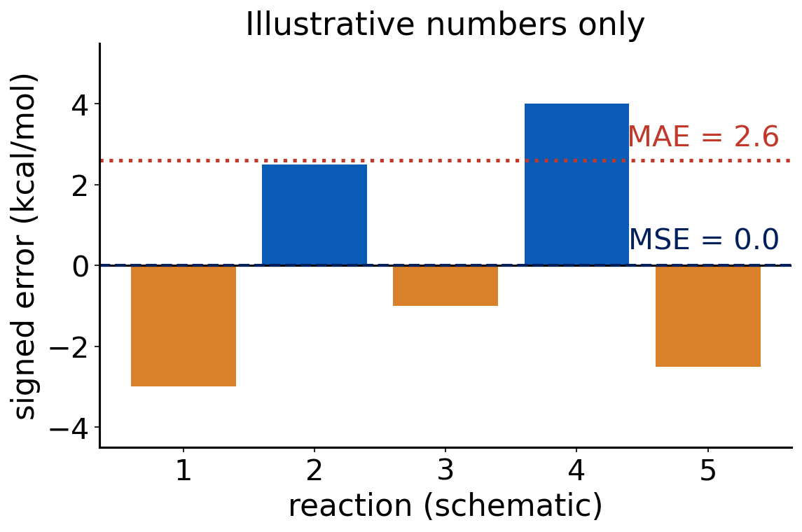
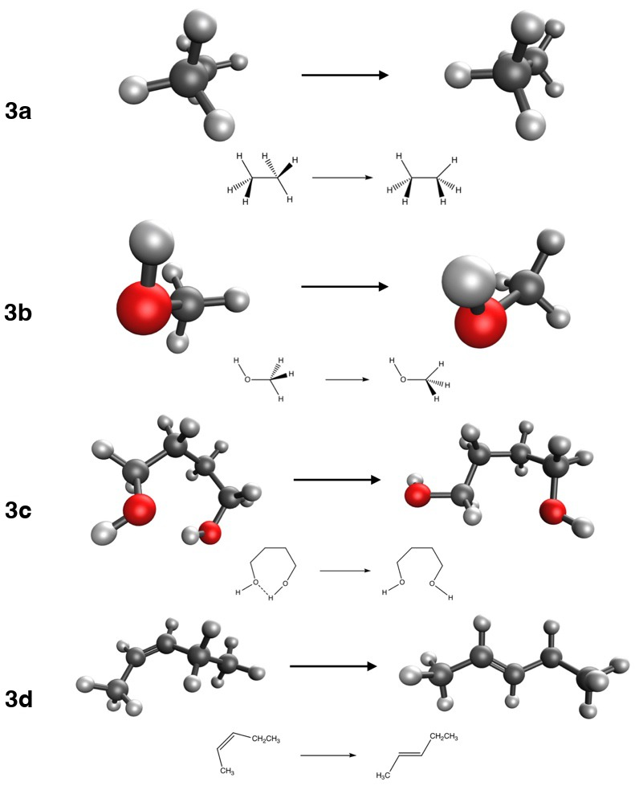

# Debrief: Experiment 1 {background-color="#00205b"}

## Your results

::: {.takeaway}
**[Live: open Class results → Experiment 1 heatmap]**

[Open the class results page](../class-results.html)
:::

- Signed error of each method at each basis set, for (HCl)₂ → 2 HCl
- Look for patterns before we explain them

::: notes
Open the heatmap and let students call out what they see for two minutes before moving on.
:::

## [Insert class plot: error vs. basis set]

::: {.takeaway}
**[Insert class plot: signed error of (HCl)₂ → 2 HCl vs. basis set (def2-SVP, def2-TZVP, def2-QZVP and cc-pVDZ, cc-pVTZ, cc-pVQZ), one line per method]**
:::

Questions to ask: which lines flatten out? Which methods never reach the reference?

## Error versus ζ: what you probably saw

- Going from double-ζ to triple-ζ changes the result a lot
- Triple-ζ to quadruple-ζ changes it much less
- Curves flatten: the basis-set limit is approaching
- Double-ζ is **not** converged; quadruple-ζ is close to the CBS limit
- The flattening is the variational principle at work: more functions, lower energy, smaller change

## Hartree–Fock never gets there

:::: {.columns}
::: {.column width="55%"}
- (HCl)₂ is held together largely by dispersion
- HF has no electron correlation, so it has no dispersion
- A bigger basis cannot add a physical effect the method does not contain
- The HF curve flattens, but at the wrong answer
:::
::: {.column width="45%"}
{fig-alt="Reaction scheme of the hydrogen chloride dimer separating into two hydrogen chloride molecules" width="100%"}
:::
::::

::: {.takeaway}
Method error and basis error are different things. A basis set only converges **toward the limit of its method**.
:::

## def2 versus cc-pVnZ

- Two families at each ζ: Karlsruhe def2 and Dunning cc-pVnZ
- cc-pVnZ sets were designed for **correlated wave-function methods**
- def2 sets were designed with DFT and HF in mind
- Typical behavior: for DFT, def2 is often as good or better at the same ζ and usually cheaper
- The two families are not interchangeable at a given ζ: compare sizes, not just names

## Cost: the exponent you measured

- Formal scaling of hybrid DFT and HF integrals is about N⁴ in the number of basis functions
- Fitting time versus N_bf, you probably got a **smaller** exponent
- Why? Integral screening, density fitting, and small molecules where overhead dominates
- Small N is not the asymptotic regime

## [Insert class plot: timing vs. basis functions]

::: {.takeaway}
**[Insert class plot: wall time vs. number of basis functions (log-log) for each method, with the fitted exponent]**
:::

Use it to discuss which method is cheapest and how steeply cost rises from def2-TZVP to def2-QZVP.

## Quick question

Cost rises steeply with ζ. You have to run many jobs in 10 minutes each.

**Which basis-set level would you pick for routine work, and why?**

. . .

Triple-ζ (def2-TZVP): most of the convergence for a fraction of the cost. That is why it is the default for Experiments 3–6 and 9.

## Takeaway: Experiment 1

::: {.takeaway}
- Always check basis-set convergence before comparing methods
- Triple-ζ is the usual accuracy/cost compromise
- Missing physics (dispersion in HF) is not repaired by a bigger basis
:::

# Debrief: Experiment 2 {background-color="#00205b"}

## Common misclassifications

- **Range-separated hybrids** (ωB97M-V, M11): they are hybrids, with the HF fraction growing with distance
- **-V versus -D**: -V (VV10, -rV) is a nonlocal correlation kernel; -D4 is an add-on pairwise correction
- **Meta-GGA versus hybrid meta-GGA**: look for HF exchange
- Functionals named after their parameters (M06-2X: 2X means twice the HF exchange of M06)

## The 16 methods on the ladder

| Rung | Methods |
|---|---|
| LSDA | SPW92 |
| GGA | BP86, BLYP, PBE, PBE-D4 |
| meta-GGA | SCAN, B97M-V |
| hybrid GGA | B3LYP, B3LYP-D4, B3PW91, PBE0 |
| hybrid meta-GGA | M06-2X, M11, MN15, ωB97M-V |
| wave function | HF |

::: {.small}
Dispersion flags: -D4 (PBE-D4, B3LYP-D4); nonlocal VV10 (B97M-V, ωB97M-V). Range-separated: M11, ωB97M-V.
:::

# How we test a functional {background-color="#00205b"}

## Why benchmark?

- A functional is an **approximation**, with no guarantee of accuracy
- Papers report good results on selected examples
- A benchmark asks: how does it do on many reactions, with trusted answers?
- This lab is a small benchmark you run yourselves

## Where the reference values come from

- **CCSD(T) at the complete-basis-set limit**: "gold standard" for small and medium molecules
- **Experiment** corrected to electronic energies (class 13), for cases where theory cannot reach
- Reference quality limits what we can conclude: the reference must be much better than the method tested

## Benchmark databases

- **GMTKN55**: 55 subsets, about 1500 relative energies (Goerigk 2017)
- **MGCDB84**: 84 subsets, used to compare many functionals (Mardirossian 2017)
- **Minnesota databases**: used to train and test the Minnesota functionals
- Exp. 1 uses the NCCE30 subset, and later experiments draw on other subsets

## Reaction types

:::: {.columns}
::: {.column width="50%"}
- Thermochemistry (atomization energies, bond energies)
- Barrier heights
- Noncovalent interactions
:::
::: {.column width="50%"}
- Isomerization energies
- Conformer energies
- Transition-metal energetics
:::
::::

Each type stresses a different weakness. A functional can be good on one and bad on another.

## Error statistics

Signed error of one reaction (ΔE = Σ νᵢEᵢ, ν > 0 products, ν < 0 reactants):

$$
\varepsilon = \Delta E_{\text{calc}} - \Delta E_{\text{ref}}
$$

- **MSE** = mean of ε: sign shows systematic over- or under-binding
- **MAE** = mean of |ε|: typical size of the error
- **Max error** = largest |ε|: the worst case
- **Relative error** = ε / ΔE_ref: fair across reactions of different size

## Why report more than one number

:::: {.columns}
::: {.column width="55%"}
{fig-alt="Bar chart of five illustrative signed errors with the mean signed error near zero and the mean absolute error much larger" width="100%"}
:::
::: {.column width="45%"}
- Positive and negative errors can cancel in the MSE
- A small MSE with a large MAE means scatter, not accuracy
:::
::::

## Quick question

A functional has MSE ≈ 0 over your four reactions.

**Is it accurate?**

. . .

Not necessarily. Errors of both signs cancel. Check the MAE and the maximum error, and look at the individual reactions.

## Chemical accuracy

- **1 kcal/mol** is the usual target for useful thermochemistry
- 1 Eh = 627.5095 kcal/mol, so 1 kcal/mol is about 1.6 mEh of a total energy of hundreds of Eh
- Most approximate functionals do not reach it on all reaction types
- A single number never tells the whole story: ask for what, with which basis, and which reactions

::: {.takeaway}
Report signed error, MAE and the worst case, and always say which reactions they average over.
:::

# Experiment 3 briefing {background-color="#00205b"}

## Goal

**[Experiment 3: Applying DFT to Organic Chemistry, Part A](../experiments/ex03-organic-a.html)**

- Test 16 methods on four "easy" organic reactions
- Same basis set for all (def2-TZVP), so differences come from the method
- Also record the cost per SCF cycle

## The four reactions

:::: {.columns}
::: {.column width="48%"}
| Reaction | Ref. (kcal/mol) |
|---|---:|
| 3a ethane: staggered → eclipsed | 2.73 |
| 3b methanol: staggered → eclipsed | 1.01 |
| 3c butane-1,4-diol: B1 → B43 | 3.29 |
| 3d cis- → trans-pent-2-ene | −1.15 |
:::
::: {.column width="52%"}
{fig-alt="Drawings of the four reactions of Experiment 3: ethane and methanol rotation, butanediol conformers, and cis to trans pentene" width="100%"}
:::
::::

## Methods and jobs

- 16 methods: SPW92, BP86, BLYP, PBE, PBE-D4, SCAN, B97M-V, B3LYP, B3LYP-D4, B3PW91, PBE0, M06-2X, M11, MN15, ωB97M-V, HF
- Basis set: def2-TZVP
- 8 molecules × 16 methods = **128 short jobs**
- Submit in batches ([shared-machine guide](../guides/shared-machines.html))
- All molecules are singlets; line 2 of each .xyz file is "charge multiplicity"

## Why these reactions are "easy"

- Same bonds before and after: only geometry changes
- Isodesmic-like: the same kind of electronic error appears on both sides and **cancels**
- Do not expect a method's error here to predict its error when bonds break (Experiments 4–5)

## Pitfalls

- Copy **all digits** of each total energy: reaction energies are small differences of large numbers
- Use signed ν: ΔE = Σ νᵢEᵢ, then × 627.5095 kcal/mol per Eh
- Check that the right method name is in the job (-D4 variants!)
- Record SCF cycles and wall time for every job

## Predictions to lock

Before you run anything:

- Which method will have the smallest error overall?
- Which will be the worst, and why?
- Which will be the most expensive per SCF cycle?

::: {.takeaway}
Write predictions first. Experiments teach most when you can compare with what you expected.
:::

## Before next class

- Run the jobs, enter the results, submit the JSON file by the Microsoft Form (Florida Tech email)
- Next class: debrief Experiment 3, then dispersion

## References {.smaller}

::: {.small}
- Goerigk, L. et al. Phys. Chem. Chem. Phys. 19 (2017): GMTKN55.
- Mardirossian, N.; Head-Gordon, M. Mol. Phys. 115 (2017): MGCDB84 and a survey of functionals.
- Weigend, F.; Ahlrichs, R. Phys. Chem. Chem. Phys. 7 (2005): def2 basis sets.
- Dunning, T. H. J. Chem. Phys. 90 (1989): cc-pVnZ basis sets.
- pchem2 textbook: <https://peverati.github.io/pchem2/>
:::
