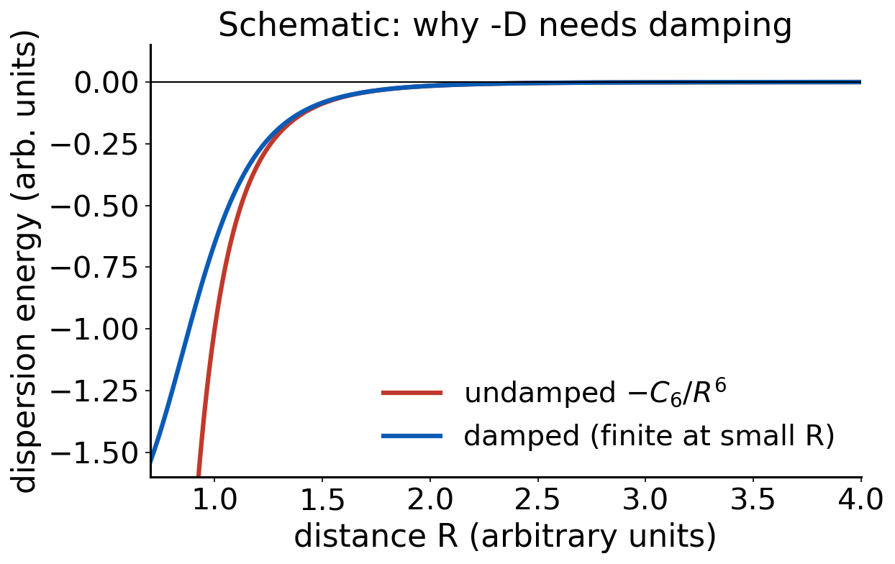
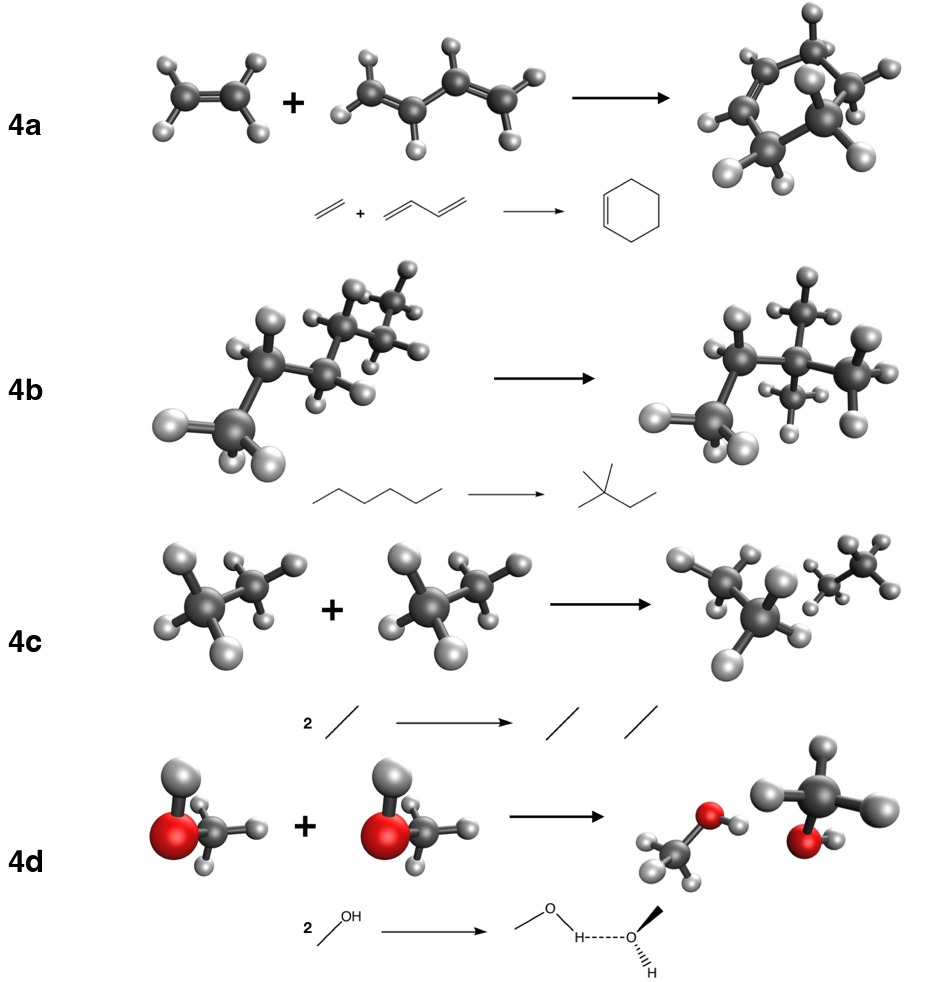

# Debrief: Experiment 3 {background-color="#00205b"}

## Your results

::: {.takeaway}
**[Live: open Class results → Experiment 3 heatmap]**

[Open the class results page](../class-results.html)
:::

- Signed errors for 16 methods on four "easy" reactions
- Which cells are dark? Which rows are almost all light?

## [Insert class plot: error by method and reaction]

::: {.takeaway}
**[Insert class plot: Experiment 3 signed-error chart, 16 methods × reactions 3a–3d]**
:::

## What you probably saw: easy means forgiving

- Most methods do well on the rotation and conformer energies
- Reason: **error cancellation**. Both sides of each reaction have the same bonds
- Typical outliers: the local density approximation (SPW92) and Hartree–Fock
- The ranking by rung is not strict: a good GGA can beat a poor hybrid here

## Butane-1,4-diol: an intramolecular hydrogen bond

- Conformers differ in how the two OH groups interact
- A hydrogen bond mixes electrostatics, charge transfer and **dispersion**
- Methods that treat noncovalent contacts poorly show up here
- Keep this in mind: 3c is the first hint of what Experiment 4 pushes harder

## [Insert class plot: cost versus accuracy]

::: {.takeaway}
**[Insert class plot: time per SCF cycle vs. mean absolute error, one point per method]**
:::

## Cost: what you probably saw

- (Meta-)GGAs are cheapest per SCF cycle among DFT methods
- Hybrids cost more because of exact exchange
- Range-separated hybrids and VV10-containing methods add more
- B3LYP is **not special** in cost compared with other hybrids
- The most expensive method is not automatically the most accurate

::: {.takeaway}
Cost and accuracy are different axes. Pick on evidence, not on habit.
:::

# Dispersion {background-color="#00205b"}

## What is dispersion?

- Electrons in two atoms fluctuate: instantaneous dipoles appear
- A dipole on A induces a dipole on B, and they attract
- This **correlated** motion lowers the energy at long range (London 1930)
- Present between all atoms and molecules, even noble gases

## The long-range form

$$
E_{\text{disp}}(R) \;\approx\; -\frac{C_6}{R^6}
$$

- C₆ grows with polarizability of the two partners
- Weak per contact, but it adds up over many atom pairs
- Dominant for noncovalent complexes, important in large molecules

## Why semilocal functionals miss it

- LDA, GGA and meta-GGA energy density at a point depends only on the **local** density (and gradient, τ)
- Two distant, non-overlapping densities do not "see" each other
- No correlated fluctuation between them: no −C₆/R⁶ tail

::: notes
Key point: the energy density at a point depends only on the local density, so two separated fragments cannot correlate. Contrast with VV10, which integrates over pairs of points.
:::

## Why HF misses it

- HF has no electron correlation at all
- Dispersion **is** a correlation effect
- No amount of basis set or integration grid brings it back
- That is why (HCl)₂ was not fixed by a bigger basis in Experiment 1

## Fix 1: add it by hand (-D)

- Add a pairwise sum over atoms: E_disp = −Σ C₆,ᵢⱼ / R⁶ᵢⱼ × damping
- History: D2 used fixed C₆ values; D3 made C₆ depend on coordination
- **-D4** (this course): C₆ also depends on **atomic charges** [Caldeweyher 2017, 2019]
- The damping parameters are fitted per functional, so **-D4 only works with the functional it was parameterized for**

## Damping

:::: {.columns}
::: {.column width="55%"}
{fig-alt="Two curves of dispersion energy against distance, one undamped diverging at small distance, the other damped and finite" width="100%"}
:::
::: {.column width="45%"}
- Undamped −C₆/R⁶ diverges at short range
- Damping turns the correction off where the functional already describes overlap
- Different damping schemes exist (zero, Becke–Johnson)
:::
::::

## Fix 2: build it into the functional

- **Nonlocal VV10 kernel**: a double integral over the density at two points [Vydrov and Van Voorhis 2010]
- Names: B97M-V, ωB97M-V, B97M-rV (the "-V" and "-rV" tell you)
- No atom-pair parameters: the kernel works from the density
- Cost: extra integration over pairs of grid points

## Fix 3: let the fitting do it

- Minnesota functionals (M06-2X, M11, MN15) have no explicit dispersion term
- Their flexible forms were fitted to data that include noncovalent complexes
- Can work well inside the training domain
- Less transferable than a physical long-range tail

## Summary of three routes

| Route | Example | Notes |
|---|---|---|
| Add a pairwise term | PBE-D4, B3LYP-D4 | cheap; functional-specific damping |
| Nonlocal kernel | ωB97M-V, B97M-V | density-based; extra cost |
| Fitted | M06-2X, MN15 | no explicit tail |

## Quick question

Hexane has a linear chain, neohexane is branched (more compact).

**Which should be more stable, and what holds it up?**

. . .

Neohexane. Branching brings more atoms into close contact, so there is more intramolecular dispersion. Semilocal functionals without a correction tend to miss this.

## Intramolecular dispersion

- It is not only for dimers: a large molecule folds against itself
- Isomerization energies, conformers and reaction energies of big molecules can all shift by several kcal/mol
- Experiment 4 includes hexane → neohexane for this reason

::: {.takeaway}
Dispersion is a long-range correlation effect. Semilocal DFT and HF miss it; -D4, VV10 and fitting restore it in different ways.
:::

# Experiment 4 briefing {background-color="#00205b"}

## Goal

**[Experiment 4: Applying DFT to Organic Chemistry, Part B](../experiments/ex04-organic-b.html)**

- When does error cancellation **stop** helping?
- What do -D4 and VV10 actually fix?
- Same 16 methods as Experiment 3, def2-TZVP

## The four reactions

:::: {.columns}
::: {.column width="48%"}
| Reaction | Ref. (kcal/mol) |
|---|---:|
| 4a ethene + butadiene → cyclohexene | −45.4 |
| 4b n-hexane → neohexane | −2.49 |
| 4c 2 ethane → (ethane)₂ | −1.34 |
| 4d MeOH(A) + MeOH(B) → (MeOH)₂ | −5.81 |
:::
::: {.column width="52%"}
{fig-alt="Drawings of the reactions of Experiment 4: Diels-Alder, alkane isomerization, ethane dimer and methanol dimer" width="100%"}
:::
::::

## What each reaction tests

- **4a Diels–Alder**: π bonds become σ bonds. Bond types change
- **4b**: intramolecular dispersion
- **4c**: pure dispersion
- **4d**: hydrogen bond with a dispersion contribution

## Jobs and setup

- 10 molecules × 16 methods = **160 jobs** with def2-TZVP
- Dimers: each monomer and the dimer are separate jobs (ethane monomer, ethane dimer, two methanol monomers, methanol dimer)
- Check the species list carefully: 4c uses coefficient −2 for ethane

## Pitfalls

- Dimers and **BSSE**: the dimer borrows basis functions from its partner, so binding looks too strong in small bases. We use a triple-ζ set, but keep it in mind
- Do not apply -D4 twice: use the -D4 methods as listed, not extra keywords
- Large total energies, small differences: keep every digit

## Expectations to lock

Before running, write down:

- Will -D4 matter more for 4a, 4b, 4c or 4d?
- Which treatment of dispersion will do best on 4c: none, -D4, VV10 or fitted?
- Will the same treatment win on 4d?

## References

::: {.small}
- London, F. Z. Phys. 63 (1930): dispersion force.
- Grimme, S. et al. J. Chem. Phys. 132 (2010): D3.
- Caldeweyher, E. et al. J. Chem. Phys. 147 (2017); J. Chem. Phys. 150 (2019): D4.
- Vydrov, O. A.; Van Voorhis, T. J. Chem. Phys. 133 (2010): VV10.
:::
