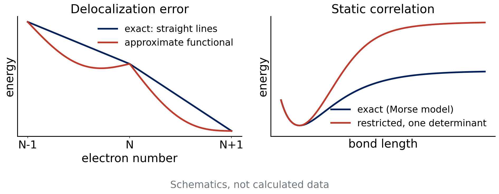
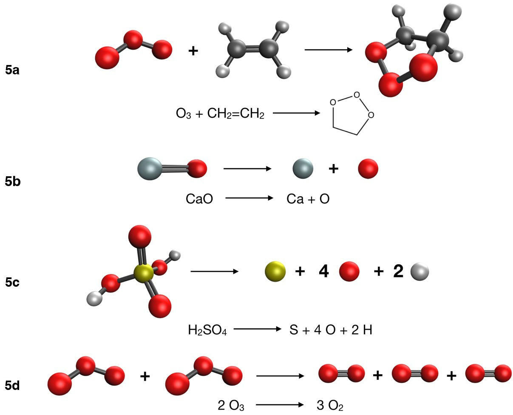

# Debrief: Experiment 4 {background-color="#00205b"}

## Your results

::: {.takeaway}
**[Live: open Class results → Experiment 4 heatmap]**

[Open the class results page](../class-results.html)
:::

- Signed errors for 16 methods on reactions 4a–4d
- Compare the dark cells with Experiment 3

## [Insert class plot: -D4 on versus off]

::: {.takeaway}
**[Insert class plot: Experiment 4 D4 chart: PBE vs. PBE-D4 and B3LYP vs. B3LYP-D4, per reaction]**
:::

## [Insert class plot: dimer chart]

::: {.takeaway}
**[Insert class plot: Experiment 4 dimer chart: ethane dimer (4c) and methanol dimer (4d) errors grouped by dispersion treatment: none, -D4, VV10, fitted]**
:::

## What you probably saw: -D4 on and off

- -D4 matters most where dispersion matters most: the ethane dimer, hexane → neohexane
- It helps less for the Diels–Alder reaction, which is not a dispersion problem
- An uncorrected GGA often **underbinds** a dispersion-bound dimer
- Adding -D4 usually moves the result in the right direction, but not always to the reference

## What you probably saw: dispersion treatments

- Pure dispersion (4c): corrected, VV10 and well-fitted functionals typically beat uncorrected ones
- Hydrogen-bonded dimer (4d): electrostatics matters too, so the ranking can differ from 4c
- Treatments can differ by case: no single winner on every row

## Diels–Alder: error cancellation breaks

- Experiment 3: same bonds on both sides, errors cancel
- 4a: π bonds are broken, σ bonds formed
- The electronic error of a π bond is not the error of a σ bond
- Errors are larger and more spread out across methods

::: {.takeaway}
Error cancellation is a gift of the reaction type, not a property of the functional.
:::

# Why DFT fails {background-color="#00205b"}

## Three recurring problems

- **Self-interaction error** and delocalization error
- **Static (multireference) correlation**
- **Atomization energies**: no error cancellation at all

Each one is built into the approximation, not into the basis set.

## Self-interaction error

- In exact theory, an electron does not repel itself
- In HF this cancels exactly: Ĵᵢᵢ = K̂ᵢᵢ
- In approximate DFT, E_xc only partly cancels the Hartree self-repulsion
- Result: electrons spread out too much (**delocalization error**) [Cohen, Mori-Sánchez, Yang 2012]

## Delocalization error

:::: {.columns}
::: {.column width="55%"}
{fig-alt="Left, energy against electron number: exact straight lines versus an approximate curve bowing below them. Right, a bond dissociation curve where a one-determinant curve rises to a wrong limit" width="100%"}
:::
::: {.column width="45%"}
- Exact E(N) is piecewise linear between integers
- Approximate E(N) is convex: fractional charge is too cheap
- Consequences: stretched H₂⁺ too stable, barriers too low, charge-transfer states too stable
:::
::::

::: notes
Draw the straight-line condition on the board: E(N) is linear between integers for the exact functional. Convex curvature means fractional charge is too cheap.
:::

## Mitigation: add HF exchange

- HF is free of self-interaction, so mixing in exact exchange reduces the error
- Global hybrids (B3LYP 20%, PBE0 25%, M06-2X 54%) help in proportion
- Range-separated hybrids put HF exchange at long range
- Cost: exact exchange, and not a complete cure

## — Natural break: end of lecture A —

::: {.muted}
If you split the material over two meetings, stop here. Lecture B starts with a one-slide recap of self-interaction error, then static correlation, atomization energies and the Experiment 5 briefing.
:::

## Static correlation

- Some molecules need **more than one** determinant even qualitatively
- Stretched bonds, ozone (O₃), and molecules with near-degenerate orbitals
- A single-reference method (HF, most DFT) breaks down in these cases
- Right panel of the figure: restricted determinant dissociates to the wrong limit

## Quick question

H₂ is stretched to 5 Å with a restricted (RHF-type) calculation.

**What energy does it give for the separated atoms compared with 2 × E(H atom)?**

. . .

Too high. The restricted wave function keeps ionic H⁺H⁻ character at long distance. Allowing different orbitals for different spins (unrestricted) recovers the correct limit but breaks spin symmetry. This is the idea of an instability (class 12).

## CaO and ozone

- **CaO**: low-lying states, strong ionic and covalent mixing
- **O₃**: significant diradical character
- Both are common in tests of static correlation
- A -D4 correction does not help: it adds dispersion, not multireference character

## Atomization energies

- Reactant: closed-shell molecule. Products: open-shell atoms
- The electronic structure changes completely: **no error cancellation**
- Free atoms are spin-polarized and spherical; functionals are fitted mostly on molecules
- Errors scale with the **size** of the reaction energy, hundreds of kcal/mol for H₂SO₄

## Why HF fails dramatically for atomization

- HF misses correlation energy
- Correlation energy is larger in molecules than in atoms, so HF **underbinds**
- The absolute error grows with the number of bonds
- Relative error is the fair measure (Experiment 5 includes a chart)

::: {.takeaway}
Self-interaction, static correlation and missing cancellation are structural limits. Better basis sets and grids do not remove them.
:::

# Experiment 5 briefing {background-color="#00205b"}

## Goal

**[Experiment 5: Difficult Cases for DFT](../experiments/ex05-difficult-cases.html)**

- Four chemically simple reactions that are hard for DFT
- Same 16 methods as Experiments 3–4, def2-TZVP
- Learn why a calculation is never a black box

## The four reactions

:::: {.columns}
::: {.column width="48%"}
| Reaction | Ref. (kcal/mol) |
|---|---:|
| 5a O₃ + C₂H₄ → primary ozonide | −58.7 |
| 5b CaO → Ca + O | 96.15 |
| 5c H₂SO₄ → S + 4 O + 2 H | 602.18 |
| 5d 2 O₃ → 3 O₂ | −67.6 |
:::
::: {.column width="52%"}
{fig-alt="Drawings of the reactions of Experiment 5: ozonolysis, CaO dissociation, sulfuric acid atomization and ozone to oxygen" width="100%"}
:::
::::

## Things to notice

- 5c has the largest number: compare **absolute** and **relative** error
- 5b: CaO is in the training set of some functionals. What does a good result there tell you?
- 5a, 5d involve ozone: static correlation

## Atoms need the right multiplicity

| Species | Multiplicity |
|---|---|
| O, S (atoms) | 3 (triplet) |
| H (atom) | 2 (doublet) |
| Ca (atom) | 1 (singlet) |
| O₂ | 3 (triplet) |
| other molecules | 1 |

::: {.small}
Line 2 of every .xyz file gives "charge multiplicity". Use it. Open shells need **unrestricted** calculations, which the generator sets for you.
:::

## Jobs

- 12 species × 16 methods = **192 jobs** with def2-TZVP
- Plan batches, record cycles and wall time
- Watch for SCF failures on atoms: note which functionals and report them

## Predictions to lock

- Which rung will do best on 5c, in absolute and in relative terms?
- Will -D4 help any of the four reactions?
- Which method will be worst, and why?

## References

::: {.small}
- Cohen, A. J.; Mori-Sánchez, P.; Yang, W. Chem. Rev. 112 (2012): challenges for DFT.
- Caldeweyher, E. et al. J. Chem. Phys. 147 (2017); 150 (2019): D4.
- Weigend, F.; Ahlrichs, R. Phys. Chem. Chem. Phys. 7 (2005): def2 basis sets.
:::
