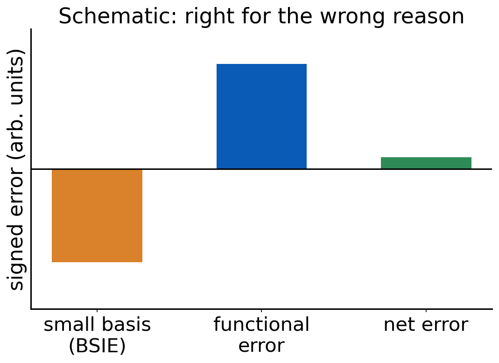

# Debrief: Experiment 5 {background-color="#00205b"}

## Your results

::: {.takeaway}
**[Live: open Class results → Experiment 5 heatmap]**

[Open the class results page](../class-results.html)
:::

- Signed errors for 16 methods on reactions 5a–5d
- Which reaction has the largest errors in kcal/mol? In percent?

## [Insert class plot: relative-error chart]

::: {.takeaway}
**[Insert class plot: Experiment 5 relative error (|error| / |reference|) per method and reaction]**
:::

## [Insert class plot: easy → hard across Experiments 3–5]

::: {.takeaway}
**[Insert class plot: mean absolute error per method in Experiments 3, 4 and 5 side by side (the "easy → hard" chart), with best overall method highlighted]**
:::

## What you probably saw: absolute versus relative

- 5c (H₂SO₄ atomization) gives the biggest errors in kcal/mol
- Relative to a reference near 600 kcal/mol, that same error may be small
- A 2 kcal/mol miss on 5a (reference −58.7) is a bigger **fraction**
- Which reaction is "hardest" depends on how you measure

## Which rungs survive

- Errors increase from Experiment 3 to 5 for most methods
- Hartree–Fock typically fails on atomization (missing correlation)
- Hybrids and modern meta-GGAs tend to hold up better than LDA and plain GGAs
- The ranking is **reaction-dependent**: no method wins everywhere

## D4 does not fix everything

- -D4 adds dispersion
- It does not cure static correlation (ozone) or self-interaction error
- In these reactions, -D4 can leave errors unchanged or even enlarge them
- Why? A dispersion term cannot repair a missing electronic effect

## CaO spotlight

- CaO is in the training data of some functionals
- A good result for a training-set molecule is **not** evidence of transferability
- It shows the functional can reproduce what it was fitted to
- Judge a functional on data it has never seen

::: {.takeaway}
Easy → hard: errors grow, rankings shuffle, and a functional's own training set is a poor test.
:::

# Basis-set error and functional error {background-color="#00205b"}

## Total error has parts

$$
\text{error} \;=\; \text{method (functional) error} \;+\; \text{basis-set error} \;+\; \text{other}
$$

- Method error: the approximation to E_xc
- Basis-set error: BSIE, from finite basis (class 2)
- Other: grid, SCF convergence, geometry, thermal effects (later classes)
- We usually see only the **sum**

## Error cancellation between them

:::: {.columns}
::: {.column width="55%"}
{fig-alt="Bar chart with a negative basis-set error bar, a positive functional error bar of similar size, and a small net error bar" width="100%"}
:::
::: {.column width="45%"}
- Errors of opposite sign can cancel
- A small total error can hide two large errors
- Change one ingredient and the agreement may vanish
:::
::::

## Quick question

A small basis set with a given functional gives a result closer to the reference than the large basis.

**Is the small basis "better"?**

. . .

Not necessarily. The result may be right **for the wrong reason**: basis-set error cancels functional error. A different functional or reaction may expose it.

## BSIE and BSSE

- **BSIE**: incompleteness of the basis. Energies are too high, differences too inaccurate
- **BSSE**: a fragment (or a molecule) borrows functions from neighbors, binding appears too strong
- Small basis sets have large BSIE and BSSE, and both usually go in the same direction for binding: more binding
- **Counterpoise correction**: compute fragments in the full dimer basis (definition only, here)

## Why B3LYP/6-31G* became so common

- 1990s: cheap enough for real molecules
- Built into widely used programs as a default
- Most-cited papers: huge citation numbers
- It often looked good on organic chemistry benchmarks

## Right for the wrong reasons

- B3LYP lacks dispersion and tends to underbind noncovalent contacts
- 6-31G* has large BSSE and BSIE and tends to overbind
- The two partly cancel in many organic comparisons (Kruse, Goerigk, Grimme 2012)
- Fixing one ingredient without the other can remove the agreement

::: notes
Do not reveal Experiment 6 outcomes. Ask students to predict the direction of each error before they run the jobs.
:::

## Not all double-ζ sets are equal

:::: {.columns}
::: {.column width="50%"}
Four double-ζ sets:

- 6-31G*
- def2-SVP
- cc-pVDZ
- pc-1
:::
::: {.column width="50%"}
- Different construction, different sizes
- Number of basis functions for **cyclohexene** differs by set
- You will count them in Experiment 6
:::
::::

::: {.takeaway}
Report the exact basis set. "Double-ζ" is not a specification.
:::

# Experiment 6 briefing {background-color="#00205b"}

## Goal

**[Experiment 6: Why is the B3LYP/6-31G* Level of Theory so Successful?](../experiments/ex06-b3lyp-631gs.html)**

- Compare small double-ζ basis sets with def2-TZVP
- B3LYP and B3LYP-D4, three reactions
- Can a small basis *look* better than a large one?

## Reactions and methods

| Reaction | Ref. (kcal/mol) |
|---|---:|
| 4a ethene + butadiene → cyclohexene | −45.4 |
| 4b n-hexane → neohexane | −2.49 |
| 5b CaO → Ca + O | 96.15 |

- Methods: B3LYP, B3LYP-D4
- Bases: 6-31G*, def2-SVP, cc-pVDZ, pc-1, and def2-TZVP (the reference level)

## Jobs

- 8 molecules × 2 methods × 4 new bases = **64 new jobs**
- **Import** the def2-TZVP results you already computed in Experiments 4 and 5
- Record the number of basis functions of every molecule

## Spot the anomaly

- The site asks you to flag cells that look suspicious
- Ask: is this result better because the **model** is better, or because errors cancel?
- Compare against def2-TZVP **first**, then judge the small basis

## Pitfalls

- 6-31G* is a Pople set: type the name exactly (`6-31G*`)
- Ca and O: same multiplicities as Experiment 5 (O triplet, Ca singlet)
- B3LYP-D4 is B3LYP with the D4 term, not a different functional
- Keep a table of N_bf per molecule per basis

## Predictions to lock

- Will the double-ζ sets differ from each other?
- Which reaction will suffer most from the small basis?
- Will adding -D4 to a small basis help or hurt?

## References

::: {.small}
- Kruse, H.; Goerigk, L.; Grimme, S. J. Org. Chem. 77 (2012): why the B3LYP/6-31G* level works.
- Weigend, F.; Ahlrichs, R. Phys. Chem. Chem. Phys. 7 (2005): def2 basis sets.
- Jensen, F. J. Chem. Phys. 115 (2001): pc-n basis sets.
- Caldeweyher, E. et al. J. Chem. Phys. 147 (2017); 150 (2019): D4.
:::
