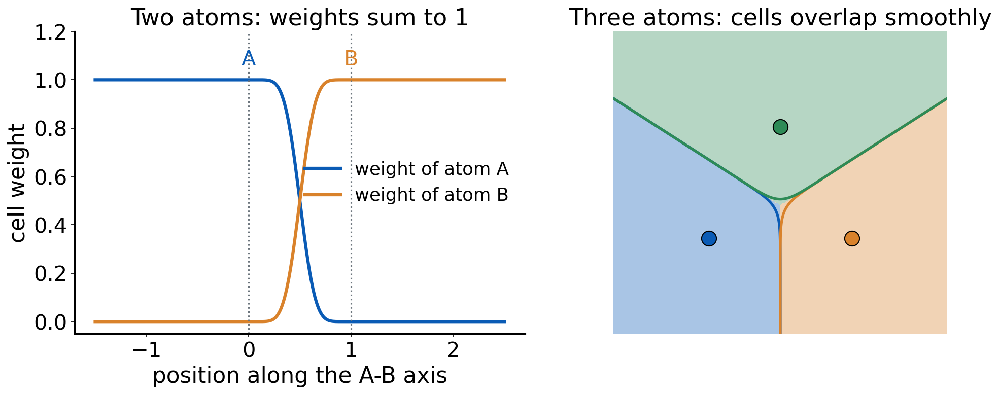
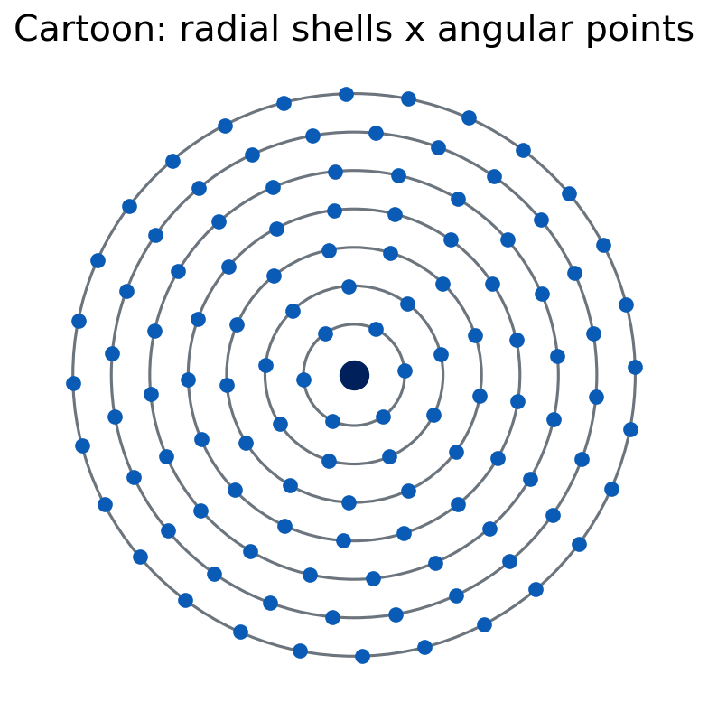
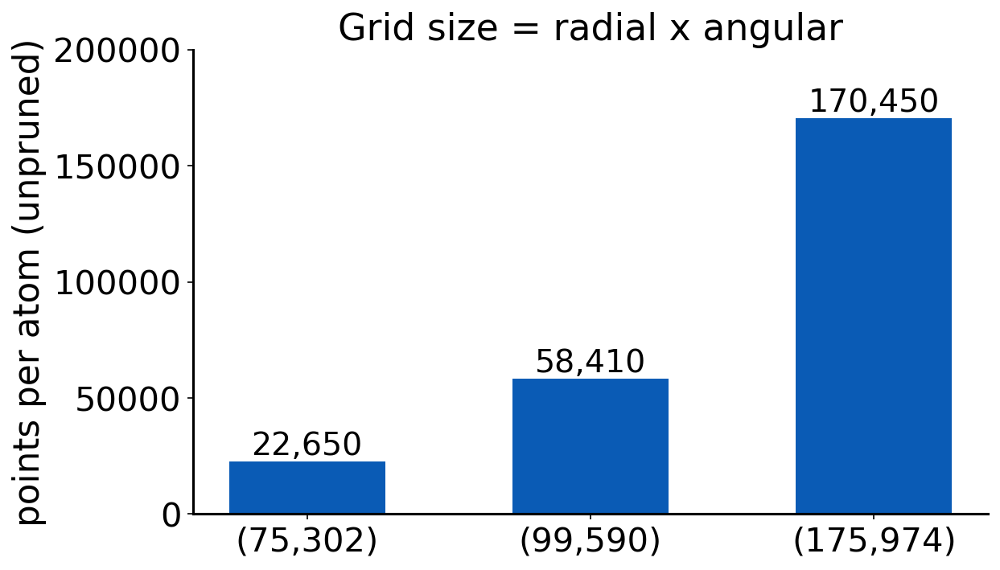
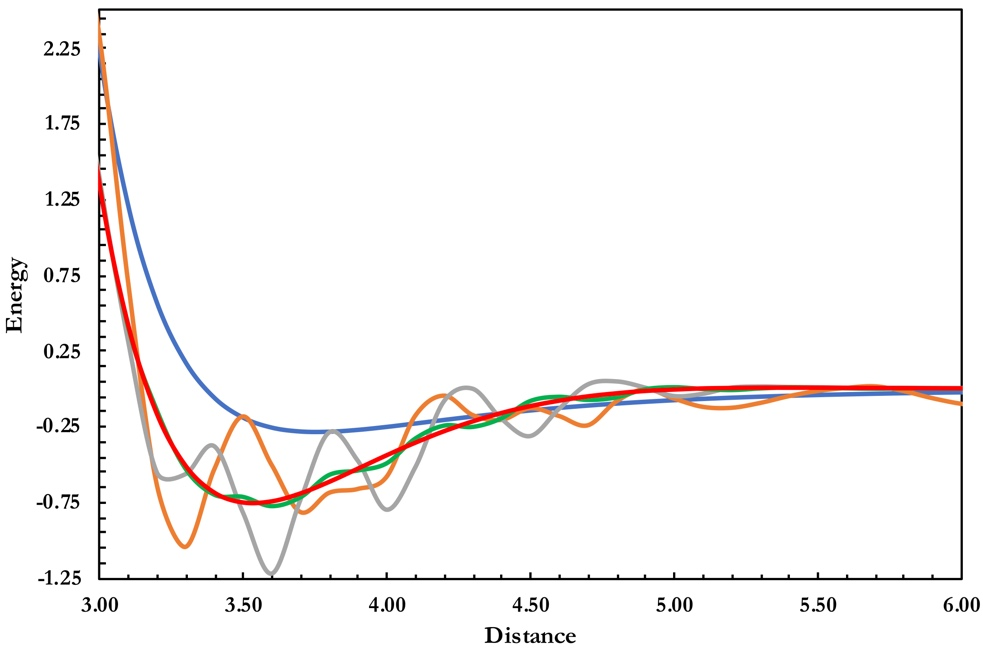

# Debrief: Experiment 6 {background-color="#00205b"}

## Your results

::: {.takeaway}
**[Live: open Class results → Experiment 6 heatmap]**

[Open the class results page](../class-results.html)
:::

- Error of B3LYP and B3LYP-D4 with each double-ζ set, relative to def2-TZVP
- Which cells did you flag in "Spot the anomaly"?

## [Insert class plot: error by basis set]

::: {.takeaway}
**[Insert class plot: Experiment 6 error of B3LYP and B3LYP-D4 with 6-31G*, def2-SVP, cc-pVDZ, pc-1, def2-TZVP for reactions 4a, 4b and 5b]**
:::

## [Insert class plot: basis-size table]

::: {.takeaway}
**[Insert class plot: number of basis functions of cyclohexene (and the other molecules) for each double-ζ set]**
:::

## What you probably saw: three reactions, three stories

- **4a (Diels–Alder)**: the small Pople basis can look **better** than def2-TZVP. That is error cancellation
- **4b (hexane → neohexane)**: the sets give about the same errors
- **5b (CaO)**: the small basis is much **worse**
- Not all double-ζ sets perform alike, and their sizes differ

## Why 6-31G* "wins" for 4a

- B3LYP alone has its own error for the reaction
- The small basis adds a **basis-set error** of different sign
- The sum happens to be small
- Converge the basis first: with def2-TZVP you see B3LYP's error without the compensating basis error

## -D4 with a small basis

- -D4 was fitted for functionals with **large** basis sets
- With a small basis, BSSE already adds attraction
- Adding -D4 on top can double-count and **overbind**
- Check: do the dispersion-corrected small-basis results look "too good" or too attractive?

::: {.takeaway}
Compare at a converged basis first. A small basis can look good only when two wrongs cancel.
:::

# Numerical integration grids {background-color="#00205b"}

## Why a grid at all?

$$
E_{xc}[\rho] = \int f\big(\rho(\mathbf{r}),\nabla\rho,\tau,\dots\big)\,d\mathbf{r}
$$

- The integrand is a complicated nonlinear function of ρ
- No closed form: integrate **numerically**, on a set of points with weights
- The Coulomb and HF exchange parts of the energy are analytic and do not use this grid

## Atoms in a molecule: the multicenter problem

- Density is sharply peaked at every nucleus
- A single grid around one center cannot resolve all cusps
- Becke's idea (1988): split space into **atomic cells**, one integral per atom [Becke 1988]
- Each atom integrates its share of every point with a weight

## Becke cell weights

:::: {.columns}
::: {.column width="62%"}
{fig-alt="Left, cell weights of two atoms along the bond axis switching smoothly from one to zero; right, a map of three overlapping atomic cells with cell boundaries" width="100%"}
:::
::: {.column width="38%"}
- Weight of atom A at a point: smooth, between 0 and 1
- Weights of all atoms sum to 1 at every point
- Smooth, not sharp, so the integrand stays well behaved
:::
::::

::: notes
Left panel: weights switch smoothly across the bond midpoint. Right panel: cell boundaries are where two weights are equal. Real polynomial, three iterations.
:::

## Becke's switching function

$$
f(\mu)=\tfrac{3}{2}\mu-\tfrac{1}{2}\mu^{3},\qquad \mu_{AB}=\frac{r_A-r_B}{R_{AB}}
$$

- Apply f three times, then s(μ) = ½ (1 − f(f(f(μ))))
- Atom weight = product of s over all other atoms, normalized
- The figure on the previous slide is exactly this

## Each atom: radial shells times angular points

:::: {.columns}
::: {.column width="45%"}
{fig-alt="Concentric circles around a nucleus with points on each circle" width="100%"}
:::
::: {.column width="55%"}
- **Radial**: N_r shells (quadrature in r)
- **Angular**: N_ang points on each sphere, **Lebedev** quadrature
- Notation: **(75,302)** means 75 radial shells, 302 angular points
- Total points per atom = N_r × N_ang before pruning
:::
::::

## How many points?

:::: {.columns}
::: {.column width="55%"}
{fig-alt="Bar chart of points per atom for three unpruned grids: (75,302), (99,590) and (175,974)" width="100%"}
:::
::: {.column width="45%"}
- Cost grows with the number of points
- **Pruning** cuts angular points near the nucleus and far away
- Pruned grids are cheaper, with a modest loss
:::
::::

## Grids in Q-Chem

| `XC_GRID` | Name | Idea |
|---|---|---|
| 1 | SG-1 | small, pruned, fast |
| 2 | SG-2 | larger, pruned, roughly (75,302) class |
| 3 | SG-3 | largest of the three, roughly (99,590) class |

- Explicit grids can be given as an integer pair, e.g. (99,590)
- **HF** needs no exchange-correlation grid
- **Rotational variance**: a small grid is not invariant: rotate the molecule and the energy changes

## Who is grid-sensitive?

- LDA and GGA: smooth integrands, converge on small grids
- **Meta-GGAs** (depend on τ): more structure, need bigger grids [Wheeler and Houk 2010]
- Heavily parametrized functionals (Minnesota family) have flexible forms that oscillate [Morgante and Peverati 2020]
- Nonlocal VV10 uses its own grid too

## Quick question

An energy curve of a weakly bound dimer wiggles with several minima.

**Physical, or numerical?**

. . .

Numerical noise, if it changes when you make the grid denser. A real potential has one well; extra minima that move or vanish with the grid are artifacts.

## The practical rules

- Do not rely on defaults
- For meta-GGAs and Minnesota functionals use at least a large grid; test convergence
- Always report the grid
- Cost grows with grid size, but for small molecules the penalty is modest

::: {.takeaway}
The grid is part of the method. A functional's result without its grid is not reproducible.
:::

# Experiment 7 briefing {background-color="#00205b"}

## Goal

**[Experiment 7: Integration Grids: The Argon Dimer](../experiments/ex07-grids.html)**

- Compute the Ar₂ dissociation curve with several functionals and grids
- Look for wiggles. Decide which are numerical

## The system

- Ar₂ at 31 distances from 3.0 to 6.0 Å, step 0.1 Å, plus the Ar atom
- Interaction energy: ΔE(r) = E(Ar₂(r)) − 2 E(Ar)
- Reference well depth about −0.28 kcal/mol at roughly 3.75 Å
- def2-TZVP basis for all jobs (SG-3 with def2-QZVP would hit the 10-minute limit)

## Setup

- Functionals: B3LYP, M06-L, M11-L, M11, ωB97M-V
- Grids: `XC_GRID 1` (SG-1), `2` (SG-2), `3` (SG-3)
- 5 functionals × 3 grids × 32 species = **480 jobs**: seconds with SG-1, minutes with SG-2/SG-3
- Reaction energies are computed for you automatically (`auto_delta`)

## 480 jobs: how to survive

- Start with one functional, one grid, all distances
- Batch the submissions and keep a checklist
- Do not rename output files by hand. The script reads the job from its echoed input
- Check for jobs that did not converge before you extract

## Extracting the results

- Script: [`extract_ex07.py`](../downloads/extract_ex07.py), Python 3.8+, standard library only
- It reads your Q-Chem outputs locally and writes `ex07_results.csv`
- On the [Experiment 7 page](../experiments/ex07-grids.html) use **Import CSV** in the results form
- Failed jobs have no energy in the CSV

::: {.small}
Instructions are in the "Extracting results" section of the Experiment 7 page.
:::

## The wiggle report

- The page flags suspicious curves
- You explain: numerical or physical? which grid fixes it?
- Report the **minimum grid** each functional needs

## Figure from the experiment page

{fig-alt="Dissociation curves of the argon dimer computed with the VSXC functional on four integration grids and a reference curve" width="75%"}

## Predictions to lock

- Which functional will be the most grid-sensitive?
- Which grid will be enough for B3LYP?
- Will a bigger grid cost much extra time?

## References

::: {.small}
- Becke, A. D. J. Chem. Phys. 88 (1988): multicenter numerical integration.
- Wheeler, S. E.; Houk, K. N. J. Chem. Theory Comput. 6 (2010): integration grids and meta-GGAs.
- Morgante, P.; Peverati, R. Int. J. Quantum Chem. 120 (2020): undervalued aspects of DFT.
:::
