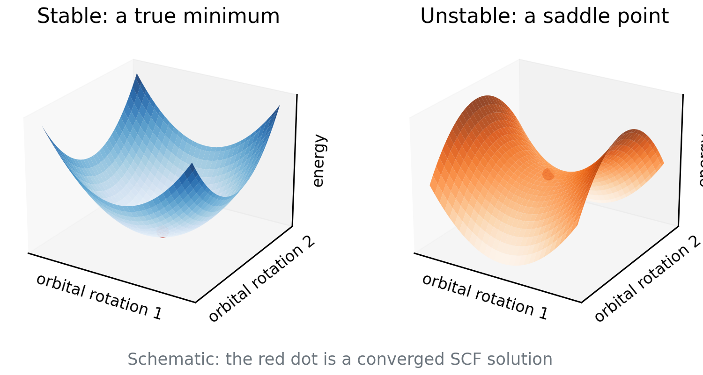

# Debrief: Experiment 7 {background-color="#00205b"}

## Your results

::: {.takeaway}
**[Live: open Class results → Experiment 7 heatmap]**

[Open the class results page](../class-results.html)
:::

- Ar₂ curves for five functionals on SG-1, SG-2 and SG-3
- Which curves wiggle? On which grids?

## [Insert class plot: Ar₂ curves by grid]

::: {.takeaway}
**[Insert class plot: Experiment 7 dissociation curves for each functional on SG-1, SG-2 and SG-3 with the reference curve]**
:::

## [Insert class plot: wiggle report and timing]

::: {.takeaway}
**[Insert class plot: Experiment 7 wiggle report (number of extrema per curve) and time per job vs. grid]**
:::

## What you probably saw: wiggles are numerical

- Extra minima and maxima that change with the grid are **grid noise**, not physics
- They are worst for the smallest grid and flexible meta-GGAs
- Functionals such as M06-L, M11-L and M11 typically needed SG-3
- B3LYP typically converged already on SG-1 or SG-2

## ωB97M-V and timing

- ωB97M-V is a modern, carefully constrained functional: typically better behaved
- Bigger grids cost more time, but the penalty is **modest** for small systems
- HF exchange needs no grid: the grid only affects the DFT part

## Recommendations

- Use at least SG-2 or SG-3 for meta-GGAs and Minnesota functionals
- Test convergence: repeat with the next larger grid
- **Report your grid** in every calculation

::: {.takeaway}
Wiggles that move with the grid are numerical noise. Choose the grid for the functional, and report it.
:::

# SCF solutions and stability {background-color="#00205b"}

## An SCF solution is a stationary point

- The SCF finds orbitals where the energy is **stationary** with respect to orbital rotations
- Stationary can mean minimum **or saddle point**
- A saddle point has a lower-energy direction hidden in orbital space
- "Convergence criterion met" does not tell you which one you reached

## Minimum versus saddle point

:::: {.columns}
::: {.column width="62%"}
{fig-alt="Two three-dimensional surfaces; left a bowl with a minimum, right a saddle surface, each with a red point at the center" width="100%"}
:::
::: {.column width="38%"}
- Left: every direction goes up
- Right: some directions go **down**
- The energy can still be lowered
:::
::::

::: notes
Schematic only. Stress that the SCF reports a stationary point; the Hessian eigenvalues decide minimum versus saddle.
:::

## Stability analysis

- Compute the **electronic Hessian**: second derivatives of E with respect to orbital rotations
- All eigenvalues positive: a true minimum, a **stable** solution
- A negative eigenvalue: an **instability**; follow that direction and re-converge to lower energy
- Cost: a diagonalization-like step at the end of the SCF

## Internal and external instabilities

- **Internal**: the lower solution has the same form, e.g. restricted → another restricted solution, or unrestricted → another unrestricted
- **External**: the lower solution needs a different form, e.g. RHF → UHF (symmetry breaking)
- Q-Chem keyword for internal: `INTERNAL_STABILITY TRUE` [Seeger and Pople 1977; Bauernschmitt and Ahlrichs 1996]

## Spin contamination

- Unrestricted wave functions are not eigenfunctions of Ŝ²
- Exact: ⟨S²⟩ = S(S+1). Quintet 6, quartet 3.75, triplet 2, sextet 8.75
- Output ⟨S²⟩ larger than this signals contamination from higher spin states
- Always compare with the exact value for your multiplicity

## Quick question

An SCF converged in 12 cycles with a nice small gradient.

**Is the energy the ground-state energy for that functional?**

. . .

Not necessarily. It may be a saddle point or a higher-lying solution. Only stability analysis (or trying other initial guesses) can tell.

## Open shells recap

- Open shells need an **unrestricted** treatment (UKS/UHF): different orbitals for α and β
- The guess matters: convergence may land on different solutions
- Multiplicity 2S + 1 is an input you must get right
- Stability analysis is especially useful for open-shell systems

::: {.takeaway}
A converged SCF is a stationary point, not necessarily a minimum. Check stability when it matters.
:::

## — Natural break: end of lecture A —

::: {.muted}
If you split the material over two meetings, stop here. Lecture B begins with a one-slide recap of stability analysis, then transition metals and the Experiment 8 briefing.
:::

# Transition metals {background-color="#00205b"}

## Why transition metals are hard

- 3d and 4s (4d and 5s) orbitals lie close in energy
- Many electron configurations are nearby
- Many low-lying states of different spin
- The ground state can depend on the functional

## Spin-state energetics

- A spin-state gap is a small difference between large energies
- The fraction of HF exchange tends to shift the balance toward high spin
- A benchmark: it tests how well a functional balances these effects
- SCF can converge to the wrong state even for single atoms

## Effective core potentials

- Heavy atoms: core electrons are many and move fast
- An **ECP** replaces the core by an effective potential, including **scalar relativistic** effects
- In the def2 family, ECPs (`ECP def2-ECP`) start at Rb, so Ru needs one
- Fe needs no ECP, so keep the keyword for Ru⁺

## Why several functionals were removed

- Some functionals' SCF often **fail to converge** on these atoms
- Examples excluded from the experiment: SPW92, B3LYP, SCAN, ωB97M-V, and HF
- Message: methods that work well on organic molecules may not be usable for metals
- This is a general warning, not a ranking

::: {.takeaway}
Metals: near-degenerate configurations, many spin states, ECPs for heavier elements, and SCF problems.
:::

# Experiment 8 briefing {background-color="#00205b"}

## Goal

**[Experiment 8: Stability Analysis and Transition Metals](../experiments/ex08-stability.html)**

- Run each calculation **with and without** stability analysis
- See what stability analysis changes
- Test whether a stable solution is automatically an accurate one

## Reactions and reference values

| Reaction | Ref. (kcal/mol) |
|---|---:|
| Fe: quintet → triplet | 34.32 |
| Ru⁺: quartet → sextet | 21.96 |

| Species | Charge | Multiplicity |
|---|---:|---:|
| Fe (ground) | 0 | 5 |
| Fe (excited) | 0 | 3 |
| Ru⁺ (ground) | +1 | 4 |
| Ru⁺ (excited) | +1 | 6 |

## Methods and jobs

| Functional | Species run |
|---|---|
| BP86 | Ru⁺ |
| PBE | Fe and Ru⁺ |
| PBE0 | Ru⁺ |
| M06-2X | Fe |
| B97M-V | Fe |

- def2-TZVP for all, with `ECP def2-ECP` for Ru⁺
- Each job twice: plain and with `INTERNAL_STABILITY TRUE`
- **24 jobs** in total

## Pitfalls

- Use the multiplicities from the table, not the default singlet
- Ru⁺ has charge +1: line 2 of the .xyz is "1 4" or "1 6"
- Compare the SCF energies: the stability run can be lower or equal
- Record whether the stability job reported an instability

## Predictions to lock

- Will stability analysis lower any energies? Which functionals?
- Will a stable solution be accurate to a few kcal/mol?
- Which functional would you trust for these atoms?

## References

::: {.small}
- Seeger, R.; Pople, J. A. J. Chem. Phys. 66 (1977): stability of Hartree–Fock wave functions.
- Bauernschmitt, R.; Ahlrichs, R. J. Chem. Phys. 104 (1996): stability of Kohn–Sham solutions.
- Weigend, F.; Ahlrichs, R. Phys. Chem. Chem. Phys. 7 (2005): def2 basis sets and ECPs.
- Wheeler, S. E.; Houk, K. N. J. Chem. Theory Comput. 6 (2010): grid errors.
:::
