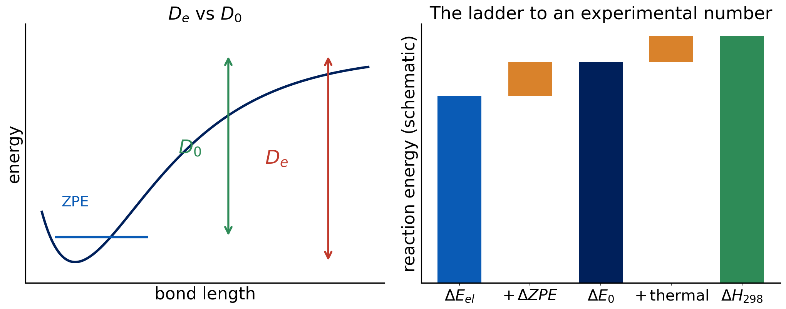

# Debrief: Experiment 8 {background-color="#00205b"}

## Your results

::: {.takeaway}
**[Live: open Class results → Experiment 8 heatmap]**

[Open the class results page](../class-results.html)
:::

- Spin-state gaps of Fe and Ru⁺ with and without stability analysis
- Which cells changed? By how much?

## [Insert class plot: energy lowering from stability analysis]

::: {.takeaway}
**[Insert class plot: Experiment 8 energy-lowering table (E_plain − E_stab, kcal/mol) per functional and state]**
:::

## [Insert class plot: errors before and after stability]

::: {.takeaway}
**[Insert class plot: Experiment 8 signed error of the spin-state gaps for each functional, without vs. with stability analysis]**
:::

## What you probably saw: stability analysis

- In many cases nothing changed: the first solution was already stable
- Where it did change, the energy dropped and the gap moved
- The lowering can be large for some states: the first SCF landed on a saddle point
- Stability analysis costs little compared with a wrong answer

## Stable is not accurate

- After stability analysis the solution is a minimum of **that functional**
- Remaining errors are **functional errors**: DFT's problem, not the SCF's
- Spin-state energetics are a hard benchmark, with errors of several kcal/mol typical
- Converged and stable only means "the SCF did its job"

## Why some functionals were dropped

- Several functionals often **failed to converge** on these atoms
- A method that fails is not "worse"; it is **unusable** for the task
- Transition-metal chemistry demands checking convergence for every state

::: {.takeaway}
Stability analysis removes SCF problems. It cannot remove functional error.
:::

# From ΔE_el to something you can measure {background-color="#00205b"}

## What Q-Chem gives you

- Total electronic energy at a **fixed geometry** (class 1)
- No zero-point motion, no temperature
- A reaction energy from these: ΔE_el = Σ νᵢEᵢ
- Experiment measures something else

## The ladder of reaction energies

:::: {.columns}
::: {.column width="62%"}
{fig-alt="Left, a bond dissociation curve showing De from the bottom of the well and D0 from the zero-point level; right, stacked bars climbing from electronic energy to energy at 0 K to enthalpy at 298 K" width="100%"}
:::
::: {.column width="38%"}
- ΔE_el: electronic
- + ΔZPE → ΔE₀
- + thermal → ΔH₂₉₈
- + entropy term → ΔG
:::
::::

::: notes
Walk the ladder left to right. Heights are schematic, not data. Ask which rung each class result sits on.
:::

## Zero-point energy

- Molecules vibrate even at 0 K
- ZPE = ½ Σ ħωᵢ (harmonic frequencies)
- It needs a **frequency calculation** (second derivatives)
- Breaking a bond loses vibrational modes: ZPE changes along the reaction

## D_e versus D₀

- **D_e**: dissociation energy from the **bottom** of the potential well (electronic)
- **D₀**: from the ground **vibrational level**: D₀ = D_e − ΔZPE
- Spectroscopy measures D₀; a single-point calculation gives D_e
- Hydrogen-containing bonds have large ZPE differences

## Thermal corrections

- At temperature T, add translation, rotation and vibration contributions
- From statistical mechanics: H(T) = E₀ + thermal terms + pV
- For a gas-phase reaction, Δn(gas) matters: e.g. dissociation of one molecule into two adds RT per extra particle
- ΔG adds the entropy term, −TΔS

## Quick question

You compute a bond dissociation energy with a single-point calculation and compare with a tabulated experimental bond enthalpy at 298 K.

**Name two corrections missing from your number.**

. . .

ZPE (D_e → D₀) and thermal corrections (0 K → 298 K, including the pV term). For atoms and some radicals, spin–orbit effects too.

## — Natural break: end of lecture A —

::: {.muted}
If you split the material over two meetings, stop here. Lecture B starts with a one-slide recap of ZPE and thermal corrections, then spin–orbit, atomization energies, NIST and the Experiment 9 briefing.
:::

## Spin–orbit and atoms

- Atoms with degenerate ground states (open shells, p or d) split by **spin–orbit coupling**
- Experimental references often include the spin-orbit-averaged or lowest-level energy
- A DFT energy with a single spin-adapted determinant does not include it
- Small for light atoms, larger for heavier

## Atomization energies and formation enthalpies

- **Atomization**: molecule → free atoms. A very large number, hardest to match
- **Enthalpy of formation**: from elements in standard states, via experiment tables
- You cannot compare ΔE_el with a ΔH_f directly: they refer to different processes
- Convert via thermodynamic cycles using atomic enthalpies

## Experimental uncertainties

- Experimental values have error bars (often tenths of a kcal/mol, sometimes more)
- Different experiments can disagree
- **NIST Chemistry WebBook**: a source for tabulated thermochemistry and spectroscopic data
- A calculation cannot be better than the reference to which you compare

::: {.takeaway}
ΔE_el → (ZPE) → ΔE₀ → (thermal) → ΔH₂₉₈. Compare like with like, or correct first.
:::

# Experiment 9 briefing {background-color="#00205b"}

## Goal

**[Experiment 9: Comparison with Experimental Results](../experiments/ex09-experiment-vs-theory.html)**

- Bond dissociation and atomization energies with five methods
- Why radicals and atoms are hard
- Why a computed electronic energy cannot be compared directly with an enthalpy

## Reactions and reference values

| Reaction | Ref. (kcal/mol) |
|---|---:|
| (CH₃)₃C–OH → (CH₃)₃C· + ·OH | 115.02 |
| FeCl → Fe + Cl | 78.5 |
| H₂ → 2 H | 109.5 |
| CH₄ → C + 4 H | 420.4 |
| NH₃ → N + 3 H | 298.0 |
| H₂O → O + 2 H | 233.0 |
| O₃ → 3 O | 147.4 |

## Multiplicities

| Species | Multiplicity |
|---|---|
| H, Cl, OH, (CH₃)₃C· | 2 (doublet) |
| C, O (atoms) | 3 (triplet) |
| N (atom) | 4 (quartet) |
| Fe (atom) | 5 (quintet) |
| FeCl | 6 (sextet) |
| closed-shell molecules | 1 |

## Methods and settings

- Methods: MN15-L, MN15, B3LYP, PBE, HF
- Basis set: def2-TZVP
- Grid (99,590), `XC_GRID 000099000590`
- Stability analysis on: `INTERNAL_STABILITY TRUE`
- Extra: B3LYP/6-31G* on the three tert-butanol species

## Jobs

- 15 species × 5 methods = 75 jobs
- 3 additional B3LYP/6-31G* jobs for tert-butanol and its fragments
- **78 jobs**
- The largest jobs (tert-butanol) are close to the 10-minute limit: submit early

## Pitfalls

- Set multiplicities from the table: the default singlet is wrong for atoms and radicals
- Your result is ΔE_el. The NIST panel will show an enthalpy: you decide what is missing
- Check the stability output: did any job report an instability?
- Keep all digits of every total energy

## Predictions to lock

- Which method will do best on bond dissociation? On atomization?
- How will HF do on atomization?
- Will FeCl be harder than tert-butanol?

## References

::: {.small}
- NIST Chemistry WebBook: <https://webbook.nist.gov/chemistry/>
- Seeger, R.; Pople, J. A. J. Chem. Phys. 66 (1977); Bauernschmitt, R.; Ahlrichs, R. J. Chem. Phys. 104 (1996): SCF stability.
- pchem2 textbook: <https://peverati.github.io/pchem2/>
:::
