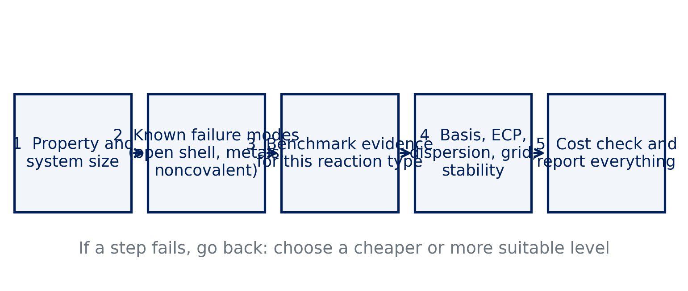
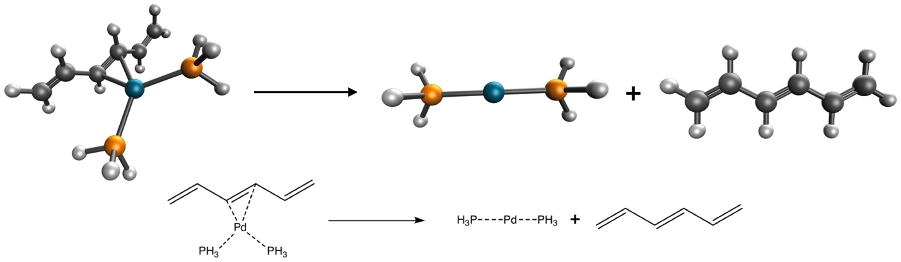

# Debrief: Experiment 9 {background-color="#00205b"}

## Your results

::: {.takeaway}
**[Live: open Class results → Experiment 9 heatmap]**

[Open the class results page](../class-results.html)
:::

- Errors for bond dissociation and atomization energies, five methods
- Compare closed-shell molecules with atoms and radicals

## [Insert class plot: atomization errors by method]

::: {.takeaway}
**[Insert class plot: Experiment 9 signed error of the five atomization energies for MN15-L, MN15, B3LYP, PBE and HF]**
:::

## [Insert class plot: NIST comparison]

::: {.takeaway}
**[Insert class plot: Experiment 9 NIST panel: reference electronic energy vs. experimental enthalpy for tert-butanol and FeCl, with the size of the difference]**
:::

## What you probably saw: radicals and atoms

- Open-shell atoms and radicals give larger spreads between methods
- Errors in atomization grow with the number of bonds broken
- HF **underbinds** strongly: no correlation energy
- Functionals fitted to such data (Minnesota) tend to do better on them

## FeCl and the thermal correction

- FeCl combines a transition metal with an open-shell, high-spin ground state
- Method spread is typically larger than for tert-butanol
- NIST enthalpy and the reference electronic energy differ by ZPE and thermal terms
- The size of that difference is comparable to the accuracy you are chasing

## Basis set effect on tert-butanol

- B3LYP/6-31G* versus B3LYP/def2-TZVP for the C–O bond
- Recall Experiment 6: a small basis can look good or bad for reasons unrelated to the functional
- Compare both with the reference before drawing a conclusion

::: {.takeaway}
Atoms and radicals are hard; HF fails on atomization; always compare like with like against experiment.
:::

# How to choose a method {background-color="#00205b"}

## No universal best

- No functional is the best for everything
- A choice is a **decision under constraints**: accuracy needed, cost allowed, known failures
- Your evidence: Experiments 1–9
- Document why you chose it

## A decision flow

{fig-alt="Five boxes in a row connected by arrows: property and system size, known failure modes, benchmark evidence, basis dispersion grid and stability, cost check and report" width="100%"}

::: notes
Ask students to walk through the flow for Experiment 10 aloud before moving on.
:::

## Step 1: property and size

- What do you want: reaction energy, barrier, noncovalent binding, spin gap?
- How big is the system and how many calculations?
- Cost budget: the free server stops after **10 minutes**
- Cheap enough to check convergence, not just run once

## Step 2: known failure modes

- Open shells and radicals: unrestricted, check stability
- Transition metals: spin states, SCF problems, ECPs
- Noncovalent interactions: dispersion needed
- Stretched bonds and diradicals: static correlation, self-interaction

## Step 3: benchmark evidence

- Look for benchmark studies of **your** reaction type
- GMTKN55 and MGCDB84 summaries are a starting point (Goerigk 2017; Mardirossian 2017)
- Prefer functionals that do well on data **not** used to fit them
- Course evidence: which methods held up from Experiment 3 to 9?

## Step 4: the rest of the setup

| Choice | Guideline |
|---|---|
| Basis set | triple-ζ (def2-TZVP) as a rule; check convergence |
| Heavy elements | ECP, e.g. `ECP def2-ECP` |
| Dispersion | -D4 with a functional it was fitted for, or a VV10 functional; never both |
| Grid | at least SG-3 for meta-GGAs |
| Stability | `INTERNAL_STABILITY TRUE` for open shells and metals |

## Quick question

A colleague asks you to use B3LYP-D4 with 6-31G* "because everyone does."

**What do you check first?**

. . .

Whether the basis is converged enough for the question (compare with a triple-ζ set), and whether the dispersion correction and the basis do not double-count. Then check the functional's evidence for your reaction type.

## Step 5: cost check

- Estimate time per SCF cycle from a small test
- Count the jobs
- A cheaper choice that fits the budget beats a better one that does not finish
- Test on a smaller model first

## Reproducibility: what to report

- Program and version (Q-Chem, via IQmol)
- Functional (and dispersion correction)
- Basis set and ECP
- Integration grid
- SCF convergence criterion and stability analysis
- Geometry source (and charge and multiplicity)

::: {.takeaway}
A result that cannot be reproduced from the report is not a result.
:::

# Experiment 10 briefing {background-color="#00205b"}

## The request

**[Experiment 10: Final Review](../experiments/ex10-final-review.html)**

- You are the consultant: a colleague needs a Pd–ligand bond energy
- Every choice is yours: functional, basis set, ECP, grid, stability
- You will write a short report

## The reaction

:::: {.columns}
::: {.column width="55%"}
Pd(PH₃)₂(C₆H₈) → Pd(PH₃)₂ + C₆H₈

- Reference: **16.2 kcal/mol** (PdBE2 subset)
- Three species, all singlets
:::
::: {.column width="45%"}
{fig-alt="Pd(PH3)2(hexatriene) dissociating into Pd(PH3)2 and hexatriene" width="100%"}
:::
::::

## Your tools

- **Method card** on the Experiment 10 page: choose each setting and write down why
- It warns about common pitfalls: double-counting dispersion, grid-sensitive functionals
- It checks whether each job fits in 10 minutes
- It writes the three Q-Chem inputs for you

## Cost check

- Pd needs an ECP: `ECP def2-ECP` with the def2 basis sets
- The Pd complex is the biggest molecule you have run
- Test one job first and read the wall time
- Everything must fit within the 10-minute limit

## Report (about 300 words)

- Title
- Method and **why**, with references
- Complete computational setup, enough to reproduce
- Your result compared with the reference 16.2 kcal/mol
- Short conclusion, then references

## Predict first

- What do you expect for the result, and what error?
- Which choices do you consider critical?
- What would you change with ten times more computer time?

## Pitfalls

- Using a basis without an ECP for Pd
- Double-counting dispersion
- Choosing a grid-sensitive functional with a small grid
- Comparing ΔE_el with an enthalpy without saying so

## References

::: {.small}
- Goerigk, L. et al. Phys. Chem. Chem. Phys. 19 (2017): GMTKN55.
- Mardirossian, N.; Head-Gordon, M. Mol. Phys. 115 (2017): functional benchmarks.
- Dohm, S. et al. J. Chem. Theory Comput. 14 (2018): thermochemical benchmark of metal-organic reactions.
- Weigend, F.; Ahlrichs, R. Phys. Chem. Chem. Phys. 7 (2005): def2 basis sets and ECPs.
- Caldeweyher, E. et al. J. Chem. Phys. 147 (2017); 150 (2019): D4.
:::
