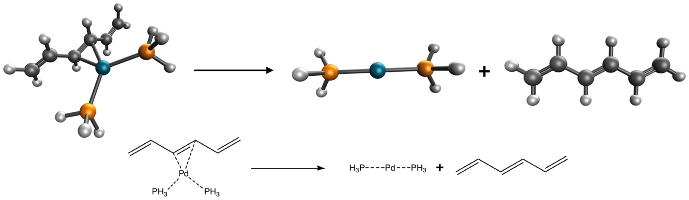
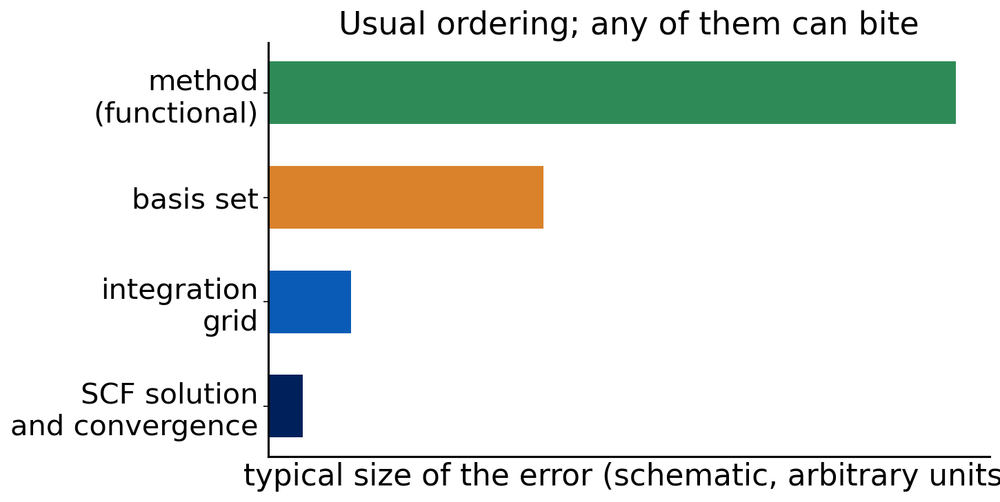

# Debrief: Experiment 10 {background-color="#00205b"}

## Your results

::: {.takeaway}
**[Live: open Class results → Experiment 10 heatmap]**

[Open the class results page](../class-results.html)
:::

- Everyone chose a different level of theory for the same reaction
- Which choices clustered? Which stood out?

## [Insert class plot: choices of method and basis]

::: {.takeaway}
**[Insert class plot: Experiment 10 table or histogram of the functionals, basis sets, dispersion treatments and grids chosen by the class]**
:::

## [Insert class plot: results against the reference]

::: {.takeaway}
**[Insert class plot: Experiment 10 computed bond energies (one point per student) with the reference value 16.2 kcal/mol marked, colored by functional family]**
:::

## The system again

:::: {.columns}
::: {.column width="50%"}
{fig-alt="Pd(PH3)2(hexatriene) dissociating into Pd(PH3)2 and hexatriene" width="100%"}
:::
::: {.column width="50%"}
- Reference: 16.2 kcal/mol
- Needs an ECP for Pd
- A dative bond in a large molecule: dispersion matters
:::
::::

## What worked

- Justified choices that cite benchmark evidence for similar reactions
- A triple-ζ basis with an ECP and dispersion treated once
- A grid chosen for the functional
- Complete reports: anyone can reproduce the number

## What to discuss

- Spread of results for similar choices: what is the source?
- Did a more expensive method give a better answer?
- How close to the reference is "good enough" for the colleague's question?
- Which statements in a report were evidence, and which were habit?

::: {.takeaway}
The right choice is the one you can defend, reproduce and afford.
:::

# Synthesis {background-color="#00205b"}

## The two approximations, revisited

- **Ψ**: finite basis set (classes 2–3, Experiments 1, 6)
- **Ĥ**: approximate method: HF, then DFT on Jacob's ladder (classes 4–6, Experiments 2–5)
- Everything else is **numerics** and **analysis**: grid, SCF solution, thermal corrections
- A model chemistry is a choice for each

## What you can now do

| Skill | Where |
|---|---|
| Read and set up a Q-Chem job | Exp. 1 |
| Place a functional on the ladder | Exp. 2 |
| Measure error against a reference | Exp. 3–5 |
| Judge basis-set and error cancellation | Exp. 6 |
| Check the grid | Exp. 7 |
| Check SCF stability | Exp. 8 |
| Compare with experiment | Exp. 9 |
| Choose, run and report | Exp. 10 |

## An error hierarchy

:::: {.columns}
::: {.column width="55%"}
{fig-alt="Horizontal bars of decreasing length for method error, basis-set error, integration grid error, and SCF convergence error" width="100%"}
:::
::: {.column width="45%"}
- Typical order: method > basis > grid > SCF
- But any of them can dominate when mishandled
- A wiggly Ar₂ curve or a saddle point is not a method error
:::
::::

## Error cancellation, once more

- Easy reactions (Exp. 3): errors cancel by construction
- Hard reactions (Exp. 4–5): they do not
- Small basis plus a functional (Exp. 6): can cancel for the wrong reason
- Lesson: understand **why** a number is right before you trust it

## Quick question

Name the single most important check you would run **before** trusting a new DFT result.

. . .

There is no single answer. A good minimum: basis-set convergence, grid sensitivity, SCF stability (open shells and metals), and a comparison with a benchmark of a similar reaction type. Report all of them.

## The black-box warning

- Defaults differ between programs and versions
- A calculation that finishes is not a calculation that is right
- Read the output: convergence, ⟨S²⟩, warnings
- Know what the program did, and report it

## Where the field is going

- **Machine-learned functionals** and corrections trained on large data sets
- **Local correlation methods** that bring CCSD(T)-like accuracy to larger molecules
- **Double hybrids** that add a perturbative correlation term (rung 5)
- All still need: benchmarks, honest error bars, reproducible reports

::: {.takeaway}
New methods change the tools, not the habits: converge, check, compare, report.
:::

# Feedback {background-color="#00205b"}

## Course feedback

- What was the most useful experiment? Why?
- Which class or slide would you change?
- Was the workload (jobs per experiment) reasonable?
- What should we add?

## Muddiest points

On a card or in the chat, one sentence:

**"The thing I am still least sure about is ..."**

We will start from your answers.

::: notes
Collect cards or chat answers; start the next meeting (or the review) from the most common ones.
:::

## References

::: {.small}
- Goerigk, L. et al. Phys. Chem. Chem. Phys. 19 (2017); Mardirossian, N.; Head-Gordon, M. Mol. Phys. 115 (2017).
- Caldeweyher, E. et al. J. Chem. Phys. 147 (2017); 150 (2019): D4.
- Weigend, F.; Ahlrichs, R. Phys. Chem. Chem. Phys. 7 (2005): def2 basis sets.
- Morgante, P.; Peverati, R. Int. J. Quantum Chem. 120 (2020): details that matter in DFT calculations.
- pchem2 textbook: <https://peverati.github.io/pchem2/>
:::
